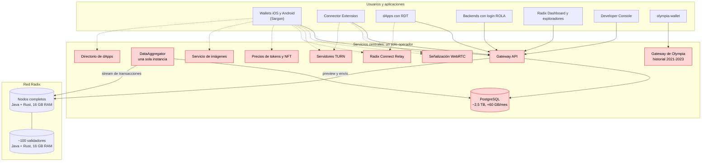
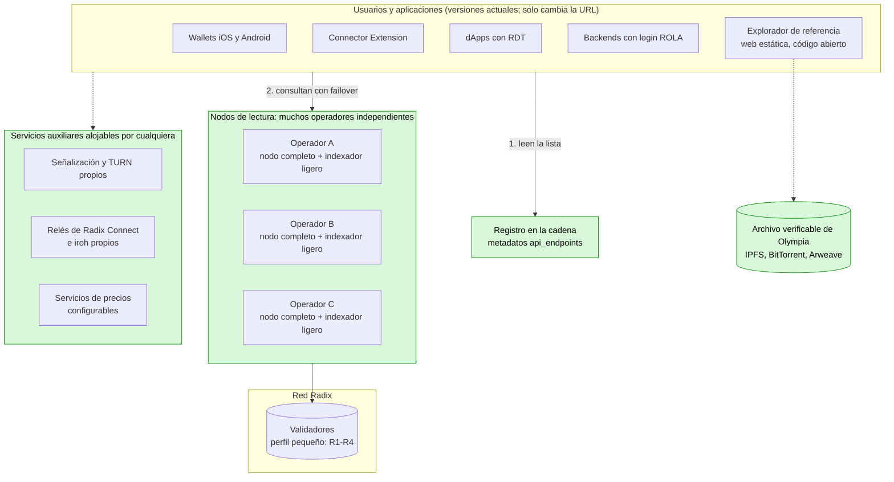
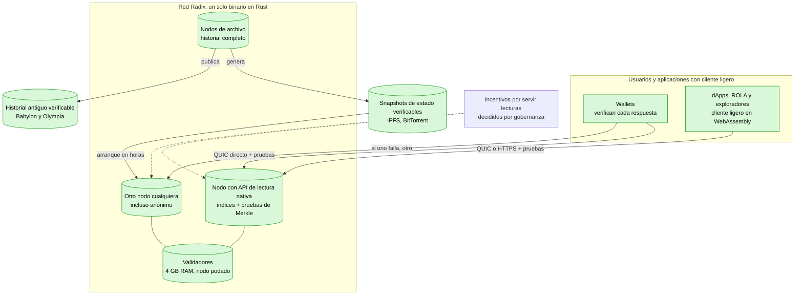
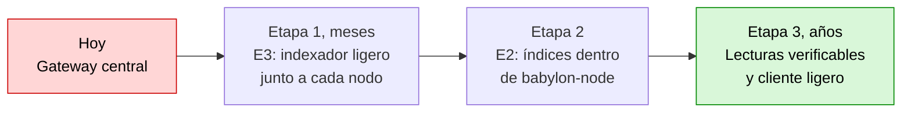
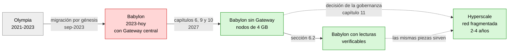

# Radix sin dependencias centrales

Español · [English](README.md)

Análisis técnico y hoja de ruta para que la red Radix dé servicio a todos sus usuarios **sin depender del Babylon Gateway**, con **nodos de 4 GB de RAM y 500 GB de disco**, y para una posible **evolución hacia Hyperscale**. Incluye análisis del código, datos medidos de mainnet, estrategias comparadas, cambios por repositorio y guía de implementación.

Informe del 3 de noviembre de 2026.

### Cifras clave

| | |
|---|---|
| Fin de la financiación del Gateway | **31-dic-2026** |
| Base de datos del Gateway | **~2,5 TB**, +60 GB/mes |
| Ledger de mainnet (snapshot comprimido, sep-2026) | **274 GiB**, +5-8 GiB/mes |
| Versiones de estado en mainnet (nov-2026) | **~567 millones**, ~97-98 % cambios de ronda |
| Transacciones de usuario desde el génesis | **~10-15 millones** (estimado) |
| Casos de uso que el nodo ya resuelve sin Gateway | **~80-85 %** (estimado) |
| Indexador ligero propuesto | **~10-50 GB** (estimado) |
| RAM de un nodo hoy → objetivo | **16 GB → 4 GB** |

### Guía de lectura

| Si eres… | Lee primero |
|---|---|
| Miembro de la comunidad o poseedor de XRD | Este resumen, la conclusión y los diagramas de infraestructura |
| Operador de nodo o validador | [Capítulo 9: nodos más ligeros](docs/es/07-nodos-ligeros.md) |
| Desarrollador de wallets, dApps o herramientas | [Capítulo 7: cambios por repositorio](docs/es/05-cambios-por-repositorio.md) y [capítulo 10: guía de implementación](docs/es/08-guia-de-implementacion.md) |
| Gobernanza (RAC, DAO) | La conclusión, la [hoja de ruta](docs/es/06-hoja-de-ruta.md) y el [capítulo 11: evolución hacia Hyperscale](docs/es/09-evolucion-hyperscale.md) |
| Quien no conozca algún término | El [glosario](docs/es/11-glosario.md) |
| Quien quiera aportar correcciones, datos o ideas | La [guía de contribución](CONTRIBUTING.es.md) y la carpeta [`community/`](community/README.md) |

## Resumen ejecutivo

1. **El Gateway es hoy un punto único de fallo para el ecosistema.**
   - Ningún cliente oficial se comunica directamente con los nodos: ni los wallets (Sargon), ni la RDT, ni ROLA, ni la Connector Extension, ni el Dashboard.
   - Según la Foundation, su operación está **financiada solo hasta el 31 de diciembre de 2026**, y no hay un plan público para después.
2. **Los nodos ya cubren directamente el 80-85 % de los casos de uso** (estimación a partir del inventario de la sección 2), según el código de `babylon-node`. Faltan seis capacidades principales (N1-N6, sección 3) y algunas menores (N7-N9, sección 7.2).
3. **Se han comparado seis estrategias.** Con los datos medidos, la más adecuada combina dos (E3 y E2):
   - **A corto plazo (E3): un indexador ligero junto a cada nodo**, que sustituye al Gateway. El Gateway deja de existir.
     - Para que los wallets y dApps ya publicados sigan funcionando sin actualizarse, el indexador acepta las mismas peticiones que esas aplicaciones envían hoy. Solo se conserva el **formato de la API (peticiones y respuestas)**, no el software del Gateway.
     - Ocuparía **unos 10-50 GB** (estimación), frente a los **~2,5 TB** del Gateway, con un coste casi nulo para quien ya opera un nodo.
     - Incluye lo que necesitan los **exploradores de transacciones**, y se completa con un **explorador de referencia de código abierto**.
   - **A medio plazo (E2): incorporar esos índices y un modo de lectura pública al propio nodo.** Cada nodo de la red pasa a ser un punto de acceso.
   - **Descubrimiento en la cadena:** las aplicaciones obtienen la lista de puntos de acceso de los metadatos de los validadores, en lugar de usar una dirección fija.
4. **Nodos más ligeros (sección 9).**
   - Hoy un nodo de mainnet reserva 12 GB de memoria para Java, usa RocksDB sin límites de memoria y conserva todo el historial; el ledger comprimido ya ocupa 274 GiB.
   - Con cambios concretos en el código (ajustar RocksDB, podar datos que solo usan las APIs, arrancar desde un snapshot verificado y, más adelante, migrar el núcleo de Java a Rust), un validador o un nodo completo **puede funcionar con 4 GB de RAM y menos de 500 GB de disco**.
5. **Evolución final hacia Hyperscale (sección 11).**
   - Hyperscale es de código abierto, pero es **una red nueva**: otra máquina virtual, otras direcciones y sin compatibilidad con Scrypto. Adoptarlo exige migrar los saldos y **reescribir las aplicaciones**.
   - Correspondería a la comunidad. La estrategia recomendada es una génesis con **reclamación verificable** de saldos mediante pruebas criptográficas.
   - Su dificultad es **muy alta**, con un plazo estimado de 2 a 4 años. Mientras tanto, Babylon debe seguir funcionando, lo que mantiene la utilidad del resto del plan.

La sección «Conclusión», a continuación, resume la viabilidad y la dificultad de cada objetivo. La sección 9.4 detalla cada cambio en los nodos, la sección 10 explica paso a paso cómo construir las piezas principales, y el glosario, al final, explica los términos técnicos.

## Conclusión

> [!IMPORTANT]
> - **¿Es posible?** Sí. La red puede dar servicio a todos sus usuarios y casos de uso sin el Gateway.
> - **Dificultad:** Media-alta (organización y plazo más que técnica).
> - **Esfuerzo y plazo:** 6-10 persona-mes para la solución mínima viable; 20-35 para la completa (estimaciones).

**¿Puede la red Radix dar servicio a todos sus usuarios y casos de uso sin depender del Gateway?** **Sí.**

- Ningún caso de uso necesita información que solo el Gateway pueda generar: todo procede del ledger y del estado que ya guardan los nodos.
- Lo que falta son índices concretos y un modo de acceso público en los nodos. No hacen falta cambios en el protocolo ni en el consenso.

**Olympia no supone un obstáculo.** Su estado se migró a la génesis de Babylon, de modo que los nodos ya lo tienen. Añade dos tareas (la sección 2.2 detalla las cuatro consideraciones, dos de las cuales no requieren trabajo):

- procesar la génesis una vez al construir los índices;
- **archivar cuanto antes el historial de Olympia**, que no está en Babylon y depende hoy de un único servicio. Es una tarea de dificultad **baja**, pero **urgente**.

**Viabilidad y dificultad por objetivo:**

| Objetivo | ¿Es posible? | Dificultad | Esfuerzo estimado |
|---|---|---|---|
| dApps, inicio de sesión con ROLA, envío y seguimiento de transacciones, saldos | **Sí** | **Baja-media** | ~1-2 persona-mes |
| Wallets actuales funcionando sin el Gateway (E3, sin publicar versiones nuevas) | **Sí** | **Media** | ~4-7 persona-mes para el indexador ligero |
| Exploradores de transacciones completos sin el Gateway (índices propios y explorador de referencia de código abierto) | **Sí** | **Media** | ~1-2 persona-mes de índices + ~2-3 de explorador |
| Descentralización efectiva: muchos operadores, descubrimiento en la cadena, conmutación por error y reenvío en los clientes | **Sí** | **Media** | ~3-5 persona-mes en clientes |
| Todas las funciones dentro del propio nodo (E2), historial completo y snapshots de gobernanza | **Sí** | **Alta** | ~6-10 persona-mes en el nodo + ~4-6 en clientes |
| Archivo verificable del historial de Olympia | **Sí** (urgente) | **Baja** | Semanas |
| Nodos de 4 GB de RAM y ≤ 500 GB de disco, aún con Java (R1-R9, sección 9) | **Sí** | **Media** | ~8-14 persona-mes |
| Migrar el núcleo del nodo de Java a Rust (R11): margen suficiente en 4 GB, también para nodos de lectura | **Sí** | **Muy alta** | ~30-50 persona-mes |
| Acceso sin necesidad de confiar en el nodo: lecturas verificables con cliente ligero (sección 6.2) | **Sí** | **Muy alta** | ~40-80 persona-mes, varios años |
| Migración a Hyperscale como evolución final (sección 11) | **Sí, con condiciones**: la red y los fondos sí; las dApps deben reescribirse; aún no en producción | **Muy alta** | ~110-210 persona-mes, 2-4 años, sin contar las dApps |
| Mantener los contratos Scrypto en Hyperscale (sección 11.4) | **No** con el diseño actual de Hyperscale | **Muy alta** si se intentara (bifurcación) | No recomendado |

**Dificultad global para eliminar el Gateway: media-alta.** La principal dificultad no es técnica, sino de organización:

- **Coordinación:** la Foundation está en modo de mantenimiento. Los cambios en el nodo, Sargon y los wallets dependen de desarrolladores de la comunidad y de la gobernanza (DAO / RAC).
- **Plazo:** la financiación del Gateway termina el 31 de diciembre de 2026.
- **Financiación:** un equipo pequeño necesitaría del orden de **6-10 persona-mes** para la solución mínima viable (indexador ligero y explorador de referencia), y **20-35** para eliminar el Gateway con todas las funciones (suma de las cinco primeras filas de la tabla).

**Solución recomendada a corto plazo:** el **indexador ligero junto a cada nodo (E3)**, que sustituye al Gateway, seguido de su integración en `babylon-node` (E2) y del descubrimiento en la cadena. Los datos medidos lo respaldan:

- ocupa ~10-50 GB (estimación), frente a ~2,5 TB;
- su coste por operador es casi nulo (estimación), frente a los ~300-400 €/mes que cuesta operar el Gateway;
- funciona con los wallets actuales sin publicar versiones nuevas;
- es la única opción que puede estar lista antes de que termine la financiación.

**¿Es posible?** Sí. **Dificultad:** media.

**Nodos de 4 GB y 500 GB** (sección 9). **¿Es posible?** Sí. **Dificultad:** media con Java (R1-R9); muy alta para tener margen holgado (R11).

- **R1-R2:** eliminan la causa principal de los 16 GB actuales (RocksDB sin límites y 12 GB reservados para Java); **R3-R4** reducen el disco. Los cuatro tienen un coste bajo (semanas). **Dificultad: baja.**
- **R5-R9:** la poda y el arranque desde un snapshot verificado mantienen el disco por debajo de 500 GB aunque la red siga creciendo. **Dificultad: media** (R9, media-alta).
- **R11:** la migración a Rust da margen suficiente para que también los nodos de lectura que sustituyen al Gateway funcionen con 4 GB. **Dificultad: muy alta.**

**Solución ideal a largo plazo.** **¿Es posible?** Sí. **Dificultad:** muy alta. Consiste en que cualquier nodo sirva lecturas **verificables** y que cada wallet incluya un cliente ligero que compruebe cada respuesta (sección 6.2). Así no es necesario confiar en ningún nodo.

- Babylon ya firma las raíces de Merkle del estado, de las transacciones y de los recibos; falta exponer esas pruebas y verificarlas en los clientes.
- Es el objetivo final dentro de Babylon. Su dificultad es **muy alta** (varios años), y la solución a corto plazo es su primera etapa.

**Evolución final con Hyperscale** (sección 11). **¿Es posible?** Sí, con condiciones. **Dificultad:** muy alta.

- **¿Es posible migrar Radix usando el código de Hyperscale? Sí, con condiciones.** La red y los fondos pueden migrar; los contratos Scrypto y las dApps no, porque deben reescribirse. Con el código actual, aún en desarrollo, todavía no es posible hacerlo en producción.
- **¿Se puede mantener Scrypto con Hyperscale?** No con el diseño actual: Hyperscale declara la compatibilidad con Scrypto como no-objetivo. El SDK de Hyperscale también usa Rust y `#[blueprint]` y tiene conceptos parecidos (recursos, badges, cuentas virtuales), lo que facilita reescribir los contratos, pero hay que reescribirlos (sección 11.4).
- Es una migración a una red nueva, no una actualización.
- La comunidad tendría que:
  - preparar Hyperscale para mainnet;
  - construir su API de lectura e indexador;
  - adaptar Sargon y los wallets;
  - migrar los saldos mediante una reclamación verificable;
  - y cada proyecto, reescribir sus contratos.
- Las piezas propuestas en este informe (indexador ligero, descubrimiento en la cadena, snapshots verificados, pruebas de Merkle y la interfaz `LedgerBackend`) también son necesarias para esa migración.
- Recomendación: que la gobernanza decida primero si adopta Hyperscale. Hasta entonces, conviene aplicar R1-R9 y **aplazar R11**.

**Pendiente de validar con un prototipo:**

- el tamaño real de los índices;
- la velocidad de indexación desde la génesis;
- la compatibilidad exacta de las respuestas con lo que esperan los wallets;
- el tamaño real del ledger por tabla en un nodo de mainnet.

## Infraestructura y evolución en diagramas

### Infraestructura actual

### Infraestructura a corto plazo: sin Gateway

### Infraestructura a largo plazo: solución ideal

### Etapas hasta la solución ideal

### Evolución de Radix

## Documentos

1. [Secciones 1-2: situación actual, quién depende del Gateway, exploradores y Olympia](docs/es/01-situacion-actual.md)
2. [Sección 3: qué ofrece hoy el nodo y qué le falta](docs/es/02-que-ofrece-el-nodo.md)
3. [Secciones 4-5: las seis estrategias evaluadas y su comparativa con datos](docs/es/03-estrategias.md)
4. [Sección 6: solución recomendada, almacenamiento y solución ideal a largo plazo](docs/es/04-solucion-recomendada.md)
5. [Sección 7: cambios concretos en cada repositorio](docs/es/05-cambios-por-repositorio.md)
6. [Sección 8: hoja de ruta](docs/es/06-hoja-de-ruta.md)
7. [Sección 9: nodos más ligeros, 4 GB de RAM y 500 GB de disco, migración de Java a Rust](docs/es/07-nodos-ligeros.md)
8. [Sección 10: guía de implementación paso a paso](docs/es/08-guia-de-implementacion.md)
9. [Sección 11: evolución final hacia Hyperscale y migración](docs/es/09-evolucion-hyperscale.md)
10. [Fuentes y metodología](docs/es/10-fuentes.md)
11. [Glosario](docs/es/11-glosario.md)

## Cómo contribuir

Este repositorio es de código abierto y la comunidad puede mejorarlo mediante *issues* y *pull requests*:

- **Correcciones** de datos, referencias, enlaces o traducciones.
- **Datos y mediciones** reales (tamaño del ledger, RAM, tiempos de sincronización), con su método y fecha.
- **Nuevas estrategias** o alternativas a las propuestas del informe.
- **Ideas y notas de la comunidad** en la carpeta [`community/`](community/README.md).
- **Enlaces a prototipos** o implementaciones que avancen alguna propuesta.

La [guía de contribución](CONTRIBUTING.es.md) explica cómo hacerlo y las reglas de calidad: citar siempre las fuentes, marcar las estimaciones y mantener los dos idiomas sincronizados.

> Las cifras marcadas como *estimación* deben validarse con un prototipo o una medición real.
