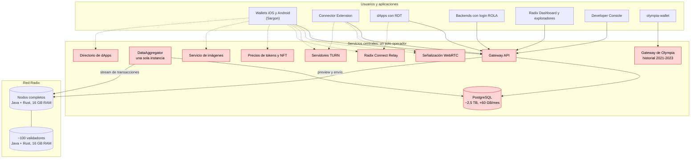
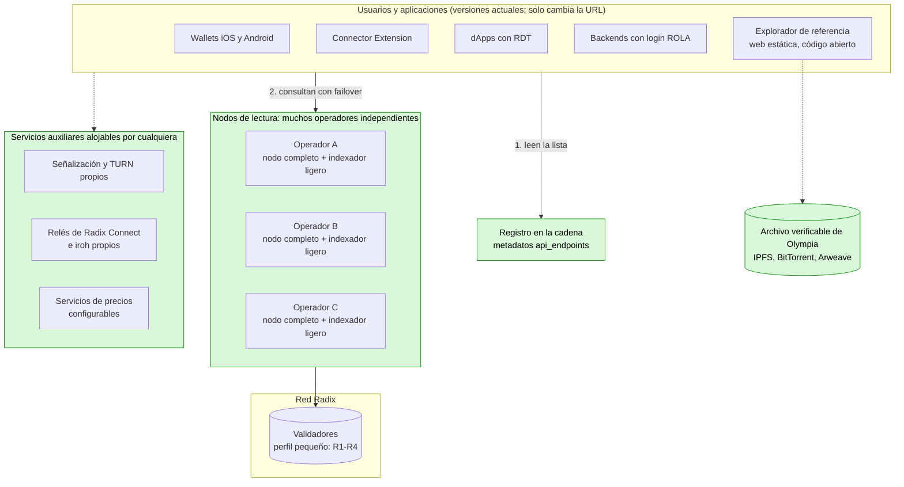
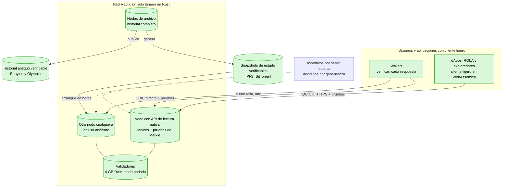
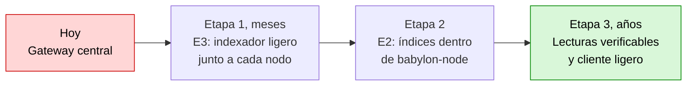

# Radix sin Gateway

🇪🇸 Español · [🇬🇧 English](README.md)

Cómo conseguir que la red Radix funcione para todo y para todo el mundo **sin el Babylon Gateway**: análisis del código, datos medidos de mainnet, estrategias comparadas y cambios por repositorio.

Informe del 3 de noviembre de 2026.

### Infraestructura actual

### Infraestructura a corto plazo: sin Gateway

### Infraestructura a largo plazo: solución ideal

## Resumen ejecutivo

1. **Hoy el Gateway es un punto único de fallo para todo el ecosistema.**
   - Ningún cliente oficial sabe hablar con un nodo: ni los wallets ni Sargon, ni la RDT ni ROLA, ni la extensión ni el Dashboard.
   - Según la Foundation, su operación está **pre-financiada solo hasta diciembre de 2026**, dentro de dos meses, y no hay plan público para después.
2. **El nodo ya resuelve directamente ~80-85 % de los casos de uso.** Lo he comprobado en el código de `babylon-node`. Faltan seis capacidades: N1 a N6, detalladas en la sección 3.
3. **He evaluado seis estrategias.** Con los datos medidos, la mejor es **E3 + E2**:
   - **E3, a corto plazo:** un **indexador ligero** junto a cada nodo («sidecar»). **Sustituye al Gateway**: el Gateway se apaga y no se ejecuta en ningún sitio. Para que los wallets y dApps ya publicados funcionen sin actualizarse, el indexador responde a las mismas rutas y con el mismo JSON que esas apps ya saben pedir. Solo se reutiliza ese **formato de las peticiones**, no el software del Gateway.
     - Se estima que ocupa **unos 10-50 GB**, frente a los **~2,5 TB** del Gateway.
     - Un operador de nodo lo despliega con un coste marginal casi nulo.
     - **Los wallets y la RDT actuales lo pueden usar sin publicar una versión nueva**, porque ya permiten configurar la URL del Gateway.
     - Incluye los índices que necesitan los **exploradores de transacciones**: historial de cualquier entidad, titulares de recursos, ubicación de NFT, estadísticas y búsqueda. Se completa con un **explorador de referencia de código abierto**, porque el Radix Dashboard no es público.
   - **E2, a medio plazo:** llevar esos índices y un «modo de lectura pública» al propio `babylon-node`. Así cada nodo de la red es también un punto de acceso.
   - **Descubrimiento descentralizado:** los clientes encuentran los puntos de acceso en el propio ledger, en los metadatos de los validadores, en vez de en una URL fija.
4. **Conclusión:** **es posible**. La dificultad global es **media-alta**:
   - **Baja-media** para que dApps, ROLA y transacciones funcionen.
   - **Media** para que los wallets funcionen con historial reducido, y para tener exploradores de transacciones completos con E3 y un explorador de código abierto.
   - **Alta** para la paridad completa, por el historial filtrado, la ubicación de NFT y los snapshots históricos.

5. **Nodos más ligeros (sección 9):** hoy un nodo de mainnet usa 12 GB de memoria Java por defecto, RocksDB sin límites de memoria, y guarda para siempre el historial completo: el snapshot comprimido ya ocupa 274 GiB. Con cambios concretos en el código (ajustar RocksDB, podar datos que solo usan las APIs, arranque desde un snapshot verificado y, a largo plazo, migrar el núcleo de Java a Rust), un validador o un nodo completo **puede funcionar con 4 GB de RAM y menos de 500 GB de disco**.

   El detalle está en la sección «Conclusión», justo debajo. La sección 10 explica paso a paso cómo hacer cada cambio.

## Conclusión

**¿Es posible que Radix funcione para todo y para todo el mundo sin el Gateway?** **Sí, es posible.**

- Ningún caso de uso necesita algo que solo el Gateway pueda producir. Todo sale del stream de transacciones y del estado del nodo.
- La red ya tiene casi todo en el nodo. Lo que falta son índices concretos y un modo de acceso público, no cambios de protocolo ni de consenso.

**Olympia no es un inconveniente** para el objetivo. Su estado se migró al génesis de Babylon, así que el nodo lo tiene. Solo añade dos tareas: procesar el génesis al indexar (una vez) y **archivar ya el historial de Olympia**, que no está en Babylon y hoy depende de un único servicio. Esta segunda es de dificultad **baja**, pero **urgente**.

**Dificultad por objetivo:**

| Objetivo | Dificultad | Estimación |
|---|---|---|
| dApps, login con ROLA, envío y seguimiento de transacciones, saldos (con E3 o con el nodo + cambios pequeños en RDT y ROLA) | **Baja-media** | ~1-2 persona-mes |
| Wallets actuales funcionando sin el Gateway (E3, sin publicar versiones nuevas) | **Media** | ~4-7 persona-mes para el indexador ligero |
| Exploradores de transacciones completos sin el Gateway (índices h, i, j y explorador de referencia de código abierto) | **Media** | ~1-2 persona-mes de índices + ~2-3 persona-mes de explorador |
| Descentralización real: muchos operadores, descubrimiento en la cadena, failover y reenvío en los clientes | **Media** | ~3-5 persona-mes en clientes |
| Paridad total dentro del nodo (E2), historial completo y snapshots de gobernanza | **Alta** | ~6-10 persona-mes en el nodo, más ~4-6 en clientes |
| Acceso sin confianza: lecturas verificables con cliente ligero (sección 6.2) | **Muy alta** | ~40-80 persona-mes adicionales, años |
| Nodos de 4 GB de RAM y ≤ 500 GB de disco con Java: ajustes de RocksDB y memoria, poda de datos de API, arranque desde snapshot verificado (R1-R9, sección 9) | **Media** | ~8-14 persona-mes |
| Migrar el núcleo del nodo de Java a Rust (R11): margen holgado en 4 GB, incluso para nodos de lectura | **Muy alta** | ~30-50 persona-mes |

**Dificultad global: media-alta.** Lo difícil no es la técnica, sino tres factores de organización:

- **Coordinación:** la Foundation está en mantenimiento. Los cambios en el nodo, Sargon y los wallets dependen de desarrolladores de la comunidad y de la gobernanza (DAO / RAC).
- **Plazo:** la financiación del Gateway acaba el 31-dic-2026.
- **Financiación** de un pequeño equipo, del orden de **18-30 persona-mes** para el camino completo (exploradores incluidos), o **7-10** para el mínimo viable con E3 y el explorador de referencia.

**Mejor solución a corto plazo:** el **indexador ligero junto a cada nodo (E3)**, que sustituye al Gateway. Le siguen su integración en `babylon-node` (E2) y el descubrimiento en la cadena. Con tiempo ilimitado, la solución ideal es la de la sección 6.2: lecturas **verificables** con pruebas criptográficas. Los motivos, con los datos medidos:

- Ocupa ~10-50 GB (estimado), frente a ~2,5 TB.
- Su coste por operador es casi nulo, frente a ~300-500 €/mes.
- Funciona con los wallets actuales sin publicar versiones nuevas.
- Es el único camino viable antes de que acabe la financiación.

**Nodos de 4 GB y 500 GB: sí es posible** (sección 9). Los cambios R1-R4 son baratos (semanas) y quitan el principal motivo de los 16 GB: RocksDB sin límites y 12 GB reservados para Java. La poda y el arranque desde un snapshot verificado (R5-R9) mantienen el disco por debajo de 500 GB aunque la red siga creciendo. La migración a Rust (R11) da margen holgado y permite que también los nodos de lectura que sustituyen al Gateway quepan en 4 GB.

**Mejor solución con tiempo ilimitado:** que cada nodo sirva lecturas **verificables** y que cada wallet lleve un cliente ligero que compruebe cada respuesta (sección 6.2). Así ni siquiera hace falta confiar en el nodo. Babylon ya firma raíces de Merkle del estado, de las transacciones y de los recibos; falta exponer las pruebas y verificarlas en los clientes. Es la meta final, de dificultad **muy alta** (años), y la solución a corto plazo es la primera etapa hacia ella.

**Puntos a validar con un prototipo:**

- el tamaño real de los índices;
- la velocidad de ingesta desde la génesis;
- la conformidad exacta de las respuestas con las de los wallets.

### Etapas hasta la solución ideal

## Documentos

1. [Secciones 1-2: situación actual, quién depende del Gateway, exploradores y Olympia](docs/es/01-situacion-actual.md)
2. [Sección 3: qué ofrece hoy el nodo y qué le falta](docs/es/02-que-ofrece-el-nodo.md)
3. [Secciones 4-5: las seis estrategias evaluadas y su comparativa con datos](docs/es/03-estrategias.md)
4. [Sección 6: solución recomendada, almacenamiento y solución ideal a largo plazo](docs/es/04-solucion-recomendada.md)
5. [Sección 7: cambios concretos en cada repositorio](docs/es/05-cambios-por-repositorio.md)
6. [Sección 8: hoja de ruta](docs/es/06-hoja-de-ruta.md)
7. [Sección 9: nodos más ligeros, 4 GB de RAM y 500 GB de disco, migración de Java a Rust](docs/es/07-nodos-ligeros.md)
8. [Sección 10: guía de implementación paso a paso](docs/es/08-guia-de-implementacion.md)
9. [Fuentes y metodología](docs/es/09-fuentes.md)

> Las cifras marcadas como *estimación* deben validarse con un prototipo. Las correcciones y aportaciones son bienvenidas mediante *issues* o *pull requests*.
