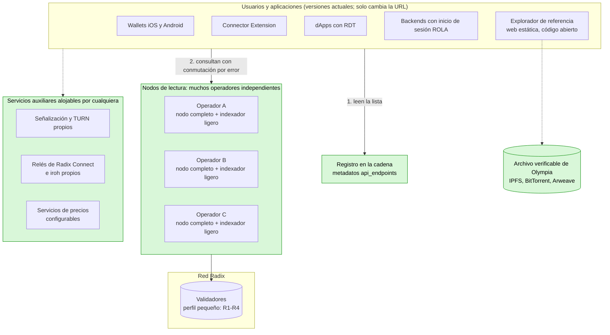
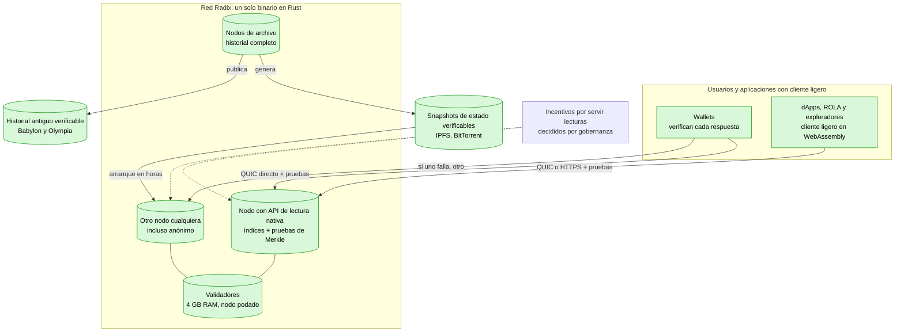
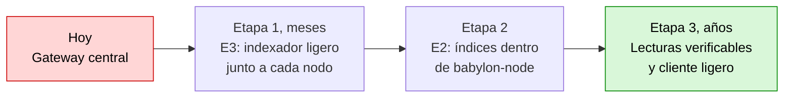
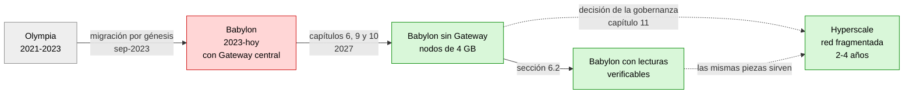

# Radix sin dependencias centrales

Español · [English](README.md)

Análisis técnico y hoja de ruta para que la red Radix dé servicio a todos sus usuarios **sin depender del Babylon Gateway**, con **nodos más ligeros (objetivo: 4-8 GB de RAM y 500 GB de disco o menos)**, y para una posible **evolución hacia Hyperscale**. Incluye análisis del código, datos medidos de mainnet, estrategias comparadas, cambios por repositorio, guía de implementación y referencias de otras redes.

Informe del 3 de noviembre de 2026.

### Cifras clave

| | |
|---|---|
| Fin de la financiación del Gateway | **31-dic-2026** |
| Base de datos del Gateway | **~2,5 TB** (estimado), +60 GB/mes |
| Ledger de mainnet (snapshot comprimido, sep-2026) | **274 GiB**, +5-8 GiB/mes |
| Versiones de estado en mainnet (nov-2026) | **~567 millones**, ~97-98 % cambios de ronda |
| Transacciones de usuario desde el génesis | **~10-15 millones** (estimado) |
| Capacidades que el nodo ya cubre sin Gateway | **9 de 19** por completo y 2 en parte (tabla 3.2) |
| Indexador ligero propuesto | **~10-50 GB** (estimado) |
| Validadores activos (3-nov-2026) | **100** (de 290 registrados) |
| Titulares de XRD (3-nov-2026) | **435 605** |
| RAM de un nodo hoy → objetivo | **16 GB** (requisito oficial) → **4-8 GB** (objetivo, estimado) |

## Guía de lectura

| Si eres… | Lee primero |
|---|---|
| Miembro de la comunidad o poseedor de XRD | El resumen, la conclusión y la reflexión final de esta página |
| Operador de nodo o validador | [Capítulo 9: nodos más ligeros (RAM y disco) y migración de Java a Rust](docs/es/09-nodos-ligeros.md) |
| Desarrollador de wallets, dApps o herramientas | [Capítulo 7: cambios concretos en cada repositorio](docs/es/07-cambios-por-repositorio.md) y [Capítulo 10: guía de implementación paso a paso](docs/es/10-guia-de-implementacion.md) |
| Gobernanza (RAC, DAO) | Los próximos pasos de esta página y [Capítulo 8: hoja de ruta](docs/es/08-hoja-de-ruta.md) y [Capítulo 11: evolución final hacia Hyperscale](docs/es/11-evolucion-hyperscale.md) |
| Quien no conozca algún término | [Glosario](docs/es/glosario.md) |
| Quien quiera aportar correcciones, datos o ideas | La [guía de contribución](CONTRIBUTING.es.md) y la carpeta [`community/`](community/README.md) |

## Documentos

- [Alcance y capítulos 1-2: situación actual, quién depende del Gateway, exploradores y Olympia](docs/es/01-02-situacion-actual.md)
- [Capítulo 3: qué ofrece hoy el nodo y qué le falta](docs/es/03-que-ofrece-el-nodo.md)
- [Capítulos 4-5: las seis estrategias evaluadas y su comparativa](docs/es/04-05-estrategias.md)
- [Capítulo 6: solución recomendada, almacenamiento, solución ideal y riesgos](docs/es/06-solucion-recomendada.md)
- [Capítulo 7: cambios concretos en cada repositorio](docs/es/07-cambios-por-repositorio.md)
- [Capítulo 8: hoja de ruta](docs/es/08-hoja-de-ruta.md)
- [Capítulo 9: nodos más ligeros (RAM y disco) y migración de Java a Rust](docs/es/09-nodos-ligeros.md)
- [Capítulo 10: guía de implementación paso a paso](docs/es/10-guia-de-implementacion.md)
- [Capítulo 11: evolución final hacia Hyperscale](docs/es/11-evolucion-hyperscale.md)
- [Capítulo 12: referencias de otras redes descentralizadas](docs/es/12-referencias-otras-redes.md)
- [Fuentes, metodología y preguntas abiertas](docs/es/fuentes-y-metodologia.md)
- [Glosario](docs/es/glosario.md)

## Resumen ejecutivo

1. **El Gateway es hoy un punto único de fallo para el ecosistema.**
   - Ningún cliente oficial se comunica directamente con los nodos: ni los wallets (Sargon), ni la RDT, ni ROLA, ni la Connector Extension, ni el Dashboard.
   - Según la Foundation, su operación está **financiada solo hasta el 31 de diciembre de 2026**, y no hay un plan público para después.
2. **Los nodos ya resuelven directamente las operaciones más habituales** (enviar transacciones, consultar su estado, saldos, NFT, metadatos, validadores), según el código de `babylon-node`: de las 19 capacidades de la tabla de la sección [3.2](docs/es/03-que-ofrece-el-nodo.md#s3-2), [9](docs/es/09-nodos-ligeros.md#s9) están cubiertas por completo y 2 en parte. Faltan seis capacidades principales (N1-N6, sección [3](docs/es/03-que-ofrece-el-nodo.md#s3)) y algunas menores (N7-N9, sección [7.2](docs/es/07-cambios-por-repositorio.md#s7-2)).
3. **Se han comparado seis estrategias.** Con los datos medidos, la más adecuada combina dos (E3 y E2), con E6 como complemento:
   - **A corto plazo (E3): un indexador ligero junto a cada nodo**, que sustituye al Gateway. El Gateway deja de existir.
     - Para que los wallets y dApps ya publicados sigan funcionando sin actualizarse, el indexador acepta las mismas peticiones que esas aplicaciones envían hoy. Solo se conserva el **formato de la API (peticiones y respuestas)**, no el software del Gateway.
     - Ocuparía **unos 10-50 GB** (estimación), frente a los **~2,5 TB** del Gateway, con un coste casi nulo para quien ya opera un nodo.
     - Incluye lo que necesitan los **exploradores de transacciones**, y se completa con un **explorador de referencia de código abierto**.
   - **A medio plazo (E2): incorporar esos índices y un modo de lectura pública al propio nodo.** Cada nodo de la red pasa a ser un punto de acceso.
   - **Descubrimiento en la cadena:** las aplicaciones obtienen la lista de puntos de acceso de los metadatos de los validadores, en lugar de usar una dirección fija.
4. **Nodos más ligeros (sección [9](docs/es/09-nodos-ligeros.md#s9)).**
   - Hoy un nodo de mainnet reserva 12 GB de memoria para Java, usa RocksDB sin límites de memoria y conserva todo el historial; el ledger comprimido ya ocupa 274 GiB.
   - Con cambios concretos en el código (ajustar RocksDB, podar datos que solo usan las APIs, arrancar desde un snapshot verificado y, más adelante, migrar el núcleo de Java a Rust), un validador o un nodo completo **podría funcionar con 8 GB de RAM como máximo, y previsiblemente con 4 GB, con 500 GB de disco o menos** (estimaciones que hay que confirmar midiendo un nodo real).
5. **Evolución final hacia Hyperscale (sección [11](docs/es/11-evolucion-hyperscale.md#s11)).**
   - Hyperscale es de código abierto, pero es **una red nueva**: otra máquina virtual, otras direcciones y sin compatibilidad con Scrypto. Adoptarlo exige migrar los saldos y **reescribir las aplicaciones**.
   - Correspondería a la comunidad. La estrategia recomendada es una génesis con **reclamación verificable** de saldos mediante pruebas criptográficas.
   - Su dificultad es **muy alta**, con un plazo estimado de 2 a 4 años. Mientras tanto, Babylon debe seguir funcionando, lo que mantiene la utilidad del resto del plan.

6. **Referencias de otras redes (capítulo [12](docs/es/12-referencias-otras-redes.md#s12)).** Cardano, Sui, Aptos, Solana, NEAR, Polkadot, Kaspa, Ethereum y Cosmos ya aplican técnicas equivalentes a las propuestas (snapshots verificados, poda, lectura en el nodo, clientes ligeros, reescritura en Rust), lo que confirma que son viables. También se analiza cómo implementa Midnight la privacidad, como referencia para la capa 1 de Radix.

La sección «Conclusión», a continuación, resume la viabilidad y la dificultad de cada objetivo. La sección [9.4](docs/es/09-nodos-ligeros.md#s9-4) detalla cada cambio en los nodos, la sección [10](docs/es/10-guia-de-implementacion.md#s10) explica paso a paso cómo construir las piezas principales, y el glosario, al final, explica los términos técnicos.

## Conclusión

> [!IMPORTANT]
> - **¿Es posible?** Sí. La red puede dar servicio a todos sus usuarios y casos de uso sin el Gateway.
> - **Dificultad:** Media-alta (organización y plazo más que técnica).
> - **Esfuerzo y plazo:** 7-12 personas-mes para la solución mínima viable; 21-35 para la completa (estimaciones).

**¿Puede la red Radix dar servicio a todos sus usuarios y casos de uso sin depender del Gateway?** **Sí.**

- Ningún caso de uso necesita información que solo el Gateway pueda generar: todo procede del ledger y del estado que ya guardan los nodos.
- Lo que falta son índices concretos y un modo de acceso público en los nodos. No hacen falta cambios en el protocolo ni en el consenso.
- Todo se resuelve en la capa 1, sin soluciones de capa 2 (ver «[Principio de diseño](docs/es/01-02-situacion-actual.md#alcance)» en el Alcance).

**Olympia no supone un obstáculo.** Su estado se migró a la génesis de Babylon, de modo que los nodos ya lo tienen. Añade dos tareas (la sección [2.2](docs/es/01-02-situacion-actual.md#s2-2) detalla las cuatro consideraciones, dos de las cuales no requieren trabajo):

- procesar la génesis una vez al construir los índices;
- **archivar cuanto antes el historial de Olympia**, que no está en Babylon y depende hoy de un único servicio. Es una tarea de dificultad **baja**, pero **urgente**.

**Viabilidad y dificultad por objetivo:**

| Objetivo | ¿Es posible? | Dificultad | Esfuerzo estimado |
|---|---|---|---|
| dApps, inicio de sesión con ROLA, envío y seguimiento de transacciones, saldos | **Sí** | **Baja-media** | ~1-2 personas-mes |
| Wallets actuales funcionando sin el Gateway (E3, sin publicar versiones nuevas) | **Sí** | **Media** | ~4-7 personas-mes para el indexador ligero |
| Exploradores de transacciones completos sin el Gateway (índices propios y explorador de referencia de código abierto) | **Sí** | **Media** | ~1-2 personas-mes de índices + ~2-3 de explorador |
| Descentralización efectiva: muchos operadores, descubrimiento en la cadena, conmutación por error y reenvío en los clientes | **Sí** | **Media** | ~3-5 personas-mes en clientes |
| Todas las funciones dentro del propio nodo (E2), historial completo y snapshots de gobernanza | **Sí** | **Alta** | ~6-10 personas-mes en el nodo + ~4-6 en clientes |
| Archivo verificable del historial de Olympia | **Sí** (urgente) | **Baja** | Semanas |
| Nodos de 4-8 GB de RAM y ≤ 500 GB de disco, aún con Java (R1-R9, sección [9](docs/es/09-nodos-ligeros.md#s9)) | **Sí** (estimación: 8 GB alcanzable, 4 GB plausible) | **Media** | ~8-14 personas-mes |
| Migrar el núcleo del nodo de Java a Rust (R11): margen suficiente en 4 GB, también para nodos de lectura | **Sí** | **Muy alta** | ~30-50 personas-mes |
| Acceso sin necesidad de confiar en el nodo: lecturas verificables con cliente ligero (sección [6.2](docs/es/06-solucion-recomendada.md#s6-2)) | **Sí** | **Muy alta** | ~40-80 personas-mes, varios años |
| Migración a Hyperscale como evolución final (sección [11](docs/es/11-evolucion-hyperscale.md#s11)) | **Sí, con condiciones**: la red y los fondos sí; las dApps deben reescribirse; aún no en producción | **Muy alta** | ~110-210 personas-mes, 2-4 años, sin contar las dApps |
| Mantener los contratos Scrypto en Hyperscale (sección [11.4](docs/es/11-evolucion-hyperscale.md#s11-4)) | **No** con el diseño actual de Hyperscale | **Muy alta** si se intentara (bifurcación) | No recomendado |

### Qué hacer para cada objetivo: mejor estrategia y tecnología

| Objetivo | Qué hay que hacer | Mejor estrategia o tecnología | Por qué | Detalle |
|---|---|---|---|---|
| **Eliminar el Gateway antes de que acabe su financiación** | Construir y desplegar el indexador ligero junto a los nodos, con el formato de API que ya usan las apps; pruebas de conformidad mientras el Gateway siga activo | **Indexador ligero en Rust junto al nodo (E3)**, alimentado por el stream de transacciones del nodo, al estilo de Geyser (Solana) o del servicio de flujo de Aptos | Funciona con los wallets actuales sin publicar versiones nuevas; ocupa ~10-50 GB (estimación) frente a ~2,5 TB | [6](docs/es/06-solucion-recomendada.md#s6), [7.1](docs/es/07-cambios-por-repositorio.md#s7-1), [10.1](docs/es/10-guia-de-implementacion.md#s10-1) |
| **Que el acceso no dependa de nadie** | Muchos operadores de nodos de lectura; que los clientes los encuentren y cambien de uno a otro | **Registro de puntos de acceso en la propia capa 1** (metadatos de los validadores), más una lista de arranque y conmutación por error en los clientes, como el *Resolver* de Kaspa | Las redes federadas existentes (Koios, Kaspa) se coordinan fuera de la cadena; hacerlo en la capa 1 elimina también esa dependencia | [10.2](docs/es/10-guia-de-implementacion.md#s10-2) |
| **Exploradores sin Gateway** | Índices de titulares, estadísticas y búsqueda; explorador de código abierto | **Índices h, i y j del indexador ligero + explorador estático** publicable en cualquier alojamiento o en IPFS | No depende de ningún servidor propio; el Dashboard oficial no es de código abierto | [2.1](docs/es/01-02-situacion-actual.md#s2-1), [7.16](docs/es/07-cambios-por-repositorio.md#s7-16) |
| **Conservar el historial de Olympia** | Exportarlo una vez y publicarlo | **Archivo verificable** (raíz de Merkle firmada por varias personas) en IPFS, BitTorrent o Arweave | Está congelado: no necesita indexador, solo conservación | [2.2](docs/es/01-02-situacion-actual.md#s2-2), [10.5](docs/es/10-guia-de-implementacion.md#s10-5) |
| **Integrar la lectura en el propio nodo** | Índices opcionales y modo de lectura pública en `babylon-node` | **API de lectura nativa en el nodo (E2)**, como Kaspa (wRPC) o Sui (gRPC en el nodo completo) | Cada nodo pasa a ser un punto de acceso, sin proceso aparte | [7.2](docs/es/07-cambios-por-repositorio.md#s7-2), [10.3](docs/es/10-guia-de-implementacion.md#s10-3) |
| **Reducir la RAM a 8 GB o menos (y previsiblemente a 4 GB)** | Limitar la memoria de RocksDB, reducir el heap de Java y la mempool | **R1 + R2:** caché de bloques compartida, índices y filtros dentro de la caché y *Write Buffer Manager*, según la documentación oficial de RocksDB; perfil de 4 GB en el instalador | El estado de Radix ya está en disco; el consumo actual es de configuración | [9.2](docs/es/09-nodos-ligeros.md#s9-2), [9.4](docs/es/09-nodos-ligeros.md#s9-4) |
| **Mantener el disco por debajo de 500 GB** | Dejar de guardar lo que solo usan las APIs; podar el historial en los nodos que no lo necesiten | **R3-R7 y nodo podado (R8)**, con nodos de archivo aparte, como la poda por defecto de Polkadot, Kaspa o Cosmos y la expiración del historial de Ethereum | ~97-98 % de las versiones de estado son cambios de ronda, y la mayor parte de sus datos solo la usan las APIs | [9.3](docs/es/09-nodos-ligeros.md#s9-3), [9.4](docs/es/09-nodos-ligeros.md#s9-4) |
| **Arrancar nodos nuevos en horas y sin confiar en terceros** | Exportar e importar el estado verificándolo contra la raíz firmada | **Snapshot verificado al final de época (R9)**, como los snapshots formales de Sui o el *warp sync* de Polkadot | Babylon ya firma `state_tree_hash` en sus pruebas; es la técnica estándar en las redes modernas | [9.4](docs/es/09-nodos-ligeros.md#s9-4) (R9), [12.9](docs/es/12-referencias-otras-redes.md#s12-9) |
| **Margen holgado en 4 GB y un nodo más sencillo** | Sustituir la parte Java del nodo por Rust | **Migración por fases con convivencia en la red (R11)**, como hizo Kaspa al pasar de Go a Rust | Elimina la JVM y el puente JNI; el riesgo se controla con adopción gradual | [9.4](docs/es/09-nodos-ligeros.md#s9-4) (R11) |
| **No tener que confiar en ningún nodo** | Endpoint de pruebas de Merkle en el nodo y cliente ligero en wallets y navegador | **Lecturas verificables con cliente ligero en Rust compilado a WebAssembly**, como smoldot (Polkadot) o Helios (Ethereum) | Es la garantía máxima: el wallet comprueba cada respuesta | [6.2](docs/es/06-solucion-recomendada.md#s6-2), [10.6](docs/es/10-guia-de-implementacion.md#s10-6) |
| **Evolución final con Hyperscale** | Preparar Hyperscale para mainnet, API de lectura, wallets, migración de saldos y reescritura de dApps | **Génesis con reclamación verificable (M1)**: prueba de Merkle contra la raíz final de Babylon más firma, con plazo largo y soporte para cuentas securificadas, combinando el contrato `MerkleDistributor` y el Glacier Drop de Midnight | No exige confiar en un puente ni deja a nadie fuera; antes conviene comparar con mejorar Babylon en su cadena, como hace Cardano con Leios | [11](docs/es/11-evolucion-hyperscale.md#s11), [12.9](docs/es/12-referencias-otras-redes.md#s12-9) |
| **Contratos Scrypto en Hyperscale** | Reescribirlos con el SDK de Hyperscale | **Reescritura asistida por herramientas de traducción**, aprovechando que ambos usan Rust y conceptos similares | Mantener Scrypto no es posible con el diseño actual de Hyperscale | [11.4](docs/es/11-evolucion-hyperscale.md#s11-4) |
| **Privacidad en la capa 1** (opcional) | Verificación de pruebas ZK en el motor y recursos protegidos | **Primitiva nativa de verificación de pruebas ZK** en el Radix Engine (por ejemplo, Halo2, como Midnight) y recursos protegidos | Mantiene el principio de capa 1, sin una red aparte | [12.8](docs/es/12-referencias-otras-redes.md#s12-8) |

**Dificultad global para eliminar el Gateway: media-alta.** La principal dificultad no es técnica, sino de organización:

- **Coordinación:** la Foundation está en modo de mantenimiento. Los cambios en el nodo, Sargon y los wallets dependen de desarrolladores de la comunidad y de la gobernanza (DAO / RAC).
- **Plazo:** la financiación del Gateway termina el 31 de diciembre de 2026.
- **Financiación:** un equipo pequeño necesitaría del orden de **7-12 personas-mes** para la solución mínima viable (indexador ligero, índices para exploradores y explorador de referencia), y **21-35** para eliminar el Gateway con todas las funciones (suma de las cinco primeras filas de la tabla).

**Solución recomendada a corto plazo:** el **indexador ligero junto a cada nodo (E3)**, que sustituye al Gateway, seguido de su integración en `babylon-node` (E2) y del descubrimiento en la cadena. Los datos medidos lo respaldan:

- ocupa ~10-50 GB (estimación), frente a ~2,5 TB;
- su coste por operador es casi nulo (estimación), frente a los ~300-400 €/mes que cuesta operar el Gateway;
- funciona con los wallets actuales sin publicar versiones nuevas;
- es la única opción que puede estar lista antes de que termine la financiación.

**¿Es posible?** Sí. **Dificultad:** media.

**Nodos de 4 GB y 500 GB** (sección [9](docs/es/09-nodos-ligeros.md#s9)). **¿Es posible?** Sí: con R1-R2, un nodo de 8 GB como máximo parece alcanzable, y 4 GB es plausible (estimaciones que hay que medir). Radix lo tiene más fácil que otras redes porque su estado ya está en disco, su conjunto de validadores es pequeño y su carga es baja (sección [12.9](docs/es/12-referencias-otras-redes.md#s12-9)). **Dificultad:** media con Java (R1-R9); muy alta para tener margen holgado (R11).

- **R1-R2:** eliminan la causa principal de los 16 GB actuales (RocksDB sin límites y 12 GB reservados para Java); **R3-R4** reducen el disco. Los cuatro tienen un coste bajo (semanas). **Dificultad: baja.**
- **R5-R9:** la poda y el arranque desde un snapshot verificado mantienen el disco por debajo de 500 GB aunque la red siga creciendo. **Dificultad: baja-media a media** (R9, media-alta).
- **R11:** la migración a Rust da margen suficiente para que también los nodos de lectura que sustituyen al Gateway funcionen con 4 GB. **Dificultad: muy alta.**

**Solución ideal a largo plazo.** **¿Es posible?** Sí. **Dificultad:** muy alta. Consiste en que cualquier nodo sirva lecturas **verificables** y que cada wallet incluya un cliente ligero que compruebe cada respuesta (sección [6.2](docs/es/06-solucion-recomendada.md#s6-2)). Así no es necesario confiar en ningún nodo.

- Babylon ya firma las raíces de Merkle del estado, de las transacciones y de los recibos; falta exponer esas pruebas y verificarlas en los clientes.
- Es el objetivo final dentro de Babylon. Su dificultad es **muy alta** (varios años), y la solución a corto plazo es su primera etapa.

**Evolución final con Hyperscale** (sección [11](docs/es/11-evolucion-hyperscale.md#s11)). **¿Es posible?** Sí, con condiciones. **Dificultad:** muy alta.

- **¿Es posible migrar Radix usando el código de Hyperscale? Sí, con condiciones.** La red y los fondos pueden migrar; los contratos Scrypto y las dApps no, porque deben reescribirse. Con el código actual, aún en desarrollo, todavía no es posible hacerlo en producción.
- **¿Se puede mantener Scrypto con Hyperscale?** No con el diseño actual: Hyperscale declara la compatibilidad con Scrypto como no-objetivo. El SDK de Hyperscale también usa Rust y `#[blueprint]` y tiene conceptos parecidos (recursos, badges, cuentas virtuales), lo que facilita reescribir los contratos, pero hay que reescribirlos (sección [11.4](docs/es/11-evolucion-hyperscale.md#s11-4)).
- Es una migración a una red nueva, no una actualización.
- La comunidad tendría que:
  - preparar Hyperscale para mainnet;
  - construir su API de lectura e indexador;
  - adaptar Sargon y los wallets;
  - migrar los saldos mediante una reclamación verificable;
  - y cada proyecto, reescribir sus contratos.
- Las piezas propuestas en este informe (indexador ligero, descubrimiento en la cadena, snapshots verificados, pruebas de Merkle y la interfaz `LedgerBackend`) también son necesarias para esa migración.
- Recomendación: que la gobernanza decida primero si adopta Hyperscale. Hasta entonces, conviene aplicar R1-R9 y **aplazar R11**.

**Pendiente de validar con un prototipo:**

- el tamaño real de los índices;
- la velocidad de indexación desde la génesis;
- la compatibilidad exacta de las respuestas con lo que esperan los wallets;
- el tamaño real del ledger por tabla en un nodo de mainnet.

## Próximos pasos y decisiones para la gobernanza

### Quién puede hacer qué, desde ya

| Quién | Acción | Cuándo | Cómo aportarlo |
|---|---|---|---|
| Operadores de nodo | Publicar el tamaño por column family (métricas `raw_db_size`) y el consumo real de RAM (RSS) de un nodo de mainnet | Lo antes posible | Plantilla de *issue* «Dato o medición» |
| Operadores de nodo | Probar en Stokenet el perfil de memoria reducida (R2) y los ajustes de RocksDB (R1) | Nov.-dic. 2026 | Plantilla «Dato o medición» |
| Desarrolladores | Construir el prototipo del indexador ligero (sección [7.1](docs/es/07-cambios-por-repositorio.md#s7-1)) y grabar respuestas reales del Gateway para las pruebas de conformidad **mientras siga activo** | Antes del 31-dic-2026 | *Pull requests* con enlaces al prototipo |
| Desarrolladores | Implementar la interfaz `LedgerBackend` en Sargon y la conmutación por error en la RDT y ROLA (sección [10.4](docs/es/10-guia-de-implementacion.md#s10-4)) | 2027 | *Pull requests* en los repositorios afectados |
| Comunidad | Exportar, sellar y replicar el archivo de Olympia (sección [10.5](docs/es/10-guia-de-implementacion.md#s10-5)) | Antes de que se apague el Gateway de Olympia | Notas en `community/` |
| Validadores | Publicar sus puntos de acceso en el metadato `api_endpoints` (sección [10.2](docs/es/10-guia-de-implementacion.md#s10-2)) cuando haya nodos de lectura | Cuando exista el indexador | — |

### Decisiones que corresponden a la gobernanza

| Decisión | Plazo | Información necesaria | Dónde |
|---|---|---|---|
| Financiar la solución mínima viable (7-12 personas-mes, estimación) | Antes del 31-dic-2026 | Este informe; propuestas de equipos | Conclusión, sección [6](docs/es/06-solucion-recomendada.md#s6) |
| Plan de contingencia si el sustituto no está listo a tiempo | Antes del 31-dic-2026 | Estado del prototipo | Sección [6.3](docs/es/06-solucion-recomendada.md#s6-3) |
| Quién genera y firma el archivo de Olympia | Lo antes posible | Disponibilidad de una copia de su base de datos | Sección [2.2](docs/es/01-02-situacion-actual.md#s2-2) |
| Adoptar `api_endpoints` como convención de descubrimiento | 2027 | Prototipo del indexador | Sección [10.2](docs/es/10-guia-de-implementacion.md#s10-2) |
| Incentivos para nodos de lectura, pagados en la capa 1 | 2027 | Número de operadores voluntarios | Secciones [6.2](docs/es/06-solucion-recomendada.md#s6-2) y [12.1](docs/es/12-referencias-otras-redes.md#s12-1) |
| Pedir la publicación del código del Dashboard y de la Developer Console | Lo antes posible | — | Sección [7.16](docs/es/07-cambios-por-repositorio.md#s7-16) |
| Votar la actualización de protocolo R10 | Cuando esté lista | Pruebas en Stokenet | Sección [9.4](docs/es/09-nodos-ligeros.md#s9-4) |
| Adoptar o no Hyperscale, frente a seguir mejorando Babylon en su cadena; según el resultado, iniciar o aplazar R11 | 2027 | Madurez de Hyperscale; equipo disponible | Capítulos [11](docs/es/11-evolucion-hyperscale.md#s11) y [12](docs/es/12-referencias-otras-redes.md#s12) |

## Infraestructura y evolución en diagramas

### Infraestructura actual

En rojo, los servicios que dependen de un solo operador.

### Infraestructura a corto plazo: sin Gateway

### Infraestructura a largo plazo: solución ideal

### Etapas hasta la solución ideal

### Evolución de Radix

## Reflexión final

**La pregunta ya no es si es posible.** El análisis muestra que todos los objetivos son técnicamente viables, y que lo más urgente (eliminar el Gateway y aligerar los nodos) no requiere cambiar el consenso. La pregunta real es otra: **¿cuenta Radix con desarrolladores con la capacidad necesaria y con una comunidad lo bastante comprometida para llevarlo a cabo?**

Los datos del informe permiten concretar qué exige cada parte:

- **Capacidad técnica.**
  - Lo más urgente (indexador ligero y ajustes del nodo) requiere perfiles de Rust y de bases de datos, con un esfuerzo acotado: 7-12 personas-mes para la solución mínima viable.
  - Lo más ambicioso (migrar el consenso a Rust, lecturas verificables, Hyperscale) requiere especialistas en consenso y criptografía, hoy escasos en el ecosistema:
    - `hyperscale-rs` depende casi por completo de un solo desarrollador;
    - según la propia Foundation, su equipo interno trabaja con alrededor del 10 % de los recursos que tenía antes de su reestructuración ([2026 Strategy](https://www.radixdlt.com/blog/2026-strategy-the-next-chapter-of-radix)).
- **Compromiso de la comunidad.** Hace falta:
  - operadores que ejecuten nodos de lectura y de archivo;
  - financiación decidida por la gobernanza;
  - decisiones a tiempo, antes del 31-dic-2026;
  - y contribuciones como las que permite este repositorio.

  Hay señales en los dos sentidos:
  - **a favor:** la comunidad gestiona Stokenet desde junio de 2026 (según [radix.wiki](https://radix.wiki/ecosystem/radix-accountability-council), fuente secundaria), y las consultas a los poseedores de XRD han reunido a más de mil millones de XRD ([Foundation Update](https://www.radixdlt.com/blog/foundation-update-moving-to-maintenance-mode));
  - **en contra:** de los seis hitos propuestos para `hyperscale-rs` solo se financió el primero, porque la tesorería de la DAO aún no estaba disponible (según [radix.wiki](https://radix.wiki/contents/tech/releases/radix-mainnet-xian), fuente secundaria; [RFC original](https://radixtalk.com/t/rfc-xian-delivering-hyperscale-for-radix/2280)).
- **Precedentes.** Otras comunidades lo han conseguido: Kaspa reescribió su nodo en Rust, y Cardano mantiene Koios con operadores independientes (capítulo [12](docs/es/12-referencias-otras-redes.md#s12)).

**La tecnología no es el obstáculo.** El resultado dependerá de que la comunidad de Radix decida priorizar este trabajo, reúna el talento necesario y lo financie a tiempo. Este informe pretende facilitar esa decisión y es, en sí mismo, una invitación a contribuir.

## Cómo contribuir

Este repositorio es de código abierto y la comunidad puede mejorarlo mediante *issues* y *pull requests*:

- **Correcciones** de datos, referencias, enlaces o traducciones.
- **Datos y mediciones** reales (tamaño del ledger, RAM, tiempos de sincronización), con su método y fecha.
- **Nuevas estrategias** o alternativas a las propuestas del informe.
- **Ideas y notas de la comunidad** en la carpeta [`community/`](community/README.md).
- **Enlaces a prototipos** o implementaciones que avancen alguna propuesta.

La [guía de contribución](CONTRIBUTING.es.md) explica cómo hacerlo y las reglas de calidad: citar siempre las fuentes, marcar las estimaciones y mantener los dos idiomas sincronizados.

> Las cifras marcadas como *estimación* deben validarse con un prototipo o una medición real.

## Licencia

Este trabajo se publica bajo la licencia [Creative Commons Atribución 4.0 Internacional (CC BY 4.0)](LICENSE): se puede copiar, adaptar y redistribuir, también con fines comerciales, citando la fuente.
