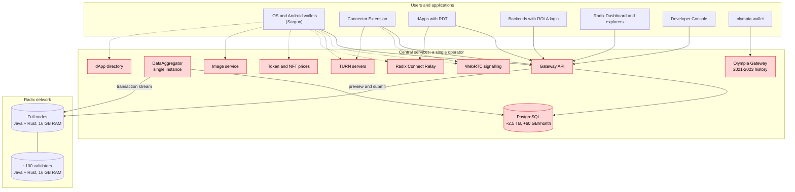
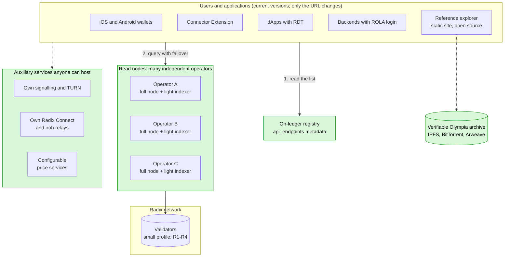
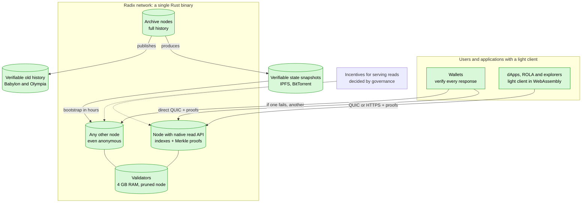
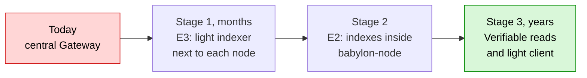
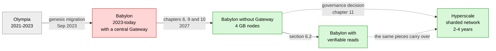

# Radix without central dependencies

English · [Español](README.es.md)

Technical analysis and roadmap for the Radix network to serve all of its users **without depending on the Babylon Gateway**, with **lighter nodes (target: 4-8 GB RAM and 500 GB disk or less)**, and for a possible **evolution towards Hyperscale**. It includes code analysis, measured mainnet data, compared strategies, per-repository changes, an implementation guide and references from other networks.

Report dated 3 November 2026.

## Goals

1. **Remove the Gateway completely**, so that wallets, dApps, ROLA sign-in, explorers and tools work with the network's nodes (and their light indexer), without any central service.
2. **Access to the network that depends on no one:** many independent operators, discovered on ledger and, in the long term, without trusting any node (verifiable reads).
3. **Lighter nodes:** 4-8 GB of RAM and 500 GB of disk or less, so that more people can run them.
4. **Everything on Layer 1**, without Layer-2 solutions.
5. **Preserve Olympia's history** in a verifiable way.
6. **Prepare the final evolution towards Hyperscale**, if the community decides to adopt it.

## Key figures

| | |
|---|---|
| End of Gateway funding | **31 Dec 2026** |
| Gateway database | **~2.5 TB** (estimate), +60 GB/month |
| Mainnet ledger (compressed snapshot, Sep 2026) | **274 GiB**, +5-8 GiB/month |
| Mainnet state versions (Nov 2026) | **~567 million**, ~97-98 % round updates |
| User transactions since genesis | **~10-15 million** (estimate) |
| Capabilities the node already covers without the Gateway | **9 of 19** fully and 2 partly (table 3.2) |
| Proposed light indexer | **~10-50 GB** (estimate) |
| Active validators (3 Nov 2026) | **100** (of 290 registered) |
| XRD holders (3 Nov 2026) | **435,605** |
| Node RAM today → target | **16 GB** (official requirement) → **4-8 GB** (target, estimate) |

## Reading guide

| Profile | Where to start |
|---|---|
| A community member or XRD holder | The summary, the conclusion and the final reflection on this page |
| A node operator or validator | [Chapter 9: lighter nodes (RAM and disk) and the Java to Rust migration](docs/en/09-lighter-nodes.md) |
| A wallet, dApp or tooling developer | [Chapter 7: concrete changes in each repository](docs/en/07-per-repository-changes.md) and [Chapter 10: step-by-step implementation guide](docs/en/10-implementation-guide.md) |
| Governance (RAC, DAO) | The next steps on this page and [Chapter 8: roadmap](docs/en/08-roadmap.md) and [Chapter 11: final evolution towards Hyperscale](docs/en/11-hyperscale-evolution.md) |
| Anyone unsure about a term | [Glossary](docs/en/glossary.md) |
| Anyone wanting to contribute corrections, data or ideas | The [contribution guide](CONTRIBUTING.md) and the [`community/`](community/README.md) folder |

## Documents

- [Scope and chapters 1-2: current situation, who depends on the Gateway, explorers and Olympia](docs/en/01-02-current-situation.md)
- [Chapter 3: what the node offers today and what it lacks](docs/en/03-what-the-node-offers.md)
- [Chapters 4-5: the six strategies evaluated and their comparison](docs/en/04-05-strategies.md)
- [Chapter 6: recommended solution, storage, ideal solution and risks](docs/en/06-recommended-solution.md)
- [Chapter 7: concrete changes in each repository](docs/en/07-per-repository-changes.md)
- [Chapter 8: roadmap](docs/en/08-roadmap.md)
- [Chapter 9: lighter nodes (RAM and disk) and the Java to Rust migration](docs/en/09-lighter-nodes.md)
- [Chapter 10: step-by-step implementation guide](docs/en/10-implementation-guide.md)
- [Chapter 11: final evolution towards Hyperscale](docs/en/11-hyperscale-evolution.md)
- [Chapter 12: references from other decentralised networks](docs/en/12-references-other-networks.md)
- [Sources, methodology and open questions](docs/en/sources-and-methodology.md)
- [Glossary](docs/en/glossary.md)

## Executive summary

1. **The Gateway is currently a single point of failure for the ecosystem.**
   - No official client talks to nodes directly: not the wallets (Sargon), the RDT, ROLA, the Connector Extension or the Dashboard.
   - According to the Foundation, its operation is **funded only until 31 December 2026**, and there is no public plan for afterwards.
2. **Nodes already handle the most common operations directly** (submitting transactions, checking their status, balances, NFTs, metadata, validators), according to the `babylon-node` code: of the 19 capabilities in the table in section [3.2](docs/en/03-what-the-node-offers.md#s3-2), 9 are fully covered and 2 partly. Six main functions are missing, fully or partly (N1-N6, chapter [3](docs/en/03-what-the-node-offers.md#s3)): pre-authorisation status, the location of an NFT, full history, lookup by access rules, historical state and safe public access.
3. **Six strategies were compared.** Based on the measured data, the most suitable combines two (E3 and E2), with E6 (keeping specific applications' data on ledger, such as votes) as a complement:
   - **Short term (E3): a light indexer next to each node**, which replaces the Gateway. The Gateway ceases to exist.
     - So that already-released wallets and dApps keep working without an update, the indexer accepts the same requests those applications send today. Only the **API format (requests and responses)** is kept, not the Gateway software.
     - It would take **about 10-50 GB** (estimate), versus the Gateway's **~2.5 TB**, at almost no cost for anyone who already runs a node.
     - It includes what **transaction explorers** need, and is complemented by an **open-source reference explorer**.
   - **Medium term (E2): build those indexes and a public read mode into the node itself.** Every node in the network becomes an access point.
   - **On-ledger discovery:** applications get the list of access points from validator metadata instead of using a fixed address.
4. **Lighter nodes (chapter [9](docs/en/09-lighter-nodes.md#s9)).**
   - Today a mainnet node reserves 12 GB of memory for Java, runs RocksDB with no memory limits and keeps the full history; the compressed ledger is already 274 GiB.
   - With specific code changes (tuning RocksDB, pruning data used only by APIs, bootstrapping from a verified snapshot and, later, migrating the core from Java to Rust), a validator or full node **could run with at most 8 GB of RAM, and probably 4 GB, with 500 GB of disk or less** (estimates to be confirmed by measuring a real node).
5. **Final evolution towards Hyperscale (chapter [11](docs/en/11-hyperscale-evolution.md#s11)).**
   - Hyperscale is open source, but it is **a new network**: a different virtual machine, different addresses and no Scrypto compatibility. Adopting it means migrating balances and **rewriting applications**.
   - The work would fall to the community. The recommended strategy is a genesis with **verifiable claims** of balances using cryptographic proofs.
   - Its difficulty is **very high**, with an estimated 2-4 year timeline. Meanwhile, Babylon must keep running, so the rest of the plan remains useful.

6. **References from other networks (chapter [12](docs/en/12-references-other-networks.md#s12)).** Cardano, Sui, Aptos, Solana, NEAR, Polkadot, Kaspa, Ethereum and Cosmos already use techniques equivalent to the proposals (verified snapshots, pruning, reads in the node, light clients, rewriting in Rust), which confirms they are feasible. How Midnight implements privacy is also analysed, as a reference for Radix's Layer 1.

The "Conclusion" section below summarises feasibility and difficulty for each goal. Section [9.4](docs/en/09-lighter-nodes.md#s9-4) details each node change, chapter [10](docs/en/10-implementation-guide.md#s10) explains step by step how to build the main pieces, and the [glossary](docs/en/glossary.md) explains technical terms.

## Conclusion

> [!IMPORTANT]
> - **Is it possible?** Yes. The network can serve all of its users and use cases without the Gateway.
> - **Difficulty:** Medium-high (organisation and timeline more than technology).
> - **Effort and timeline:** 7-12 person-months for the minimum viable solution, within months; 21-35 for the full one, during 2027 (estimates).

**Can the Radix network serve all of its users and use cases without depending on the Gateway?** **Yes.**

- No use case needs information that only the Gateway can produce: everything comes from the ledger and the state that nodes already store.
- What is missing is specific indexes and a public access mode on nodes. No protocol or consensus changes are needed.
- Everything is solved on Layer 1, without Layer-2 solutions (see "[Design principle](docs/en/01-02-current-situation.md#scope)" in the Scope).

**Olympia is not an obstacle.** Its state was migrated into the Babylon genesis, so nodes already have it. It adds two tasks (section [2.2](docs/en/01-02-current-situation.md#s2-2) describes four considerations, two of which require no work):

- processing genesis once when building the indexes;
- **archiving Olympia's history as soon as possible**, because it is not in Babylon and currently depends on a single service. This task is **low** difficulty but **urgent**.

**Feasibility and difficulty by goal:**

| Goal | Is it possible? | Difficulty | Estimated effort |
|---|---|---|---|
| dApps, ROLA sign-in, transaction submission and tracking, balances | **Yes** | **Low-medium** | ~1-2 person-months (in the RDT and ROLA: `NodeGatewayApiService`, `ownerKeysReader` and `relayUrl`, sections [7.8](docs/en/07-per-repository-changes.md#s7-8) and [7.9](docs/en/07-per-repository-changes.md#s7-9)) |
| Current wallets working without the Gateway (E3, no new releases) | **Yes** | **Medium** | ~4-7 person-months for the light indexer |
| Full transaction explorers without the Gateway (dedicated indexes and an open-source reference explorer) | **Yes** | **Medium** | ~1-2 person-months of indexes + ~2-3 for the explorer |
| Effective decentralisation: many operators, on-ledger discovery, failover and resubmission in clients | **Yes** | **Medium** | ~3-5 person-months in clients (Sargon, wallets, extension and SDK; excluding the RDT and ROLA) |
| All features inside the node itself (E2), full history and governance snapshots | **Yes** | **High** | ~6-10 person-months in the node + ~4-6 in clients |
| Verifiable archive of Olympia's history | **Yes** (urgent) | **Low** | Weeks |
| Nodes with 4-8 GB RAM and ≤ 500 GB disk, still on Java (R1-R9, chapter [9](docs/en/09-lighter-nodes.md#s9)) | **Yes** (estimate: 8 GB achievable, 4 GB plausible) | **Medium** | ~8-14 person-months |
| Migrating the node core from Java to Rust (R11): enough headroom in 4 GB, including for read nodes | **Yes** | **Very high** | ~30-50 person-months |
| Access without trusting the node: verifiable reads with a light client (section [6.2](docs/en/06-recommended-solution.md#s6-2)) | **Yes** | **Very high** | ~40-80 person-months, several years |
| Migration to Hyperscale as the final evolution (chapter [11](docs/en/11-hyperscale-evolution.md#s11)) | **Yes, with conditions**: the network and funds yes; dApps must be rewritten; not yet production-ready | **Very high** | ~110-210 person-months, 2-4 years, excluding dApps |
| Keeping Scrypto contracts on Hyperscale (section [11.4](docs/en/11-hyperscale-evolution.md#s11-4)) | **No** with Hyperscale's current design | **Very high** if attempted (fork) | Not recommended |

### What to do for each goal: best strategy and technology

This is a technical table: the names of technologies from other networks (Geyser, smoldot, Helios, Leios…) are explained in chapter [12](docs/en/12-references-other-networks.md#s12).

| Goal | What has to be done | Best strategy or technology | Why | Details |
|---|---|---|---|---|
| **Remove the Gateway before its funding ends** | Build and deploy the light indexer next to nodes, with the API format apps already use; conformance tests while the Gateway is still running | **A Rust light indexer next to the node (E3)**, fed by the node's transaction stream, in the style of Geyser (Solana) or Aptos's stream service | It works with current wallets without new releases; ~10-50 GB (estimate) versus ~2.5 TB | [6](docs/en/06-recommended-solution.md#s6), [7.1](docs/en/07-per-repository-changes.md#s7-1), [10.1](docs/en/10-implementation-guide.md#s10-1) |
| **Access that depends on no one** | Many read-node operators; clients find them and fail over between them | **An access-point registry on Layer 1 itself** (validator metadata), plus a bootstrap list and failover in clients, like Kaspa's *Resolver* | Existing federated networks (Koios, Kaspa) coordinate off chain; doing it on Layer 1 removes that dependency too | [10.2](docs/en/10-implementation-guide.md#s10-2) |
| **Explorers without the Gateway** | Holder, statistics and search indexes; an open-source explorer | **The light indexer's indexes h, i and j + a static explorer** publishable on any hosting or IPFS | It depends on no server of its own; the official Dashboard is not open source | [2.1](docs/en/01-02-current-situation.md#s2-1), [7.16](docs/en/07-per-repository-changes.md#s7-16) |
| **Preserve Olympia's history** | Export it once and publish it | **A verifiable archive** (Merkle root signed by several people) on IPFS, BitTorrent or Arweave | It is frozen: it needs no indexer, only preservation | [2.2](docs/en/01-02-current-situation.md#s2-2), [10.5](docs/en/10-implementation-guide.md#s10-5) |
| **Build reads into the node itself** | Optional indexes and a public read mode in `babylon-node` | **A native read API in the node (E2)**, like Kaspa (wRPC) or Sui (gRPC in the full node) | Every node becomes an access point, with no separate process | [7.2](docs/en/07-per-repository-changes.md#s7-2), [10.3](docs/en/10-implementation-guide.md#s10-3) |
| **Reduce RAM to 8 GB or less (and probably to 4 GB)** | Cap RocksDB memory, reduce the Java heap and the mempool | **R1 + R2:** shared block cache, index and filter blocks inside the cache and a Write Buffer Manager, per the official RocksDB documentation; a 4 GB installer profile | Radix's state is already on disk; current consumption comes from configuration | [9.2](docs/en/09-lighter-nodes.md#s9-2), [9.4](docs/en/09-lighter-nodes.md#s9-4) |
| **Keep disk under 500 GB** | Stop storing what only APIs use; prune history on nodes that do not need it | **R3-R7 and pruned nodes (R8)**, with separate archive nodes, like the default pruning of Polkadot, Kaspa or Cosmos and Ethereum's history expiry | ~97-98 % of state versions are round updates, and most of their data is used only by APIs | [9.3](docs/en/09-lighter-nodes.md#s9-3), [9.4](docs/en/09-lighter-nodes.md#s9-4) |
| **Bootstrap new nodes in hours without trusting third parties** | Export and import state, verifying it against the signed root | **A verified end-of-epoch snapshot (R9)**, like Sui's formal snapshots or Polkadot's warp sync | Babylon already signs `state_tree_hash` in its proofs; it is the standard technique in modern networks | [9.4](docs/en/09-lighter-nodes.md#s9-4) (R9), [12.9](docs/en/12-references-other-networks.md#s12-9) |
| **Comfortable headroom in 4 GB and a simpler node** | Replace the Java part of the node with Rust | **A phased migration coexisting on the network (R11)**, as Kaspa did moving from Go to Rust | It removes the JVM and the JNI bridge; risk is contained by gradual adoption | [9.4](docs/en/09-lighter-nodes.md#s9-4) (R11) |
| **Not having to trust any node** | A Merkle-proof endpoint in the node and a light client in wallets and browsers | **Verifiable reads with a Rust light client compiled to WebAssembly**, like smoldot (Polkadot) or Helios (Ethereum) | It is the strongest guarantee: the wallet checks every response | [6.2](docs/en/06-recommended-solution.md#s6-2), [10.6](docs/en/10-implementation-guide.md#s10-6) |
| **Final evolution with Hyperscale** | Prepare Hyperscale for mainnet, read API, wallets, balance migration and dApp rewrites | **Genesis with verifiable claims (M1)**: a Merkle proof against Babylon's final root plus a signature, with a long window and support for securified accounts, combining the `MerkleDistributor` contract and Midnight's Glacier Drop | It requires no trust in a bridge and leaves no one out; first, compare with improving Babylon on its own chain, as Cardano does with Leios | [11](docs/en/11-hyperscale-evolution.md#s11), [12.1](docs/en/12-references-other-networks.md#s12-1), [12.8](docs/en/12-references-other-networks.md#s12-8) |
| **Scrypto contracts on Hyperscale** | Rewrite them with the Hyperscale SDK | **Rewriting assisted by translation tools**, taking advantage of both using Rust and similar concepts | Keeping Scrypto is not possible with Hyperscale's current design | [11.4](docs/en/11-hyperscale-evolution.md#s11-4) |
| **Privacy on Layer 1** (optional) | ZK proof verification in the engine and shielded resources | **A native ZK proof-verification primitive** in the Radix Engine (for example Halo2, like Midnight) and shielded resources | It keeps the Layer-1 principle, without a separate network | [12.8](docs/en/12-references-other-networks.md#s12-8) |

**Overall difficulty of removing the Gateway: medium-high.** The main difficulty is organisational rather than technical:

- **Coordination:** the Foundation is in maintenance mode. Changes to the node, Sargon and the wallets depend on community developers and governance (DAO / RAC).
- **Timeline:** Gateway funding ends on 31 December 2026.
- **Funding:** a small team would need roughly **7-12 person-months** for the minimum viable solution (light indexer, explorer indexes and reference explorer), and **21-35** to remove the Gateway with every feature (the sum of the first five rows of the table).

**Recommended short-term solution:** the **light indexer next to each node (E3)**, which replaces the Gateway, followed by integrating it into `babylon-node` (E2) and on-ledger discovery. The measured data supports it:

- it takes ~10-50 GB (estimate), versus ~2.5 TB;
- its cost per operator is close to zero (estimate), versus the ~€300-400/month a community proposal estimated for running the Gateway (section [1.1](docs/en/01-02-current-situation.md#s1-1));
- it works with current wallets without new releases;
- it is the only option that can be ready before funding ends.

**Is it possible?** Yes. **Technical difficulty:** medium.

**4-8 GB / 500 GB nodes** (chapter [9](docs/en/09-lighter-nodes.md#s9)). **Is it possible?** Yes: with R1-R2, a node of at most 8 GB looks achievable, and 4 GB is plausible (estimates to be measured). Radix is better placed than other networks because its state is already on disk, its validator set is small and its load is low (section [12.9](docs/en/12-references-other-networks.md#s12-9)). **Difficulty:** medium while on Java (R1-R9); very high for comfortable headroom (R11).

- **R1-R2:** remove the main cause of today's 16 GB (unbounded RocksDB and 12 GB reserved for Java); **R3-R4** reduce disk. All four are low cost (weeks). **Difficulty: low.**
- **R5-R9:** pruning and bootstrapping from a verified snapshot keep disk under 500 GB even as the network grows. **Difficulty: low-medium to medium** (R9, medium-high).
- **R11:** migrating to Rust provides enough headroom for the read nodes that replace the Gateway to run in 4 GB as well. **Difficulty: very high.**

**Ideal long-term solution.** **Is it possible?** Yes. **Difficulty:** very high. Any node serves **verifiable** reads, and every wallet includes a light client that checks each response (section [6.2](docs/en/06-recommended-solution.md#s6-2)). Then no node needs to be trusted.

- Babylon already signs the Merkle roots of state, transactions and receipts; what is missing is exposing those proofs and verifying them in clients.
- It is the end goal within Babylon. Its difficulty is **very high** (several years), and the short-term solution is its first stage.

**Final evolution with Hyperscale** (chapter [11](docs/en/11-hyperscale-evolution.md#s11)). **Is it possible?** Yes, with conditions. **Difficulty:** very high.

- **Is it possible to migrate Radix using the Hyperscale code? Yes, with conditions.** The network and funds can migrate; Scrypto contracts and dApps cannot, because they must be rewritten. With the current code, still in development, it is not yet possible in production.
- **Can Scrypto be kept with Hyperscale?** Not with the current design: Hyperscale lists Scrypto compatibility as a non-goal. The Hyperscale SDK also uses Rust and `#[blueprint]` and has similar concepts (resources, badges, virtual accounts), which makes rewriting contracts easier, but they do have to be rewritten (section [11.4](docs/en/11-hyperscale-evolution.md#s11-4)).
- It is a migration to a new network, not an upgrade.
- The community would have to:
  - prepare Hyperscale for mainnet;
  - build its read API and indexer;
  - adapt Sargon and the wallets;
  - migrate balances through verifiable claims;
  - and each project would have to rewrite its contracts.
- The pieces proposed in this report (light indexer, on-ledger discovery, verified snapshots, Merkle proofs and the `LedgerBackend` interface) are also needed for that migration.
- Recommendation: governance should first decide whether to adopt Hyperscale. Until then, apply R1-R9 and **postpone R11**.

**Still to validate with a prototype:**

- the real size of the indexes;
- indexing speed from genesis;
- exact compatibility of responses with what wallets expect;
- the real per-table ledger size on a mainnet node.

## Next steps and governance decisions

### Who can do what, starting now

| Who | Action | When | How to contribute it |
|---|---|---|---|
| Node operators | Publish per-column-family size (`raw_db_size` metrics) and the real RAM use (RSS) of a mainnet node | As soon as possible | "Data or measurement" issue template |
| Node operators | Test the reduced-memory profile (R2) and RocksDB settings (R1) on Stokenet | Nov-Dec 2026 | "Data or measurement" template |
| Developers | Build the light-indexer prototype (section [7.1](docs/en/07-per-repository-changes.md#s7-1)) and record real Gateway responses for conformance tests **while it is still running** | Before 31 Dec 2026 | Pull requests linking the prototype |
| Developers | Implement the `LedgerBackend` interface in Sargon and failover in the RDT and ROLA (section [10.4](docs/en/10-implementation-guide.md#s10-4)) | 2027 | Pull requests in the affected repositories |
| Community | Export, seal and replicate the Olympia archive (section [10.5](docs/en/10-implementation-guide.md#s10-5)) | Before the Olympia Gateway is switched off | Notes in `community/` |
| Validators | Publish their access points in the `api_endpoints` metadata (section [10.2](docs/en/10-implementation-guide.md#s10-2)) once read nodes exist | When the indexer exists | — |

### Decisions that belong to governance

| Decision | Deadline | Information needed | Where |
|---|---|---|---|
| Fund the minimum viable solution (7-12 person-months, estimate) | Before 31 Dec 2026 | This report; team proposals | Conclusion, chapter [6](docs/en/06-recommended-solution.md#s6) |
| Prioritise the critical subset if the full replacement is not ready in time | Before 31 Dec 2026 | Prototype status | Section [6.3](docs/en/06-recommended-solution.md#s6-3) |
| Who produces and signs the Olympia archive | As soon as possible | Availability of a copy of its database | Section [2.2](docs/en/01-02-current-situation.md#s2-2) |
| Adopt `api_endpoints` as the discovery convention | 2027 | Indexer prototype | Section [10.2](docs/en/10-implementation-guide.md#s10-2) |
| Incentives for read nodes, paid on Layer 1 | 2027 | Number of volunteer operators | Sections [6.2](docs/en/06-recommended-solution.md#s6-2) and [12.1](docs/en/12-references-other-networks.md#s12-1) |
| Request publication of the Dashboard and Developer Console source code | As soon as possible | — | Section [7.16](docs/en/07-per-repository-changes.md#s7-16) |
| Vote on protocol update R10 | When ready | Stokenet tests | Section [9.4](docs/en/09-lighter-nodes.md#s9-4) |
| Adopt Hyperscale or keep improving Babylon on its own chain; depending on the outcome, start or postpone R11 | 2027 | Hyperscale maturity; available team | Chapters [11](docs/en/11-hyperscale-evolution.md#s11) and [12](docs/en/12-references-other-networks.md#s12) |

## Infrastructure and evolution in diagrams

### Current infrastructure

In red, services that depend on a single operator.

### Short-term infrastructure: no Gateway

### Long-term infrastructure: the ideal solution

### Stages towards the ideal solution

### Evolution of Radix

## Final reflection

**The question is no longer whether it is possible.** The analysis shows that every goal is technically feasible, and that the most urgent work (removing the Gateway and lightening nodes) does not require changing consensus. The real question is a different one: **does Radix have developers with the necessary capability, and a community committed enough, to carry it out?**

The report's data makes it possible to state what each side requires:

- **Technical capability.**
  - The most urgent work (light indexer and node tuning) needs Rust and database profiles, with bounded effort: 7-12 person-months for the minimum viable solution.
  - The most ambitious work (moving consensus to Rust, verifiable reads, Hyperscale) needs consensus and cryptography specialists, who are scarce in the ecosystem today:
    - `hyperscale-rs` depends almost entirely on a single developer;
    - according to the Foundation itself, its in-house team works with around 10 % of the resources it had before its restructuring ([2026 Strategy](https://www.radixdlt.com/blog/2026-strategy-the-next-chapter-of-radix)).
- **Community commitment.** It requires:
  - operators who run read and archive nodes;
  - funding decided by governance;
  - timely decisions, before 31 Dec 2026;
  - and contributions such as those this repository enables.

  There are signs in both directions:
  - **in favour:** the community has run Stokenet since June 2026 (according to [radix.wiki](https://radix.wiki/ecosystem/radix-accountability-council), a secondary source), and XRD holder consultations have drawn over one billion XRD ([Foundation Update](https://www.radixdlt.com/blog/foundation-update-moving-to-maintenance-mode));
  - **against:** of the six milestones proposed for `hyperscale-rs`, only the first was funded, because the DAO treasury was not yet available (according to [radix.wiki](https://radix.wiki/contents/tech/releases/radix-mainnet-xian), a secondary source; [original RFC](https://radixtalk.com/t/rfc-xian-delivering-hyperscale-for-radix/2280)).
- **Precedents.** Other communities have done it: Kaspa rewrote its node in Rust, and the Cardano community maintains Koios with independent operators (chapter [12](docs/en/12-references-other-networks.md#s12)).

**Technology is not the obstacle.** The outcome will depend on whether the Radix community decides to prioritise this work, gathers the necessary talent and funds it in time. This report aims to make that decision easier, and is itself an invitation to contribute.

## How to contribute

This repository is open source and the community can improve it through issues and pull requests:

- **Corrections** to figures, references, links or translations.
- Real **data and measurements** (ledger size, RAM, sync times), with method and date.
- **New strategies** or alternatives to the report's proposals.
- **Community ideas and notes** in the [`community/`](community/README.md) folder.
- **Links to prototypes** or implementations that advance a proposal.

The [contribution guide](CONTRIBUTING.md) explains how, and the quality rules: always cite sources, mark estimates and keep both languages in sync.

> Figures marked as *estimate* must be validated with a prototype or a real measurement.

## Licence

This work is published under the [Creative Commons Attribution 4.0 International licence (CC BY 4.0)](LICENSE): it may be copied, adapted and redistributed, including commercially, with attribution.
