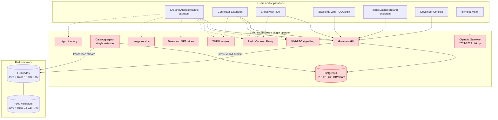
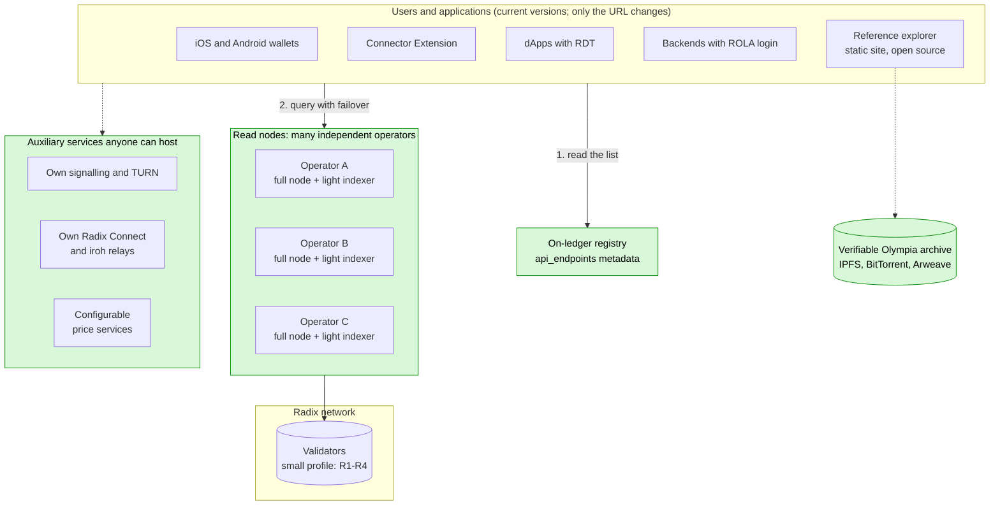
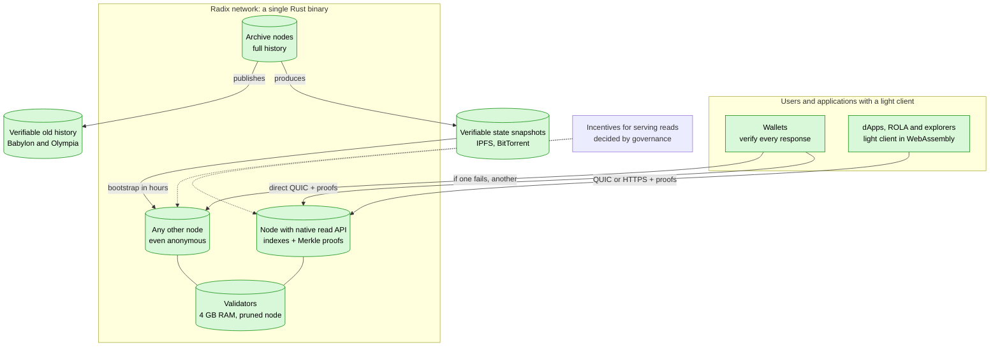

# Radix without the Gateway

🇬🇧 English · [🇪🇸 Español](README.es.md)

How to make the Radix network work for everything and for everyone **without the Babylon Gateway**: code analysis, measured mainnet data, compared strategies and per-repository changes.

Report dated 3 November 2026.

### Current infrastructure

### Short-term infrastructure: no Gateway

### Long-term infrastructure: the ideal solution

## Executive summary

1. **Today the Gateway is a single point of failure for the whole ecosystem.**
   - No official client can talk to a node. That covers the wallets, Sargon, the RDT, ROLA, the extension and the Dashboard.
   - According to the Foundation, its operation is **pre-funded only until December 2026**, two months from now. There is no public plan for after that.
2. **The node already serves ~80-85 % of use cases directly.** I verified this in the `babylon-node` code. Six capabilities are missing (N1-N6, section 3).
3. **I evaluated six strategies.** Based on the measured data, the best is **E3 + E2**:
   - **E3 (short term): a lightweight indexer running next to each node** (a sidecar). **It replaces the Gateway**: the Gateway is switched off and runs nowhere. So that already-released wallets and dApps work without an update, the indexer answers the same routes, with the same JSON, that those apps already know how to request. Only that **request format** is reused, not the Gateway software.
     - Estimated **~10-50 GB**, versus the Gateway's **~2.5 TB**.
     - A node operator can deploy it at near-zero marginal cost.
     - **Current wallets and the RDT can use it without a new release**, because they already accept a custom Gateway URL.
     - It includes the indexes that **transaction explorers** need: history of any entity, resource holders, NFT location, statistics and search.
     - It is completed by an **open-source reference explorer**, because the Radix Dashboard is not public.
   - **E2 (medium term): move those indexes and a "public read mode" into `babylon-node` itself.** Every node then becomes an access point.
   - **On-ledger discovery:** clients find access points in validator metadata instead of a hard-coded URL.
4. **Conclusion: it is possible. Overall difficulty is medium-high.**
   - **Low-medium** for dApps, ROLA and transactions.
   - **Medium** for wallets with reduced history, and for full transaction explorers (E3 plus an open-source explorer).
   - **High** for full parity: filtered history, NFT location and historical snapshots.

5. **Lighter nodes (section 9):** today a mainnet node defaults to 12 GB of Java memory, runs RocksDB with no memory limits, and keeps the full history forever: the compressed snapshot is already 274 GiB. With concrete code changes (tuning RocksDB, pruning data used only by APIs, bootstrapping from a verified snapshot and, in the long run, migrating the core from Java to Rust), a validator or full node **can run on 4 GB of RAM and under 500 GB of disk**.

   Details in the "Conclusion" section right below. Section 10 explains step by step how to make each change.

## Conclusion

**Is it possible for Radix to work for everything and for everyone without the Gateway?** **Yes, it is possible.**

- No use case needs anything that only the Gateway can produce. Everything derives from the node's transaction stream and state.
- The network already has almost everything in the node. What is missing is specific indexes and a public access mode, not protocol or consensus changes.

**Olympia is not an obstacle** to the goal. Its state was migrated into the Babylon genesis, so the node already has it. It adds only two tasks: process genesis when indexing (once), and **archive Olympia's history now**, because it is not in Babylon and today depends on a single service. The second task is **low** difficulty but **urgent**.

**Difficulty by goal:**

| Goal | Difficulty | Estimate |
|---|---|---|
| dApps, ROLA login, transaction submit and tracking, balances (with E3, or with the node plus small RDT and ROLA changes) | **Low-medium** | ~1-2 person-months |
| Today's wallets working without the Gateway (E3, no new releases) | **Medium** | ~4-7 person-months for the light indexer |
| Full transaction explorers without the Gateway (indexes h, i, j and an open-source reference explorer) | **Medium** | ~1-2 person-months of indexes + ~2-3 person-months of explorer |
| Real decentralisation: many operators, on-ledger discovery, failover and resubmission in clients | **Medium** | ~3-5 person-months in clients |
| Full parity inside the node (E2), full history and governance snapshots | **High** | ~6-10 person-months in the node + ~4-6 in clients |
| Trustless access: verifiable reads with a light client (section 6.2) | **Very high** | ~40-80 more person-months, years |
| Nodes with 4 GB RAM and ≤ 500 GB disk while still on Java: RocksDB and memory tuning, pruning API-only data, verified snapshot bootstrap (R1-R9, section 9) | **Medium** | ~8-14 person-months |
| Migrating the node core from Java to Rust (R11): comfortable headroom in 4 GB, even for read nodes | **Very high** | ~30-50 person-months |

**Overall difficulty: medium-high.** The hard part is not the technology. It is three organisational factors:

- **Coordination:** the Foundation is in maintenance mode. Node, Sargon and wallet changes depend on community developers and governance (DAO / RAC).
- **Time:** Gateway funding ends on 31 Dec 2026.
- **Funding** for a small team, roughly **18-30 person-months** for the full path including explorers, or **7-10** for the minimum viable path (E3 plus the reference explorer).

**Best short-term solution:** the **lightweight indexer next to each node (E3)**, which replaces the Gateway. It is followed by moving it into `babylon-node` (E2) and on-ledger discovery. With unlimited time, the ideal solution is the one in section 6.2: **verifiable** reads with cryptographic proofs. The reasons, from the measured data:

- It needs ~10-50 GB (estimated), versus ~2.5 TB.
- Its cost per operator is near zero, versus ~€300-500/month.
- It works with today's wallets without new releases.
- It is the only path viable before funding ends.

**4 GB / 500 GB nodes: yes, it is possible** (section 9). Changes R1-R4 are cheap (weeks) and remove the main reason for the 16 GB: unbounded RocksDB and 12 GB reserved for Java. Pruning and bootstrapping from a verified snapshot (R5-R9) keep disk under 500 GB even as the network keeps growing. Migrating to Rust (R11) gives comfortable headroom and lets the read nodes that replace the Gateway fit in 4 GB as well.

**Best solution with unlimited time:** every node serves **verifiable** reads, and every wallet carries a light client that checks each response (section 6.2). Then there is no need to trust even the node. Babylon already signs Merkle roots of state, transactions and receipts; what is missing is exposing the proofs and verifying them in clients. It is the end goal, with **very high** difficulty (years), and the short-term solution is the first stage towards it.

**To validate with a prototype:**

- the real size of the indexes;
- ingestion speed from genesis;
- exact response conformance with what the wallets expect.

### Stages towards the ideal solution

## Documents

1. [Sections 1-2: current situation, who depends on the Gateway, explorers and Olympia](docs/en/01-current-situation.md)
2. [Section 3: what the node offers today and what it lacks](docs/en/02-what-the-node-offers.md)
3. [Sections 4-5: the six strategies evaluated and their data-driven comparison](docs/en/03-strategies.md)
4. [Section 6: recommended solution, storage, and the ideal long-term solution](docs/en/04-recommended-solution.md)
5. [Section 7: concrete changes in each repository](docs/en/05-per-repository-changes.md)
6. [Section 8: roadmap](docs/en/06-roadmap.md)
7. [Section 9: lighter nodes, 4 GB RAM and 500 GB disk, Java to Rust migration](docs/en/07-lighter-nodes.md)
8. [Section 10: step-by-step implementation guide](docs/en/08-implementation-guide.md)
9. [Sources and methodology](docs/en/09-sources.md)

> Figures marked as *estimate* must be validated with a prototype. Corrections and contributions are welcome via issues or pull requests.
