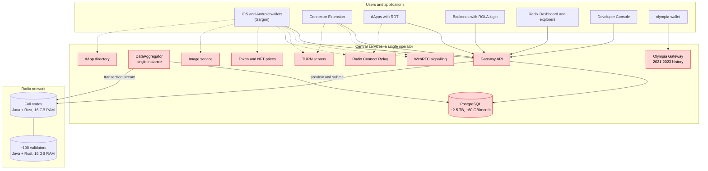
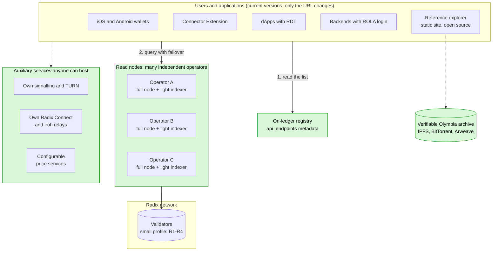
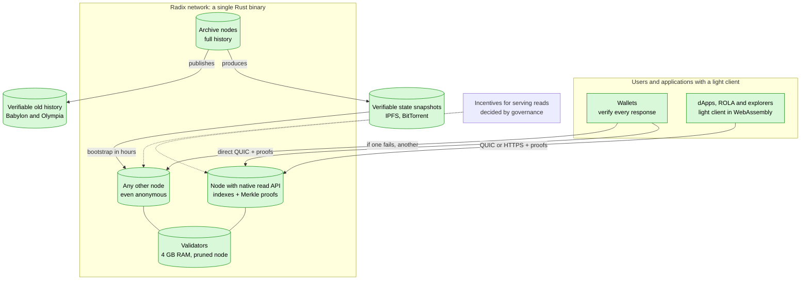
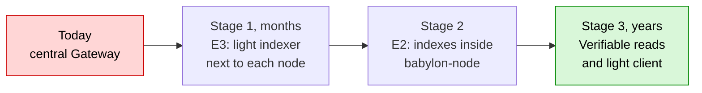
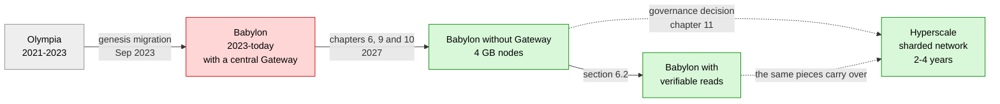

# Radix without central dependencies

English · [Español](README.es.md)

Technical analysis and roadmap for the Radix network to serve all of its users **without depending on the Babylon Gateway**, with **4 GB RAM / 500 GB disk nodes**, and for a possible **evolution towards Hyperscale**. It includes code analysis, measured mainnet data, compared strategies, per-repository changes and an implementation guide.

Report dated 3 November 2026.

### Key figures

| | |
|---|---|
| End of Gateway funding | **31 Dec 2026** |
| Gateway database | **~2.5 TB**, +60 GB/month |
| Mainnet ledger (compressed snapshot, Sep 2026) | **274 GiB**, +5-8 GiB/month |
| Mainnet state versions (Nov 2026) | **~567 million**, ~97-98 % round updates |
| User transactions since genesis | **~10-15 million** (estimated) |
| Use cases the node already serves without the Gateway | **~80-85 %** (estimated) |
| Proposed light indexer | **~10-50 GB** (estimated) |
| Node RAM today → target | **16 GB → 4 GB** |

### Reading guide

| If you are… | Read first |
|---|---|
| A community member or XRD holder | This summary, the conclusion and the infrastructure diagrams |
| A node operator or validator | [Chapter 9: lighter nodes](docs/en/07-lighter-nodes.md) |
| A wallet, dApp or tooling developer | [Chapter 7: per-repository changes](docs/en/05-per-repository-changes.md) and [chapter 10: implementation guide](docs/en/08-implementation-guide.md) |
| Governance (RAC, DAO) | The conclusion, the [roadmap](docs/en/06-roadmap.md) and [chapter 11: evolution to Hyperscale](docs/en/09-hyperscale-evolution.md) |
| Anyone unsure about a term | The [glossary](docs/en/11-glossary.md) |

## Executive summary

1. **The Gateway is currently a single point of failure for the ecosystem.**
   - No official client talks to nodes directly: not the wallets (Sargon), the RDT, ROLA, the Connector Extension or the Dashboard.
   - According to the Foundation, its operation is **funded only until 31 December 2026**, and there is no public plan for afterwards.
2. **Nodes already cover 80-85 % of use cases directly** (an estimate based on the inventory in section 2), according to the `babylon-node` code. Six main capabilities are missing (N1-N6, section 3), plus some minor ones (N7-N9, section 7.2).
3. **Six strategies were compared.** Based on the measured data, the most suitable combines two (E3 and E2):
   - **Short term (E3): a light indexer next to each node**, which replaces the Gateway. The Gateway ceases to exist.
     - So that already-released wallets and dApps keep working without an update, the indexer accepts the same requests those applications send today. Only the **API format (requests and responses)** is kept, not the Gateway software.
     - It would take **about 10-50 GB** (estimate), versus the Gateway's **~2.5 TB**, at almost no cost for anyone who already runs a node.
     - It includes what **transaction explorers** need, and is complemented by an **open-source reference explorer**.
   - **Medium term (E2): build those indexes and a public read mode into the node itself.** Every node in the network becomes an access point.
   - **On-ledger discovery:** applications get the list of access points from validator metadata instead of using a fixed address.
4. **Lighter nodes (section 9).**
   - Today a mainnet node reserves 12 GB of memory for Java, runs RocksDB with no memory limits and keeps the full history; the compressed ledger is already 274 GiB.
   - With specific code changes (tuning RocksDB, pruning data used only by APIs, bootstrapping from a verified snapshot and, later, migrating the core from Java to Rust), a validator or full node **can run with 4 GB of RAM and under 500 GB of disk**.
5. **Final evolution towards Hyperscale (section 11).**
   - Hyperscale is open source, but it is **a new network**: a different virtual machine, different addresses and no Scrypto compatibility. Adopting it means migrating balances and **rewriting applications**.
   - The work would fall to the community. The recommended strategy is a genesis with **verifiable claims** of balances using cryptographic proofs.
   - Its difficulty is **very high**, with an estimated 2-4 year timeline. Meanwhile, Babylon must keep running, so the rest of the plan remains useful.

The "Conclusion" section below summarises feasibility and difficulty for each goal. Section 9.4 details each node change, section 10 explains step by step how to build the main pieces, and the glossary at the end explains technical terms.

## Conclusion

> [!IMPORTANT]
> - **Is it possible?** Yes. The network can serve all of its users and use cases without the Gateway.
> - **Difficulty:** Medium-high (organisation and timeline more than technology).
> - **Effort and timeline:** 6-10 person-months for the minimum viable solution; 20-35 for the full one (estimates).

**Can the Radix network serve all of its users and use cases without depending on the Gateway?** **Yes.**

- No use case needs information that only the Gateway can produce: everything comes from the ledger and the state that nodes already store.
- What is missing is specific indexes and a public access mode on nodes. No protocol or consensus changes are needed.

**Olympia is not an obstacle.** Its state was migrated into the Babylon genesis, so nodes already have it. It adds two tasks (section 2.2 describes four considerations, two of which require no work):

- processing genesis once when building the indexes;
- **archiving Olympia's history as soon as possible**, because it is not in Babylon and currently depends on a single service. This task is **low** difficulty but **urgent**.

**Feasibility and difficulty by goal:**

| Goal | Is it possible? | Difficulty | Estimated effort |
|---|---|---|---|
| dApps, ROLA sign-in, transaction submission and tracking, balances | **Yes** | **Low-medium** | ~1-2 person-months |
| Current wallets working without the Gateway (E3, no new releases) | **Yes** | **Medium** | ~4-7 person-months for the light indexer |
| Full transaction explorers without the Gateway (dedicated indexes and an open-source reference explorer) | **Yes** | **Medium** | ~1-2 person-months of indexes + ~2-3 for the explorer |
| Effective decentralisation: many operators, on-ledger discovery, failover and resubmission in clients | **Yes** | **Medium** | ~3-5 person-months in clients |
| All features inside the node itself (E2), full history and governance snapshots | **Yes** | **High** | ~6-10 person-months in the node + ~4-6 in clients |
| Verifiable archive of Olympia's history | **Yes** (urgent) | **Low** | Weeks |
| Nodes with 4 GB RAM and ≤ 500 GB disk, still on Java (R1-R9, section 9) | **Yes** | **Medium** | ~8-14 person-months |
| Migrating the node core from Java to Rust (R11): enough headroom in 4 GB, including for read nodes | **Yes** | **Very high** | ~30-50 person-months |
| Access without trusting the node: verifiable reads with a light client (section 6.2) | **Yes** | **Very high** | ~40-80 person-months, several years |
| Migration to Hyperscale as the final evolution (section 11) | **Yes, with conditions**: the network and funds yes; dApps must be rewritten; not yet production-ready | **Very high** | ~110-210 person-months, 2-4 years, excluding dApps |
| Keeping Scrypto contracts on Hyperscale (section 11.4) | **No** with Hyperscale's current design | **Very high** if attempted (fork) | Not recommended |

**Overall difficulty of removing the Gateway: medium-high.** The main difficulty is organisational rather than technical:

- **Coordination:** the Foundation is in maintenance mode. Changes to the node, Sargon and the wallets depend on community developers and governance (DAO / RAC).
- **Timeline:** Gateway funding ends on 31 December 2026.
- **Funding:** a small team would need roughly **6-10 person-months** for the minimum viable solution (light indexer and reference explorer), and **20-35** to remove the Gateway with every feature (the sum of the first five rows of the table).

**Recommended short-term solution:** the **light indexer next to each node (E3)**, which replaces the Gateway, followed by integrating it into `babylon-node` (E2) and on-ledger discovery. The measured data supports it:

- it takes ~10-50 GB (estimate), versus ~2.5 TB;
- its cost per operator is close to zero (estimate), versus the ~€300-400/month it costs to run the Gateway;
- it works with current wallets without new releases;
- it is the only option that can be ready before funding ends.

**Is it possible?** Yes. **Difficulty:** medium.

**4 GB / 500 GB nodes** (section 9). **Is it possible?** Yes. **Difficulty:** medium while on Java (R1-R9); very high for comfortable headroom (R11).

- **R1-R2:** remove the main cause of today's 16 GB (unbounded RocksDB and 12 GB reserved for Java); **R3-R4** reduce disk. All four are low cost (weeks). **Difficulty: low.**
- **R5-R9:** pruning and bootstrapping from a verified snapshot keep disk under 500 GB even as the network grows. **Difficulty: medium** (R9, medium-high).
- **R11:** migrating to Rust provides enough headroom for the read nodes that replace the Gateway to run in 4 GB as well. **Difficulty: very high.**

**Ideal long-term solution.** **Is it possible?** Yes. **Difficulty:** very high. Any node serves **verifiable** reads, and every wallet includes a light client that checks each response (section 6.2). Then no node needs to be trusted.

- Babylon already signs the Merkle roots of state, transactions and receipts; what is missing is exposing those proofs and verifying them in clients.
- It is the end goal within Babylon. Its difficulty is **very high** (several years), and the short-term solution is its first stage.

**Final evolution with Hyperscale** (section 11). **Is it possible?** Yes, with conditions. **Difficulty:** very high.

- **Is it possible to migrate Radix using the Hyperscale code? Yes, with conditions.** The network and funds can migrate; Scrypto contracts and dApps cannot, because they must be rewritten. With the current code, still in development, it is not yet possible in production.
- **Can Scrypto be kept with Hyperscale?** Not with the current design: Hyperscale lists Scrypto compatibility as a non-goal. The Hyperscale SDK also uses Rust and `#[blueprint]` and has similar concepts (resources, badges, virtual accounts), which makes rewriting contracts easier, but they do have to be rewritten (section 11.4).
- It is a migration to a new network, not an upgrade.
- The community would have to:
  - prepare Hyperscale for mainnet;
  - build its read API and indexer;
  - adapt Sargon and the wallets;
  - migrate balances through verifiable claims;
  - and each project would have to rewrite its contracts.
- The pieces proposed in this report (light indexer, on-ledger discovery, verified snapshots, Merkle proofs and the `LedgerBackend` interface) are also needed for that migration.
- Recommendation: governance should first decide whether to adopt Hyperscale. Until then, apply R1-R9 and **postpone R11**.

**Still to validate with a prototype:**

- the real size of the indexes;
- indexing speed from genesis;
- exact compatibility of responses with what wallets expect;
- the real per-table ledger size on a mainnet node.

## Infrastructure and evolution in diagrams

### Current infrastructure

### Short-term infrastructure: no Gateway

### Long-term infrastructure: the ideal solution

### Stages towards the ideal solution

### Evolution of Radix

## Documents

1. [Sections 1-2: current situation, who depends on the Gateway, explorers and Olympia](docs/en/01-current-situation.md)
2. [Section 3: what the node offers today and what it lacks](docs/en/02-what-the-node-offers.md)
3. [Sections 4-5: the six strategies evaluated and their data-driven comparison](docs/en/03-strategies.md)
4. [Section 6: recommended solution, storage, and the ideal long-term solution](docs/en/04-recommended-solution.md)
5. [Section 7: concrete changes in each repository](docs/en/05-per-repository-changes.md)
6. [Section 8: roadmap](docs/en/06-roadmap.md)
7. [Section 9: lighter nodes, 4 GB RAM and 500 GB disk, Java to Rust migration](docs/en/07-lighter-nodes.md)
8. [Section 10: step-by-step implementation guide](docs/en/08-implementation-guide.md)
9. [Section 11: final evolution towards Hyperscale and migration](docs/en/09-hyperscale-evolution.md)
10. [Sources and methodology](docs/en/10-sources.md)
11. [Glossary](docs/en/11-glossary.md)

> Figures marked as *estimate* must be validated with a prototype. Corrections and contributions are welcome via issues or pull requests.
