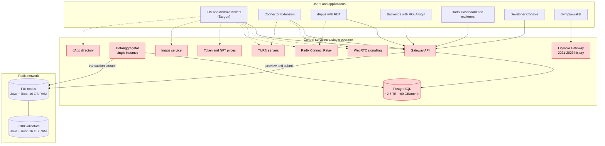
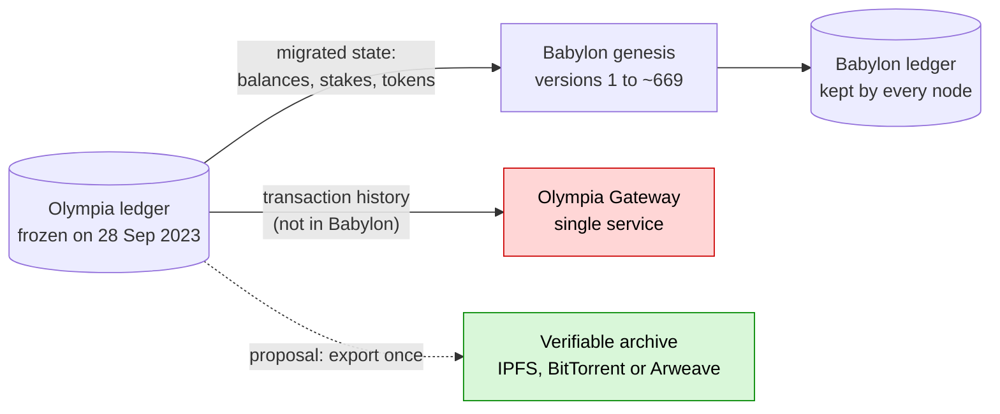

[← Index](../../README.md) · [Next: Section 3: what the node offers today and what it lacks](02-what-the-node-offers.md)

# Scope

**Goal.** The Radix Babylon network should serve **any user, in any use case**, without depending on the Babylon Network Gateway: the REST + DataAggregator + PostgreSQL service published today at `mainnet.radixdlt.com`. The use cases are:

- wallets;
- dApps;
- ROLA login;
- transaction explorers;
- governance;
- agents;
- developer tools.

**Design principle: everything on Layer 1.** Radix's goal is to scale and deliver all its features on Layer 1, without Layer-2 solutions (rollups, sidechains or partner chains). Every proposal in this report respects that principle:

- The light indexer, read nodes and access-point discovery are infrastructure for **reading** Layer-1 state. They do not execute transactions or keep any state of their own that the network has to trust.
- Pruning, verified snapshots, the migration to Rust and verifiable reads are changes to Layer-1 node software.
- Incentives for serving reads would be paid on Layer 1 itself (for example, through an on-ledger component), as governance decides.
- Hyperscale scales **on Layer 1 itself**, through sharding with atomic composability, which is consistent with that goal.
- The bridge in strategy M2 would only connect two Layer-1 networks during the transition, and it is optional.

References to Layer-2 or partner-chain mechanisms in other networks (chapter 12) are included only as a contrast, not as a model.

**Repositories analysed.**

- **Local:**
  - `babylon-wallet-android` and its forks;
  - `radix-dapp-toolkit`;
  - `connector-extension` and `connector-extension-iroh`;
  - `radix-connect-iroh` and `radix-connect-webrtc`;
  - `radixdlt-rust-sdk`;
  - `consultation_v2` and `consultation_v3`;
  - `governance-framework`;
  - `wallet-agent-ai`;
  - `Radix-Desktop-Tool`;
  - `olympia-wallet`;
  - `wallet-compatible-derivation`;
  - `reference/hyperscale-rs`.
- **Cloned from GitHub** (not present on this machine):
  - `radixdlt/babylon-node`;
  - `radixdlt/babylon-gateway`;
  - `radixdlt/sargon`;
  - `radixdlt/babylon-wallet-ios`;
  - `radixdlt/rola`;
  - `radixdlt/babylon-nodecli`;
  - `radixdlt/explorer`, the Olympia explorer (see 2.2).
- **Not public:** the source of the Radix Dashboard and the Developer Console is not in the `radixdlt` GitHub organisation. They are treated as black-box clients.

# Current infrastructure

In red, services that depend on a single operator.

# 1. Current situation: data

## 1.1 The Gateway and its funding

| Data point | Value | Source |
|---|---|---|
| Gateway database size (Feb 2026) | **~2 TB, growing ~60 GB/month** | Foundation RFP, 3 Feb 2026 |
| Estimated size today (Nov 2026) | ~2.5 TB (2 TB + 9 months × 60 GB) | calculation |
| RFP requirements | 99.9 % uptime, <1 s latency, blue/green deployment | RFP |
| DataAggregator | **Single instance**: transactions are processed sequentially | Foundation, radixtalk 2202 posts 15 and 22 |
| Current operator | Former Foundation DevOps team, as a standalone operation | Blog, 28 Apr 2026 |
| Funding | **Until end of December 2026** | Blog, 28 Apr 2026 |
| Cost for a third party | ~€300-400/month for the Gateway alone; ~€500/month including relay and signalling (2 × €190/month servers for Postgres with failover) | Community proposal, radixtalk 2202 post 26 |
| Estimated load | ~250,000 requests/hour (~69 req/s) | Community estimate, radixtalk 2202 post 29 |
| Xi'an / Hyperscale | "would require building a completely new gateway"; the current one is not reusable | Foundation, radixtalk 2202 post 15 |
| WebRTC signalling | ~6,000 concurrent peak connections | RFP |

## 1.2 Own mainnet measurements (3 Nov 2026, via the public API)

| Measure | Value |
|---|---|
| Current `state_version` | 567,005,616 (epoch 355,117) |
| State-version rate | **~3.6/s on average** since June 2026 (4.4/s in today's sample). Each consensus round is one version. |
| User transactions per day (100-transaction sample at each date) | Nov 23: 1.5k · Mar 24: 5.5k · Jul 24: 11.6k · Nov 24: 20.7k · **Mar 25: 34.7k (peak)** · Jul 25: 8.4k · Nov 25: 5.9k · Mar 26: 3.4k · Jul 26: 2.2k · Oct 26: 4.4k |
| Estimated user transactions since genesis | **~10-15 million** (rough integration, ±50 %) |
| Share of user transactions | **~2-3 % of state versions** over the whole history (~10-15 million of ~567 million); today, under 1 %. The rest (~97-98 %) are round and epoch changes. |
| Node historical window | `state_version_history_length = 60,000` versions by default, **≈ 4-5 hours** at the current rate |

**Key consequence.** Most of the Gateway's volume comes from storing the full history of every substate, including ~555 million round changes. An index that records only what clients need deals with ~10-15 million user transactions. That is a problem **about 40-50 times smaller**.

# 2. Who depends on the Gateway, and for what

| Client | Gateway endpoints | Purpose |
|---|---|---|
| **Sargon** (Rust core shared by iOS and Android) | `transaction/{construction, preview, preview-v2, submit, status, subintent-status}`, `status/gateway-status`, `state/entity/details`, `state/entity/page/{fungibles, non-fungibles, non-fungible-vaults, non-fungible-vault/ids}`, `state/account/page/{resource-preferences, authorized-depositors}`, `state/non-fungible/{location, data}`, `extensions/entities-by-role-requirement/lookup` | Transaction review and fees, submit and track, pre-authorizations, securified or deleted accounts, MFA and shields, account deletion, RNS, NFT pricing |
| **Android wallet** (Kotlin, on top of Sargon) | `state/entity/details`, `state/entity/page/{fungibles, non-fungibles, non-fungible-vault/ids, metadata}`, `state/non-fungible/data`, `state/account-lockers/touched-at`, `state/account-locker/page/vaults`, `transaction/{construction, account-deposit-pre-validation}`, `stream/transactions`, `status/gateway-status` | Balances, NFTs, pools, validators, LSUs, stake claims, dApp metadata, account recovery, lockers, deposit pre-validation, **history** |
| **iOS wallet** (Swift, on top of Sargon) | Same, plus `state/entity/page/fungible-vaults` | Same |
| **Radix dApp Toolkit** | `transaction/status`, `transaction/subintent-status`, `state/entity/page/metadata` | Track the transaction the wallet submits; dApp name on the connect button |
| **ROLA** (`radixdlt/rola`) | `state/entity/details` (`owner_keys` metadata) | **Login for every dApp.** It is queried on every sign-in (`typescript/src/rola.ts:49-87`, `gateway.ts:14-38`) and uses the public URL by default. |
| **Connector Extension** | `transaction/status` (via the RDT's `GatewayModule`) | "Transaction committed" notification |
| **Transaction explorers** (Radix Dashboard, closed source; community explorers) | Cannot be verified for the Dashboard; from its features, practically the whole API, including the **resource holders** extension, NFT location, filtered history of **any** entity, validator uptime, KV stores, packages, schemas and `at_ledger_state` | See section 2.1 |
| **Developer Console** (closed source) | Cannot be verified; from its features, at least preview, submit, status and entity details | Package deployment, manifests |
| **Consultation** (governance) | `state/entity/details`, `state/key-value-store/{keys, data}`, `stream/transactions`, `transaction/committed-details`, `status/gateway-status`, balances and NFTs **with historical `at_ledger_state`** | Proposals, votes, snapshot tally |
| **radixdlt-rust-sdk** | `status/gateway-status`, `state/entity/page/fungibles`, `transaction/{status, committed-details, submit, construction, preview}`, `state/entity/details` | Generic signing and submission SDK |
| **wallet-agent-ai** | ~25 calls: entity details, preview, submit, status, stream, validators, uptime | Agent with its own wallet |
| **Exchanges and integrators** | According to the Core API specification, they are recommended to use the node's own `/lts/` endpoints (`core-api-schema.yaml:83-89`, v1.4.0.0) | Deposits, withdrawals and transaction tracking. Those who follow that recommendation **do not depend on the Gateway**. Those using the Gateway or the Mesh API (removed in v1.4.0.0) must move to the LTS. |
| **Radix-Desktop-Tool** | The whole API, via `@atlantis-l/radix-tool` | Desktop tooling, history |

## 2.1 Transaction explorers: an explicit requirement

> [!IMPORTANT]
> - **Is it possible?** Yes. Explorers can work without the Gateway.
> - **Difficulty:** Medium.
> - **Effort and timeline:** ~1-2 person-months of indexes + ~2-3 for the reference explorer (estimate).

An explorer is the **most demanding** client: it needs global indexes that neither the node nor the wallets need. Each explorer feature has a different source on the node:

| Explorer feature | How it is served without the Gateway |
|---|---|
| Look up a transaction by intent hash: receipt, events, state changes, fees | Yes: Node: `/core/transaction/receipt` (by `intent_hash`) and `/core/lts/transaction/status`. Balance changes are computed from the receipt. |
| Latest transactions; transactions by epoch or round | Yes: Node: `/core/stream/transactions` (ascending). Descending order or "from a date" needs a `timestamp → state_version` index. |
| Account, component or resource page: current state, balances, NFTs, metadata, roles, royalties | Yes: Node: Core and Engine State APIs |
| Packages: blueprints, code, schemas | Yes: Node: `/core/state/package`, `/blueprint/info`, `/entity/schema/entry` |
| Component KV stores | Yes: Node: `/kv-store/iterator` |
| **Transaction history of any entity**, filtered by type, resource or event | No: E3 index (a), or N3 |
| **Holders of a resource**, ranked by balance | No: New index (h): `resource → (entity, balance)` |
| **Where an NFT is** | No: E3 index (b), or N2 |
| Validators: uptime, stake history, APY | No: E3 index (g), or N9. Current stake comes from the node. |
| Account or resource state at a past date | No: Archive node (N5), or balance-change index (a) + (h) |
| Statistics: TPS, transactions per day, active accounts, fees burned | No: New index (i): hourly and daily aggregates |
| Search by name or symbol (metadata) | No: New index (j): text of `name`, `symbol`, `tags` → entity |
| Search by address | Yes: The address encodes its type; `/entity/info` is enough |

**Consequences for the strategy:**

- Explorers **rule out E1**. With the node alone, history, holders and statistics pages are lost.
- **E3 must include indexes (h), (i) and (j).** They remain small:
  - (h) scales with the number of resource-holder pairs, not with state versions;
  - (i) is a few rows per hour;
  - (j) covers only entities that have `name` or `symbol` metadata.
- **The official explorer (Radix Dashboard) is not open source.** For the network to have an explorer that depends on nobody, an **open-source reference explorer** is also needed. It would run against `radix-lite-indexer` or any access point discovered on ledger (section 7.16).

## 2.2 The Olympia legacy

> [!IMPORTANT]
> - **Is it possible?** Yes. Olympia does not prevent removing the Gateway. Archiving its history is also possible.
> - **Difficulty:** Low, but urgent (before the Olympia Gateway is switched off).

Radix had an earlier network, **Olympia**, which was migrated to Babylon on 28 Sep 2023. This was checked against the live ledger and the code: it **does not block the solution**, but it adds four considerations, two of which require work (items 1 and 3).

1. **Olympia's state is inside the Babylon genesis.**
   - Mainnet state versions 1 to ~669 are genesis transactions. The first user transaction is version 670 (2023-09-28 07:26 UTC).
   - Those transactions load, in chunks (`GenesisDataChunk`: `Validators`, `Stakes`, `Resources`, `ResourceBalances`, `XrdBalances`; `radix-engine/.../genesis_helper/src/lib.rs:34-46`), the validators, stakes, tokens and balances that existed on Olympia. Accounts are derived from the Olympia secp256k1 keys.
   - **Consequence for the indexer (E3/E2):**
     - the first sync must start at version 1 and process genesis, whose receipts are very large;
     - otherwise every migrated account that has not moved since 2023 would be missing from the indexes: XRD holders, the account's first movement, migrated stakes.
   - This is a one-off job and can be included in the signed snapshots.
2. **Olympia accounts keep working without the Gateway.**
   - Importing Olympia accounts into the Babylon wallet is **offline**: export with `olympia-wallet`, and `MigrateOlympiaAccountsUseCase` in the Android wallet.
   - ROLA verifies secp256k1 accounts by derivation, without querying the ledger.
   - The **recovery scan** with an Olympia seed phrase (BIP44 path, `ResolveDerivationPathsForRecoveryScanUseCase.kt:42-79`) uses the same ledger queries as everything else. It works against a node: genesis-created accounts exist and are detected with `/entity/info`, even without `last_updated_at_state_version`.
3. **Olympia transaction history (before 28 Sep 2023) is NOT in the Babylon ledger.**
   - It is served only by the **Olympia Gateway**, `olympia-gateway.radixdlt.com`. It is still live today, running Gateway API 1.1.14, frozen at version 337,759,839 from 2023-09-28T06:33:34Z.
   - It is used by `olympia-wallet` (`src/helpers/network.ts:14-39`) and the Olympia explorer (`radixdlt/explorer`).
   - It is **another central service**, and it does not appear in the transition service lists published by the Foundation that were reviewed.
   - If it is switched off, Olympia's public history (audits, taxes, research) **is lost**, unless someone keeps a copy of an Olympia node or Gateway database.
   - **Advantage:** it is frozen and no longer changes, so it needs no indexer. A **single, verifiable archive** is enough:
     - export the Olympia ledger (node database or a dump of the Olympia Gateway);
     - publish it with its hash on distributed storage (IPFS, BitTorrent or Arweave);
     - add a static index by `rdx1…` address that any explorer can serve as plain files.
   - **Priority P0, because it is urgent:** this must be done before the Foundation's infrastructure is switched off.
4. **Explorers must understand both eras.**
   - An Olympia address (`rdx1…`) maps deterministically to its Babylon account (`account_rdx…`), because both come from the same key. Sargon already does this conversion, so no index is needed.
   - The reference explorer (7.16) should accept both addresses, showing Olympia history from the static archive and Babylon history from the nodes.

---

[← Index](../../README.md) · [Next: Section 3: what the node offers today and what it lacks](02-what-the-node-offers.md)
