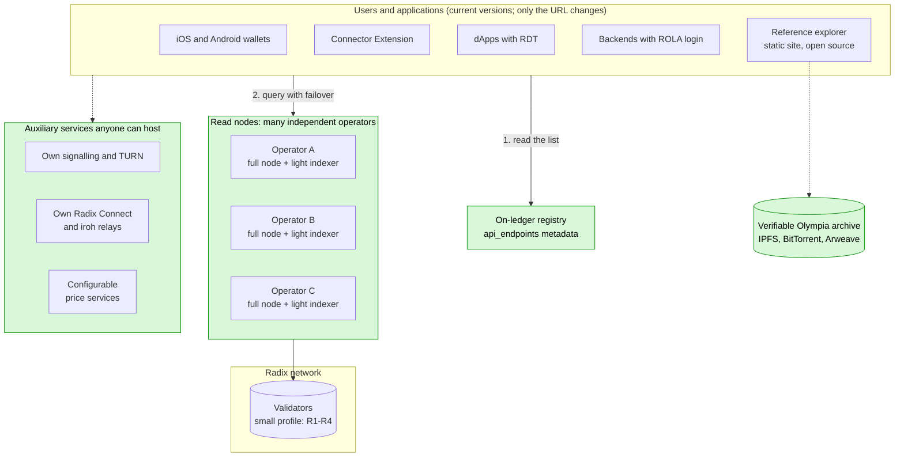
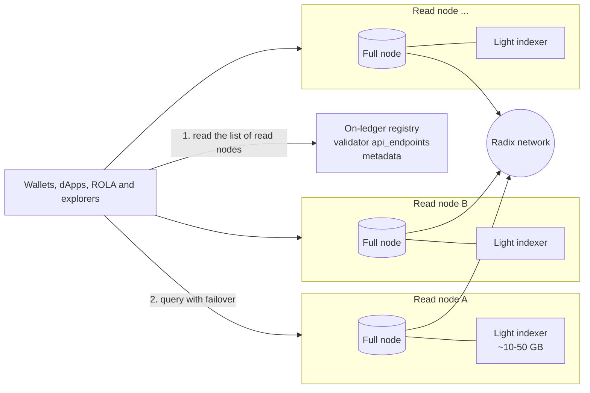
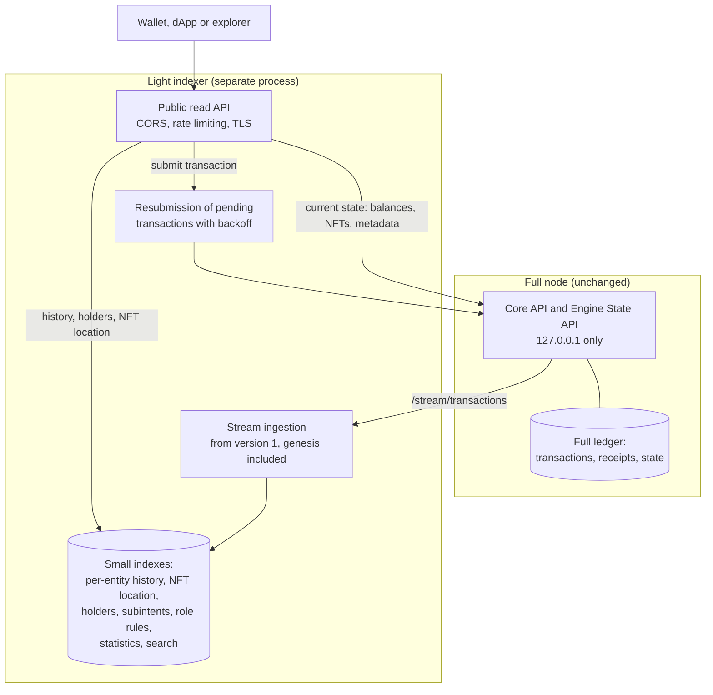
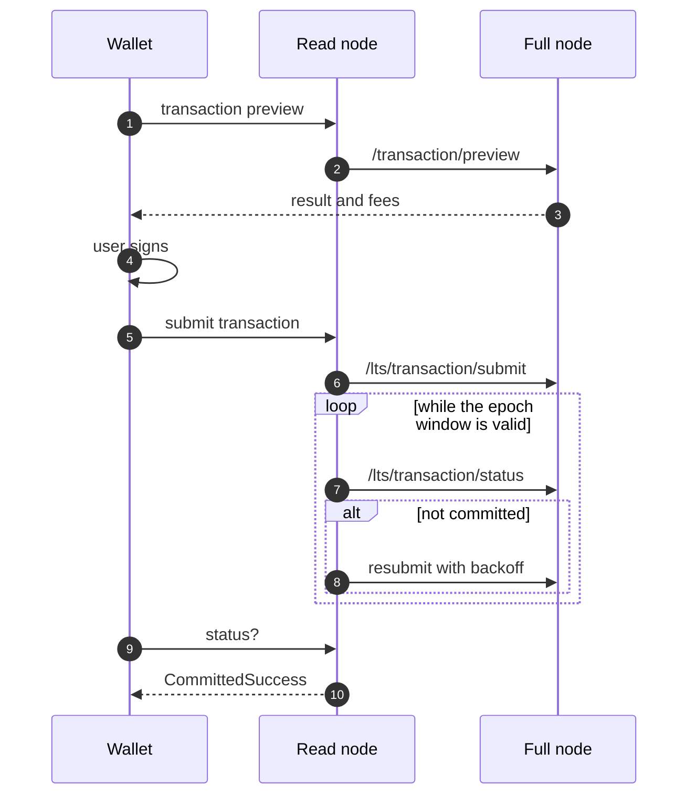
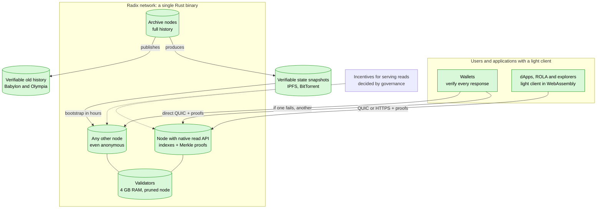
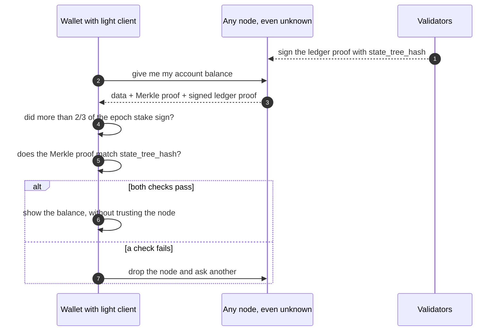
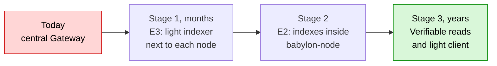

[← Index](../../README.md) · [Previous: Sections 4-5: the six strategies evaluated and their data-driven comparison](03-strategies.md) · [Next: Section 7: concrete changes in each repository](05-per-repository-changes.md)

# 6. Recommended solution and why

## Short-term infrastructure: no Gateway

## How a read node works

## Submitting a transaction without the Gateway

**Strategy: E3 first, then E2, with E6 as a complement.** Two cross-cutting pieces are added:

- **(D) on-ledger discovery:** validators publish their access URLs in their component metadata, for example under the key `api_endpoints`;
- **(B) a `LedgerBackend` abstraction** in clients.

**Why:**

1. **Time.** The Gateway is funded only until 31 Dec 2026. E3 is the only option that can **serve today's wallets without new releases**, because they already accept a custom Gateway URL.
2. **Cost.** It goes from ~2.5 TB and ~€300-500/month per operator to ~10-50 GB added to a node that already exists. The measured data explains why: over 99 % of state versions are round changes that do not need indexing.
3. **Real decentralisation.** If every validator or full node can serve the API at near-zero cost and announce itself on ledger, the "default provider" disappears. That is the condition for the network to serve any user without depending on a particular provider.
4. **Upgrade path.**
   - E3's indexes later move into `babylon-node` (E2).
   - The clients' `LedgerBackend` interface lets them switch to the node's native API later, and in future to Hyperscale (E5), without rewriting applications.
5. **Contained risk.** It does not touch consensus or the node core. It is a separate process that can be stopped or restarted without affecting the node.

**What E3 does not provide, and how it is covered:**

- **Arbitrary historical state** (old `at_ledger_state`):
  - E6, with forward capture in consultation;
  - or an "archive node" option in E2, with long history and `ByTimestamp`.
- **Trust in the node:** query several nodes discovered on ledger and compare `state_version` and the accumulator hash (`/stream/proofs`). Eventually, E5.

## 6.1 Impact on validator storage

**Short answer:** it does not increase significantly. And validators **do not have to run it**.

1. **It is optional and separate from the validator.**
   - Only those who want to serve public reads run the indexer.
   - Recommended practice is that a validator does **not** serve public traffic, so it is not exposed to attacks or to load that affects consensus. Reads are served by full nodes (not validators) run by the community, wallet providers, dApps, or validator operators on a separate machine.
   - A validator that does not run it sees **no change** in storage.
   - In E2, the in-node indexes would be flags that are **off by default**.
2. **If an operator runs it on the same machine as their node:**

   | Item | Size |
   |---|---|
   | Recommended node disk (official docs, "initially") | 500 GB |
   | Lightweight indexer (E3), estimated | ~10-50 GB |
   | Relative increase | **~2-10 %** of the recommended disk |
   | Indexer growth | ~0.1-0.3 GB/month at today's rate (~4,400 user transactions/day × 0.5-1 KB, plus auxiliary indexes); ~1 GB/month at the March 2025 peak (~35,000/day) |
   | For comparison: today's Gateway | ~2.5 TB, **+60 GB/month** |

   **Comparison per public access point** (what someone serving wallets, dApps and explorers needs):

   | | Today, with the Gateway | With the lightweight indexer |
   |---|---|---|
   | Full node (complete ledger: transactions, receipts and state; both models need it) | Yes, one or more: the DataAggregator reads from full nodes | Yes, one |
   | Plus | ~2.5 TB PostgreSQL database (+60 GB/month) | ~10-50 GB of indexes (estimated) |
   | Total extra on top of the node | **~2.5 TB** | **~10-50 GB** |

   In other words: a full node **already stores all network data today**, because it needs it to sync and validate, and that does not change. The lightweight indexer **only adds its indexes on top**: slightly more than a bare node (~2-10 %) and far less than a node plus Gateway (~50 times less).

   The indexer stays small because it **does not duplicate state or transactions**, which already live in the node. It only stores pointers (entity → `state_version`) and a few small tables, and it skips round changes, which are over 99 % of versions.
3. **Margin of error.**
   - I found no current public figure for the real ledger size of a mainnet node; the docs only give the 500 GB "initial" figure.
   - The 10-50 GB for the indexer is an **estimate** based on the user-transaction measurements. The resource-holder index (h) and the NFT-location index (b) depend on the number of resource-holder pairs and existing NFTs, which I did not measure.
   - The first prototype must measure both before committing to figures.
4. **What would grow a lot:** an "archive node" with full substate history (N5), which is essentially what makes the Gateway 2.5 TB. That is why this report does **not** propose it for validators. It would be an option only for those who need arbitrary historical state. For governance it is replaced by capturing the snapshot when the vote opens (E6).

## 6.2 The best solution with unlimited time: verifiable reads from any node

The short-term solution (E3) removes the Gateway, but the client **still has to trust** the node that answers it, just as it trusts the Gateway today. With unlimited time, the ideal solution removes that trust too: **any node, even an unknown one, can serve data, and the wallet checks for itself that the data is correct.**

**Key fact, verified in the node code:** Babylon already has almost everything needed.

- The ledger proofs signed by validators include three Merkle tree roots (`LedgerHashes`, `core-api-schema.yaml:1846-1870`):
  - `state_tree_hash` (all state);
  - `transaction_tree_hash` (all transactions);
  - `receipt_tree_hash` (all results).
- The node maintains the state tree (`state_hash_tree.*`).
- `/stream/proofs` already delivers the signed proofs, including epoch changes, which say which validators sign the next epoch.
- **What is missing** is an endpoint that returns the **Merkle proof** for a specific piece of data, and a client that verifies it.

## Long-term infrastructure: the ideal solution

### How the wallet verifies a response

**Components of the ideal solution:**

| # | Component | What it does |
|---|---|---|
| 1 | **Every node is a read node** (E2) | Indexes live inside `babylon-node` as options. An open, versioned **native read API** replaces the legacy format. There is no separate process. |
| 2 | **Reads with proofs** | Each response includes the data, its Merkle proof against `state_tree_hash`, `transaction_tree_hash` or `receipt_tree_hash`, and the validator-signed ledger proof. This covers balances, NFTs, metadata, component state, transactions and receipts. Consensus does not change. |
| 3 | **Light client in wallets and dApps** | In Sargon (Rust), and in WebAssembly for the browser (RDT, ROLA, explorers). It follows epoch changes from a checkpoint shipped with the app and checks that more than 2/3 of stake signed each proof. With that, it verifies every response. **The client stops trusting the node.** |
| 4 | **Verifiable indexes** | A Merkle proof shows that a piece of data *is there*, but not that a list (history, holders) is *complete*. That needs a protocol update: the engine keeps, in state, an accumulator of each entity's history and holders, so they fall under `state_tree_hash` and can be proven too. Until then, several independent nodes are cross-checked. |
| 5 | **Discovery and transport without intermediaries** | An on-ledger registry of read nodes (validator metadata or another component), and a direct QUIC/iroh connection between wallet and node. This avoids depending on DNS, TLS certificates and central relays; the same technology is already used in Radix Connect. |
| 6 | **Incentives to serve reads** | A share of network emissions or fees, or per-query XRD micropayments, for those who run read nodes. Governance decides. Without incentives, the service depends on operators' voluntary commitment. |
| 7 | **Verifiable historical archive** | Old history (Olympia included) lives in distributed storage (IPFS or Arweave). Its integrity is checked against `transaction_tree_hash` and `receipt_tree_hash`. No node has to keep all of it. |
| 8 | **Ready for Hyperscale** | Hyperscale already uses JMT multiproofs. The light client and the native API can be adapted to that network. The full migration to Hyperscale is analysed in section 11. |

**Comparison with the short-term solution:**

| | Short term (E3 → E2) | Ideal (6.2) |
|---|---|---|
| Gateway | Removed | Removed |
| Does the client trust the node? | Yes, though it can compare several | **No, it verifies every response** |
| Who can serve data? | Known node operators | **Any node, even anonymous** |
| Protocol changes | None | Only for verifiable indexes (item 4) |
| Lead time | Months | **Years** |
| Effort (est.) | 7-10 person-months minimum viable; 18-30 full | **~40-80 person-months** more, with protocol experts |

**Why it is the best with unlimited time:** it is the only option in which the network depends on no one, neither a Gateway nor the honesty of a node. It gives the same level of guarantee as the chain itself, extended to every user's wallet.

**How it fits with the short term:** these are stages, not alternatives. E3 solves the 2026 problem. E2 removes the separate process. Items 2-8 add verification on top of what E2 already serves. The clients' `LedgerBackend` interface is what lets them move from one stage to the next without rewriting applications.

---

[← Index](../../README.md) · [Previous: Sections 4-5: the six strategies evaluated and their data-driven comparison](03-strategies.md) · [Next: Section 7: concrete changes in each repository](05-per-repository-changes.md)
