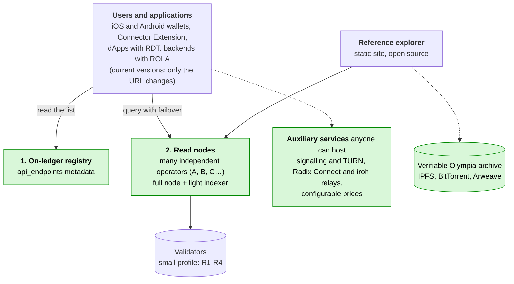
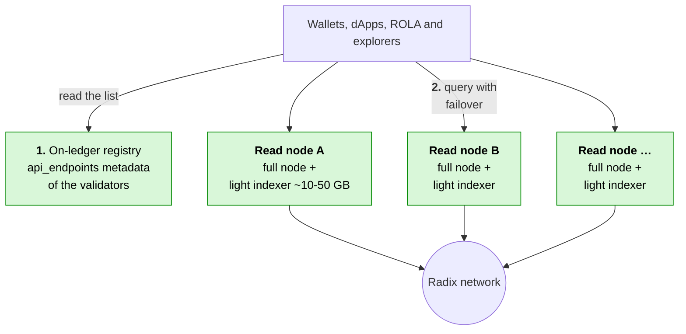
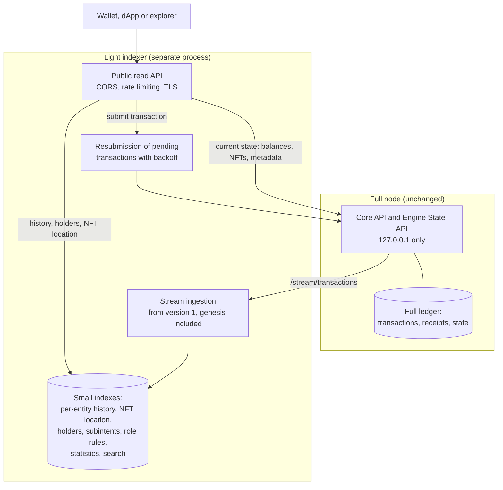
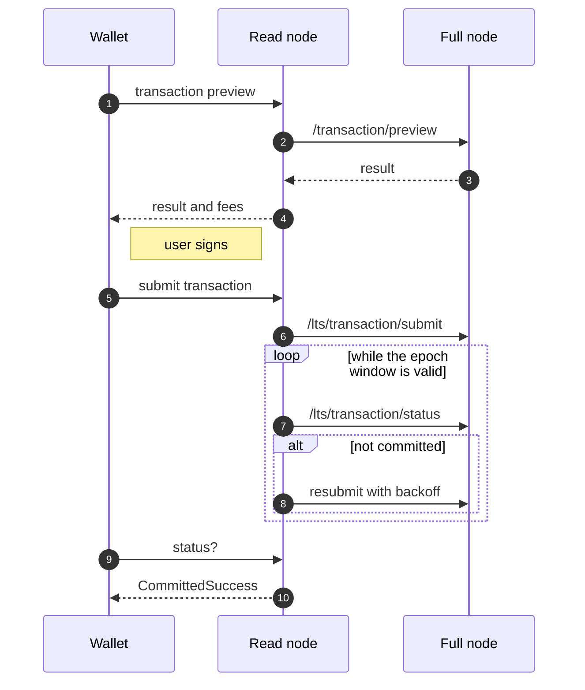
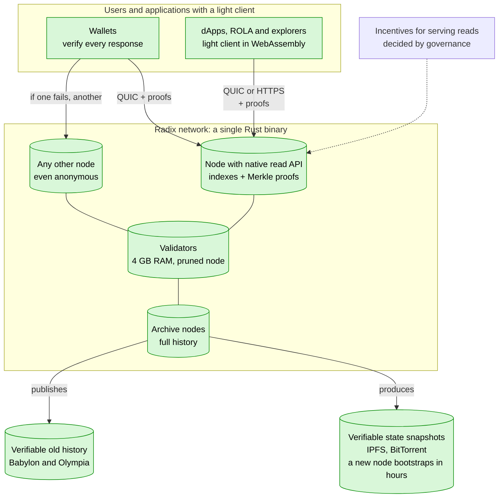
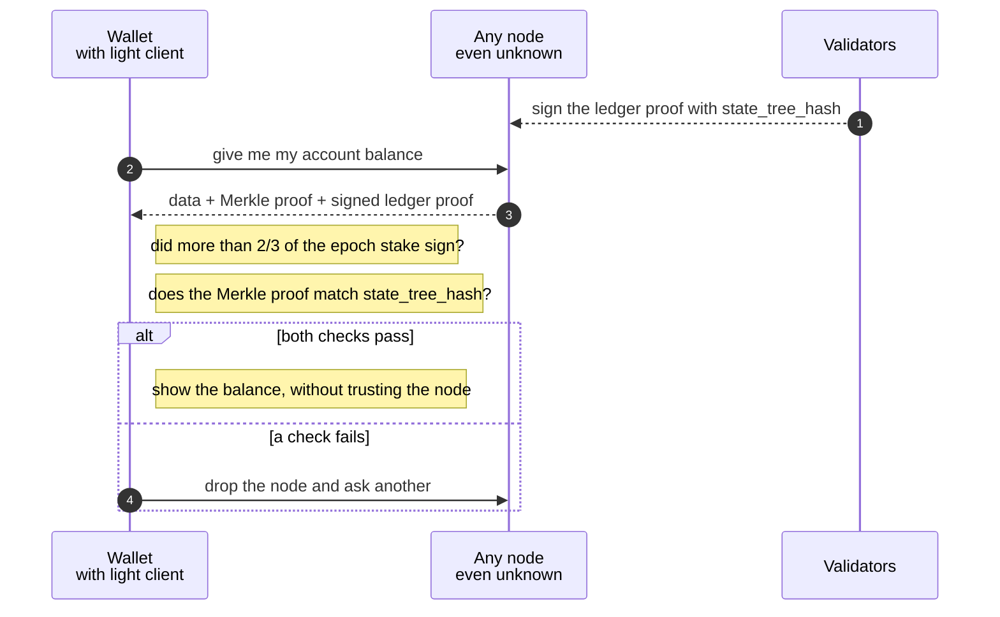
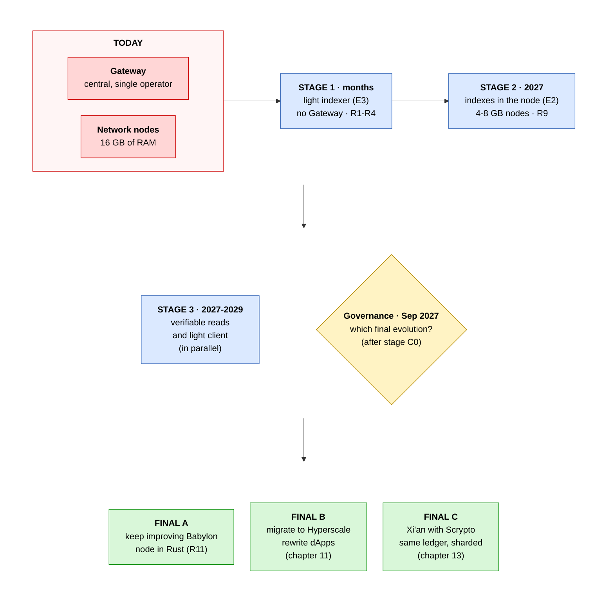
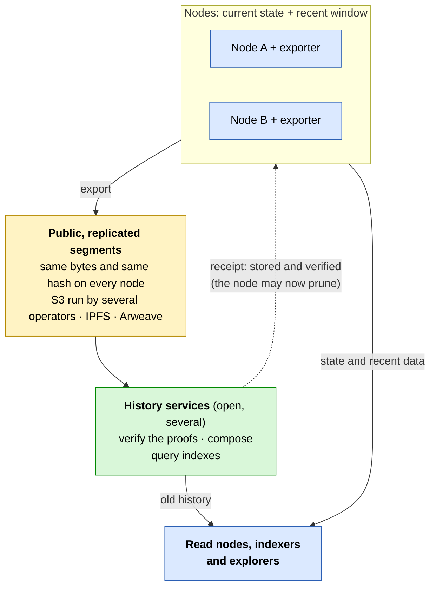

[← Index](../../README.md) · [Previous: Chapters 4-5: the six strategies evaluated and their comparison](04-05-strategies.md) · [Next: Chapter 7: concrete changes in each repository](07-per-repository-changes.md)

# 6. Recommended solution and why

> [!IMPORTANT]
> - **Is it possible?** Yes. It is the recommended short-term solution.
> - **Difficulty:** Medium.
> - **Effort and timeline:** 7-12 person-months for the minimum viable solution; months (estimate).

## Short-term infrastructure: no Gateway

Detail: how applications find read nodes.

## How a read node works

## Submitting a transaction without the Gateway

**Strategy: E3 first, then E2, with E6 as a complement.** Two cross-cutting pieces are added:

- **(D) on-ledger discovery:** validators publish their access URLs in their component metadata, for example under the key `api_endpoints`;
- **(L) a `LedgerBackend` abstraction** in clients.

**Why:**

1. **Time.** The Gateway is funded only until 31 Dec 2026. E3 is the only option that can **serve today's wallets without new releases**, because they already accept a custom Gateway URL.
2. **Cost.** It goes from the Gateway's ~2.5 TB, and the ~€300-400/month a community proposal estimated for running it (section [1.1](01-02-current-situation.md#s1-1)), to ~10-50 GB (estimate) added to a node that already exists. The measured data explains why: ~97-98 % of state versions are round updates that do not need indexing.
3. **Real decentralisation.** If every validator or full node can serve the API at near-zero cost and announce itself on ledger, the "default provider" disappears. That is the condition for the network to serve any user without depending on a particular provider.
4. **Upgrade path.**
   - E3's indexes later move into `babylon-node` (E2).
   - The clients' `LedgerBackend` interface lets them switch to the node's native API later, to the light client (E5) and, if adopted, to Hyperscale (chapter [11](11-hyperscale-evolution.md#s11)), without rewriting application logic.
5. **Contained risk.** It does not touch consensus or the node core. It is a separate process that can be stopped or restarted without affecting the node.

**What E3 does not provide, and how it is covered:**

- **Arbitrary historical state** (old `at_ledger_state`):
  - E6, with forward capture in consultation;
  - or an "archive node" option in E2, with long history and `ByTimestamp`.
- **Trust in the node:** query several nodes discovered on ledger and compare `state_version` and the accumulator hash (`/stream/proofs`). Eventually, E5.

## 6.1 Impact on validator storage

**Short answer:** it does not increase significantly. And validators **do not have to run it**.

1. **It is optional and separate from the validator.**
   - Only those who want to serve public reads run the indexer.
   - It is advisable that a validator does **not** serve public traffic, so it is not exposed to attacks or to load that affects consensus. Reads are served by full nodes (not validators) run by the community, wallet providers, dApps, or validator operators on a separate machine.
   - A validator that does not run it sees **no change** in storage.
   - In E2, the in-node indexes would be flags that are **off by default**.
2. **If an operator runs it on the same machine as their node:**

   | Item | Size |
   |---|---|
   | Recommended node disk (official docs, "initially") | 500 GB |
   | Disk a mainnet node takes today (measurement contributed by a community member, Nov 2026) | ~493 GB; ~600 GB with the account change index; +~65 GB/year |
   | Light indexer (E3), estimated | ~10-50 GB |
   | Relative increase | **~2-10 %** of the recommended disk |
   | Indexer growth | ~0.1-0.3 GB/month at today's rate (~4,400 user transactions/day × 0.5-1 KB, plus auxiliary indexes); ~1 GB/month at the March 2025 peak (~35,000/day) |
   | For comparison: today's Gateway | ~2.5 TB, **+60 GB/month** |

   **Comparison per public access point** (what someone serving wallets, dApps and explorers needs):

   | | Today, with the Gateway | With the light indexer |
   |---|---|---|
   | Full node (complete ledger: transactions, receipts and state; both models need it) | Yes, one or more: the DataAggregator reads from full nodes | Yes, one |
   | Plus | ~2.5 TB PostgreSQL database (+60 GB/month) | ~10-50 GB of indexes (estimated) |
   | Total extra on top of the node | **~2.5 TB** | **~10-50 GB** |
   | **Total per access point** (a ~493-600 GB node, contributed measurement, plus the above) | **~3.0-3.1 TB** | **~0.5-0.65 TB** |

   In other words: a full node **already stores all network data today**, because it needs it to sync and validate, and that does not change. The light indexer **only adds its indexes on top of the node's data**: slightly more than a bare node (~2-10 %) and far less than a node plus Gateway: what it adds is 50 to 250 times smaller, and the total per access point about 4.5-6 times smaller (estimate).

   The indexer stays small because it **does not duplicate state or transactions**, which already live in the node. It only stores pointers (entity → `state_version`) and a few small tables, and it skips round updates, which are ~97-98 % of versions.

   **The large part is the full node, and it is the same in both models.** Shrinking it is the aim of chapter [9](09-lighter-nodes.md#s9). Section [9.6](09-lighter-nodes.md#s9-6) sets out which changes a read node can apply without losing what the indexer needs.
3. **Margin of error.**
   - The compressed community snapshot is 274 GiB (Sep 2026). A community member has contributed a measurement of a mainnet node's on-disk size (~493 GB; receipts, 217 GB; ~600 GB with the account change index; +~65 GB/year), without yet publishing the method or node version. It should be confirmed with the per-column-family `raw_db_size` metrics.
   - The 10-50 GB for the indexer is an **estimate** based on the user-transaction measurements. The resource-holder index (h) and the NFT-location index (b) depend on the number of resource-holder pairs and existing NFTs, which were not measured.
   - The first prototype must measure both before committing to figures.
4. **What would grow a lot:** an "archive node" with full substate history (N5), which is essentially what makes the Gateway 2.5 TB. That is why this report does **not** propose it for validators. It would be an option only for those who need arbitrary historical state. For governance it is replaced by capturing the snapshot when the vote opens (E6).

## 6.2 The best solution with unlimited time: verifiable reads from any node

> [!IMPORTANT]
> - **Is it possible?** Yes, without changing consensus (verifiable indexes do need a protocol update).
> - **Difficulty:** Very high.
> - **Effort and timeline:** ~40-80 more person-months; years (estimate).

The short-term solution (E3) removes the Gateway, but the client **still has to trust** the node that answers it, just as it trusts the Gateway today. With unlimited time, the ideal solution removes that trust too: **any node, even an unknown one, can serve data, and the wallet checks for itself that the data is correct.**

**Key fact, verified in the node code:** Babylon already has almost everything needed.

- The ledger proofs signed by validators include three Merkle tree roots (`LedgerHashes`, `core-api-schema.yaml:1846-1870`):
  - `state_tree_hash` (all state);
  - `transaction_tree_hash` (all transactions);
  - `receipt_tree_hash` (all results).
- The node maintains the state tree (`state_hash_tree.*`).
- `/stream/proofs` already delivers the signed proofs, including epoch changes, which say which validators sign the next epoch.
- **What is missing** is an endpoint that returns the **Merkle proof** for a specific piece of data, and a client that verifies it.

### Long-term infrastructure: the ideal solution

#### How the wallet verifies a response

**Components of the ideal solution:**

| # | Component | What it does |
|---|---|---|
| 1 | **Every node is a read node** (E2) | Indexes live inside `babylon-node` as options. An open, versioned **native read API** replaces the legacy format. There is no separate process. |
| 2 | **Reads with proofs** | Each response includes the data, its Merkle proof against `state_tree_hash`, `transaction_tree_hash` or `receipt_tree_hash`, and the validator-signed ledger proof. This covers balances, NFTs, metadata, component state, transactions and receipts. Consensus does not change. |
| 3 | **Light client in wallets and dApps** | In Sargon (Rust), and in WebAssembly for the browser (RDT, ROLA, explorers). It follows epoch changes from a checkpoint shipped with the app and checks that more than 2/3 of stake signed each proof. With that, it verifies every response. **The client stops trusting the node.** |
| 4 | **Verifiable indexes** | A Merkle proof shows that a piece of data *is there*, but not that a list (history, holders) is *complete*. That needs a protocol update: the engine keeps, in state, an accumulator of each entity's history and holders, so they fall under `state_tree_hash` and can be proven too. Until then, several independent nodes are cross-checked. |
| 5 | **Discovery and transport without intermediaries** | An on-ledger registry of read nodes (validator metadata or another component), and a direct QUIC/iroh connection between wallet and node. This reduces the dependency on DNS and TLS certificates, and relays can be self-hosted or many; the same technology is already used in Radix Connect. |
| 6 | **Incentives to serve reads** | A share of network emissions or fees, or per-query XRD micropayments, for those who run read nodes. Governance decides. Without incentives, the service depends on operators' voluntary commitment. |
| 7 | **Verifiable historical archive** | Old history (including Olympia) is exported in **canonical segments** with the signed proofs inside, published as publicly readable and replicated across several stores (S3 run by different operators, IPFS, Arweave). Its integrity is checked against `transaction_tree_hash` and `receipt_tree_hash`. No node needs to keep all of it. Details in section [6.5](#s6-5). |
| 8 | **Ready for the final evolution** | Hyperscale already uses JMT multiproofs, and in Xi'an with Scrypto Babylon's state tree is kept per shard. The light client and the native API can be adapted to either. They are analysed in chapters [11](11-hyperscale-evolution.md#s11) and [13](13-xian-with-scrypto.md#s13). |

**Comparison with the short-term solution:**

| | Short term (E3 → E2) | Ideal |
|---|---|---|
| Gateway | Removed | Removed |
| Does the client trust the node? | Yes, though it can compare several | **No, it verifies every response** |
| Who can serve data? | Known node operators | **Any node, even anonymous** |
| Protocol changes | None | Only for verifiable indexes (item 4) |
| Lead time | Months | **Years** |
| Effort (est.) | 7-12 person-months minimum viable; 21-35 full | **~40-80 person-months** more, with protocol experts |

**Why it is the best with unlimited time:** it is the only option in which the network depends on no one, neither a Gateway nor the honesty of a node. It gives the same level of guarantee as the chain itself, extended to every user's wallet.

**How it fits with the short term:** these are stages, not alternatives. E3 solves the 2026 problem. E2 removes the separate process. Items 2-8 add verification on top of what E2 already serves. The clients' `LedgerBackend` interface is what lets them move from one stage to the next without rewriting applications.

## 6.3 Risks of removing the Gateway and how to mitigate them

| Risk | Consequence | Mitigation |
|---|---|---|
| **A node returns incorrect data**, by mistake or maliciously | The user sees false balances or state | Query several access points and compare `state_version` and the accumulator hash ([10.2](10-implementation-guide.md#s10-2)); in the long term, verifiable reads ([6.2](#s6-2)) |
| **Few read-node operators** | A central dependency reappears | Near-zero cost per operator (E3); on-ledger discovery; incentives decided by governance ([6.2](#s6-2), item 6; chapter [12](12-references-other-networks.md#s12)) |
| **Denial-of-service attacks** on read nodes | Slow or unavailable service | Public mode with per-IP limits and a route allow-list (N6); several operators; validators kept separate from read nodes ([6.1](#s6-1)) |
| **More reads than a read node can handle** | Slow responses, or a node that falls behind the ledger | Batch reads (N7), indexer cache, per-IP limits and several read nodes; a load test before committing to figures ([6.4](#s6-4)) |
| **The indexer does not exactly reproduce the responses** wallets expect | Application errors | Conformance tests against the public Gateway **before it is switched off** ([10.1](10-implementation-guide.md#s10-1)) |
| **Few archive nodes** | New nodes cannot obtain history or snapshots | Several archive nodes in different hands; verifiable snapshots on distributed storage (R9); export, then prune, with replicated history segments ([6.5](#s6-5)) |
| **History ends up in the hands of a single operator** | If it stops funding it, access to history is lost | Public segments replicated across stores run by different operators; open format and software; several history services ([6.5](#s6-5)) |
| **A transaction is lost** if the access point restarts | The user believes something was sent that never committed | Resubmission in the indexer and in clients ([10.1](10-implementation-guide.md#s10-1), [10.4](10-implementation-guide.md#s10-4)) |
| **Lack of funding or developers** | The plan slips beyond 31 Dec 2026 | Prioritise the minimum viable solution (7-12 person-months); an early governance decision |
| **Bugs in new software** (indexer, node changes) | Service failures or, in the node, consensus failures | Deploy on Stokenet first; options off by default; gradual adoption ([10.7](10-implementation-guide.md#s10-7)) |

---

## 6.4 Read load on a public read node

> [!IMPORTANT]
> - **Is it possible?** Yes, with conditions: batch reads must be added to the node and a cache to the indexer, and traffic must be spread across several read nodes. The RAM of a public node must come from a load test.
> - **Difficulty:** Medium.
> - **Effort and timeline:** ~1-2 person-months for N7, the cache and the load test; weeks to a few months (estimate).

**The problem (checked in the code):**

- Responses in the Gateway format **aggregate data**. For example, `state/entity/details` accepts up to **20 entities** per request and up to 20 explicit metadata keys (`StateEntityDetailsMaxPageSize = 20` and `ExplicitMetadataMaxItems = 20` in `babylon-gateway/src/RadixDlt.NetworkGateway.GatewayApi/Configuration/EndpointOptions.cs:99,105`).
- The node's APIs read **one entity, field or entry per call**: the Core API (`/state/account`, `/state/resource`, `/state/non-fungible`…) and the Engine State API (`/entity/info`, `/object/field`, `/kv-store/entry`…), according to `core-api-schema.yaml` and `engine-state-api-schema.yaml`. There are no batch endpoints, and the state manager uses RocksDB multi-reads (`multi_get_cf`) only for node ancestry (`state-manager/src/store/rocks_db.rs:1235-1241`), not for the APIs' substate reads.
- So, in the light indexer, **one wallet request becomes many reads** on the node, on the same RocksDB that must keep up with the ledger.
- The memory section [9.5](09-lighter-nodes.md#s9-5) assigns to a read node (0.6 GB for APIs and indexer) is an **estimate without a load measurement**. It holds for a personal or low-traffic node, not for sizing a public one.

**Why this does not block the goal:**

- Radix's write load is low (~4,400 user transactions a day, section [1.2](01-02-current-situation.md#s1-2)), so contention between reads and writes is bounded. In addition, the node's read handlers already read from a database snapshot (`database.snapshot()`, for example in `core-api-server/src/core_api/handlers/state_account.rs:23`).
- Today the Gateway performs the same aggregation over a ~2.5 TB database and serves **all** traffic from a single deployment. With E3, traffic is spread across **many** read nodes discovered on ledger ([10.2](10-implementation-guide.md#s10-2)), each serving only part of it.
- Decentralisation does not require every read node to be small. It requires that **anyone can run one** on commodity hardware. The 4-8 GB target stays for validators and low-traffic read nodes. A public read node is sized to its traffic, like any web server.

**How to make it possible:**

1. **Batch reads in the node (N7, section [7.2](07-per-repository-changes.md#s7-2)).** An endpoint that takes several entities and returns their data read from **a single database snapshot**. RocksDB offers multi-reads (`MultiGet`, also available in the Rust `rocksdb` crate), which lower the per-key cost compared with separate reads. N7 moves from P2 to **P1**.
2. **A cache in the indexer, invalidated by `state_version`.** The indexer knows exactly which entities change in each transaction (`entity_tx` table). A stored response stays valid until a later transaction touches that entity. Since writes are few, repeated reads can be served from the cache.
3. **Use the aggregated reads the node already has.** For example, `/lts/state/account-all-fungible-resource-balances` returns all of an account's fungible balances in one call.
4. **Per-request and per-IP limits** (public mode N6 and the indexer's server layers, section [10.1](10-implementation-guide.md#s10-1)), so a single client cannot exhaust the node.
5. **Several read nodes** with client failover ([10.2](10-implementation-guide.md#s10-2), [10.4](10-implementation-guide.md#s10-4)): if one is saturated, the client uses another.
6. **A load test as an acceptance criterion.**
   - Replay the real traffic recorded for the conformance tests ([10.1](10-implementation-guide.md#s10-1)) against 4, 8 and 16 GB nodes, at increasing rates.
   - Measure latency (p50 and p99), RAM use and whether the node **keeps up with the ledger** while serving reads.
   - Publish the results with method, date and version.

**Resulting profiles** (the public-node figures are set by the load test):

| Profile | Purpose | RAM |
|---|---|---|
| Personal or low-traffic read node | A wallet, a dApp or an operator serving itself | 4-8 GB target (estimate, section [9.5](09-lighter-nodes.md#s9-5)) |
| Public read node | Serving many users | Per the load test. For reference, the current official node requirement is 16 GB |

## 6.5 History without a central service: export, then prune

> [!IMPORTANT]
> - **Is it possible?** Yes. The first version runs next to the node, without changing it; the full version needs a small change in `babylon-node` (N10).
> - **Difficulty:** Medium.
> - **Effort and timeline:** ~5-9 person-months; the first experiment, weeks (estimate).

**Origin.** This design builds on an exploration shared by a community member ("Node-side History Export", Nov 2026). The contributor describes it as an exploration, not a decision, and it is not yet tested. This report adopts it and adapts it to the goal of not depending on any operator.

**The problem it solves:**

- Most of the Gateway's disk (~2.5 TB) and of a full node's (~493 GB, contributed measurement) is **history**. Serving the current state needs far less.
- Pruning (R8) reduces node disk, but without a mechanism that guarantees history has first been stored elsewhere, it can be lost. The risk table already flagged "few archive nodes".
- A **central** history service would repeat today's problem: if whoever runs it stops funding it, access is lost.

**A three-tier design:**

1. **Nodes:** keep the current state and a **recent window** of history, for example a few hours or days. Babylon epochs last about 5 minutes (`target_duration_millis: 300000` in `mainnet_genesis`), so 4-5 hours are about 50-60 epochs. They serve submission, preview and recent data.
2. **History segments:** immutable files, one per fixed range of epochs, with raw transactions, receipts in their on-ledger form and the **proofs signed by validators**. They are published to object storage and **replicated**.
3. **History services:** read the segments, verify them and build indexes to query them (by account, resource or date). They are **open**: anyone can run one, and read nodes and indexers fetch old history from any of them.

**The four rules that make it safe** (the first three come from the contributed design):

| Rule | What it requires | Why |
|---|---|---|
| **Canonical segments** | Every honest node produces **exactly the same bytes** for the same range. Segment boundaries are consensus facts (epoch numbers), never a node's clock, and the encoding is deterministic. Signatures stay outside this canonical part (see "Proofs inside") | Any node can upload a segment and the others confirm it by comparing its hash |
| **Proofs inside** | Each segment carries the end-of-epoch header (roots and version) in its canonical part, and a separate signatures file. Each node may keep a different subset of signatures on the same proof (`core-api-schema.yaml:844-849`), so any set adding up to more than 2/3 of the stake is valid | Anyone can verify it without trusting the uploader or the storage |
| **Export, then prune** | A node deletes past its horizon only what the archive has confirmed ("receipted") as stored and verified. If receipts stop arriving, it holds the data for a bounded time and raises alarms, but **never stalls consensus** | History is not lost even though nodes prune |
| **Public replicas** (added by this report) | Segments are publicly readable and kept in several places run by different operators: S3-compatible storage, IPFS with several pinning services, and Arweave for a permanent copy. The format and the software that processes it are open source | No operator is indispensable. Since each segment is identified by its hash and carries its proofs, the storage need not be trusted |

**What can be verified on Babylon** (checked in the `babylon-node` code):

- Ledger proofs sign `LedgerHashes`, with three roots: state, transactions and receipts (`state_root`, `transaction_root` and `receipt_root` in `state-manager/src/types.rs:284-288`; in the Core API, `state_tree_hash`, `transaction_tree_hash` and `receipt_tree_hash`).
- The receipt root is computed from the `ConsensusReceipt`: the transaction's outcome, the root of its state changes and the root of its events (`types.rs:109-131`; `receipt.rs:414-425`). In other words, **the network signs the on-ledger receipt** (`LedgerTransactionReceipt`).
- Local execution data, such as balance changes and the fee summary, is **not signed**. History services recompute it from the receipt, or take it from a node knowing that it is unproven.
- Each epoch starts a new transaction and receipt tree from the previous root (`staging/epoch_handling.rs:174-200`). So an epoch-aligned segment can be verified on its own: the epoch's tree is recomputed from its transaction hashes and compared with the root in the signed proof.

**What is missing today:** the Core API provides raw transactions (`transaction_format_options.raw_ledger_transaction`) and proofs (`/stream/proofs`), but receipts only as JSON. Including receipts in canonical form needs **N10**: an option that returns the `LedgerTransactionReceipt` encoded in SBOR. Until then, the first version of the segments carries transactions and proofs, which can already be verified.

**Consequences for the rest of the plan:**

- **Smaller read nodes.** If old history is served from segments, a read node can also prune (R8) and keep only a window with its indexes (section [9.6](09-lighter-nodes.md#s9-6)). For reference, the community member reports that their minimal Gateway, with one day of state, runs on 100-150 GB of disk, 2 CPUs and 4-6 GB of RAM, although today it still needs a full node with indexes of 550-600 GB (the contributor's own figure).
- **Windows per operator.** Each read node decides how much history it indexes locally (for example 7, 30 or 90 days) and fetches the rest from history services.
- **Explorers and Olympia.** The Olympia archive ([10.5](10-implementation-guide.md#s10-5)) is the first historical "segment", and explorers read the full history from the services.
- **Hyperscale and Xi'an.** The same design works per shard: each shard exports its segments and the history services join cross-shard transactions (chapters [11](11-hyperscale-evolution.md#s11) and [13](13-xian-with-scrypto.md#s13)).

**Who pays for storage:** a governance decision. Because segments can be verified, whoever stores them need not be trusted, only rate-limited. The options are volunteer operators, incentives paid on Layer 1 ([6.2](#s6-2), item 6) or a one-off permanent-storage payment on Arweave for the reference copies.

---

[← Index](../../README.md) · [Previous: Chapters 4-5: the six strategies evaluated and their comparison](04-05-strategies.md) · [Next: Chapter 7: concrete changes in each repository](07-per-repository-changes.md)
