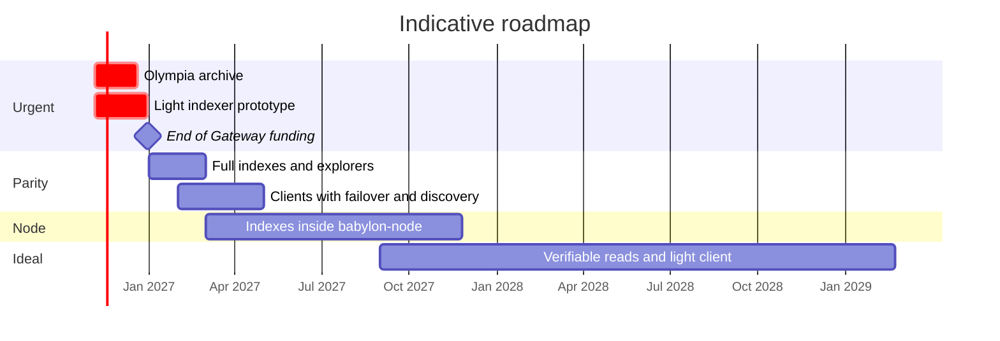

[← Index](../../README.md) · [Previous: Section 7: concrete changes in each repository](05-per-repository-changes.md) · [Next: Sources and methodology](07-sources.md)

# 8. Roadmap

| Phase | Indicative dates | Content | Result |
|---|---|---|---|
| **F0** | Nov-Dec 2026 | **Verifiable archive of the Olympia ledger** (2.2), before it is switched off. `radix-lite-indexer` prototype with the critical subset: status, submit, preview, balances, NFTs, metadata, subintents, validators. `babylon-nodecli` profile. Conformance tests against the public Gateway. | Today's wallets, RDT and ROLA work by changing only the URL |
| **F1** | Jan-Feb 2027 | History, NFT-location and role-rule indexes. Explorer indexes (holders, statistics, search). Resubmission. Public mode. Snapshots. Validator `api_endpoints` convention. First release of `radix-explorer`. | Parity with what clients use. Explorers without the Gateway. Several node operators serving data with the indexer. |
| **F2** | Feb-Apr 2027 | Clients: lists with failover and discovery (Sargon, wallets, RDT, ROLA, extension, SDK). Resubmission in Sargon. Fixes (`BaseUrlInterceptor`, hard-coded mainnet, hard-coded services). | No central default provider |
| **F3** | 2027 | `babylon-node`: N1, N6, N5b, then N2-N4. Snapshot capture in consultation. | Every node is an access point; the indexer becomes optional |
| **F4** | Long term | Light client with proofs (E5), on Babylon if substate proofs are added, or on Hyperscale | Access without trusting the node |

---

[← Index](../../README.md) · [Previous: Section 7: concrete changes in each repository](05-per-repository-changes.md) · [Next: Sources and methodology](07-sources.md)
