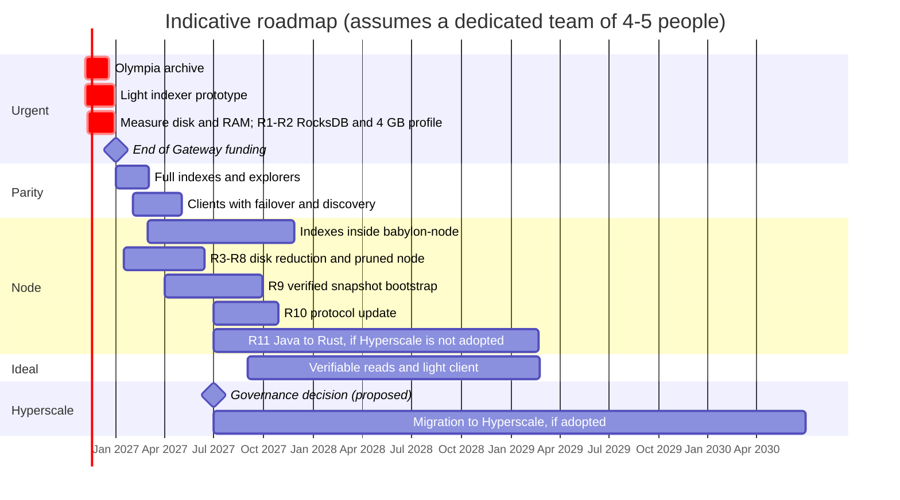

[← Index](../../README.md) · [Previous: Chapter 7: concrete changes in each repository](07-per-repository-changes.md) · [Next: Chapter 9: lighter nodes (RAM and disk) and the Java to Rust migration](09-lighter-nodes.md)

# 8. Roadmap

> [!IMPORTANT]
> - **Is it possible?** Only partly before 31 Dec 2026: the critical subset of the light indexer can have a prototype if work starts now; the rest of the plan arrives in 2027 and later years.
> - **Difficulty:** Medium (the schedule) and very high (the final phases).
> - **Effort and timeline:** dates assume a dedicated team of about 4-5 full-time people (an assumption of this report); with fewer people, timelines lengthen.

| Phase | Indicative dates | Content | Result |
|---|---|---|---|
| **F0** | Nov-Dec 2026 | **Verifiable archive of the Olympia ledger** ([2.2](01-02-current-situation.md#s2-2)), before it is switched off. **Measure per-column-family size on a mainnet node.** R1-R2 (RocksDB and 4 GB profile). `radix-lite-indexer` prototype with the critical subset: status, submit, preview, balances, NFTs, metadata, subintents, validators. `babylon-nodecli` profile. Conformance tests against the public Gateway. | Today's wallets, RDT and ROLA work by changing only the URL |
| **F1** | Jan-Feb 2027 | History, NFT-location and role-rule indexes. Explorer indexes (holders, statistics, search). Resubmission. Public mode. Snapshots. Validator `api_endpoints` convention. First release of `radix-explorer`. | Parity with what clients use. Explorers without the Gateway. Several node operators serving data with the indexer. |
| **F2** | Feb-Apr 2027 | Clients: lists with failover and discovery (Sargon, wallets, RDT, ROLA, extension, SDK). Resubmission in Sargon. Fixes (`BaseUrlInterceptor`, hard-coded mainnet, hard-coded services). | No central default provider |
| **F3** | 2027 | `babylon-node`: N1, N6, N5b, then N2-N4. R3-R8 (disk reduction and pruned node) and R9 (verified snapshot bootstrap). Snapshot capture in consultation. | Every node is an access point; the indexer becomes optional |
| **F4** | 2027-2029 | Phased migration of the core to Rust (R11), **if governance does not adopt Hyperscale or postpones it** (section [11.8](11-hyperscale-evolution.md#s11-8)). Protocol update R10. Verifiable reads and light client ([6.2](06-recommended-solution.md#s6-2), [10.6](10-implementation-guide.md#s10-6)). | 4 GB nodes with headroom; access without trusting the node |
| **F5** | After the governance decision | Migration to Hyperscale (section [11](11-hyperscale-evolution.md#s11)): mainnet readiness, read API and indexer, wallets, genesis with verifiable claims, dApp rewrites. | Final evolution of Radix, if the community adopts it |

---

[← Index](../../README.md) · [Previous: Chapter 7: concrete changes in each repository](07-per-repository-changes.md) · [Next: Chapter 9: lighter nodes (RAM and disk) and the Java to Rust migration](09-lighter-nodes.md)
