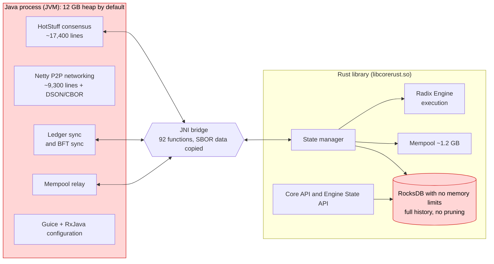
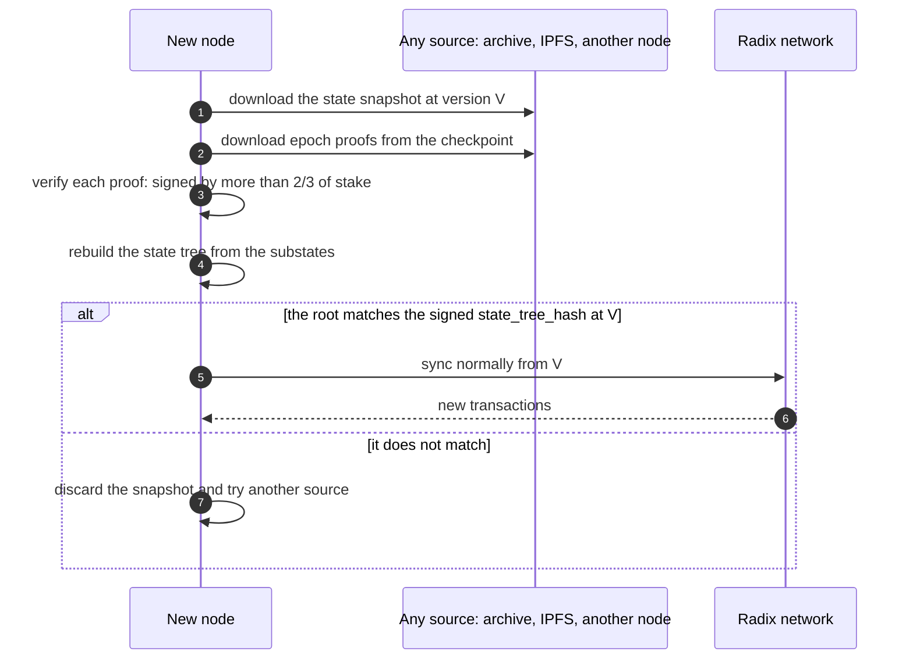
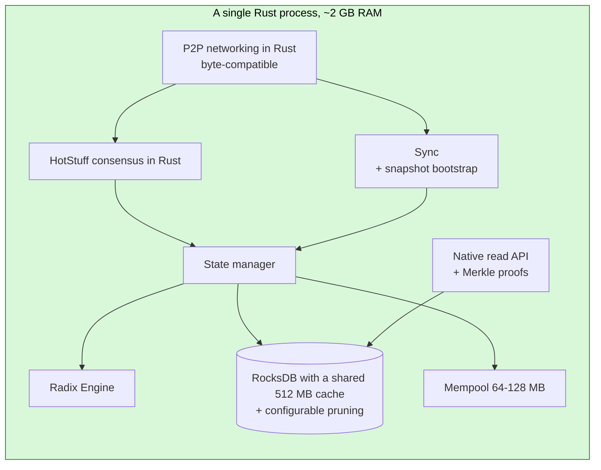
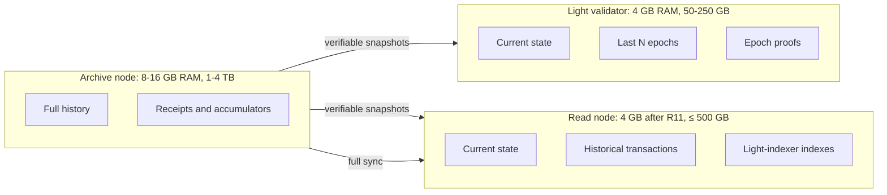

[← Index](../../README.md) · [Previous: Chapter 8: roadmap](08-roadmap.md) · [Next: Chapter 10: step-by-step implementation guide](10-implementation-guide.md)

<a id="s9"></a>

# 9. Lighter nodes: target of 4-8 GB RAM and 500 GB disk or less

> [!IMPORTANT]
> - **Is it possible?** Yes. A node of at most 8 GB of RAM looks achievable, and 4 GB is plausible, with under 500 GB of disk (estimates to be confirmed by measuring a real node).
> - **Difficulty:** Medium while on Java (R1-R9); very high for comfortable headroom (R11, migration to Rust).
> - **Effort and timeline:** 8-14 person-months for R1-R9, including Stokenet testing, review and rollout (assumption); 30-50 person-months for R11 (estimates).

**Goal.** A mainnet validator or full node should run on **4-8 GB of RAM (ideally 4 GB) and 500 GB of disk or less**, and the network should keep working without the Gateway.

**Code reviewed:**

- `babylon-node`, branch `develop` (12919a01, last commit 12 Mar 2025; recent releases do not come from this branch);
- the **latest published release, `v1.4.0.0` "Eagle Ray"** (7400951e; commit of 8 Sep 2026, published 10 Sep 2026);
- `babylon-nodecli`.

`file:line` paths refer to `develop` unless stated otherwise. Differences in `v1.4.0.0` that matter here are called out explicitly.

<a id="s9-1"></a>

## 9.1 Current situation: data

| Data point | Value | Source |
|---|---|---|
| Official requirements | 4 CPU, **16 GB RAM**, "500 GB of SSD (initially)" | docs.radixdlt.com, *Node setup* |
| Default memory configuration on mainnet | `-Xms12g -Xmx12g -XX:MaxDirectMemorySize=2048m`, **14 GB** container (`mem_limit: 14000m`) | `babylon-nodecli/node-runner-cli/config/CoreDockerConfig.py:23-32`, `templates/radix-fullnode-compose.yml.j2:17,46` |
| Recommended swap | 8 GB | docs.radixdlt.com, *Optimizing performance* |
| Ledger size: **compressed** (zstd) community snapshot | 6.3 GiB (Oct 2023) → 69 GiB (Sep 2024) → 180 GiB (Sep 2025) → 259 GiB (Jul 2026) → **274 GiB (29 Sep 2026)** | snapshots.radix.live |
| Recent growth | **~5-8 GiB/month** compressed | calculated from the row above |
| Another published snapshot | 343.9 GB (PublicNode, v1.4.0.0, height 566,915,789; not stated whether compressed) | publicnode.com/snapshots |
| Share of the optional indexes | ~4-5 % (274 vs 262 GiB without indexes) | snapshots.radix.live |
| Transaction-history pruning | **Does not exist** | code: only state-tree GC and ledger-proof GC exist |
| Bootstrapping from a verified snapshot | **Does not exist.** A new node replays ~567 million transactions from genesis, or downloads a third-party snapshot with no cryptographic verification. | code; `babylon-nodecli/.../ledger_snapshot/__init__.py:26-80` |
| RocksDB tuning | **None**: `Options::default()` for the database and all 26 column families, also in `v1.4.0.0` | `core-rust/state-manager/src/store/rocks_db.rs:164-170` |
| Mempool | 512 MiB of transactions × factor 2.3 ≈ **~1.2 GB** by default | `core-rust/node-common/src/config/mod.rs:74-75`, `RadixNodeModule.java` (mempool computation) and `priority_mempool.rs:81` (230 % factor) |
| Java code remaining | ~55,500 hand-written lines in `core` + ~35,000 in `common` + ~14,000 of Java-Rust bridge classes (plus ~4,000 of JNI layer in Rust) | `wc -l` count |
| Official "all-Rust" node | Xi'an / hyperscale-rs is a **different network** (not Babylon) with no launch date. According to radix.wiki, on 3 Sep 2026 its lead developer stopped proposals, grants and engagements with Radix, while continuing to develop the code (section [11.1](11-hyperscale-evolution.md#s11-1)). | radixdlt.com (roadmap 30 Nov 2024), radix.wiki |

**Starting point:**

- **RAM:** with what is shipped today, a mainnet node **does not fit in 4 GB**: it reserves a 12 GB Java heap, RocksDB has no memory limits and the mempool can take ~1.2 GB. The configured heap and direct memory (12 + 2 GB) already match the container limit (14 GB); they are reserved maximums, not measured use: the real consumption (RSS) of a mainnet node has not been published.
- **Disk:** the compressed ledger is already 274 GiB. Uncompressed it is noticeably larger; the exact figure has not been published. So **500 GB of disk may already be insufficient, or soon will be**.

<a id="s9-2"></a>

## 9.2 Where the memory goes

### The node today



| Consumer | Today | Why | Can be reduced to |
|---|---|---|---|
| Java heap | 12 GB reserved up front (`-Xms12g`) | Installer default. Actual use has not been published; 1.5-7 GB was measured on betanet (2023). | **1-1.5 GB** (target) with limits on Java structures (vertex store, message queues); **0 GB** after moving to Rust |
| Direct memory (Netty) | up to 2 GB | Network buffers | 256 MB; **0** after moving to Rust |
| RocksDB: index and filter blocks of every SST file | **Unbounded**; grows with the ledger | `max_open_files=-1` and `cache_index_and_filter_blocks=false` (defaults) keep the indexes of **all** open files in memory, ~0.5-1.5 % of database size (*estimate*) | Counted inside a shared **512 MB** cache |
| RocksDB: memtables | 64 MB × 2 per column family with no global cap; ~0.6-1.3 GB in practice (*estimate*) | Defaults (RocksDB documentation, chapter [12](12-references-other-networks.md#s12)) | **256 MB** in total with `WriteBufferManager` |
| RocksDB: block cache | a separate one per column family: 26 × 32 MB ≈ 0.8 GB with RocksDB 10.4 (`v1.4.0.0`); 26 × 8 MB with RocksDB 8.1 (`develop`) | Defaults | A single shared cache (the one above) |
| Mempool | ~1.2 GB | 512 MiB default | **64-128 MB** on small validators |
| Vertex store (consensus, Java) | up to 150 MB, fully re-serialised on every change | `VertexStoreJavaImpl.java:223-238` | Same, without re-serialisation, once it moves to Rust |
| Result and execution caches (Rust) | 3 LRUs of 10,000 entries and the staging cache | `state_manager.rs:257-264` | Configurable size |

**The decisive factor is untuned RocksDB.** Its memory grows with the size of the ledger and nothing caps it. It can be fixed without touching consensus, with a few dozen lines in `rocks_db.rs` (change R1).

<a id="s9-3"></a>

## 9.3 Where the disk goes

About 555 of the ledger's ~567 million versions (~97-98 %) are **round updates**: system transactions, one per consensus round. Each one **permanently** writes:

| Data stored per round update | Uncompressed bytes (estimated from the schemas) | Pruned? | What needs it? |
|---|---|---|---|
| Raw transaction (`raw_ledger_transactions`) | ~50 | No | Serving sync to other nodes |
| Identifiers (`committed_transaction_identifiers`) | ~200 (hashes, barely compress) | No | Node startup, APIs; for user transactions, duplicate validation |
| **Receipt** (`transaction_receipts`) | **~4-4.5 KB**. ~3.8 KB is the proposal statistics of ~100 validators, stored **twice** (new and previous value, `receipt.rs:105-124`) | No | APIs only, except epoch-change receipts (used by protocol-update readiness) |
| Local execution (`local_transaction_executions`) | ~0.7-1.5 KB | No (enabled by default) | APIs only |
| Accumulator slices (`transaction/receipt_accu_tree_slices`) | ~0.9-1.3 KB (hashes) | **No** | Only the latest slice of the current epoch is read |
| Transaction-hash index (`ledger_transaction_hashes`) | 40 | No | Duplicate check; no API reader |
| Ledger proofs | ~5-8 KB | Yes, after 12 epochs ~1 in 1,000 remain | Sync |
| State tree (JMT) nodes | ~3-6 KB | Yes, 60,000-version window | Consensus (state root) |

- **Estimated permanent cost per round update:** the table adds up to ~6-7.5 KB **uncompressed** with local executions enabled. Over ~555 million rounds that is **in the order of 3-4 TB uncompressed**. These are **upper-bound** figures: much of this data (receipts that are nearly identical from one round to the next) compresses very well, and the full compressed snapshot is 274 GiB. The real on-disk size can only be known by measuring it.
- **Order of importance:** receipts > accumulator slices > local executions > identifiers. Raw round-update transactions only add up to ~25-30 GB.
- **How to confirm:** the node already publishes per-column-family sizes (`raw_db_size` metrics, `SM/metrics.rs:590-640`). The **first step** of the plan is to publish those figures from a mainnet node.
- **Root cause:** the ConsensusManager's `CurrentProposalStatistic` field, ~1.9 KB, is rewritten in full every round. Its previous value is stored in the receipt and its path is rewritten in the state tree.
- **New in `v1.4.0.0`:**
  - It adds the option **`db.keep_previous_substate_values`**: with `false`, receipts stop storing previous values (`rocks_db.rs:705-714` in `v1.4.0.0`), which **roughly halves each round's receipt**.
  - Its default on mainnet is `true`, that is, previous values **are still stored**; the option only affects data written after it is enabled.
  - `v1.4.0.0` also **removes the Mesh API**.

<a id="s9-4"></a>

## 9.4 Changes: what to do, where and how

Each change states:

- **where** to make it;
- **how** to make it;
- **how to test** it;
- estimated **savings**;
- **risk**.

Changes R1-R7 **do not touch consensus** and can ship in any node release. R8 and R9 change how nodes sync. R10 is a protocol update. R11 is the Java-to-Rust migration.

### R1. Configure RocksDB with memory limits (P0, effort S-M)

> [!NOTE]
> **Reference from other networks:** the official RocksDB documentation describes these same settings (shared cache, index and filter blocks inside the cache, Write Buffer Manager). See chapter [12](12-references-other-networks.md#s12).

- **Where:**
  - `core-rust/state-manager/src/store/rocks_db.rs:164-170` (and the read-only and secondary opens, `:201-207`, `:237-243`);
  - `core-rust/p2p/src/rocks_db.rs:117-123`;
  - new properties in `RadixNodeModule.java` and `DatabaseConfig`.
- **How:**

```rust
// One cache and one memtable budget for the whole node.
let cache = Cache::new_lru_cache(cfg.block_cache_bytes);            // e.g. 512 MiB
let wbm = WriteBufferManager::new_write_buffer_manager_with_cache(
    cfg.memtable_budget_bytes, /*allow_stall=*/ true, cache.clone()); // e.g. 256 MiB

let mut db_opts = Options::default();
db_opts.create_if_missing(true);
db_opts.create_missing_column_families(true);
db_opts.set_max_open_files(cfg.max_open_files);                   // e.g. 1,024
db_opts.set_write_buffer_manager(&wbm);
db_opts.set_max_background_jobs(cfg.background_jobs);              // e.g. 2

let cf_opts = |cf: &str| {
    let mut t = BlockBasedOptions::default();
    t.set_block_cache(&cache);
    t.set_cache_index_and_filter_blocks(true);
    t.set_pin_l0_filter_and_index_blocks_in_cache(true);
    if is_point_lookup_cf(cf) { t.set_bloom_filter(10.0, false); } // substates, JMT, hash indexes
    let mut o = Options::default();
    o.set_block_based_table_factory(&t);
    o.set_level_compaction_dynamic_level_bytes(true);
    o.set_write_buffer_size(if is_hot_cf(cf) { 32 << 20 } else { 8 << 20 });
    o.set_compression_type(DBCompressionType::Lz4);
    if is_append_only_cf(cf) {                                      // receipts, executions, transactions
        o.set_bottommost_compression_type(DBCompressionType::Zstd);
    }
    o
};
```

- **Note on the code:** the `develop` branch uses the `rocksdb` crate 0.21 (RocksDB 8.1.1), but release `v1.4.0.0` already uses crate 0.24 (RocksDB 10.4.2), which includes every function in the snippet (`WriteBufferManager`, `set_block_cache`, `set_cache_index_and_filter_blocks`, `set_bloom_filter`, etc.). The snippet is indicative.
- **New properties:**
  - `db.rocksdb.block_cache_mb` (512);
  - `db.rocksdb.memtable_budget_mb` (256);
  - `db.rocksdb.max_open_files` (1,024);
  - `db.rocksdb.compression` (`lz4+zstd`).
- **Tests:**
  - sync a Stokenet node, and a mainnet node from a snapshot;
  - measure RSS, commit latency, sync throughput and compaction;
  - compare the state hash with an unmodified node.
- **Savings:**
  - RocksDB RAM capped at **~0.8 GB**, instead of several GB and growing;
  - **25-40 % less disk** for receipts and executions as they get compacted (*estimate*).
- **Risk:** low; cold reads somewhat slower.

### R2. A "small node" profile in the installer (P0, S)

- **Where:** `babylon-nodecli` (`CoreDockerConfig.py`, `CoreSystemDConfig.py`, templates `radix-fullnode-compose.yml.j2` and `systemd-environment.j2`).
- **How:** a new `--profile small-4gb` with:
  - `JAVA_OPTS="-Xms1g -Xmx1536m -XX:MaxDirectMemorySize=256m -XX:+UseG1GC -XX:MaxGCPauseMillis=200"`;
  - `mem_limit: 3500m`;
  - `RADIXDLT_MEMPOOL_MAX_MEMORY=134217728` (128 MB);
  - lower P2P channel limits (`network.p2p.max_inbound_channels` and `max_outbound_channels` from 1,024 to ~64);
  - the R1 and R3 options.
- **Same repository, security bug:** the snapshot command downloads, without TLS verification, a remote script that is run with bash, and checks no hash or signature of the snapshot (see section [7.3](07-per-repository-changes.md#s7-3)). TLS must be verified, along with a **published signature or hash** of the snapshot.
- **Tests:** a Stokenet validator with 4 GB for several weeks, measuring missed rounds and RSS.
- **Risk:** low. If the heap is too small the node restarts; the long test prevents that.

### R3. Validators without API indexes (P0, S)

- **What:** on validators, `db.local_transaction_execution_index.enable=false` and `db.account_change_index.enable=false`.
- **Where:** today they cannot be disabled on an existing database (`traits.rs:124-133` rejects it). Allow the `true` → `false` switch:
  - drop the column families (`drop_cf` or `delete_range`);
  - run a manual compaction;
  - store the new option state in `extensions_data`.
- **Savings:** ~0.7-1.5 KB per version, **possibly hundreds of GB** on mainnet (uncompressed estimate: ~555 million round updates × 0.7-1.5 KB ≈ 0.4-0.8 TB, before compression).
- **What is lost:** on that node, `/stream/transactions`, `/transaction/receipt` and the LTS history. Read nodes (chapter [6](06-recommended-solution.md#s6)) keep them.
- **Risk:** low; the API handlers already check the option.

### R4. Receipts without previous values, old ones included (P0, S)

- **What:**
  1. Make **`db.keep_previous_substate_values=false`** the default on validators (already exists in `v1.4.0.0`).
  2. Add a RocksDB **compaction filter** on the `transaction_receipts` column family that strips `previous` from old receipts as they are compacted. It is the same loop as `rocks_db.rs:705-714`, applied in the filter.
- **Savings:** ~1.9 KB per round update uncompressed; **in the order of hundreds of GB** across history (*estimate*, to be confirmed with `raw_db_size`).
- **Risk:** APIs stop returning the previous value; `v1.4.0.0` already accepts that.

### R5. Prune accumulator slices from closed epochs (P1, S)

- **Where:** the ledger-proof GC (`SM/store/proofs_gc.rs`) or a new GC.
- **How:** `delete_range` on `transaction_accu_tree_slices` and `receipt_accu_tree_slices` up to the start of the epoch before the current one. Each epoch starts a new tree from the previous root (`staging/epoch_handling.rs:174-200`), and only the latest slice is read (`accumulator_tree/tree_builder.rs:110-113`).
- **Savings:** ~0.9-1.3 KB per round, of data that **does not compress**: **hundreds of GB** (*estimate*).
- **Risk:** low. It removes the ability to build historical transaction-inclusion proofs, which no API offers today. Archive nodes can keep them.

### R6. Do not index round-update hashes (P2, S)

- **Where:** `rocks_db.rs:676-690`.
- **How:** omit the `put` and the duplicate check when the transaction is a `RoundUpdate`. The engine already rejects non-increasing rounds.
- **Savings:** ~20-30 GB (estimate: ~555 million × 40 bytes) and some index RAM.

### R7. Optional round-update receipts (P1, S-M)

- **What:** an option `db.round_update_receipts=epoch_only` that keeps only epoch-change receipts, the only ones the core reads (`protocol_state.rs:599-616`).
- **Why it is safe:** the receipt root stays in the identifiers and in the signed proofs, so consensus is unchanged. Any receipt can be recomputed by replaying the transaction.
- **Savings:** the **largest remaining component** after R4.
- **Risk:** receipt APIs for old rounds, and the rebuild of entity indexes (`rocks_db.rs:1541`), would have to replay the transaction. That is why it is optional and aimed at validators.

### R8. "Pruned node" mode (P1, M-L)

> [!NOTE]
> **Reference from other networks:** Cosmos SDK offers pruning as a configurable option (pruned and archive nodes), and since July 2025 every Ethereum execution client supports expiry of pre-Merge history (EIP-4444; not always on by default), saving 300-500 GB per node. See chapter [12](12-references-other-networks.md#s12).

- **What:** an option `ledger.retain_epochs=N`. It range-deletes transactions, identifiers, receipts and executions older than N epochs. It keeps:
  - epoch and protocol-update proofs;
  - epoch-change receipts;
  - the `intent_hashes` index and the identifiers of user transactions within the validity window, which `validation.rs:74-81` needs.
- **Code changes:**
  1. **Gap guard** in `get_syncable_txns_and_proof` (`rocks_db.rs:1011-1066`): today it does not check that the first transaction returned is at the requested version, so it could build an inconsistent response.
  2. **Advertise the oldest servable version** in sync status messages (`RemoteSyncService.java:128-166`), so peers do not ask for what is gone.
  3. Review `max_state_version` and `get_first_proof` (`rocks_db.rs:990-995, 1134-1138`).
- **Savings:** almost all of the history. A validator would hold state plus N epochs (**tens of GB up to ~200 GB**, depending on N; *estimate*).
- **Risk:** the network needs **enough archive nodes** for new nodes to bootstrap from. Without R9, new nodes depend on them.

### R9. Bootstrap from a verified state snapshot: "fast sync" (P0 for the goal, L)

> [!NOTE]
> **Reference from other networks:** CometBFT/Cosmos (state sync) and Ethereum (checkpoint sync) use this same scheme: a snapshot or checkpoint verified against the chain from a trust point. See chapter [12](12-references-other-networks.md#s12).

A new node starts **in hours (estimate), without replaying 567 million transactions and without trusting whoever provides the snapshot**.

- **Export** (on any node, at a version V that ends an epoch):
  - the `substates` and `substate_node_ancestry_records` column families;
  - identifiers and the last accumulator slice at V;
  - epoch proofs since genesis;
  - protocol state;
  - a manifest with per-chunk hashes.
- **Distribution:** HTTP, BitTorrent or IPFS. Its origin does not matter, because it is verified.
- **Import and verification:**
  1. Verify the **chain of epoch proofs** from genesis, or from a checkpoint shipped in the binary: each proof is signed by more than 2/3 of the previous validator set's stake.
  2. Load the substates and **rebuild the state tree** (JMT).
  3. Check that the rebuilt root equals the `state_tree_hash` in the signed proof at V. If it does not match, the snapshot is rejected.
  4. Continue normal sync from V.
- **Where:**
  - a new `babylon-node snapshot export` / `import` command (Rust, `state-manager`), reusing the checkpoint infrastructure (`node-common/src/store/rocks_db.rs:214`);
  - in Java, `LocalSyncService` must accept starting from V.
- **Risk:** the trust model (initial checkpoint) and the consistency of protocol state must be designed carefully. It is the most delicate change in this group, but it **does not change consensus**.
- **Effect:**
  - No node needs the full history except archive nodes.
  - The dependence on unverified third-party snapshots disappears.
  - 500 GB stops being a long-term problem.

### How a node bootstraps with R9



### R10. Protocol update: per-validator proposal statistics (P2, M; needs a validator vote)

- **Effort:** not included in this report's person-month totals.
- **What:** split `CurrentProposalStatistic` (~1.9 KB rewritten every round) into a collection with one entry per validator, so each round only rewrites the proposer's entry (~20 bytes).
- **Where:**
  - the ConsensusManager blueprint in `radix-engine`;
  - a new protocol update in `babylon-node` (`protocol/protocol_updates/definitions/`), like Bottlenose, Cuttlefish or Eagle Ray.
- **Savings:** round receipts and state-tree rewrites drop roughly tenfold (estimate) **for everything written after the update**.
- **Risk:** it is a protocol update; it needs testing and validator readiness signalling.

### R11. Migrate the node core from Java to Rust (P1 for 4 GB with headroom, XL)

> [!NOTE]
> **Reference from other networks:** on Solana, Frankendancer combines components of the new Firedancer client with those of the existing client, a real example of piece-by-piece replacement. See chapter [12](12-references-other-networks.md#s12).

**What remains in Java** (`develop`):

| Area | Approx. lines | Anything already in Rust? |
|---|---|---|
| Consensus: HotStuff, pacemaker, safety rules, vertex store, epochs | ~17,400 | Persistence (safety store, vertex store) and computing the next validator set |
| P2P networking: Netty, RLPx-style ECIES handshake, AES-CTR + Keccak MAC encryption, discovery, address book | ~9,300 | Only address-book storage (`core-rust/p2p`) |
| Messaging and DSON/CBOR serialisation (47 message types) | ~5,400 + ~7,400 | No |
| Ledger sync and BFT sync | ~4,900 | The serving side (`getSyncableTxnsAndProof`) |
| Mempool relay | ~1,700 | The whole mempool |
| Configuration, Guice and RxJava | ~7,000 | `StateManagerConfig` |
| System API and Prometheus | ~3,300 | The metrics registry |
| Keys and keystore | ~750 + crypto | secp256k1 primitives |
| **Disappears with the migration:** Java SBOR, bridge DTOs, JNI layer | ~7,000 + ~14,000 + ~4,000 | — |

**How to do it without putting the network at risk** (*strangler* pattern: replace piece by piece, with the node always working):

1. **Phase 0: test foundation.**
   - Port the deterministic Java harness (`core/src/test-core`, ~17,800 hand-written lines) to Rust, or wrap it so the same scenarios run against both implementations.
   - The *sans-io* design of `hyperscale-rs/crates/core` and its simulator are a useful reference.
2. **Phase 1: pieces with no networking.**
   - Vertex store and safety rules in Rust, called from Java via JNI. This removes the full re-serialisation of the vertex store on every change.
   - Mempool relay in Rust, which removes the `triggerMempoolRelay` callback.
   - Configuration in Rust.
3. **Phase 2: sync.** Ledger-sync client and BFT sync in Rust. The serving side is already in Rust.
4. **Phase 3: P2P networking in Rust, byte-compatible.**
   - Handshake, channel encryption and Snappy.
   - A DSON/CBOR codec for the 47 messages.
   - **Compatibility tests** with vectors captured from real Java nodes.
   - Deploy on full nodes first, then validators. Patterns from `hyperscale-rs/crates/network` (retries, backoff, handler registry) can be reused.
5. **Phase 4: consensus in Rust.**
   - Port HotStuff, pacemaker and epochs.
   - Run in **shadow mode**: the Rust node computes votes, but Java signs, and the two are compared.
   - Then a mixed Java/Rust testnet and, finally, mainnet with gradual adoption.
6. **Phase 5:** retire the JVM, the JNI bridge and the Java code.
7. **Optional, later:** a new transport (QUIC/iroh) negotiated by capability, once every node speaks Rust.

### The node after moving to Rust (R11)



**Benefit:**

- The Java heap, metaspace, JIT and Netty direct memory disappear: **~1.5-2.5 GB less** with a small profile (*estimate*).
- One process and one memory allocator.
- No more data copying across JNI.

**Effort:** in the order of **30-50 person-months**, with consensus experts (*estimate*).

**Risk:** high, because it touches consensus. Mitigated by shadow mode, a mixed testnet and gradual adoption.

**Relationship with Xi'an/hyperscale-rs:** it is a new network, with another virtual machine, BLS signatures and sharding. It does not replace Babylon in the short term and has no launch date (chapter [11](11-hyperscale-evolution.md#s11)). Migrating the Babylon node to Rust still makes sense. Patterns from hyperscale-rs (networking, memory-bounded RocksDB storage, deterministic testing) can be reused, but not its protocol.

<a id="s9-5"></a>

## 9.5 Memory budget with 4 GB

> [!NOTE]
> **Reference from other networks:** none of the networks analysed runs a full node doing consensus and execution in 4 GB today; the closest is Cardano, with ~5-5.8 GB after moving its ledger to disk. Radix starts with an advantage because its state is already on disk, it has about 100 validators and its load is low. See section [12.9](12-references-other-networks.md#s12-9).

These figures are *estimates* to be validated with R2's long-running test.

| Component | Validator with Java (R1-R4) | Validator without Java (after R11) | Read node with light indexer (chapter [6](06-recommended-solution.md#s6)), no Java |
|---|---|---|---|
| Operating system and other | 0.4 GB | 0.4 GB | 0.4 GB |
| JVM: heap + metaspace + threads + direct memory | 1.5 + 0.4 GB | — | — |
| RocksDB: shared cache + memtables | 0.5 + 0.25 GB | 0.5 + 0.25 GB | 0.75 + 0.25 GB |
| Mempool | 0.13 GB | 0.13 GB | 0.13 GB |
| Execution, caches and Rust runtime | 0.4 GB | 0.5 GB | 0.5 GB |
| APIs and light indexer | — | — | 0.6 GB |
| **Total** | **~3.6 GB (tight)** | **~1.8 GB (with headroom)** | **~2.6 GB (with headroom)** |

**Reading the table:**

- With Java and the R1-R4 tweaks, a validator **fits in 4 GB, but with no headroom**.
- After the move to Rust it fits comfortably, **even a read node with an indexer**.
- **4 GB of swap** is recommended as a safety net.

<a id="s9-6"></a>

## 9.6 Disk budget with 500 GB

- **Today:**
  - 274 GiB compressed (Sep 2026), +5-8 GiB/month.
  - The uncompressed size on a real node has not been published. The first task is to measure it with the per-column-family `raw_db_size` metrics.
  - With defaults, a full node **will exceed 500 GB**: it may already, or will within a few years (*estimate*).
- **With R3 + R4 + R5 + R6 + R7, without pruning history:**
  - Most per-round bytes go away: round receipts, executions, accumulators and the hash index.
  - What remains is mainly raw transactions (~25-30 GB of rounds + user transactions), identifiers (~110 GB uncompressed) and state.
  - Expected size: **in the order of 150-250 GB** for a validator with full transaction history (*estimate*).
- **With R8 + R9 (pruned node that bootstraps from a verified snapshot):**
  - state + N epochs, **tens of GB**;
  - disk stops growing with the age of the network.



| Node type | RAM (estimate) | Disk (estimate) | What it stores |
|---|---|---|---|
| **Light validator** | 4 GB | ≤ 500 GB (estimated 50-250 GB depending on pruning) | Current state, N epochs, epoch proofs; no API indexes (R1-R9) |
| **Read node** | 4 GB after R11; ~4.5 GB before (the Java column of 9.5 plus the indexer) | Probably ≤ 500 GB with R4-R6, compression and light indexes; it must be measured (`raw_db_size`) | Transaction history + light-indexer indexes |
| **Archive node** (a few, in several hands) | 8-16 GB | 1-4 TB, depending on compression (see [9.3](#s9-3)) | Full history; serves full sync and produces R9's verifiable snapshots |

<a id="s9-7"></a>

## 9.7 Conclusion of this chapter

- **Is a 4-8 GB RAM / 500 GB disk node possible?** **Yes, probably (estimate):** at most 8 GB looks achievable and 4 GB is plausible.
  - With **R1-R4** (weeks of work, no consensus changes), a validator would drop to ~3.6 GB of RAM (estimate) and its memory would stop growing with the ledger.
  - With **R5-R9** (months), disk stays well under 500 GB, and new nodes start in hours from a verified snapshot.
  - With **R11** (more than a year) there is comfortable headroom, and the read nodes that replace the Gateway also fit in 4 GB.
- **Most urgent:** measure the real per-column-family size on a mainnet node, and apply R1 and R2. They are low-cost and remove the main cause of today's 16 GB.
- **Difficulty:**

  | Changes | Difficulty |
  |---|---|
  | R1-R4, R6 | Low |
  | R5, R7 | Low-medium |
  | R8 | Medium |
  | R9 | Medium-high |
  | R10 | Medium (protocol update) |
  | R11 | **Very high** |

---

[← Index](../../README.md) · [Previous: Chapter 8: roadmap](08-roadmap.md) · [Next: Chapter 10: step-by-step implementation guide](10-implementation-guide.md)
