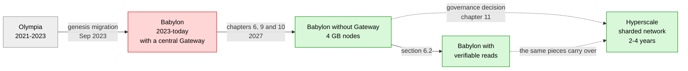
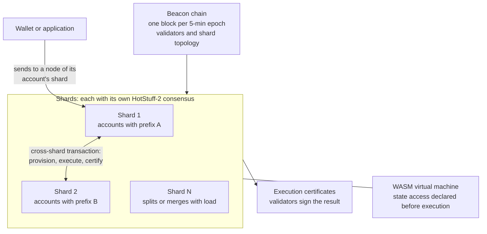
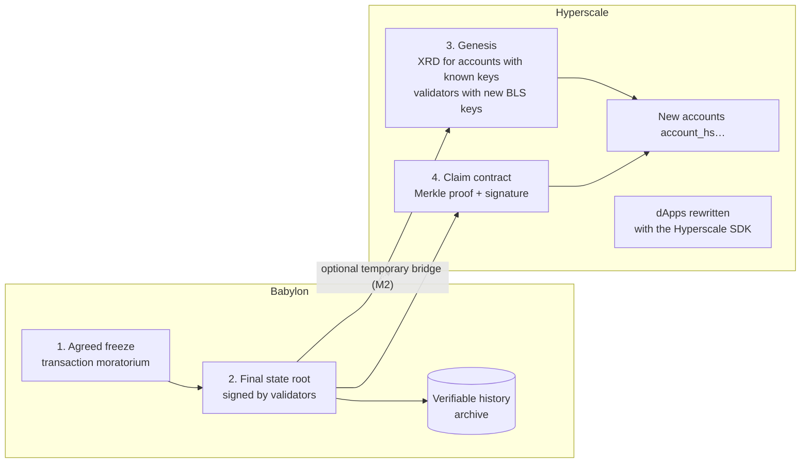
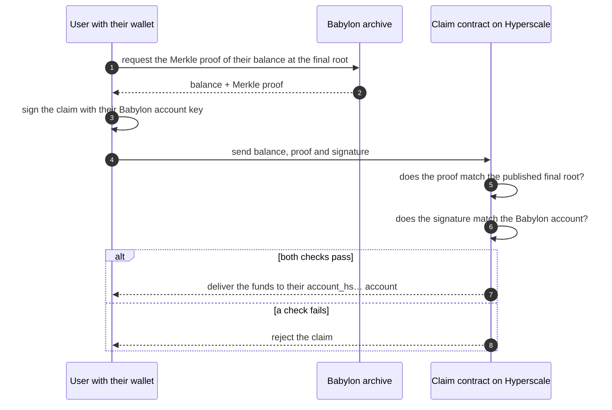

[← Index](../../README.md) · [Previous: Chapter 10: step-by-step implementation guide](10-implementation-guide.md) · [Next: Chapter 12: references from other decentralised networks](12-references-other-networks.md)

# 11. Final evolution: from Babylon to Hyperscale

> [!IMPORTANT]
> - **Is it possible?** Yes, with conditions: the network and funds can migrate; Scrypto contracts and dApps cannot, they must be rewritten. With the current code (in development) it is not yet possible in production.
> - **Difficulty:** Very high.
> - **Effort and timeline:** ~110-210 person-months excluding dApps; 2-4 years (estimate).

**Purpose of this chapter.** To describe what it would take for Radix to adopt Hyperscale as the final evolution of the network, who would have to do it, and how difficult it would be.

Hyperscale is open source and the Foundation is in maintenance mode. So if the community decides to adopt it, the community itself will have to adapt the Radix code and lead the migration.

## Verdict: is it possible to migrate Radix using the Hyperscale code?

**Yes, it is possible, but not directly and not with the code as it stands today.**

| What is migrated | Possible with the Hyperscale code? | Condition |
|---|---|---|
| The network (consensus, validators, nodes) | **Yes** | It is the purpose of `hyperscale-rs`. It needs completing for mainnet, and validators must generate new BLS keys. |
| XRD balances | **Yes** | With a genesis and a verifiable claim contract (strategy M1). Today's genesis already supports fee-token balances. |
| User accounts and keys | **Yes, with a new address** | Hyperscale accepts the same Ed25519 and secp256k1 keys, but addresses change (`account_rdx…` → `account_hs…`). |
| Other tokens, NFTs and stakes | **Yes, with additional development** | Genesis must be extended, or they are reissued through claims; there is no way to import them today. |
| Scrypto contracts and dApps | **No** | Hyperscale lists Scrypto compatibility as a non-goal. Every contract must be rewritten with its SDK. |
| Babylon's history | **Not inside Hyperscale** | It is kept separately, on archive nodes and verifiable distributed storage. |
| Current software (wallets, RDT, ROLA, explorers) | **Not without adaptation** | Different transaction format, addresses and API. Hyperscale does not yet have a read API or an indexer either. |

In short: the **network and funds** can migrate to Hyperscale; **applications** have to be rebuilt. With the current code (a development version, v0.0.6) **it is not yet possible in production**; the work described in sections [11.5](#s11-5) and [11.6](#s11-6) is needed.

## 11.1 What Hyperscale is

Hyperscale is a **sharded** network design: state is split across several shards, each with its own consensus, and capacity grows by adding shards. Its aim is to scale without losing **atomic composability**: a transaction that touches several shards commits on all of them or on none.

| Aspect | Hyperscale (`hyperscale-rs`) |
|---|---|
| Code | `github.com/hyperscalers/hyperscale-rs` and `github.com/hyperscalers/hyperscale-vm`, MIT or Apache-2.0 licence, in Rust |
| Activity | ~4,450 commits in hyperscale-rs, the vast majority from a single developer; latest published release v0.0.6 (Jan 2026); activity up to Nov 2026 |
| Maturity | Both repositories warn: "Work in progress. Do not use." |
| Consensus | Three layers: HotStuff-2 per shard, execution certificates, and a *beacon* chain (one block per 5-minute epoch) that manages validators and shards |
| Sharding | Dynamic: shards split or merge with load (off by default) |
| State model | A single Merkle tree (binary JMT, Blake3); each account and what it owns live on the same shard |
| Execution | Its own WASM virtual machine, with state access **declared before execution** |
| Networking | QUIC via iroh |
| Validator signatures | BLS12-381, with signature aggregation |
| User signatures | Ed25519, secp256k1 (the same as Babylon) and ML-DSA-65 (post-quantum) |
| Tests published by the Foundation | 500,000 TPS sustained and peaks above 800,000 on 128 shards (Feb 2026). They used the "Hyperscale" code whose author partially published it at `github.com/DanoshiFusermoto/Hyperscale`; the article does not mention `hyperscale-rs`, and that repository publishes no performance figures. |
| Project status (according to radix.wiki, a secondary source, Nov 2026; original RFC on RadixTalk) | `hyperscale-rs` was proposed as the production candidate in a community RFC (20 Apr 2026); only the first of six milestones was funded. On 3 Sep 2026 its developer stopped proposals, grants and engagements with Radix but kept developing the code, and considers Radix one of several candidate networks rather than the only one. He has said an upgrade path to Hyperscale exists and that he would guide it. |

## 11.2 Differences from Babylon that affect migration

| Aspect | Babylon (today) | Hyperscale |
|---|---|---|
| Contracts | Scrypto on Radix Engine | Its own SDK with declared access. **Scrypto compatibility is an explicit non-goal**, with no adaptation layer (`hyperscale-vm/docs/00-overview.md`) |
| Data encoding | SBOR | HBOR |
| Addresses | `account_rdx1…` (30 bytes, Blake2b) | `account_hs1…` (32 bytes, Blake3): **cannot be converted** |
| User keys | Ed25519 and secp256k1 | The same, plus ML-DSA. **Users can keep their current keys**, but their account will have a different address. |
| Validator keys | secp256k1 | BLS12-381: **every validator needs new keys** |
| Fees | Babylon's model, with developer royalties | All fees are burned; validators are paid from a fixed emission; **no royalties** |
| Packages | Immutable, with configurable components | Immutable; upgrades are done by publishing a new version that each user migrates to |
| Genesis | Used to migrate Olympia (balances, stakes, tokens, validators) | Only supports fee-token balances and staking pools; **no import of other tokens, NFTs or components** |
| Client API | Core API, Engine State API (and today the Gateway) | Minimal RPC: node status, submit, preview and transaction status. **No state reads, history or events.** |
| Routing | A single chain | Clients must know which nodes host the shard of each account |

**Conclusion of the comparison:** moving to Hyperscale **is not a protocol update** but a **migration to a new network**, similar to Olympia → Babylon in 2023 but deeper. Applications do not carry over: they have to be rewritten. According to radix.wiki (a secondary source), in August 2026 it was confirmed that a purpose-built virtual machine (`hyperscale-vm`) replaced the earlier work of adapting the Radix Engine to a sharded network.

## 11.3 Migration strategies

### M1. Genesis migration with verifiable claims (recommended)

> [!IMPORTANT]
> - **Is it possible?** Yes.
> - **Difficulty:** High.
> - **Effort and timeline:** included in the migration's 15-30 person-months (section [11.6](#s11-6), estimate).

> [!NOTE]
> **Reference from other networks:** Cosmos Hub migrated its state into a new genesis (`cosmoshub-3` → `cosmoshub-4`, 2021), and Uniswap's `MerkleDistributor` contract implements claims with a Merkle proof. See chapter [12](12-references-other-networks.md#s12).

1. **Freeze Babylon** at an agreed epoch. `v1.4.0.0` already includes a user-transaction "moratorium" mechanism (commit `8ea6cf97`, "Add support for user transaction moratoriums") that can serve as a basis.
2. **Publish Babylon's final state root** (the validator-signed `state_tree_hash` at the last epoch) and archive the ledger on archive nodes and distributed storage (sections [9.4](09-lighter-nodes.md#s9-4) (R9) and 9.6; a procedure similar to the Olympia archive, section [10.5](10-implementation-guide.md#s10-5)).
3. **Hyperscale genesis** with the XRD balances that can be assigned directly: accounts whose public key is already known because the account has signed at some point.
4. **A claim contract on Hyperscale** for everything else. The user presents:
   - a **Merkle proof** of their balance against Babylon's final root;
   - a signature with the key that controls that account, or the proof of its badge if the account is securified.

   The contract verifies both and delivers the funds to the new account. No operator has to be trusted.
5. **Other tokens and NFTs:** each project decides whether to reissue them on Hyperscale using the same balance proof.

**Why it is the recommended option:**

- it reuses pieces from this report (Merkle proofs and verified snapshots);
- it leaves no one behind, because anyone who has not claimed yet can do so later;
- it does not require trusting a bridge.

### M2. Coexistence with a bridge

> [!IMPORTANT]
> - **Is it possible?** Yes, as temporary support.
> - **Difficulty:** High.
> - **Effort and timeline:** included in the migration's 15-30 person-months (section [11.6](#s11-6), estimate). The bridge adds a security risk.

Babylon and Hyperscale run at the same time, and a bridge moves XRD and other assets.

- **Advantage:** migration is gradual, with no cut-over day.
- **Drawbacks:**
  - for years there are two networks to maintain, with liquidity split between them;
  - the bridge is an attack target.

  A bridge based on light clients (verifying signed proofs from both networks) is safer than a custodial one.
- **Reasonable use:** as a temporary complement to M1, to give dApps time while they are rewritten.

### M3. Making Scrypto compatible with Hyperscale

> [!IMPORTANT]
> - **Is it possible?** Not with Hyperscale's current design; only by forking it.
> - **Difficulty:** Very high. Not recommended.
> - **Effort and timeline:** not estimated, because it is not recommended.

It means running the Radix Engine inside Hyperscale, or translating Scrypto to its SDK. The full analysis is in section [11.4](#s11-4).

## 11.4 Can Scrypto be kept with Hyperscale?

> [!IMPORTANT]
> - **Is it possible?** Not with Hyperscale's current design. Only by forking it (strategy M3), and even then with limitations.
> - **Difficulty:** Very high. Not recommended.
> - **Effort and timeline:** the realistic alternative, rewriting contracts, depends on each project.

**Why it is not directly possible:**

- The Hyperscale virtual machine documentation lists "Scrypto or EVM compatibility" as a non-goal, with no adaptation layer (`hyperscale-vm/docs/00-overview.md`). It also rules out running several engines on the same network.
- Scrypto reads state it discovers during execution. Hyperscale requires **declaring beforehand** which state will be read or written, so the transaction can be split across shards; in its SDK, reaching for a key that cannot be declared is a compile error (`hyperscale-vm/docs/01-effects-and-routing.md`).
- The formats differ: SBOR versus HBOR, and different addresses.

**What does carry over, and eases the rewrite:**

- The Hyperscale SDK also uses Rust and a `#[blueprint]` macro, like Scrypto.
- It has native concepts similar to Babylon's: fungible and non-fungible resources, badges and authorisation rules, key-derived virtual accounts, personas, a metadata module with two-way dApp verification, and staking (`hyperscale-vm/docs/07-stdlib-and-upgrades.md`).
- So **business logic and Scrypto developers' knowledge can be reused**, even though the code must be rewritten.

**Realistic options:**

| Option | Is it possible? | Difficulty |
|---|---|---|
| Rewrite each contract with the Hyperscale SDK | Yes | Medium-high per project |
| Tools that help translate simple Scrypto contracts to the Hyperscale SDK | Partly | High |
| Fork Hyperscale to run the Radix Engine (M3) | Only with limitations: those contracts would lose cross-shard composability | Very high |

## 11.5 What the community would have to change or build

| Area | Work needed | Difficulty |
|---|---|---|
| **Hyperscale for mainnet** | Replace development values (e.g. `SHARD_CAPACITY=4`, provisional fee ratios); independent security audits; extend formal verification (bounded today); operator tooling (an equivalent of `babylon-nodecli`, *vnode* deployment); decide economic parameters (emission, fees, minimum stake) and make XRD the fee token | Very high |
| **Genesis and claims** | Extend Hyperscale genesis (other resources, stakes) or write the M1 claim contract; a tool to export Babylon's final state with proofs | High |
| **Babylon (exit side)** | Orderly freeze (moratorium), publication of the signed final root, a Merkle-proof endpoint (section [10.6](10-implementation-guide.md#s10-6)), archive nodes | Medium |
| **Hyperscale read API and indexer** | They do not exist today. State reads, events, receipts and history need adding, all shard-aware. The design of this report's light indexer, on-ledger discovery and light client can be reused. | High |
| **Sargon and iOS/Android wallets** | Support for HBOR, the new addresses and transaction envelopes, and shards; coexistence with Babylon during the transition; the claim flow; an address book linking old and new addresses. With the proposed `LedgerBackend` interface (section [10.4](10-implementation-guide.md#s10-4)), Hyperscale would be just another backend. | Very high |
| **Hardware wallet (Ledger)** | A new signing app for the Hyperscale format | Medium |
| **RDT, ROLA and Radix Connect** | New request types and login verification. Radix Connect (relay, WebRTC or iroh) can be reused as the channel. | Medium |
| **dApps** | **Rewrite every contract** with the Hyperscale SDK, redesigning patterns that read undeclared state; no royalties; migrate liquidity (DEXs, lending) | Very high, per project |
| **Explorers, exchanges, custodians, bridges (e.g. Hyperlane)** | Integration with the new network | Medium, per integration |
| **Governance** | Decide whether to adopt, the timeline, funding and parameters; communication to users | High (organisational) |

## 11.6 Effort and timeline

These are order-of-magnitude estimates for planning, not budgets:

| Block | Estimated effort |
|---|---|
| Harden Hyperscale for mainnet (excluding external audits) | 40-80 person-months |
| Read API, indexer and explorer for Hyperscale | 15-30 person-months |
| Migration: freeze, export, genesis, claims and temporary bridge | 15-30 person-months |
| Sargon, wallets, Ledger, RDT and ROLA | 40-70 person-months |
| **Core total (excluding third-party dApps)** | **~110-210 person-months**, in the order of **2-4 years** with a small team |

**Overall difficulty of the migration to Hyperscale: very high.** It is the largest project in this report.

## 11.7 Risks

- **Dependence on one person.** Almost all of `hyperscale-rs` was written by a single developer. The community would need to build a team that understands and maintains it.
- **Where the code goes.** Its developer considers Radix one of several candidate networks. If the project evolves in another direction, the community would have to maintain its own fork, which the licence (MIT or Apache-2.0) allows.
- **Maturity.** The project describes itself as in development and not ready for use.
- **Ecosystem.** Every dApp has to be rewritten; some may not be.
- **Users who do not claim.** Claims must stay open for a long time and be simple.
- **Security** of the claim contract and of any bridge.
- **Economics.** The fee model, emission and royalties change, which affects validators and developers.

## 11.8 How it fits with the rest of the report

1. **Babylon has to keep running for years**, because the migration would take 2 to 4 years. The work to remove the Gateway and lighten nodes (chapter [6](06-recommended-solution.md#s6), chapter [9](09-lighter-nodes.md#s9) and chapter [10](10-implementation-guide.md#s10)) is still needed.
2. **Many pieces are reused:**
   - the clients' `LedgerBackend` interface;
   - on-ledger node discovery;
   - the light indexer;
   - verified snapshots;
   - Merkle proofs and the light client.

   These same pieces are what Hyperscale and M1's claims need.
3. **Decision on R11 (migrating the Babylon node to Rust).** It makes sense to **apply R1-R9**, of moderate cost (R1-R4 in weeks; R5-R9 in months), and **postpone R11 until governance decides on Hyperscale**, because its effort (30-50 person-months) would compete with the migration. If Hyperscale is not adopted or is delayed, R11 is again the route to 4 GB nodes with headroom.
4. **An alternative worth comparing:** Cardano increases its Layer-1 capacity with Leios through a protocol hard fork on the same chain, without migrating to a new network (section [12.2](12-references-other-networks.md#s12-2)). Before deciding, governance should compare migrating to Hyperscale with continuing to improve Babylon on its own chain.
5. **Recommendation:** governance should first decide whether to adopt Hyperscale and with which strategy (M1, with M2 as temporary support). Meanwhile, keep this report's short-term plan, whose value does not depend on that decision.

---

[← Index](../../README.md) · [Previous: Chapter 10: step-by-step implementation guide](10-implementation-guide.md) · [Next: Chapter 12: references from other decentralised networks](12-references-other-networks.md)
