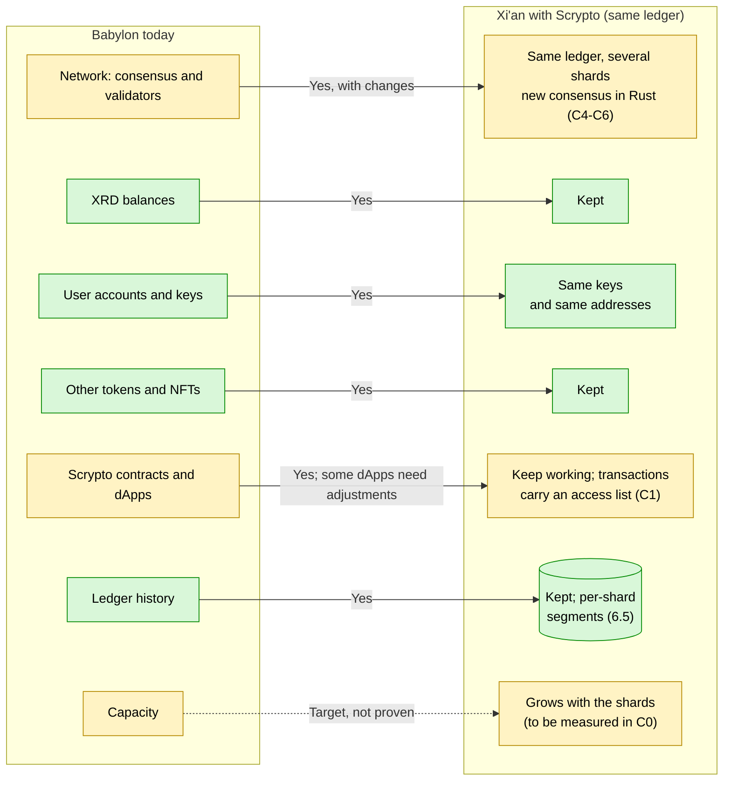
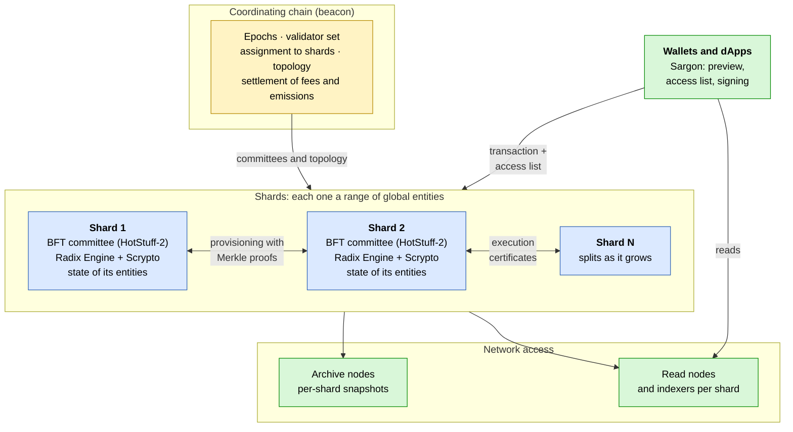
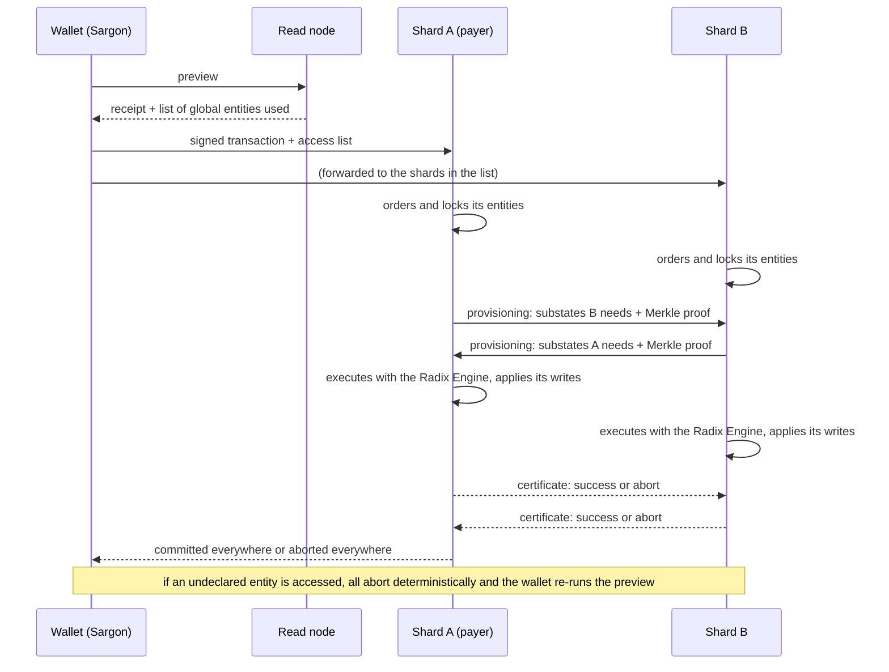
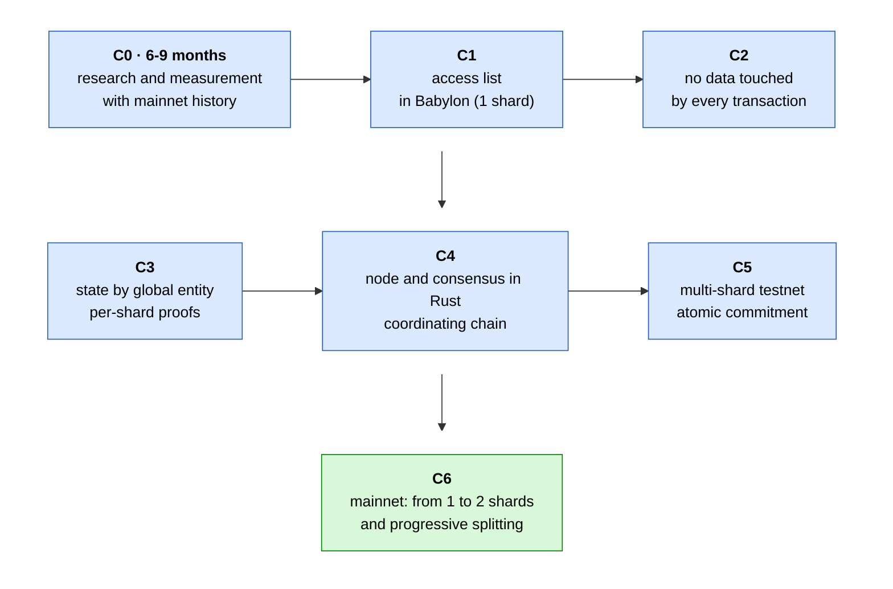

[← Index](../../README.md) · [Previous: Chapter 12: references from other decentralised networks](12-references-other-networks.md) · [Next: Sources, methodology and open questions](sources-and-methodology.md)

# 13. Alternative final stage: Xi'an with Scrypto, without migrating to Hyperscale

> [!IMPORTANT]
> - **Is it possible?** Yes, with conditions. The Radix Engine must be changed so that each transaction declares the global entities it uses, the data that almost every transaction touches today must be redesigned, and a new sharded consensus must be built. The final capacity is not proven for Scrypto: it has to be measured.
> - **Difficulty:** Very high. It is the hardest protocol change in this report, although it avoids rewriting dApps.
> - **Effort and timeline:** ~150-280 person-months and 3-5 years with a small team (estimate; section [13.10](#s13-10)).

Sections [13.2](#s13-2) to [13.8](#s13-8) and [13.10](#s13-10) develop the assessment in this box; 13.9 has its own.

**Aim of this chapter.** To describe a third final stage (**FINAL C**): Babylon evolving **on its own ledger**, through protocol updates, into a sharded network with atomic composability across shards and capacity that grows as shards are added, as Xi'an promised, **while keeping Scrypto, dApps, addresses and balances**. It explains which technologies to use, what infrastructure to build, what code to change and in which stages.

**Verified starting point:**

- Radix designed Babylon with sharding in mind. Its 2024 roadmap states that "the Radix Engine, already implemented in Babylon, was built with sharding in mind", and RDX Works described Babylon as "a fully shardable state model" (sources in section [13.12](#s13-12)).
- Babylon runs today on an **unsharded** form of Cerberus, according to Radix itself.
- The most recent public plan for Xi'an no longer keeps the Radix Engine. The RFC "Xi'an: Delivering Hyperscale for Radix" (April 2026) still used a Radix Engine integration, which its author described in the thread as not yet production-ready, aiming for "engine-level feature parity to Babylon". According to radix.wiki, in August 2026 that integration was replaced by a new virtual machine (`hyperscale-vm`). In the official Hyperscale Telegram channel, in August 2026, it was written (radix.wiki attributes these messages to its lead developer) that the sharding adjustments "are so many that it'd require touching everything" and that it is "easier to start with intention than to retrofit".
- This chapter **does not contradict** that assessment: it confirms that the engine, the state and the consensus must all be touched. What it shows is that there is a known technical path, with precedents in the literature, to do it **without losing Scrypto**. Governance can compare it with FINAL A (keep improving Babylon) and FINAL B (migrate to Hyperscale).

### Final stage C: what would happen with Xi'an with Scrypto

**Is it possible?** Yes, with conditions: each transaction declares the global entities it uses, state is reorganised and a new sharded consensus must be built. **Difficulty:** very high. **Scrypto is kept**, but the final capacity is not proven and must be measured (stage C0). Green: kept as is; yellow: kept with changes or still to be proven.

## 13.1 Verdict per goal

| Goal | Possible with Scrypto? | Condition | Difficulty |
|---|---|---|---|
| Sharding of state and execution | **Yes** | Reorganise state by global entity ([13.4](#s13-4)) | High |
| Atomicity across shards | **Yes, with conditions** | Each transaction declares in advance the global entities it uses; if it discovers another, it aborts deterministically and is retried ([13.3](#s13-3)) | Very high |
| Horizontal scalability (more shards, more capacity) | **Yes, with conditions** | Most transactions must touch few shards, and the data that almost every transaction touches must be removed ([13.5](#s13-5)); it must be measured | Very high |
| One million transactions per second | **Cannot be promised** | No network has demonstrated it with contracts like Scrypto; it is only a target to measure ([13.8](#s13-8)) | — |
| Keeping dApps, addresses and balances | **Yes** | dApps keep working; some with very dynamic patterns may need adjustments or see more aborts | Medium for the ecosystem |
| Reusing Hyperscale's consensus | **Only partly** | Its consensus is coupled to its virtual machine; pieces and designs are reused, not the whole ([13.6](#s13-6)) | High |

## 13.2 The core problem: Scrypto discovers during execution which state it uses

Every known protocol for atomic commitment across shards needs to know, **before execution**, which shards a transaction affects:

- **Cerberus** (Hellings, Hughes, Primero and Sadoghi; *Journal of Systems Research*, 2023), Radix's original design for Xi'an, assumes that each transaction's inputs and outputs can be determined *a priori* (assumption 2.2 of the paper).
- **Hyperscale** requires declaring every key read or written before execution, and its documentation lists Scrypto compatibility as a non-goal (section [11.4](11-hyperscale-evolution.md#s11-4)).
- **Solana** requires each transaction to specify upfront every account it reads or writes.
- **NEAR**, **MultiversX** and **TON** avoid the problem with asynchronous calls between shards, which do not guarantee the atomicity Xi'an aims for. In NEAR, if the second part fails, the first is not rolled back automatically (its documentation); in MultiversX, a failure of the called contract on another shard does not make the caller fail; in TON, messages between shards may execute in different blocks.

**What the Radix Engine does today** (checked in `radixdlt-scrypto`, `develop` branch):

- References in the manifest are extracted statically (`radix-transactions/src/model/preparation/references.rs:4-29`), with a maximum of 512 per intent (`transaction_validation_configuration.rs:95,107`).
- But during execution, any global address stored inside a substate that is read becomes a valid reference (`radix-engine/src/kernel/call_frame.rs:981-988`). So **a transaction can touch global entities that do not appear in its manifest**.
- In addition, some entities are always visible without being in the manifest (XRD, native packages; `radix-common/src/constants/always_visible_nodes.rs:8-40`), and each transaction's finalisation writes to the consensus manager and the transaction tracker ([13.5](#s13-5)).
- Neither the receipt nor the preview returns the list of what was read today: reads are dropped from the state updates (`radix-engine/src/track/track.rs:73-74`). Only debug mode records each opened substate with its `node_id` (`costing_entry.rs:503-509`), and that mode is not enabled in preview (`transaction_executor.rs:277-289`).

**The solution this chapter proposes** combines two techniques with published precedents:

1. **Declare only global entities**, not each substate. An entity's internal nodes (its vaults, key-value stores and owned objects) are stored in the same shard as the entity ([13.4](#s13-4)), so they can be discovered freely during execution. This is the same idea as **Pilotfish** (Kniep et al., arXiv:2401.16292, Sui's scale-out execution engine, a proof of concept): dynamic access is allowed within the hierarchy of a declared root object.
2. **Reconnaissance and deterministic retry**, the **OLLP** technique of **Calvin** (Thomson et al., SIGMOD 2012):
   - a prior read-only query discovers the read/write set;
   - the real transaction is sent with that set;
   - if the set is no longer valid at execution time, it restarts deterministically.
   
   In Radix, the prior query is the **preview** the wallet already runs before signing. Pilotfish uses a variant: when it discovers a new object, it re-proposes the augmented transaction to the shards that hold it.

**Consequence for dApps:** those that always touch the same entities (most transfers, swaps against a specific pool, loans with a known position) work as before. Those that choose at run time which component to call based on frequently changing state (for example, a router that looks for the best pool at that moment) will see more aborts and retries. How many there are must be measured (stage C0).

## 13.3 Access declaration and deterministic abort

**Changes in `radixdlt-scrypto`:**

| Component | Change |
|---|---|
| `radix-transactions` | New transaction version with an **access list**: global entities and mode (read or write). Validation: maximum size, no duplicates, consistency with the manifest's static references. |
| `radix-engine` (`kernel/call_frame.rs`, `system/system_callback.rs`) | When opening a substate, check that its **root global entity** is in the list with the right mode. If not, abort with a new deterministic error, charging the fee up to that point. |
| `radix-engine` (`track/`) | Record the global entities opened and their mode. The instrumentation already exists (`IOAccess::ReadFromDb` in `track/interface.rs:234-238`, `OpenSubstateEvent` in `costing_entry.rs:503-509`); it must be exposed as a list in the preview receipt. |
| `radix-engine` (`updates/`) | A new protocol update that enables all of the above. The mechanism already exists (Anemone, Bottlenose, Cuttlefish, Dugong; `updates/protocol_updates.rs:225-261`). |

**Changes in clients:**

- **Sargon, the Radix Engine Toolkit and wallets:** run the preview, read the access list from the receipt, add it to the transaction and sign it. If the transaction aborts because of an undeclared access, re-run the preview and sign again. For a wallet that signs on a phone, a retry may require another confirmation from the user; a margin helps (also declaring entities the preview considers likely).
- **Ledger app:** sign the new transaction format.
- **SDK and RDT:** build transactions with an access list.

**Gradual introduction:** at first the list is optional and informational only, like EIP-2930 in Ethereum, where accesses outside the list are allowed but cost more. That measures how many transactions would comply. It then becomes mandatory, before the state is split into several shards.

## 13.4 Reorganising state by global entity

**Today** (checked in the code):

- A `NodeId` is 30 bytes: 1 for the entity type and 29 derived from a hash (`radix-common/src/types/node_and_substate.rs:23-27`).
- Each node's database key is a 20-byte prefix of the hash of the `NodeId` followed by the `NodeId` itself (`radix-substate-store-interface/src/db_key_mapper.rs:107-108, 167-172`). The state tree (JMT) has three tiers: entity, partition and substate (`radix-substate-store-impls/src/state_tree/`).
- Internal nodes (for example, an account's vault) have their own `NodeId` and, because of that hash, **end up scattered**, away from their global entity. The engine does not store who owns an internal node. Only the Babylon node computes that relation, in its own index (`substate_node_ancestry_records`, `state-manager/src/store/column_families.rs:185-190`; `staging/node_ancestry_resolver.rs:75`).

**Proposed change:**

- Each node's key becomes **"hash of its root global entity" + `NodeId`**. A global entity and everything it owns then form a contiguous subtree of the state tree, and a shard is a **prefix range** of that tree. This is the same principle as Hyperscale (key = owner + local, "keys never change across splits and merges") and as Pilotfish's hierarchies.
- The engine must know the root when writing an internal node. The logic that the node's ancestry index computes today must move into the engine or the storage layer.
- **Case to study:** if an internal node can move from one global entity to another, its key would change (delete and create). The ancestry index already records each node's parent and root; stage C0 must measure on mainnet data how often this happens.
- **Migration:** a protocol update that rebuilds the state tree with the new keys. Earlier roots are kept on archive nodes. It is a large operation, comparable to R9 (section [9.4](09-lighter-nodes.md#s9-4)), and is tested on Stokenet first.
- **Per-shard proofs:** the tree already produces roots signed by validators (`state_tree_hash`). The Merkle-proof endpoint from section [6.2](06-recommended-solution.md#s6-2) also lets one shard prove a substate's value to another.

## 13.5 Data that almost every transaction touches today

In a sharded system, a piece of data that every transaction writes forces every transaction through the same shard. Babylon has three (checked in the code):

| Data | What happens today | Proposed change | Reference in other networks |
|---|---|---|---|
| **Transaction tracker** (prevents replaying an intent) | Each transaction reads its `intent_hash` in a per-epoch partition and **always rewrites** the tracker field (`radix-engine/src/system/system_callback.rs:555-590, 893-977`; 100-epoch partitions in `transaction_tracker/package.rs:24-26`) | One tracker **per shard**: the intent is recorded in the fee payer's shard, which always participates in the transaction. The global field is replaced by per-shard counters | In Sui, the transaction names the version of each owned object it uses (Sui documentation) |
| **Fees** | Finalisation reads the current leader and writes the proposer rewards and the consensus manager's rewards vault in **every** transaction whose fee has a share for the proposer or validators, that is, practically all of them (`system_callback.rs:642-881`, condition at line 788). The split is: tips 100 % to the proposer; network fees 25 % proposer, 25 % validator set, the rest burned (`radix-common/src/constants/transaction_execution.rs:41-50`) | Accumulate fees **per shard** and settle them once per epoch via the coordinating chain ([13.6](#s13-6)), keeping the same percentages | Hyperscale burns fees in the payer's shard and pays validators from emission (its VM documentation) |
| **Rounds and proposal statistics** | One system transaction per round updates the consensus manager (`consensus_manager.rs:888, 1097`) | Rounds **per shard**; epochs, the validator set and emissions on the coordinating chain. Fits with R10 (section [9.4](09-lighter-nodes.md#s9-4)) | Hyperscale's beacon chain |

**Entities everyone reads but almost nobody writes** (native packages, the XRD resource, whose supply is not tracked: `system/bootstrap.rs:415`): they are **replicated on every shard** as read-only state, and change only through protocol updates. Other resources with tracked supply stay in their shard: minting or burning includes that shard in the transaction.

## 13.6 Sharded consensus: which technology to use and what to reuse from Hyperscale

**Today:** Babylon's consensus is HotStuff in Java, with a three-consecutive-QC commit rule (`core/src/main/java/com/radixdlt/consensus/safety/SafetyRules.java:181-190`). Java calls Rust to prepare and commit (`RustStateComputer.java:110,119`; `state-manager/src/jni/state_computer.rs:68,84`). The validator set is at most 100 (`mainnet_genesis`, `radix-engine-interface/src/blueprints/consensus_manager/invocations.rs:59-65`).

**Proposed architecture** (the same design family as Cerberus and Hyperscale):

1. **Per-shard consensus:** each shard has its own validator committee and its own chain with a HotStuff-family BFT. HotStuff-2 (two-phase commit, the one Hyperscale uses) needs one phase fewer than the current three-QC rule.
2. **Coordinating chain (beacon):** manages epochs, the validator set, random assignment of validators to shards, shard topology and the settlement of fees and emissions. It does not process user transactions.
3. **Atomic commitment across shards**, in three steps (Cerberus; "provision-execute-certify" in Hyperscale):
   - **order:** each shard involved includes the transaction in its block and locks the declared entities;
   - **provision:** each shard sends the others the substates they need to read, with a Merkle proof against its certified state root;
   - **execute and certify:** each shard runs the whole transaction with the Radix Engine, deterministically and with the same inputs, applies only its own writes and votes on the outcome. If one shard aborts, all abort.
4. **Aggregated signatures (BLS)**, so certificates between shards stay small. Hyperscale uses BLS through the `blst` library.

**Reusing `hyperscale-rs`** (MIT or Apache-2.0 licence; checked in its code, commit `6204357`):

- **Reusing the whole consensus is not easy.** There is no interface for swapping the execution engine: `engine::Executor` is a concrete struct, and its virtual machine's types appear in `types`, `core`, `shard`, `mempool`, `execution`, `provisions` and storage. Its cross-shard protocol assumes access is declared key by key, and its documentation explicitly rules out optimistic execution and multiple engines.
- **Reusable with little effort:** the networking libraries on iroh (`network`, `network-iroh`), cryptography and BLS (`crypto`, `crypto-bls`), metrics, and the *sans-io* pattern with a deterministic simulator that replays a run byte for byte from a seed.
- **Reusable as reference designs**, reimplemented or extracted with considerable work: per-shard HotStuff-2, the coordinating chain with weighted time, provisioning with Merkle proofs, make-before-break shard splitting and the Quint formal models in the `specs/` folder.
- **Size, for reference:** the consensus core of `hyperscale-rs` (`types`, `shard`, `beacon`, `node`) totals ~247,000 lines of Rust, and cross-shard coordination (`execution`, `provisions`, `remote-headers`, `mempool`) ~62,000, tests included.

**Recommendation:** write the new consensus in Rust **inside `babylon-node`**, replacing the Java part. This **replaces R11** (section [9.4](09-lighter-nodes.md#s9-4)): that effort is not duplicated. Hyperscale's independent libraries are reused, and its designs and specifications serve as references, citing the licence.

## 13.7 Final infrastructure

**A transaction across two shards:**

## 13.8 Capacity: what can and cannot be claimed

| Test | What was measured | Limits |
|---|---|---|
| Hyperscale public test (January 2026) | 500,000 transactions per second sustained, with more than 100 shards (128 according to the February post), swaps, including atomic cross-shard transactions | Radix itself calls it "non-validated"; the peak figures differ between its posts (over 700,000 and over 800,000); it does not use Scrypto; the logs had not been published |
| Radix, 2019 | 1.4 million per second replaying Bitcoin's history | Tempo consensus, not Cerberus; no smart contracts |
| NEAR (December 2025) | 1 million per second with 70 shards | Native transfers only and with relaxed safeguards; not atomic across shards |
| Aptos, Shardines (2025) | Over 1 million per second on a 30-machine cluster | Secondary source; no evidence of mainnet use |
| Babylon today | "At least 50 DeFi transactions per second", according to Radix | Unsharded |

**Honest conclusion:**

- No network has demonstrated one million transactions per second with contracts that compose atomically across shards like Scrypto. **That figure cannot be promised.**
- Capacity would grow with the number of shards **if** most transactions touch few shards and aborts from undeclared accesses are rare. Both can be measured before building anything, using mainnet history (stage C0).
- The capacity of one shard with the Radix Engine has not been measured either. It is measured by replaying mainnet history on a node with the current engine.
- **Security limits the number of shards.** Each shard needs a large enough validator committee. With today's 100 validators there is room for few secure shards. To grow, `max_validators` must be raised through a protocol update, and one operator must be able to run several validator identities (Hyperscale's *vnodes*).

## 13.9 Global order for APIs and history

> [!IMPORTANT]
> - **Is it possible?** Yes. The derived order is computed from data that is already final; it only needs to be fixed in the specification.
> - **Difficulty:** Medium.
> - **Effort and timeline:** included in stages C0 (specification), C5 and C6 (estimate).

**The problem.** The API format wallets use today (the Gateway's) and this report's indexes rely on **a single global sequence**, `state_version`:

- `at_ledger_state` pins one version so that several reads are consistent with each other;
- the transaction stream and pagination cursors move along it;
- indexes are ordered and pruned by it.

With several shards, each has its own height and that single sequence no longer exists. Daffy, a community member, raised this in relation to Hyperscale. The Hyperscale developer asked where the requirement came from, and the answer is that **it comes from the API, not from the protocol**. It affects FINAL B and FINAL C alike.

**A two-level proposal:**

1. **Compatibility:**
   - A **derived order** that every node or indexer computes the same way from finalised data. For example, by coordinating-chain epoch and round, then by shard number, then by height within the shard.
   - A cross-shard transaction takes a single position: that of its final certificate.
   - This rule must be **written into the protocol specification**, so nobody builds on an order that might change.
   - If the coordinating chain periodically records each shard's certified heights (a "cut"), that cut serves as `at_ledger_state` for reads that are consistent across shards.
2. **Long term:** a shard-native API, with one cursor per shard and causal order between them. It needs no total order, and it is the one new clients should adopt.

**Cost:** small compared with the rest of the chapter. It is part of stages C5 and C6, and its specification part of C0.

## 13.10 Stages and steps

| Stage | What is done | Repositories and code | Criterion to move on |
|---|---|---|---|
| **C0. Research and measurement** | Replay mainnet history with an instrumented engine. Measure: global entities per transaction, share of transactions that would touch more than one shard with N shards, accesses the preview would not have predicted, how often an internal node changes root, per-shard throughput. Specify the protocol in Quint or TLA+ | `radixdlt-scrypto` (instrumentation in `track/` and `kernel/`), a new replay tool on top of `babylon-node` | Published data showing that most transactions touch few shards and that aborts would be rare |
| **C1. Access list** | New transaction version; list optional, then mandatory; deterministic abort. Still a single shard | `radix-transactions`, `radix-engine`, `updates/`; Sargon, Radix Engine Toolkit, wallets, Ledger app, RDT | Protocol update enacted; wallets always generate the list |
| **C2. Shared data** | Per-shard transaction tracker, fees accumulated and settled per epoch, replicated read-only entities | `radix-engine` (`system_callback.rs`, `transaction_tracker/`, `consensus_manager/`) | No user transaction writes data shared by all |
| **C3. State by global entity** | New keys (root + `NodeId`), tree rebuild, per-shard Merkle proofs, per-shard verified snapshots (R9) | `radix-substate-store-interface`, `radix-substate-store-impls`, `babylon-node`'s `state-manager` | Migration tested on Stokenet; roots and proofs verified |
| **C4. Node and consensus in Rust** | Replace Java HotStuff with a Rust consensus; coordinating chain; BLS signatures. Replaces R11 | `babylon-node` (new consensus module; retire Java `core/` and the JNI bridge); networking and BLS libraries from `hyperscale-rs` | Mainnet running on the new node with a single shard |
| **C5. Several shards on testnet** | Atomic commitment across shards, provisioning with proofs, shard splitting, validator assignment; read nodes and indexer per shard | `babylon-node`, `radix-lite-indexer`, `babylon-nodecli`; deterministic simulator | Weeks of stable operation; external audits; capacity measured and published |
| **C6. Sharded mainnet** | Split the single shard into two, then according to load; increase the number of validators | Protocol updates; coordinating-chain configuration | Each split is first decided by governance (as NEAR schedules splits in protocol upgrades); later, automatic based on load (as in TON or CockroachDB) |

**Estimated effort** (order of magnitude, for planning):

| Block | Effort |
|---|---|
| C0: measurement and formal specification | 8-15 person-months |
| C1: access list in engine and clients | 15-30 person-months |
| C2: shared data | 10-20 person-months |
| C3: state by global entity and proofs | 15-30 person-months |
| C4: node and consensus in Rust with coordinating chain (includes R11) | 40-70 person-months |
| C5: atomic commitment, splitting, sync, per-shard reads | 45-85 person-months |
| Testing, simulator and formal verification (excluding external audits) | 15-30 person-months |
| **Total** | **~150-280 person-months**, of the order of **3-5 years** |

C6 (splits on mainnet) has no row of its own: it is included in C5 and in the protocol updates.

**Basis of the estimate:** the figures for R11 (30-50 person-months, section [9.4](09-lighter-nodes.md#s9-4)) and for hardening Hyperscale for mainnet (40-80, section [11.6](11-hyperscale-evolution.md#s11-6)), plus the size of the equivalent part of `hyperscale-rs` (~310,000 lines of consensus and cross-shard coordination, tests included). It is an estimate, not a budget.

## 13.11 Comparing the three final stages

| | **FINAL A**: keep improving Babylon | **FINAL B**: migrate to Hyperscale | **FINAL C**: Xi'an with Scrypto |
|---|---|---|---|
| Sharding and horizontal scalability | No | Yes, by design | Yes, with the conditions of 13.3-13.5 |
| Atomicity across shards | Not applicable (single shard) | Yes | Yes, with aborts on undeclared accesses |
| Scrypto and current dApps | Kept | Must be rewritten | Kept; some may need adjustments |
| Addresses and balances | Kept | Migration with claims | Kept |
| New network | No | Yes | No: protocol updates |
| Maturity of the starting code | In production | In development ("Do not use") | The engine is in production; the sharded consensus must be built |
| Effort (estimate) | R1-R11: ~40-65 person-months | ~110-210 person-months **plus** rewriting dApps | ~150-280 person-months |
| Timeline (estimate) | 1-3 years | 2-4 years | 3-5 years |
| Difficulty | Medium to very high (R11) | Very high | Very high |

**When each one makes sense:**

- **A:** if network demand does not require more capacity in the coming years.
- **B:** if capacity and reaching a sharded network sooner are the priority, accepting that the ecosystem is rewritten.
- **C:** if keeping dApps, addresses and ledger continuity is the priority, accepting a longer project whose outcome must be validated by stage C0.

**Recommendation:** stage **C0 is cheap and useful for all three options**: it measures with real data how many transactions would cross shards and how the Radix Engine performs. It should be done before governance chooses between A, B and C. In addition, C1 and C2 improve Babylon even if it is never sharded.

## 13.12 References

- Cerberus: Hellings, Hughes, Primero and Sadoghi, *Journal of Systems Research*, vol. 3, no. 1, 2023 ([JSys](https://www.jsys.org/bibliography/2023-06-06-hellingsProblem.html), [arXiv:2008.04450](https://arxiv.org/abs/2008.04450)); [Radix: Cerberus peer-reviewed](https://www.radixdlt.com/blog/cerberus-consensus-peer-reviewed).
- Calvin and OLLP: Thomson et al., SIGMOD 2012, section 3.2.1 ([PDF](https://cs.yale.edu/homes/thomson/publications/calvin-sigmod12.pdf)).
- ByShard: Hellings and Sadoghi, PVLDB, vol. 14, no. 11, 2021 ([PDF](https://www.vldb.org/pvldb/vol14/p2230-hellings.pdf)).
- Chainspace and S-BAC: Al-Bassam et al. ([arXiv:1708.03778](https://arxiv.org/abs/1708.03778)).
- Pilotfish: Kniep et al. ([arXiv:2401.16292](https://arxiv.org/abs/2401.16292); [Sui blog](https://www.sui.io/blog/pilotfish-execution-scalability-blockchain)).
- Sui: [object ownership](https://docs.sui.io/concepts/object-ownership); Mysticeti ([arXiv:2310.14821](https://arxiv.org/abs/2310.14821)).
- Solana: [runtime and account declaration](https://github.com/solana-labs/solana/blob/master/docs/src/validator/runtime.md).
- Aptos: Block-STM ([arXiv:2203.06871](https://arxiv.org/abs/2203.06871)); Shardines ([crypto.news](https://crypto.news/aptos-introduces-shardines-for-horizontal-scalability-with-1m-tps/), secondary source).
- NEAR: [cross-contract calls](https://docs.near.org/smart-contracts/anatomy/crosscontract); [NEP-568, resharding](https://github.com/near/NEPs/blob/master/neps/nep-0568.md); [1 million per second test](https://blog.nearone.org/announcement/2025/12/11/scaling-near-to-1m-tps.html).
- Ethereum: [EIP-2930](https://eips.ethereum.org/EIPS/eip-2930); [EIP-7928](https://eips.ethereum.org/EIPS/eip-7928).
- MultiversX: [contract-to-contract calls](https://docs.multiversx.com/developers/developer-reference/sc-to-sc-calls). TON: [infinite sharding paradigm](https://docs.ton.org/v3/documentation/smart-contracts/shards/infinity-sharding-paradigm). CockroachDB: [load-based splitting](https://docs.cockroachlabs.com/docs/stable/load-based-splitting).
- Radix: [2024 roadmap](https://www.radixdlt.com/blog/radix-labs-roadmap---to-hyperscale-and-beyond); [post-Babylon thoughts](https://www.radixdlt.com/blog/the-road-post-babylon-thoughts-from-the-ceo-of-rdx-works); [Babylon throughput](https://www.radixdlt.com/articles-learn/what-is-the-throughput-tps-of-radixs-babylon-mainnet); [500k test](https://www.radixdlt.com/blog/hyperscale-update-500k-public-test-done); [closing the interim chapter](https://www.radixdlt.com/blog/interim-hyperscale-closing-the-chapter); [2019 test](https://www.radixdlt.com/blog/scaling-dlt-to-over-1m-tps-on-google-cloud); [Xi'an RFC](https://radixtalk.com/t/rfc-xian-delivering-hyperscale-for-radix/2280); Hyperscale channel messages ([10336](https://t.me/hyperscale_rs/10336), [6019](https://t.me/hyperscale_rs/6019)).
- Code: `radixdlt-scrypto` (`develop` branch, commit `a405d7ae48`, Jan 2026), `babylon-node` (`develop` branch), `hyperscale-rs` (commit `6204357`, 30 Oct 2026) and the `hyperscale-vm` documentation.

---

[← Index](../../README.md) · [Previous: Chapter 12: references from other decentralised networks](12-references-other-networks.md) · [Next: Sources, methodology and open questions](sources-and-methodology.md)
