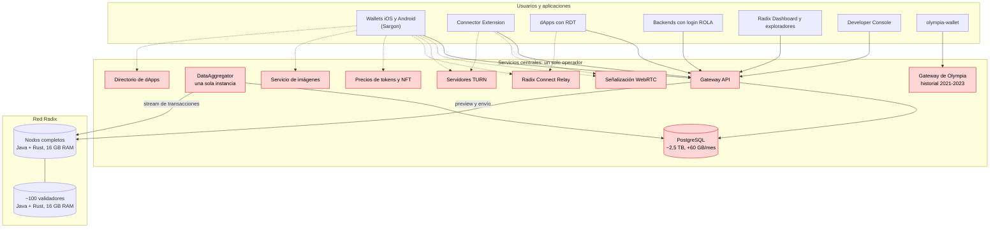
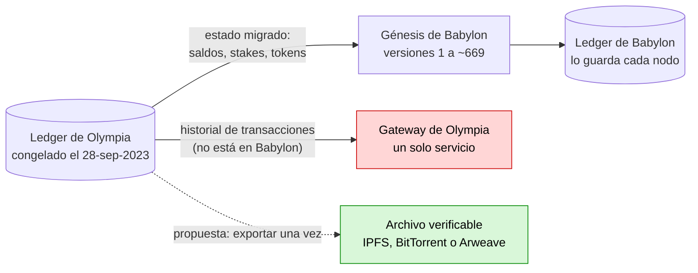

[← Índice](../../README.es.md) · [Siguiente: Sección 3: qué ofrece hoy el nodo y qué le falta](02-que-ofrece-el-nodo.md)

# Alcance

**Objetivo.** Que la red Babylon de Radix sirva **a cualquier usuario y en cualquier caso de uso** sin depender del Babylon Network Gateway: el servicio REST + DataAggregator + PostgreSQL que hoy publica `mainnet.radixdlt.com`. La lista de casos de uso es la siguiente:

- wallets;
- dApps;
- inicio de sesión con ROLA;
- exploradores;
- gobernanza;
- agentes;
- herramientas de desarrollo.

**Principio de diseño: todo en la capa 1.** El objetivo de Radix es escalar y ofrecer todas sus funciones en la capa 1, sin recurrir a soluciones de capa 2 (rollups, cadenas laterales o cadenas asociadas). Todas las propuestas de este informe respetan ese principio:

- El indexador ligero, los nodos de lectura y el descubrimiento de puntos de acceso son infraestructura para **leer** el estado de la capa 1. No ejecutan transacciones ni mantienen un estado propio en el que la red tenga que confiar.
- La poda, los snapshots verificados, la migración a Rust y las lecturas verificables son cambios en el software de los nodos de la capa 1.
- Los incentivos para servir lecturas se pagarían en la propia capa 1 (por ejemplo, mediante un componente en el ledger), según decida la gobernanza.
- Hyperscale escala **en la propia capa 1**, mediante fragmentación con composición atómica, lo que es coherente con ese objetivo.
- El puente de la estrategia M2 solo conectaría dos redes de capa 1 durante la transición, y es opcional.

Las referencias a mecanismos de capa 2 o de cadenas asociadas en otras redes (capítulo 12) se incluyen solo como contraste, no como modelo.

**Repositorios analizados.**

- **En local:**
  - `babylon-wallet-android` y sus forks;
  - `radix-dapp-toolkit`;
  - `connector-extension` y `connector-extension-iroh`;
  - `radix-connect-iroh` y `radix-connect-webrtc`;
  - `radixdlt-rust-sdk`;
  - `consultation_v2` y `consultation_v3`;
  - `governance-framework`;
  - `wallet-agent-ai`;
  - `Radix-Desktop-Tool`;
  - `olympia-wallet`;
  - `wallet-compatible-derivation`;
  - `reference/hyperscale-rs`.
- **Clonados de GitHub** (no estaban en el equipo):
  - `radixdlt/babylon-node`;
  - `radixdlt/babylon-gateway`;
  - `radixdlt/sargon`;
  - `radixdlt/babylon-wallet-ios`;
  - `radixdlt/rola`;
  - `radixdlt/babylon-nodecli`;
  - `radixdlt/explorer`, el explorador de Olympia (ver 2.2).
- **No públicos:** el código del Radix Dashboard y de la Developer Console no está en la organización `radixdlt` de GitHub. Se tratan como clientes de caja negra.

# Infraestructura actual

En rojo, los servicios que dependen de un solo operador.

# 1. Situación actual: datos

## 1.1 El Gateway y su financiación

| Dato | Valor | Fuente |
|---|---|---|
| Tamaño de la base de datos del Gateway (feb. 2026) | **~2 TB, crecimiento ~60 GB/mes** | RFP de la Foundation, 3-feb-2026 |
| Tamaño estimado hoy, nov. 2026 | ~2,5 TB (2 TB + 9 meses × 60 GB) | cálculo |
| Requisitos del RFP | 99,9 % de disponibilidad, <1 s de latencia, despliegue blue/green | RFP |
| DataAggregator | **Una sola instancia**: las transacciones se procesan en orden | Foundation, radixtalk 2202, posts 15 y 22 |
| Operador actual | El antiguo equipo DevOps de la Foundation, como operación independiente | Blog, 28-abr-2026 |
| Financiación | **Hasta finales de diciembre de 2026** | Blog, 28-abr-2026 |
| Coste para un tercero | ~300-400 €/mes solo el Gateway; ~500 €/mes con relé y señalización (2 servidores de 190 €/mes para Postgres con failover) | Propuesta comunitaria, radixtalk 2202, post 26 |
| Carga estimada | ~250 000 peticiones/hora (~69 por segundo) | Estimación comunitaria, radixtalk 2202, post 29 |
| Xi'an / Hyperscale | «requeriría construir un Gateway completamente nuevo»; el actual no es reutilizable | Foundation, radixtalk 2202, post 15 |
| Señalización WebRTC | ~6 000 conexiones simultáneas en pico | RFP |

## 1.2 Mediciones propias de mainnet (3-nov-2026, con la API pública)

| Medida | Valor |
|---|---|
| `state_version` actual | 567 005 616 (época 355 117) |
| Ritmo de versiones de estado | **~3,6/s de media** desde junio de 2026; 4,4/s en la muestra de hoy. Cada ronda de consenso es una versión. |
| Transacciones de usuario/día (muestra de 100 transacciones en cada fecha) | nov-23: 1,5k · mar-24: 5,5k · jul-24: 11,6k · nov-24: 20,7k · **mar-25: 34,7k (pico)** · jul-25: 8,4k · nov-25: 5,9k · mar-26: 3,4k · jul-26: 2,2k · oct-26: 4,4k |
| Total estimado de transacciones de usuario desde la génesis | **~10-15 millones** (integración aproximada, ±50 %) |
| Peso de las transacciones de usuario | **~2-3 % de las versiones de estado** en todo el historial (~10-15 millones de ~567 millones); hoy, menos del 1 %. El resto (~97-98 %) son cambios de ronda y de época. |
| Ventana histórica del nodo | `state_version_history_length = 60 000` versiones por defecto, **≈ 4-5 horas** al ritmo actual |

**Consecuencia clave.** Casi todo el volumen del Gateway viene de guardar la historia completa de cada substate, incluidos los ~555 millones de cambios de ronda. Un índice que solo registre lo que necesitan los clientes trabaja con ~10-15 millones de transacciones de usuario. Es un problema **unas 40-50 veces más pequeño**.

# 2. Quién depende del Gateway y para qué

| Cliente | Endpoints del Gateway que usa | Para qué |
|---|---|---|
| **Sargon** (Rust, compartido por iOS y Android) | `transaction/{construction, preview, preview-v2, submit, status, subintent-status}`, `status/gateway-status`, `state/entity/details`, `state/entity/page/{fungibles, non-fungibles, non-fungible-vaults, non-fungible-vault/ids}`, `state/account/page/{resource-preferences, authorized-depositors}`, `state/non-fungible/{location, data}`, `extensions/entities-by-role-requirement/lookup` | Revisión de transacciones y comisiones, envío y seguimiento, pre-autorizaciones, cuentas securificadas o borradas, MFA y shields, borrado de cuenta, RNS, precio de NFT |
| **Wallet Android** (Kotlin, además de Sargon) | `state/entity/details`, `state/entity/page/{fungibles, non-fungibles, non-fungible-vault/ids, metadata}`, `state/non-fungible/data`, `state/account-lockers/touched-at`, `state/account-locker/page/vaults`, `transaction/{construction, account-deposit-pre-validation}`, `stream/transactions`, `status/gateway-status` | Saldos, NFT, pools, validadores, LSU, reclamaciones de stake, metadatos de dApps, recuperación de cuentas, lockers, prevalidación de depósitos, **historial** |
| **Wallet iOS** (Swift, además de Sargon) | Los mismos, más `state/entity/page/fungible-vaults` | Igual |
| **Radix dApp Toolkit** | `transaction/status`, `transaction/subintent-status`, `state/entity/page/metadata` | Seguir la transacción que envía el wallet; nombre de la dApp en el botón |
| **ROLA** (`radixdlt/rola`) | `state/entity/details` (metadato `owner_keys`) | **Login de cualquier dApp.** Se consulta en cada inicio de sesión (`typescript/src/rola.ts:49-87`, `gateway.ts:14-38`). Por defecto usa la URL pública. |
| **Connector Extension** | `transaction/status` (a través del `GatewayModule` de la RDT) | Notificación de transacción confirmada |
| **Exploradores de transacciones** (Radix Dashboard, código no público; exploradores comunitarios) | No verificable en el Dashboard; por sus funciones, prácticamente toda la API, incluidas las extensiones de **titulares de recursos**, ubicación de NFT, historial filtrado de **cualquier** entidad, uptime de validadores, KV-stores, paquetes, esquemas y `at_ledger_state` | Ver la sección 2.1 |
| **Developer Console** (código no público) | No verificable; por sus funciones, al menos preview, envío, estado y detalles de entidad | Despliegue de paquetes, manifiestos |
| **Consultation** (gobernanza) | `state/entity/details`, `state/key-value-store/{keys, data}`, `stream/transactions`, `transaction/committed-details`, `status/gateway-status`, saldos y NFT **con `at_ledger_state` histórico** | Propuestas, votos, recuento con snapshot |
| **radixdlt-rust-sdk** | `status/gateway-status`, `state/entity/page/fungibles`, `transaction/{status, committed-details, submit, construction, preview}`, `state/entity/details` | SDK genérico para firmar y enviar |
| **wallet-agent-ai** | ~25 llamadas: detalles de entidad, preview, envío, estado, stream, validadores, uptime | Agente con wallet propia |
| **Exchanges e integradores** | Según la especificación de la Core API, se recomienda que usen los endpoints `/lts/` del propio nodo (`core-api-schema.yaml:83-89`, v1.4.0.0) | Depósitos, retiradas y seguimiento de transacciones. Quien siga esa recomendación **no depende del Gateway**. Quien use el Gateway o la Mesh API (eliminada en v1.4.0.0) debe pasar a la LTS. |
| **Radix-Desktop-Tool** | Toda la API, mediante `@atlantis-l/radix-tool` | Herramientas de escritorio, historial |

## 2.1 Exploradores de transacciones: requisito explícito

> [!IMPORTANT]
> - **¿Es posible?** Sí. Los exploradores pueden funcionar sin el Gateway.
> - **Dificultad:** Media.
> - **Esfuerzo y plazo:** ~1-2 persona-mes de índices + ~2-3 de explorador de referencia (estimación).

Un explorador es el cliente **más exigente**: necesita índices globales que ni el nodo ni los wallets necesitan. Cada función de un explorador tiene una fuente distinta en el nodo:

| Función del explorador | Cómo se sirve sin el Gateway |
|---|---|
| Buscar una transacción por su hash (intent hash) y ver su recibo, eventos, cambios de estado y comisiones | Sí: Nodo: `/core/transaction/receipt` (por `intent_hash`) y `/core/lts/transaction/status`. Los cambios de saldo se calculan a partir del recibo. |
| Últimas transacciones y transacciones por época o ronda | Sí: Nodo: `/core/stream/transactions` (orden ascendente). El orden descendente o desde una fecha necesita el índice `timestamp → state_version`. |
| Página de una cuenta, componente o recurso (estado actual, saldos, NFT, metadatos, roles, royalties) | Sí: Nodo: Core y Engine State API |
| Paquetes: blueprints, código, esquemas | Sí: Nodo: `/core/state/package`, `/blueprint/info`, `/entity/schema/entry` |
| KV-stores de un componente | Sí: Nodo: `/kv-store/iterator` |
| **Historial de transacciones de cualquier entidad**, con filtros por tipo, recurso o evento | No: Índice (a) de E3, o N3 |
| **Titulares de un recurso**, ordenados por saldo | No: Índice nuevo (h): `resource → (entidad, saldo)` |
| **Dónde está un NFT** | No: Índice (b) de E3, o N2 |
| Validadores: uptime, historial de stake, APY | No: Índice (g) de E3, o N9. El stake actual sale del nodo. |
| Estado de la cuenta o del recurso en una fecha pasada | No: Nodo de archivo (N5), o índice de cambios de saldo (a) + (h) |
| Estadísticas: TPS, transacciones/día, cuentas activas, comisiones quemadas | No: Índice nuevo (i): agregados por hora y día |
| Buscar por nombre o símbolo (metadatos) | No: Índice nuevo (j): texto `name`, `symbol`, `tags` → entidad |
| Buscar por dirección | Sí: La dirección indica su tipo; basta con `/entity/info` |

**Consecuencias para la estrategia:**

- Los exploradores **descartan E1**: con el nodo solo, se pierden las páginas de historial, de titulares y de estadísticas.
- **E3** tiene que incluir los índices (h), (i) y (j). Siguen siendo pequeños:
  - (h) depende del número de pares recurso-titular, no de las versiones de estado;
  - (i) son unas pocas filas por hora;
  - (j) solo cubre entidades con metadatos `name` o `symbol`.
- **El explorador oficial (Radix Dashboard) no es de código abierto.** Para que la red tenga un explorador que no dependa de nadie, hace falta además un **explorador de referencia de código abierto** que funcione contra `radix-lite-indexer` o contra cualquier punto de acceso descubierto en la cadena (sección 7.16).

## 2.2 La herencia de Olympia

> [!IMPORTANT]
> - **¿Es posible?** Sí. Olympia no impide eliminar el Gateway. Archivar su historial también es posible.
> - **Dificultad:** Baja, pero urgente (antes de que se apague el Gateway de Olympia).

Radix tuvo una red anterior, **Olympia**, que se migró a Babylon el 28-sep-2023. Se ha comprobado en el ledger real y en el código: **no impide la solución**, pero añade cuatro consideraciones, dos de las cuales requieren trabajo (puntos 1 y 3).

1. **El estado de Olympia está dentro dla génesis de Babylon.**
   - Las versiones de estado 1 a ~669 de mainnet son las transacciones de génesis. La primera transacción de usuario es la versión 670 (2023-09-28 07:26 UTC).
   - Esas transacciones cargan, en bloques (`GenesisDataChunk`: `Validators`, `Stakes`, `Resources`, `ResourceBalances`, `XrdBalances`; `radix-engine/.../genesis_helper/src/lib.rs:34-46`), los validadores, stakes, tokens y saldos que había en Olympia. Las cuentas se crean a partir de las claves secp256k1 de Olympia.
   - **Consecuencia para el indexador (E3/E2):**
     - la primera sincronización tiene que empezar en la versión 1 y procesar la génesis, que tiene recibos muy grandes;
     - si no lo hace, faltarían en los índices todas las cuentas migradas que no se han movido desde 2023: titulares de XRD, primer movimiento de la cuenta, stakes migrados.
   - Es un trabajo de una sola vez y se puede incluir en los snapshots firmados.
2. **Las cuentas de Olympia siguen funcionando sin el Gateway.**
   - Importar cuentas de Olympia al wallet de Babylon se hace **sin red**: exportación con `olympia-wallet` y `MigrateOlympiaAccountsUseCase` en el wallet Android.
   - ROLA verifica las cuentas secp256k1 por derivación, sin consultar el ledger.
   - El **escaneo de recuperación** con frase semilla de Olympia (ruta BIP44, `ResolveDerivationPathsForRecoveryScanUseCase.kt:42-79`) usa las mismas consultas al ledger que el resto. Con el nodo funciona: las cuentas creadas en la génesis existen y se detectan con `/entity/info`, aunque no exista `last_updated_at_state_version`.
3. **El historial de transacciones de Olympia (antes del 28-sep-2023) NO está en el ledger de Babylon.**
   - Solo lo sirve el **Gateway de Olympia**, `olympia-gateway.radixdlt.com`. Sigue activo hoy, con Gateway API 1.1.14, congelado en la versión 337 759 839 del 2023-09-28T06:33:34Z.
   - Lo usan `olympia-wallet` (`src/helpers/network.ts:14-39`) y el explorador de Olympia (`radixdlt/explorer`).
   - Es **otro servicio central**, y no aparece en las listas de servicios de la transición publicadas por la Foundation que se han revisado.
   - Si se apaga, el historial público de Olympia (auditorías, impuestos, investigación) **se pierde**, salvo que alguien conserve una copia de la base de datos de un nodo o del Gateway de Olympia.
   - **Ventaja:** está congelado y ya no cambia, así que no necesita indexador. Basta un **archivo único y verificable**:
     - exportar el ledger de Olympia (base de datos del nodo o volcado del Gateway de Olympia);
     - publicarlo con su hash en almacenamiento distribuido (IPFS, BitTorrent o Arweave);
     - añadir un índice estático por dirección `rdx1…` que cualquier explorador pueda servir como ficheros.
   - **Prioridad P0, por urgencia:** hay que hacerlo antes de que se apague la infraestructura de la Foundation.
4. **Los exploradores deben entender las dos épocas.**
   - Una dirección de Olympia (`rdx1…`) se convierte de forma determinista en su cuenta de Babylon (`account_rdx…`), porque ambas salen de la misma clave. Sargon ya hace esa conversión, así que no hace falta índice.
   - El explorador de referencia (7.16) debe aceptar ambas direcciones y mostrar el historial de Olympia desde el archivo estático y el de Babylon desde los nodos.

---

[← Índice](../../README.es.md) · [Siguiente: Sección 3: qué ofrece hoy el nodo y qué le falta](02-que-ofrece-el-nodo.md)
