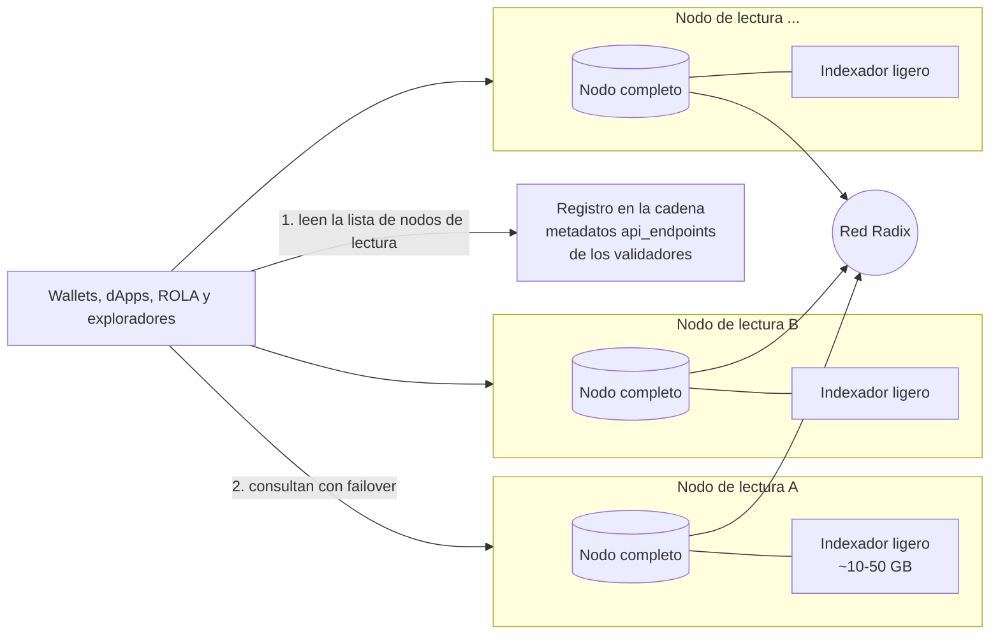
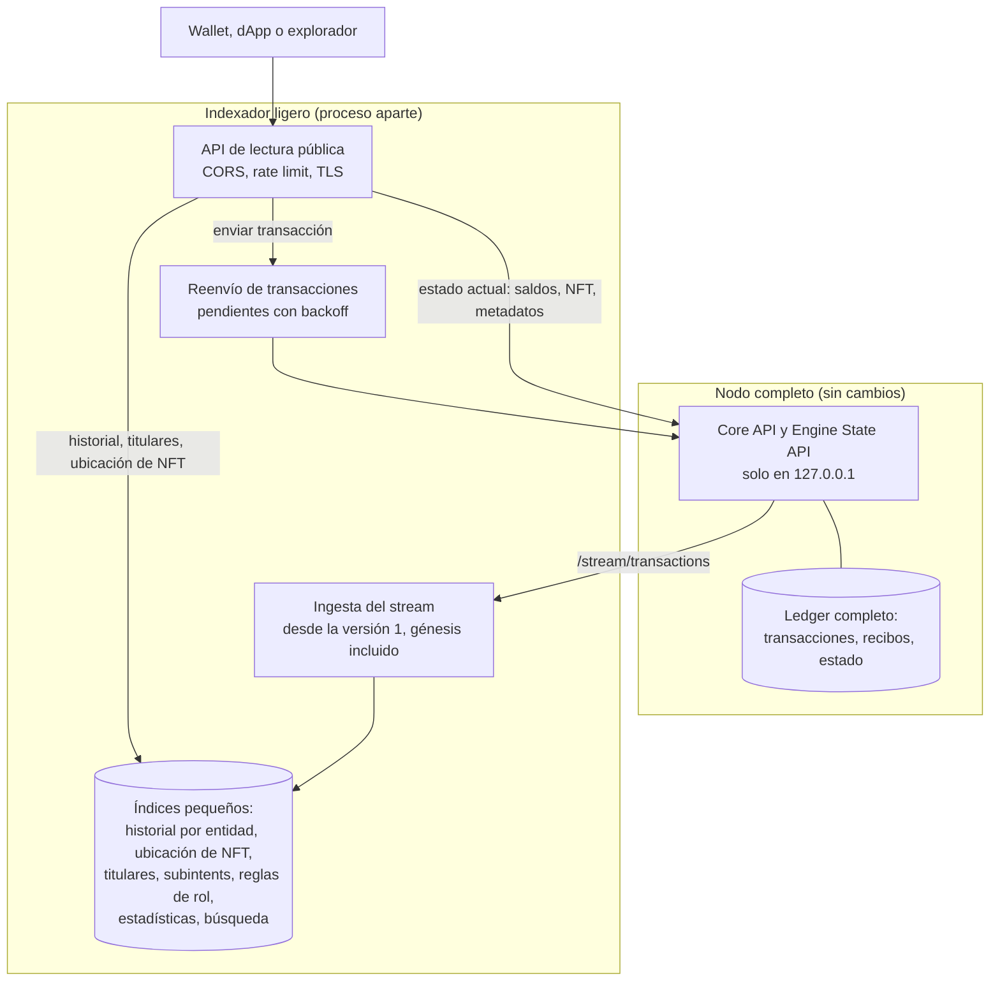
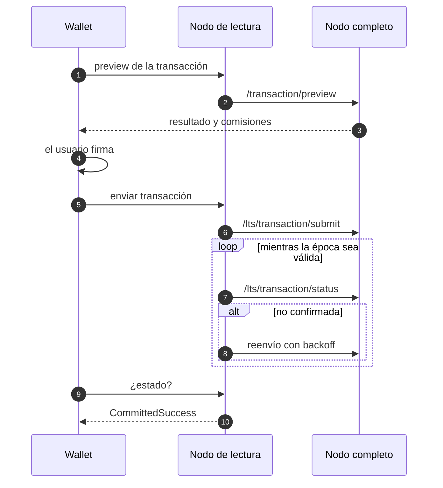
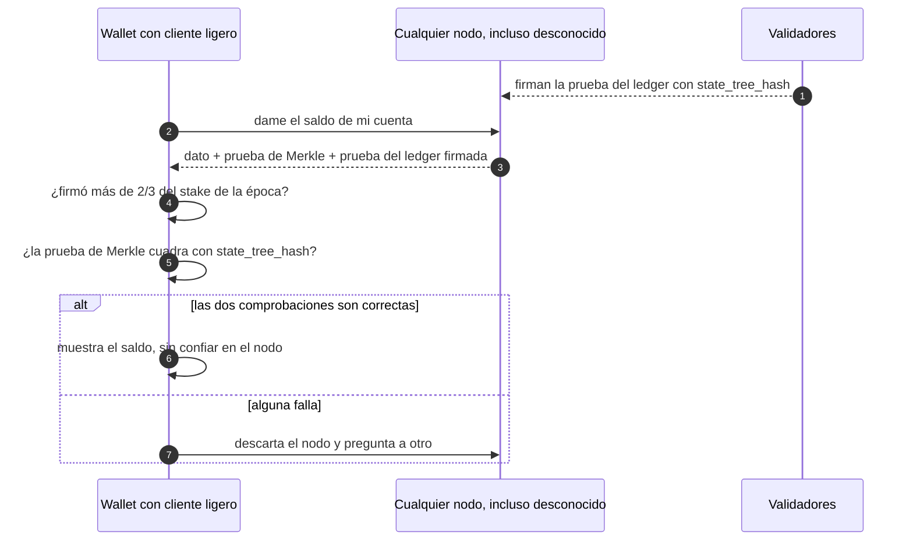
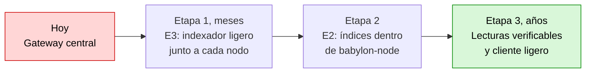

[← Índice](../../README.es.md) · [Anterior: Secciones 4-5: las seis estrategias evaluadas y su comparativa con datos](03-estrategias.md) · [Siguiente: Sección 7: cambios concretos en cada repositorio](05-cambios-por-repositorio.md)

# 6. Solución recomendada y por qué

## Cómo funciona un nodo de lectura

## Envío de una transacción sin Gateway

**Estrategia: E3 primero, E2 después y E6 como complemento.** Hay que añadir dos piezas transversales:

- **(D) descubrimiento en la cadena:** que los validadores publiquen sus URLs de acceso en los metadatos de su componente, por ejemplo con la clave `api_endpoints`;
- **(B) abstracción `LedgerBackend`** en los clientes.

**Por qué:**

1. **Tiempo.** El Gateway está financiado solo hasta el 31-dic-2026. E3 es la única opción que puede **dar servicio a los wallets actuales sin publicar versiones nuevas**, porque ya permiten configurar la URL del Gateway.
2. **Coste.** Pasa de ~2,5 TB y ~300-500 €/mes por operador a ~10-50 GB añadidos a un nodo que ya existe. Los datos medidos lo explican: más del 99 % de las versiones de estado son cambios de ronda que no hace falta indexar.
3. **Descentralización real.** Si cada validador o nodo completo puede servir la API con coste casi nulo y anunciarse en la cadena, desaparece el «proveedor por defecto». Esa es la condición para que la red «funcione para todo el mundo».
4. **Camino de evolución.**
   - Los índices de E3 se integran luego en `babylon-node` (E2).
   - La interfaz `LedgerBackend` de los clientes permite pasar después a la API nativa del nodo, y en el futuro a Hyperscale (E5), sin rehacer las aplicaciones.
5. **Riesgo controlado.** No toca el consenso ni el núcleo del nodo. Es un proceso aparte que se puede detener o reiniciar sin afectar al nodo.

**Lo que E3 no da, y cómo se cubre:**

- **Estado histórico arbitraria** (`at_ledger_state` antiguo):
  - E6, con captura hacia delante en consultation;
  - o una opción de «nodo de archivo» en E2, con historia larga y `ByTimestamp`.
- **Confianza en el nodo:** consultar a varios nodos descubiertos en la cadena y comparar `state_version` y el hash del acumulador (`/stream/proofs`). Con el tiempo, E5.

## 6.1 Impacto en el almacenamiento de los validadores

**Respuesta corta:** no aumenta de forma considerable. Y los validadores **no tienen por qué ejecutarlo**.

1. **Es opcional y separado del validador.**
   - El indexador lo ejecuta solo quien quiera servir lecturas al público.
   - La práctica recomendada es que un validador **no** atienda tráfico público, para no exponerlo a ataques ni a carga que afecte al consenso. Las lecturas las sirven nodos completos (no validadores) operados por la comunidad, proveedores de wallets, dApps o los propios operadores de validadores en una máquina aparte.
   - Un validador que no lo ejecute **no ve ningún cambio** en su almacenamiento.
   - En E2, los índices dentro del nodo serían flags **desactivados por defecto**.
2. **Si un operador lo ejecuta en la misma máquina que su nodo:**

   | Concepto | Tamaño |
   |---|---|
   | Disco recomendado para un nodo (documentación oficial, «inicial») | 500 GB |
   | Indexador ligero (E3), estimado | ~10-50 GB |
   | Aumento relativo | **~2-10 %** del disco recomendado |
   | Crecimiento del indexador | ~0,1-0,3 GB/mes al ritmo actual (~4 400 transacciones de usuario/día × 0,5-1 KB, más índices auxiliares); ~1 GB/mes en el pico de marzo de 2025 (~35 000/día) |
   | Comparación: Gateway actual | ~2,5 TB, **+60 GB/mes** |

   **Comparación por punto de acceso público** (lo que necesita quien sirve datos a wallets, dApps y exploradores):

   | | Hoy, con el Gateway | Con el indexador ligero |
   |---|---|---|
   | Nodo completo (ledger completo: transacciones, recibos y estado; lo necesitan los dos modelos) | Sí, uno o varios: el DataAggregator lee de nodos completos | Sí, uno |
   | Además | Base de datos PostgreSQL de ~2,5 TB (+60 GB/mes) | Índices de ~10-50 GB (estimado) |
   | Total adicional sobre el nodo | **~2,5 TB** | **~10-50 GB** |

   Es decir: un nodo completo **ya guarda hoy todos los datos de la red**, porque lo necesita para sincronizarse y validar, y eso no cambia. El indexador ligero **solo añade sus índices encima**: un poco más que un nodo solo (~2-10 %) y mucho menos que un nodo con Gateway (~50 veces menos).

   El indexador ocupa poco porque **no duplica el estado ni las transacciones**, que ya están en el nodo. Solo guarda punteros (entidad → `state_version`) y pocas tablas pequeñas, y descarta los cambios de ronda, que son más del 99 % de las versiones.
3. **Margen de error.**
   - No he encontrado una cifra pública actual del tamaño real del ledger de un nodo de mainnet; la documentación solo da los 500 GB «iniciales».
   - Los 10-50 GB del indexador son una **estimación** a partir de las mediciones de transacciones de usuario. El índice de titulares de recursos (h) y el de ubicación de NFT (b) dependen del número de pares recurso-titular y de NFT existentes, que no he medido.
   - El primer prototipo debe medir ambos antes de comprometer cifras.
4. **Lo que sí aumentaría mucho:** el «nodo de archivo» con historia completa de substates (N5), que es en esencia lo que hace que el Gateway ocupe 2,5 TB. Por eso el informe **no** lo propone para validadores. Sería una opción solo para quien necesite estado histórico arbitrario. Para gobernanza se sustituye por la captura del snapshot al abrir la votación (E6).

## 6.2 La mejor solución con tiempo ilimitado: lecturas verificables desde cualquier nodo

La solución a corto plazo (E3) elimina el Gateway, pero el cliente **sigue teniendo que confiar** en el nodo que le responde, igual que hoy confía en el Gateway. Con tiempo ilimitado, la solución ideal elimina también esa confianza: **cualquier nodo, incluso uno desconocido, puede servir datos, y el wallet comprueba por sí mismo que son correctos.**

**Dato clave, comprobado en el código del nodo:** Babylon ya tiene casi todo lo necesario.

- Las pruebas del ledger que firman los validadores incluyen tres raíces de árboles de Merkle (`LedgerHashes`, `core-api-schema.yaml:1846-1870`):
  - `state_tree_hash` (todo el estado);
  - `transaction_tree_hash` (todas las transacciones);
  - `receipt_tree_hash` (todos los resultados).
- El nodo mantiene el árbol de estado (`state_hash_tree.*`).
- `/stream/proofs` ya entrega las pruebas firmadas, incluidos los cambios de época, que dicen qué validadores firman la época siguiente.
- **Lo que falta** es un endpoint que devuelva la **prueba de Merkle** de un dato concreto, y un cliente que la verifique.

### Cómo verifica el wallet una respuesta

**Componentes de la solución ideal:**

| # | Componente | Qué hace |
|---|---|---|
| 1 | **Cada nodo es un nodo de lectura** (E2) | Los índices van dentro de `babylon-node` como opciones. Una **API de lectura nativa**, abierta y versionada, sustituye al formato heredado. No hay ningún proceso aparte. |
| 2 | **Lecturas con prueba** | Cada respuesta incluye el dato, su prueba de Merkle contra `state_tree_hash`, `transaction_tree_hash` o `receipt_tree_hash`, y la prueba del ledger firmada por los validadores. Sirve para saldos, NFT, metadatos, estado de componentes, transacciones y recibos. No cambia el consenso. |
| 3 | **Cliente ligero en los wallets y dApps** | En Sargon (Rust) y en WebAssembly para navegador (RDT, ROLA, exploradores). Sigue los cambios de época desde un punto de control incluido en la app y comprueba que más de 2/3 del stake firmó cada prueba. Con eso verifica cada respuesta. **El cliente deja de confiar en el nodo.** |
| 4 | **Índices verificables** | Una prueba de Merkle demuestra que un dato *está*, pero no que una lista (historial, titulares) esté *completa*. Para eso hace falta una actualización de protocolo: que el motor guarde en el estado, para cada entidad, un acumulador de su historial y de sus titulares. Así entran bajo `state_tree_hash` y también se pueden demostrar. Mientras tanto, se contrastan varios nodos independientes. |
| 5 | **Descubrimiento y transporte sin intermediarios** | Registro de nodos de lectura en la cadena (metadatos de validadores u otro componente) y conexión directa por QUIC/iroh entre wallet y nodo. Esto evita depender de DNS, de certificados TLS y de relés centrales; la misma tecnología ya se usa en Radix Connect. |
| 6 | **Incentivos para servir lecturas** | Una parte de las emisiones o comisiones de la red, o micropagos en XRD por consulta, para quien opere nodos de lectura. Lo decide la gobernanza. Sin incentivos, el servicio depende de la buena voluntad de los operadores. |
| 7 | **Archivo histórico verificable** | La historia antigua (incluido Olympia) se guarda en almacenamiento distribuido (IPFS o Arweave). Su integridad se comprueba contra `transaction_tree_hash` y `receipt_tree_hash`. Ningún nodo necesita guardarla entera. |
| 8 | **Preparado para Hyperscale** | Hyperscale ya usa multipruebas JMT. El cliente ligero y la API nativa se adaptan a esa red sin rehacer las aplicaciones. |

**Comparación con la solución a corto plazo:**

| | Corto plazo (E3 → E2) | Ideal (6.2) |
|---|---|---|
| Gateway | Eliminado | Eliminado |
| ¿El cliente confía en el nodo? | Sí, aunque puede comparar varios | **No, verifica cada respuesta** |
| ¿Quién puede servir datos? | Operadores de nodo conocidos | **Cualquier nodo, incluso anónimo** |
| Cambios de protocolo | Ninguno | Solo para los índices verificables (punto 4) |
| Plazo | Meses | **Años** |
| Esfuerzo (est.) | 7-10 persona-mes el mínimo viable; 18-30 el completo | **~40-80 persona-mes** adicionales, con perfiles expertos en el protocolo |

**Por qué es la mejor con tiempo ilimitado:** es la única opción en la que la red no depende de nadie, ni de un Gateway ni de la honestidad de un nodo. Es el mismo nivel de garantía que da la propia cadena, extendido hasta el wallet de cada usuario.

**Cómo encaja con el corto plazo:** no son alternativas, son etapas. E3 resuelve el problema de 2026. E2 elimina el proceso aparte. Los puntos 2-8 añaden la verificación sobre lo que E2 ya sirve. La interfaz `LedgerBackend` de los clientes es la que permite pasar de una etapa a otra sin rehacer las aplicaciones.

---

[← Índice](../../README.es.md) · [Anterior: Secciones 4-5: las seis estrategias evaluadas y su comparativa con datos](03-estrategias.md) · [Siguiente: Sección 7: cambios concretos en cada repositorio](05-cambios-por-repositorio.md)
