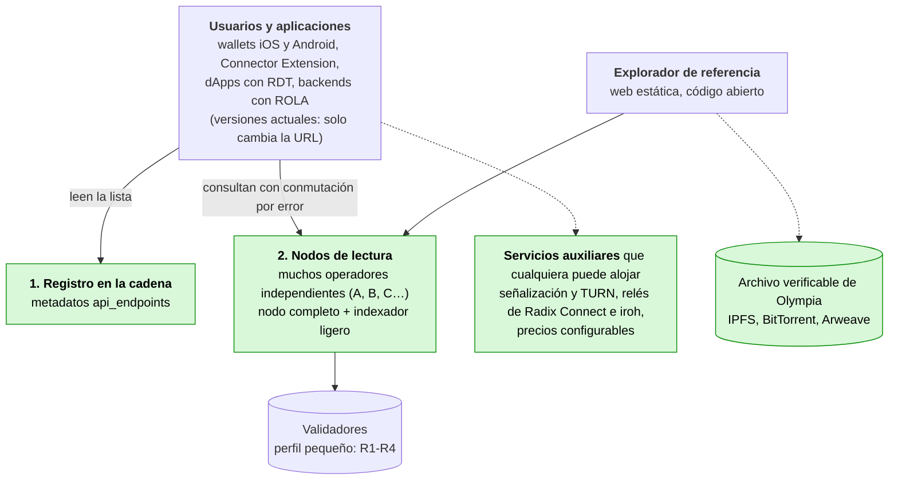
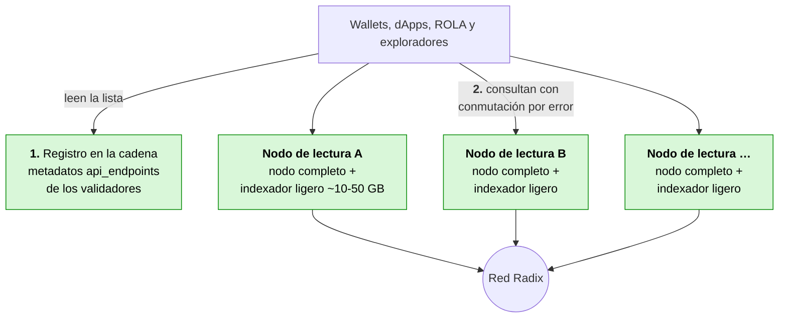
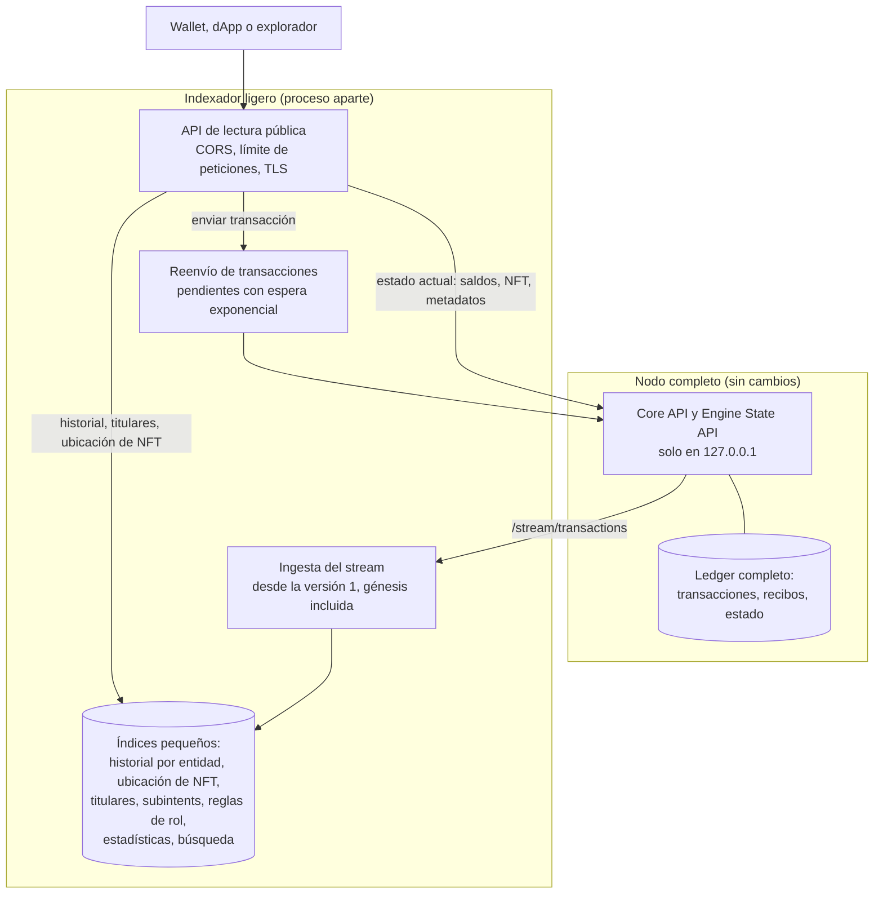
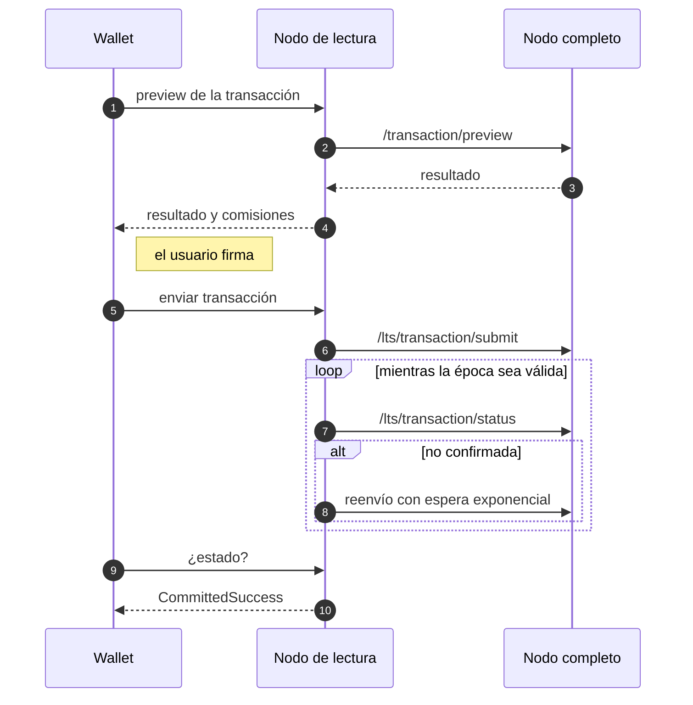
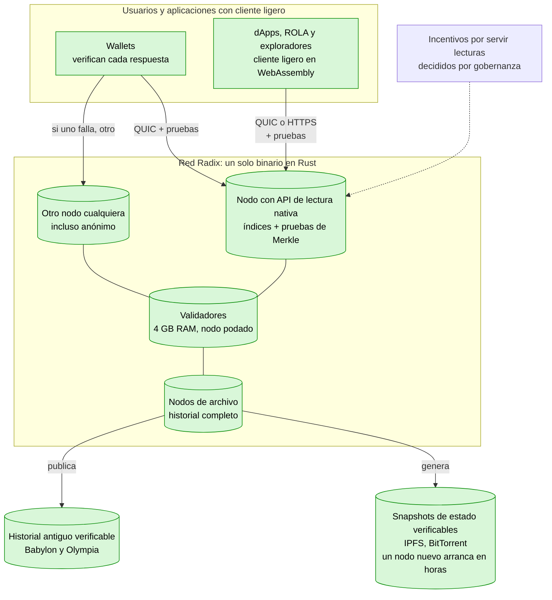
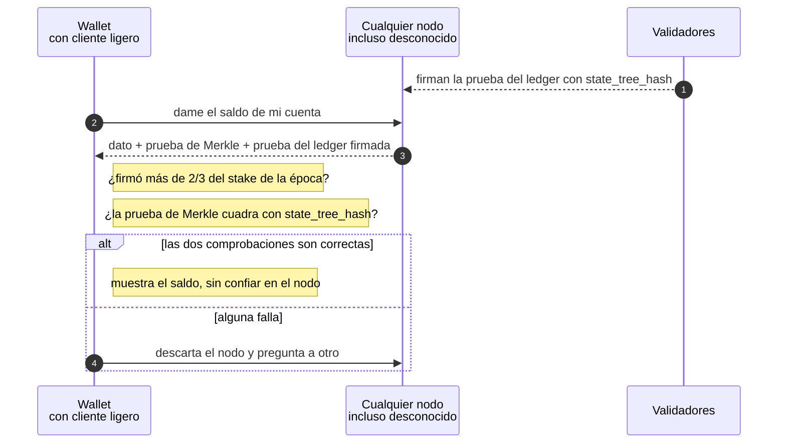
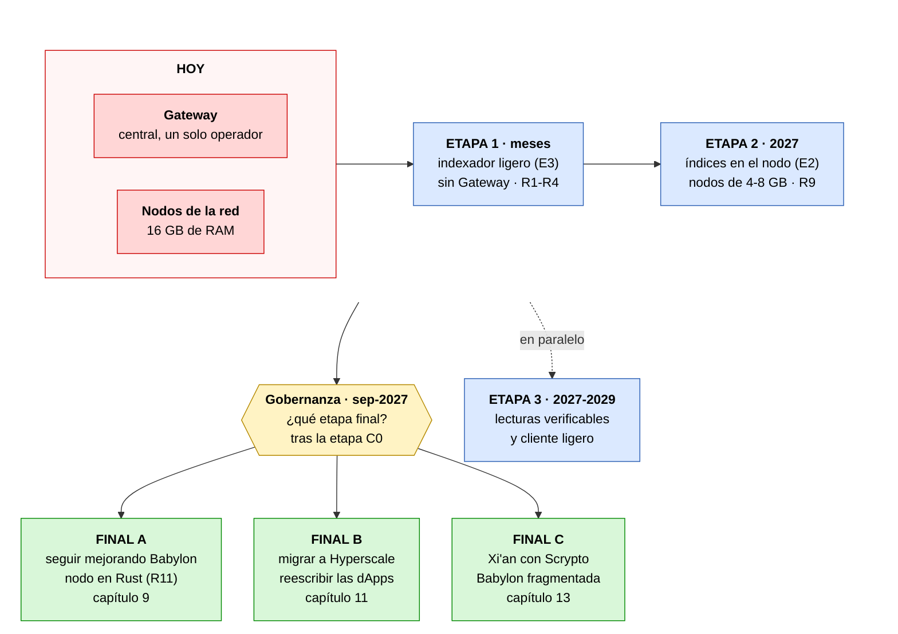
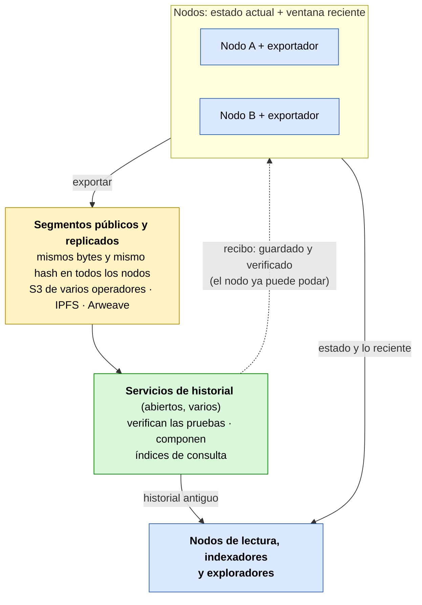

[← Índice](../../README.es.md) · [Anterior: Capítulos 4-5: las seis estrategias evaluadas y su comparativa](04-05-estrategias.md) · [Siguiente: Capítulo 7: cambios concretos en cada repositorio](07-cambios-por-repositorio.md)

# 6. Solución recomendada y por qué

> [!IMPORTANT]
> - **¿Es posible?** Sí. Es la solución recomendada a corto plazo.
> - **Dificultad:** Media.
> - **Esfuerzo y plazo:** 7-12 personas-mes para la solución mínima viable; meses (estimación).

## Infraestructura a corto plazo: sin Gateway

Detalle: cómo encuentran las aplicaciones los nodos de lectura.

## Cómo funciona un nodo de lectura

## Envío de una transacción sin Gateway

**Estrategia: E3 primero, E2 después y E6 como complemento.** Hay que añadir dos piezas transversales:

- **(D) descubrimiento en la cadena:** que los validadores publiquen sus URLs de acceso en los metadatos de su componente, por ejemplo con la clave `api_endpoints`;
- **(L) abstracción `LedgerBackend`** en los clientes.

**Por qué:**

1. **Tiempo.** El Gateway está financiado solo hasta el 31-dic-2026. E3 es la única opción que puede **dar servicio a los wallets actuales sin publicar versiones nuevas**, porque ya permiten configurar la URL del Gateway.
2. **Coste.** Pasa de los ~2,5 TB del Gateway, y de los ~300-400 €/mes que estimó una propuesta comunitaria para operarlo (sección [1.1](01-02-situacion-actual.md#s1-1)), a ~10-50 GB (estimación) añadidos a un nodo que ya existe. Los datos medidos lo explican: ~97-98 % de las versiones de estado son cambios de ronda que no hace falta indexar.
3. **Descentralización real.** Si cada validador o nodo completo puede servir la API con coste casi nulo y anunciarse en la cadena, desaparece el «proveedor por defecto». Es la condición para que la red dé servicio a cualquier usuario sin depender de un proveedor concreto.
4. **Camino de evolución.**
   - Los índices de E3 se integran luego en `babylon-node` (E2).
   - La interfaz `LedgerBackend` de los clientes permite pasar después a la API nativa del nodo, al cliente ligero (E5) y, si se adopta, a Hyperscale (capítulo [11](11-evolucion-hyperscale.md#s11)), sin rehacer la lógica de las aplicaciones.
5. **Riesgo controlado.** No toca el consenso ni el núcleo del nodo. Es un proceso aparte que se puede detener o reiniciar sin afectar al nodo.

**Lo que E3 no da, y cómo se cubre:**

- **Estado histórico arbitrario** (`at_ledger_state` antiguo):
  - E6, con captura hacia delante en consultation;
  - o una opción de «nodo de archivo» en E2, con historia larga y `ByTimestamp`.
- **Confianza en el nodo:** consultar a varios nodos descubiertos en la cadena y comparar `state_version` y el hash del acumulador (`/stream/proofs`). Con el tiempo, E5.

## 6.1 Impacto en el almacenamiento de los validadores

**Respuesta corta:** no aumenta de forma considerable. Y los validadores **no tienen por qué ejecutarlo**.

1. **Es opcional y separado del validador.**
   - El indexador lo ejecuta solo quien quiera servir lecturas al público.
   - Es aconsejable que un validador **no** atienda tráfico público, para no exponerlo a ataques ni a carga que afecte al consenso. Las lecturas las sirven nodos completos (no validadores) operados por la comunidad, proveedores de wallets, dApps o los propios operadores de validadores en una máquina aparte.
   - Un validador que no lo ejecute **no ve ningún cambio** en su almacenamiento.
   - En E2, los índices dentro del nodo serían flags **desactivados por defecto**.
2. **Si un operador lo ejecuta en la misma máquina que su nodo:**

   | Concepto | Tamaño |
   |---|---|
   | Disco recomendado para un nodo (documentación oficial, «inicial») | 500 GB |
   | Disco que ocupa hoy un nodo de mainnet (medición aportada por Daffy, miembro de la comunidad, nov-2026) | ~493 GB; ~600 GB con el índice de cambios de cuenta; +~65 GB/año |
   | Indexador ligero (E3), estimado | ~10-50 GB |
   | Aumento relativo | **~2-10 %** del disco recomendado |
   | Crecimiento del indexador | ~0,1-0,3 GB/mes al ritmo actual (~4 400 transacciones de usuario/día × 0,5-1 KB, más índices auxiliares); ~1 GB/mes en el pico de marzo de 2025 (~35 000/día) |
   | Comparación: Gateway actual | ~2,5 TB, **+60 GB/mes** |

   **Comparación por punto de acceso público** (lo que necesita quien sirve datos a wallets, dApps y exploradores):

   | | Hoy, con el Gateway | Con el indexador ligero |
   |---|---|---|
   | Nodo completo (ledger completo: transacciones, recibos y estado; lo necesitan los dos modelos) | Sí, uno o varios: el DataAggregator lee de nodos completos | Sí, uno |
   | Además | Base de datos PostgreSQL de ~2,5 TB (+60 GB/mes) | Índices de ~10-50 GB (estimado) |
   | Total adicional sobre el nodo | **~2,5 TB** | **~10-50 GB** |
   | **Total por punto de acceso** (nodo de ~493-600 GB, medición aportada, más lo anterior) | **~3,0-3,1 TB** | **~0,5-0,65 TB** |

   Es decir: un nodo completo **ya guarda hoy todos los datos de la red**, porque lo necesita para sincronizarse y validar, y eso no cambia. El indexador ligero **solo añade sus índices sobre los datos del nodo**: un poco más que un nodo solo (~2-10 %) y mucho menos que un nodo con Gateway: lo que se añade es entre 50 y 250 veces menor, y el total por punto de acceso, unas 4,5-6 veces menor (estimación).

   El indexador ocupa poco porque **no duplica el estado ni las transacciones**, que ya están en el nodo. Solo guarda punteros (entidad → `state_version`) y pocas tablas pequeñas, y descarta los cambios de ronda, que son ~97-98 % de las versiones.

   **La parte grande es el nodo completo, y es la misma en los dos modelos.** Reducirla es el objetivo del capítulo [9](09-nodos-ligeros.md#s9). La sección [9.6](09-nodos-ligeros.md#s9-6) detalla qué cambios admite un nodo de lectura sin perder lo que necesita el indexador.
3. **Margen de error.**
   - El snapshot comunitario comprimido ocupa 274 GiB (sep-2026). Daffy, miembro de la comunidad, ha aportado una medición del tamaño en disco de un nodo de mainnet (~493 GB; recibos, 217 GB; ~600 GB con el índice de cambios de cuenta; +~65 GB/año), sin publicar todavía el método ni la versión del nodo. Conviene confirmarla con las métricas `raw_db_size` por column family.
   - Los 10-50 GB del indexador son una **estimación** a partir de las mediciones de transacciones de usuario. El índice de titulares de recursos (h) y el de ubicación de NFT (b) dependen del número de pares recurso-titular y de NFT existentes, que no se ha medido.
   - El primer prototipo debe medir ambos antes de comprometer cifras.
4. **Lo que sí aumentaría mucho:** el «nodo de archivo» con historia completa de substates (N5), que es en esencia lo que hace que el Gateway ocupe 2,5 TB. Por eso el informe **no** lo propone para validadores. Sería una opción solo para quien necesite estado histórico arbitrario. Para gobernanza se sustituye por la captura del snapshot al abrir la votación (E6).

## 6.2 La mejor solución con tiempo ilimitado: lecturas verificables desde cualquier nodo

> [!IMPORTANT]
> - **¿Es posible?** Sí, sin cambiar el consenso (los índices verificables sí requieren una actualización de protocolo).
> - **Dificultad:** Muy alta.
> - **Esfuerzo y plazo:** ~40-80 personas-mes adicionales; años (estimación).

La solución a corto plazo (E3) elimina el Gateway, pero el cliente **sigue teniendo que confiar** en el nodo que le responde, igual que hoy confía en el Gateway. Con tiempo ilimitado, la solución ideal elimina también esa confianza: **cualquier nodo, incluso uno desconocido, puede servir datos, y el wallet comprueba por sí mismo que son correctos.**

**Dato clave, comprobado en el código del nodo:** Babylon ya tiene casi todo lo necesario.

- Las pruebas del ledger que firman los validadores incluyen tres raíces de árboles de Merkle (`LedgerHashes`, `core-api-schema.yaml:1846-1870`):
  - `state_tree_hash` (todo el estado);
  - `transaction_tree_hash` (todas las transacciones);
  - `receipt_tree_hash` (todos los resultados).
- El nodo mantiene el árbol de estado (`state_hash_tree.*`).
- `/stream/proofs` ya entrega las pruebas firmadas, incluidos los cambios de época, que dicen qué validadores firman la época siguiente.
- **Lo que falta** es un endpoint que devuelva la **prueba de Merkle** de un dato concreto, y un cliente que la verifique.

### Infraestructura a largo plazo: solución ideal

#### Cómo verifica el wallet una respuesta

**Componentes de la solución ideal:**

| # | Componente | Qué hace |
|---|---|---|
| 1 | **Cada nodo es un nodo de lectura** (E2) | Los índices van dentro de `babylon-node` como opciones. Una **API de lectura nativa**, abierta y versionada, sustituye al formato heredado. No hay ningún proceso aparte. |
| 2 | **Lecturas con prueba** | Cada respuesta incluye el dato, su prueba de Merkle contra `state_tree_hash`, `transaction_tree_hash` o `receipt_tree_hash`, y la prueba del ledger firmada por los validadores. Sirve para saldos, NFT, metadatos, estado de componentes, transacciones y recibos. No cambia el consenso. |
| 3 | **Cliente ligero en los wallets y dApps** | En Sargon (Rust) y en WebAssembly para navegador (RDT, ROLA, exploradores). Sigue los cambios de época desde un punto de control incluido en la app y comprueba que más de 2/3 del stake firmó cada prueba. Con eso verifica cada respuesta. **El cliente deja de confiar en el nodo.** |
| 4 | **Índices verificables** | Una prueba de Merkle demuestra que un dato *está*, pero no que una lista (historial, titulares) esté *completa*. Para eso hace falta una actualización de protocolo: que el motor guarde en el estado, para cada entidad, un acumulador de su historial y de sus titulares. Así entran bajo `state_tree_hash` y también se pueden demostrar. Mientras tanto, se contrastan varios nodos independientes. |
| 5 | **Descubrimiento y transporte sin intermediarios** | Registro de nodos de lectura en la cadena (metadatos de validadores u otro componente) y conexión directa por QUIC/iroh entre wallet y nodo. Esto reduce la dependencia de DNS y de certificados TLS, y los relés pueden ser propios o varios; la misma tecnología ya se usa en Radix Connect. |
| 6 | **Incentivos para servir lecturas** | Una parte de las emisiones o comisiones de la red, o micropagos en XRD por consulta, para quien opere nodos de lectura. Lo decide la gobernanza. Sin incentivos, el servicio depende del compromiso voluntario de los operadores. |
| 7 | **Archivo histórico verificable** | La historia antigua (incluido Olympia) se exporta en **segmentos canónicos** con las pruebas firmadas dentro, se publica con lectura pública y se replica en varios almacenamientos (S3 de distintos operadores, IPFS, Arweave). Su integridad se comprueba contra `transaction_tree_hash` y `receipt_tree_hash`. Ningún nodo necesita guardarla entera. Detalle en la sección [6.5](#s6-5). |
| 8 | **Preparado para la evolución final** | Hyperscale ya usa multipruebas JMT, y en Xi'an con Scrypto el árbol de estado de Babylon se conserva por fragmento. El cliente ligero y la API nativa se pueden adaptar a cualquiera de las dos. Se analizan en los capítulos [11](11-evolucion-hyperscale.md#s11) y [13](13-xian-con-scrypto.md#s13). |

**Comparación con la solución a corto plazo:**

| | Corto plazo (E3 → E2) | Ideal |
|---|---|---|
| Gateway | Eliminado | Eliminado |
| ¿El cliente confía en el nodo? | Sí, aunque puede comparar varios | **No, verifica cada respuesta** |
| ¿Quién puede servir datos? | Operadores de nodo conocidos | **Cualquier nodo, incluso anónimo** |
| Cambios de protocolo | Ninguno | Solo para los índices verificables (punto 4) |
| Plazo | Meses | **Años** |
| Esfuerzo (est.) | 7-12 personas-mes el mínimo viable; 21-35 el completo | **~40-80 personas-mes** adicionales, con perfiles expertos en el protocolo |

**Por qué es la mejor con tiempo ilimitado:** es la única opción en la que la red no depende de nadie, ni de un Gateway ni de la honestidad de un nodo. Es el mismo nivel de garantía que da la propia cadena, extendido hasta el wallet de cada usuario.

**Cómo encaja con el corto plazo:** no son alternativas, son etapas. E3 resuelve el problema de 2026. E2 elimina el proceso aparte. Los puntos 2-8 añaden la verificación sobre lo que E2 ya sirve. La interfaz `LedgerBackend` de los clientes es la que permite pasar de una etapa a otra sin rehacer las aplicaciones.

## 6.3 Riesgos de eliminar el Gateway y cómo mitigarlos

| Riesgo | Consecuencia | Mitigación |
|---|---|---|
| **Un nodo devuelve datos incorrectos**, por error o de forma malintencionada | El usuario ve saldos o estados falsos | Consultar varios puntos de acceso y comparar `state_version` y el hash del acumulador ([10.2](10-guia-de-implementacion.md#s10-2)); a largo plazo, lecturas verificables ([6.2](#s6-2)) |
| **Pocos operadores** de nodos de lectura | Vuelve a haber una dependencia central | Coste casi nulo por operador (E3); descubrimiento en la cadena; incentivos decididos por la gobernanza ([6.2](#s6-2), punto 6; capítulo [12](12-referencias-otras-redes.md#s12)) |
| **Ataques de denegación de servicio** contra los nodos de lectura | Servicio lento o caído | Modo público con límites por IP y lista blanca de rutas (N6); varios operadores; validadores separados de los nodos de lectura ([6.1](#s6-1)) |
| **Más lecturas de las que un nodo de lectura puede atender** | Respuestas lentas, o un nodo que se retrasa respecto al ledger | Lecturas por lotes (N7), caché del indexador, límites por IP y varios nodos de lectura; prueba de carga antes de fijar cifras ([6.4](#s6-4)) |
| **El indexador no reproduce exactamente las respuestas** que esperan los wallets | Errores en las aplicaciones | Pruebas de conformidad contra el Gateway público **antes de que se apague** ([10.1](10-guia-de-implementacion.md#s10-1)) |
| **Pocos nodos de archivo** | Los nodos nuevos no pueden obtener el historial ni snapshots | Varios nodos de archivo en distintas manos; snapshots verificables en almacenamiento distribuido (R9); exportar antes de podar, con segmentos de historial replicados ([6.5](#s6-5)) |
| **El historial queda en manos de un solo operador** | Si deja de financiarlo, se pierde el acceso al historial | Segmentos públicos y replicados en almacenamientos de distintos operadores; formato y software abiertos; varios servicios de historial ([6.5](#s6-5)) |
| **Se pierde una transacción** si el punto de acceso se reinicia | El usuario cree que envió algo que nunca se confirmó | Reenvío en el indexador y en los clientes ([10.1](10-guia-de-implementacion.md#s10-1), [10.4](10-guia-de-implementacion.md#s10-4)) |
| **Falta de financiación o de desarrolladores** | El plan se retrasa más allá del 31-dic-2026 | Priorizar el mínimo viable (7-12 personas-mes); decisión temprana de la gobernanza |
| **Errores en el software nuevo** (indexador, cambios en el nodo) | Fallos de servicio o, en el nodo, de consenso | Desplegar primero en Stokenet; opciones desactivadas por defecto; adopción gradual ([10.7](10-guia-de-implementacion.md#s10-7)) |

---

## 6.4 Carga de lecturas en un nodo de lectura público

> [!IMPORTANT]
> - **¿Es posible?** Sí, con condiciones: hay que añadir lecturas por lotes al nodo y una caché al indexador, y repartir el tráfico entre varios nodos de lectura. La RAM de un nodo público debe salir de una prueba de carga.
> - **Dificultad:** Media.
> - **Esfuerzo y plazo:** ~1-2 personas-mes para N7, la caché y la prueba de carga; semanas a pocos meses (estimación).

**El problema (comprobado en el código):**

- Las respuestas en el formato del Gateway **agregan datos**. Por ejemplo, `state/entity/details` acepta hasta **20 entidades** por petición y hasta 20 claves de metadatos explícitas (`StateEntityDetailsMaxPageSize = 20` y `ExplicitMetadataMaxItems = 20` en `babylon-gateway/src/RadixDlt.NetworkGateway.GatewayApi/Configuration/EndpointOptions.cs:99,105`).
- Las APIs del nodo leen **una entidad, un campo o una entrada por llamada**: la Core API (`/state/account`, `/state/resource`, `/state/non-fungible`…) y la Engine State API (`/entity/info`, `/object/field`, `/kv-store/entry`…), según `core-api-schema.yaml` y `engine-state-api-schema.yaml`. No hay endpoints por lotes, y el gestor de estado solo usa las lecturas múltiples de RocksDB (`multi_get_cf`) para la ascendencia de nodos (`state-manager/src/store/rocks_db.rs:1235-1241`), no para las lecturas de substates de las APIs.
- Por eso, en el indexador ligero, **una petición de un wallet se convierte en muchas lecturas** al nodo, sobre la misma RocksDB que tiene que seguir el ledger.
- La memoria que la sección [9.5](09-nodos-ligeros.md#s9-5) asigna a un nodo de lectura (0,6 GB para APIs e indexador) es una **estimación sin medición de carga**. Vale para un nodo de uso personal o de poco tráfico, no para dimensionar un nodo público.

**Por qué no impide el objetivo:**

- La carga de escritura de Radix es baja (~4 400 transacciones de usuario al día, sección [1.2](01-02-situacion-actual.md#s1-2)), así que la competencia entre lecturas y escrituras es acotada. Además, los handlers de lectura del nodo ya leen desde una instantánea de la base de datos (`database.snapshot()`, por ejemplo en `core-api-server/src/core_api/handlers/state_account.rs:23`).
- Hoy el Gateway hace la misma agregación sobre una base de datos de ~2,5 TB y atiende **todo** el tráfico desde un solo despliegue. Con E3, el tráfico se reparte entre **muchos** nodos de lectura descubiertos en la cadena ([10.2](10-guia-de-implementacion.md#s10-2)), y cada uno atiende solo una parte.
- La descentralización no exige que cada nodo de lectura sea pequeño. Exige que **cualquiera pueda ejecutar uno** con hardware común. El objetivo de 4-8 GB se mantiene para validadores y nodos de lectura de poco tráfico. Un nodo de lectura público se dimensiona según su tráfico, como cualquier servidor web.

**Cómo hacerlo posible:**

1. **Lecturas por lotes en el nodo (N7, sección [7.2](07-cambios-por-repositorio.md#s7-2)).** Un endpoint que reciba varias entidades y devuelva sus datos leídos en **una sola instantánea** de la base de datos. RocksDB ofrece lecturas múltiples (`MultiGet`, disponible también en el crate `rocksdb` de Rust), que reducen el coste por clave frente a lecturas sueltas. N7 pasa de P2 a **P1**.
2. **Caché en el indexador, invalidada por `state_version`.** El indexador sabe exactamente qué entidades cambian en cada transacción (tabla `entity_tx`). Una respuesta guardada sigue siendo válida mientras no llegue una transacción posterior que toque esa entidad. Como las escrituras son pocas, las lecturas repetidas se pueden servir desde la caché.
3. **Usar las lecturas agregadas que el nodo ya tiene.** Por ejemplo, `/lts/state/account-all-fungible-resource-balances` devuelve todos los saldos fungibles de una cuenta en una llamada.
4. **Límites por petición y por IP** (modo público N6 y capas del servidor del indexador, sección [10.1](10-guia-de-implementacion.md#s10-1)), para que un solo cliente no pueda agotar el nodo.
5. **Varios nodos de lectura** con conmutación por error en los clientes ([10.2](10-guia-de-implementacion.md#s10-2), [10.4](10-guia-de-implementacion.md#s10-4)): si uno está saturado, el cliente usa otro.
6. **Prueba de carga como criterio de aceptación.**
   - Reproducir el tráfico real grabado para las pruebas de conformidad ([10.1](10-guia-de-implementacion.md#s10-1)) contra nodos de 4, 8 y 16 GB, a ritmos crecientes.
   - Medir la latencia (p50 y p99), el consumo de RAM y si el nodo **sigue el ledger sin retraso** mientras atiende lecturas.
   - Publicar los resultados con el método, la fecha y la versión.

**Perfiles resultantes** (las cifras del nodo público se fijan con la prueba de carga):

| Perfil | Para qué | RAM |
|---|---|---|
| Nodo de lectura personal o de poco tráfico | Un wallet, una dApp o un operador que se sirve a sí mismo | Objetivo de 4-8 GB (estimación, sección [9.5](09-nodos-ligeros.md#s9-5)) |
| Nodo de lectura público | Atender a muchos usuarios | Según la prueba de carga. Como referencia, el requisito oficial actual de un nodo es de 16 GB |

## 6.5 Historial sin un servicio central: exportar antes de podar

> [!IMPORTANT]
> - **¿Es posible?** Sí. La primera versión funciona junto al nodo, sin cambiarlo; la versión completa necesita un cambio pequeño en `babylon-node` (N10).
> - **Dificultad:** Media.
> - **Esfuerzo y plazo:** ~5-9 personas-mes; el primer experimento, semanas (estimación).

**Origen.** Este diseño parte de una exploración que compartió Daffy, miembro de la comunidad («Node-side History Export», nov-2026). Daffy la describe como exploración, no como decisión, y aún sin probar. Este informe la adopta y la adapta al objetivo de no depender de ningún operador.

**El problema que resuelve:**

- La mayor parte del disco del Gateway (~2,5 TB) y de un nodo completo (~493 GB, medición aportada) es **historial**. Para servir el estado actual basta con mucho menos.
- La poda (R8) reduce el disco de los nodos, pero sin un mecanismo que garantice que el historial se ha guardado antes en otro sitio, se puede perder. La tabla de riesgos ya señalaba «pocos nodos de archivo».
- Un servicio de historial **central** repetiría el problema actual: si quien lo opera deja de financiarlo, se pierde el acceso.

**Diseño en tres niveles:**

1. **Nodos:** guardan el estado actual y una **ventana reciente** del historial, por ejemplo unas horas o unos días. Las épocas de Babylon duran unos 5 minutos (`target_duration_millis: 300000` en `mainnet_genesis`), así que 4-5 horas son unas 50-60 épocas. Sirven el envío, la simulación y lo reciente.
2. **Segmentos de historial:** ficheros inmutables, uno por cada tramo fijo de épocas, con las transacciones en bruto, los recibos en su forma registrada en la cadena y las **pruebas firmadas por los validadores**. Se publican en almacenamiento de objetos y se **replican**.
3. **Servicios de historial:** leen los segmentos, los verifican y construyen índices para consultarlos (por cuenta, por recurso, por fecha). Son **abiertos**: cualquiera puede ejecutar uno, y los nodos de lectura e indexadores piden el historial antiguo a cualquiera de ellos.

**Las cuatro reglas que lo hacen seguro** (las tres primeras vienen del diseño aportado):

| Regla | Qué exige | Por qué |
|---|---|---|
| **Segmentos canónicos** | Todo nodo honrado produce **exactamente los mismos bytes** para el mismo tramo. Los límites del segmento son hechos del consenso (números de época), nunca el reloj de un nodo, y la codificación es determinista. Las firmas quedan fuera de esa parte canónica (ver «Pruebas dentro») | Cualquier nodo puede subir un segmento y los demás confirman que es correcto comparando su hash |
| **Pruebas dentro** | Cada segmento lleva la cabecera de fin de cada época (raíces y versión) en su parte canónica, y aparte un fichero de firmas. Cada nodo puede guardar un subconjunto distinto de firmas de la misma prueba (`core-api-schema.yaml:844-849`), así que cualquier conjunto que sume más de 2/3 del stake es válido | Cualquiera lo verifica sin confiar en quien lo subió ni en quien lo guarda |
| **Exportar antes de podar** | Un nodo solo borra, pasado su horizonte, lo que el archivo ha confirmado («recibo») como guardado y verificado. Si los recibos dejan de llegar, retiene los datos un tiempo limitado y avisa, pero **nunca detiene el consenso** | El historial no se pierde aunque se pode |
| **Réplicas públicas** (añadida por este informe) | Los segmentos son de lectura pública y se guardan en varios sitios de distintos operadores: almacenamientos compatibles con S3, IPFS con varios servicios de *pinning*, y Arweave para una copia permanente. El formato y el software que los procesa son de código abierto | Ningún operador es imprescindible. Como cada segmento se identifica por su hash y lleva sus pruebas, no hace falta confiar en el almacenamiento |

**Qué se puede verificar en Babylon** (comprobado en el código de `babylon-node`):

- Las pruebas del ledger firman `LedgerHashes`, con tres raíces: estado, transacciones y recibos (`state_root`, `transaction_root` y `receipt_root` en `state-manager/src/types.rs:284-288`; en la Core API, `state_tree_hash`, `transaction_tree_hash` y `receipt_tree_hash`).
- La raíz de recibos se calcula con el `ConsensusReceipt`: el resultado de la transacción, la raíz de sus cambios de estado y la raíz de sus eventos (`types.rs:109-131`; `receipt.rs:414-425`). Es decir, **la red firma el recibo registrado en la cadena** (`LedgerTransactionReceipt`).
- **No se firman** los datos de ejecución local, como los cambios de saldo y el resumen de comisiones. Los servicios de historial los recalculan a partir del recibo, o los toman de un nodo, sabiendo que no están probados.
- Cada época empieza un árbol nuevo de transacciones y recibos a partir de la raíz anterior (`staging/epoch_handling.rs:174-200`). Por eso un segmento alineado con épocas se puede verificar por sí solo: se recalcula el árbol de la época con los hashes de sus transacciones y se compara con la raíz de la prueba firmada.

**Qué falta hoy:** la Core API da las transacciones en bruto (`transaction_format_options.raw_ledger_transaction`) y las pruebas (`/stream/proofs`), pero los recibos solo en JSON. Para incluir recibos en forma canónica hace falta **N10**: una opción que devuelva el `LedgerTransactionReceipt` codificado en SBOR. Mientras no exista, la primera versión de los segmentos lleva transacciones y pruebas, que ya se pueden verificar.

**Consecuencias para el resto del plan:**

- **Nodos de lectura más pequeños.** Si el historial antiguo se sirve desde los segmentos, un nodo de lectura también puede podar (R8) y guardar solo una ventana con sus índices (sección [9.6](09-nodos-ligeros.md#s9-6)). Como referencia, Daffy indica que su Gateway mínimo, con un día de estado, funciona con 100-150 GB de disco, 2 CPU y 4-6 GB de RAM, aunque hoy sigue necesitando un nodo completo con índices de 550-600 GB (cifra de esa misma persona).
- **Ventanas por operador.** Cada nodo de lectura decide cuánto historial indexa localmente (por ejemplo, 7, 30 o 90 días) y pide el resto a los servicios de historial.
- **Exploradores y Olympia.** El archivo de Olympia ([10.5](10-guia-de-implementacion.md#s10-5)) es el primer «segmento» histórico, y los exploradores leen el historial completo desde los servicios.
- **Hyperscale y Xi'an.** El mismo diseño sirve por fragmento: cada fragmento exporta sus segmentos y los servicios de historial unen las transacciones entre fragmentos (capítulos [11](11-evolucion-hyperscale.md#s11) y [13](13-xian-con-scrypto.md#s13)).

**Quién paga el almacenamiento:** es una decisión de gobernanza. Como los segmentos se pueden verificar, quien los guarda no necesita ser de confianza, solo tener límites de escritura. Las opciones son operadores voluntarios, incentivos pagados en la capa 1 ([6.2](#s6-2), punto 6) o un pago único de almacenamiento permanente en Arweave para las copias de referencia.

---

[← Índice](../../README.es.md) · [Anterior: Capítulos 4-5: las seis estrategias evaluadas y su comparativa](04-05-estrategias.md) · [Siguiente: Capítulo 7: cambios concretos en cada repositorio](07-cambios-por-repositorio.md)
