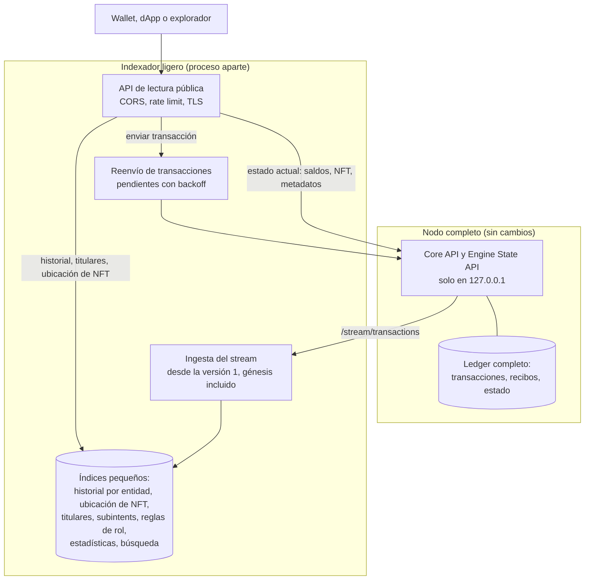
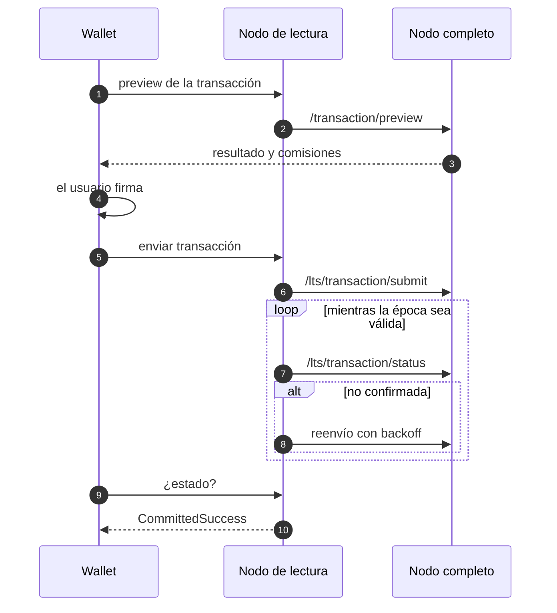

[← Índice](../../README.es.md) · [Anterior: Sección 9: nodos más ligeros, 4 GB de RAM y 500 GB de disco, migración de Java a Rust](07-nodos-ligeros.md) · [Siguiente: Sección 11: evolución final hacia Hyperscale y migración](09-evolucion-hyperscale.md)

# 10. Guía de implementación paso a paso

Este capítulo explica **cómo** construir las piezas principales. Los fragmentos de código son **orientativos**: muestran la forma de la solución, no código listo para producción, y hay que ajustarlos a la versión exacta de cada dependencia.

## 10.1 `radix-lite-indexer`: el sustituto del Gateway

### Arquitectura

```
radix-lite-indexer/
├── crates/
│   ├── core-client/   # Cliente tipado de la Core API y la Engine State API (generado de los YAML del nodo)
│   ├── ingest/        # Bucle de ingesta del stream y escritura de índices
│   ├── store/         # Índices en RocksDB (o SQLite): esquemas y consultas
│   ├── api/           # Servidor HTTP (axum): rutas en el formato que usan hoy las apps
│   ├── submit/        # Envío y reenvío de transacciones
│   └── snapshot/      # Exportar e importar índices firmados
├── conformance/       # Pruebas que comparan respuestas con el Gateway público
└── deploy/            # docker-compose, systemd, plantilla para babylon-nodecli
```

Una ventaja importante: **Babylon tiene finalidad inmediata** (consenso BFT), así que una transacción confirmada nunca se revierte. El indexador **no necesita gestionar reorganizaciones de cadena**, lo que lo simplifica mucho frente a indexadores de otras redes.



### Modelo de datos

Todas las claves van en orden de bytes, para recorrerlas por rangos.

| Tabla | Clave | Valor | Escribe | Sirve a |
|---|---|---|---|---|
| `entity_tx` | `entity_address ‖ state_version (BE)` | bits: clase de manifiesto, ¿cambió saldo?, ¿emitió evento?, ¿depósito/retiro? | cada transacción de usuario y la génesis | historial filtrado |
| `entity_tx_by_resource` | `entity ‖ resource ‖ state_version` | delta (fungible) o ids añadidos/quitados (NFT) | idem | historial por recurso, `balance_changes` |
| `nf_location` | `resource ‖ local_id` | `vault ‖ global_owner ‖ state_version` | cambios de vaults NFT | `state/non-fungible/location`, exploradores |
| `holders` | `resource ‖ owner ‖ (saldo invertido para ordenar)` | saldo | cambios de vaults | `extensions/resource-holders`, exploradores |
| `subintents` | `subintent_hash` | `state_version ‖ intent_hash` | anulaciones de subintents | `transaction/subintent-status` (hasta que exista N1) |
| `role_badges` | `badge (resource[:id]) ‖ entity` | — | cambios de `RoleAssignment` | `entities-by-role-requirement` |
| `metadata_updated` | `entity ‖ key` | `state_version` | cambios del módulo de metadatos | `last_updated_at_state_version` |
| `ts_index` | `timestamp_ms` (por minuto) | `state_version` | cada transacción | navegación por fecha |
| `stats_hourly` | `hora` | contadores | cada transacción | estadísticas |
| `search_terms` | `término normalizado ‖ entity` | — | metadatos `name`, `symbol`, `tags` | búsqueda |
| `validator_epoch` | `validator ‖ epoch` | propuestas hechas y perdidas | eventos de cambio de época | uptime |
| `cursor` | `"cursor"` | última `state_version` procesada | cada lote | reanudar |

### Bucle de ingesta

Pseudocódigo:

```rust
loop {
    let from = store.cursor()? + 1;
    let page = core.stream_transactions(from, LIMIT /* p. ej. 1000 */).await?;  // /core/stream/transactions
    if page.transactions.is_empty() { sleep(500ms).await; continue; }

    let mut batch = store.batch();
    for tx in page.transactions {
        match tx.ledger_transaction.kind() {
            RoundUpdate => { stats.count_round(&mut batch, &tx); continue; }   // no se indexan entidades
            Genesis | Flash | ProtocolUpdate | User => {}
        }
        let changes = decode_state_changes(&tx.receipt);                       // creados, actualizados, borrados
        index_entities(&mut batch, &tx, &changes);       // entity_tx, entity_tx_by_resource
        index_vaults(&mut batch, &tx, &changes);         // nf_location, holders (vault -> ancestro global vía ancestry)
        index_roles_and_metadata(&mut batch, &tx, &changes);
        index_subintents(&mut batch, &tx);
        index_time_and_stats(&mut batch, &tx);
    }
    batch.set_cursor(last_state_version);
    store.write(batch)?;                                  // atómico: índices y cursor juntos
}
```

**Detalles importantes:**

1. **Génesis.** Se empieza en la versión 1. Las transacciones de génesis (~669) contienen el estado migrado de Olympia y tienen recibos muy grandes. Hay que procesarlas en streaming, sin cargar el recibo entero en memoria.
2. **Ancestro global de un vault.** El recibo dice qué vault cambió. Para saber de qué cuenta o componente es, se usa la ascendencia del nodo: se guarda al ver la creación del vault, o se consulta `/entity/info` la primera vez.
3. **Escritura atómica.** Los índices y el cursor se escriben en el mismo lote. Si el proceso se cae, se reanuda desde el cursor y repetir trabajo no causa problemas, porque las escrituras son idempotentes.
4. **Rendimiento.** Para la primera sincronización (~567 millones de versiones), descargar lotes grandes en paralelo y escribir en orden. Los cambios de ronda solo se cuentan.

### Capa de API

Servidor `axum` con estas capas:

- `tower_http::cors::CorsLayer`;
- un limitador por IP (por ejemplo, `tower_governor`);
- límite de tamaño de petición;
- un tiempo máximo por petición.

Cada ruta resuelve sus datos de una de estas formas:

| Ruta (formato que usan hoy las apps) | Se resuelve con |
|---|---|
| `status/gateway-status`, `transaction/construction` | Core: `/status/network-status`, `/lts/transaction/construction` |
| `transaction/preview`, `preview-v2` | Core: reenvío directo |
| `transaction/submit` | módulo `submit` (ver «Reenvío de transacciones», más abajo) |
| `transaction/status` | Core `/lts/transaction/status` + tabla de pendientes del módulo `submit`, traduciendo estados |
| `transaction/subintent-status` | índice `subintents` (o N1) |
| `transaction/committed-details` | Core `/transaction/receipt` |
| `transaction/account-deposit-pre-validation` | Core `/lts/state/account-deposit-behaviour` |
| `state/entity/details` | Core `/state/*` + Engine State (metadatos, roles, campos); agrega por recurso; `last_updated` desde `metadata_updated` |
| `state/entity/page/fungibles` | Core `/lts/state/account-all-fungible-resource-balances` (cuentas) o vaults del componente |
| `state/entity/page/non-fungibles`, `non-fungible-vault/ids` | Engine State `/object/collection/iterator` |
| `state/non-fungible/data` | Core `/state/non-fungible` |
| `state/non-fungible/location` | índice `nf_location` |
| `state/key-value-store/*` | Engine State `/kv-store/*` |
| `state/validators/list` | Core `/state/consensus-manager` + `/state/validator` |
| `stream/transactions` (con filtros) | índices `entity_tx*` + Core `/transaction/receipt` para el detalle |
| `extensions/entities-by-role-requirement/lookup` | índice `role_badges` |
| `extensions/resource-holders/page` | índice `holders` |
| `statistics/validators/uptime` | índice `validator_epoch` |

**Lecturas coherentes.**

- Al empezar una petición paginada, se fija `state_version = min(nodo, cursor del indexador)` y se incluye en el cursor de paginación.
- Si el nodo ya ha avanzado y la lectura actual no puede fijarse en esa versión, se devuelve la página con `ledger_state` actualizado; el formato de la API ya lo permite.
- Para lecturas exactas en el pasado reciente se activa `db.historical_substate_values.enable` en el nodo de lectura.

### Reenvío de transacciones (módulo `submit`)

```text
al recibir submit(payload):
  validar formato y ventana de época (start <= época_actual+1 < end)
  guardar en tabla `pending`: {intent_hash, payload, primer_envío, intentos=0, próximo_intento}
  enviar a Core /lts/transaction/submit
cada 5 s:
  para cada pendiente con próximo_intento <= ahora:
    estado = Core /lts/transaction/status
    si CommittedSuccess/CommittedFailure/PermanentRejection -> cerrar
    si época_actual >= end_epoch                           -> cerrar como caducada
    si NotSeen o FateUncertain                             -> reenviar; intentos += 1;
                                                              próximo_intento = ahora + 10 s * 2^intentos (máx. 5 min)
```

Son los mismos parámetros que usa hoy el Gateway: base de 10 s, ×2, hasta 5 intentos, máximo 5 minutos.



### Pruebas de conformidad

1. **Antes de que se apague el Gateway público:** grabar peticiones reales y sus respuestas, en un muestreo de las rutas de la tabla y con direcciones variadas (cuentas antiguas de Olympia, cuentas con NFT, validadores, pools).
2. **Comparar** con lo que responde el indexador campo a campo, ignorando los campos que cambian con el tiempo (`ledger_state`).
3. **Integración continua:** cada cambio del indexador pasa estas pruebas.
4. **Prueba con apps reales:** wallet Android/iOS en Stokenet y mainnet apuntando al indexador mediante Ajustes → Gateways. Recorrer saldos, NFT, staking, historial, envío y pre-autorizaciones.

### Despliegue junto al nodo

```yaml
# docker-compose (fragmento)
services:
  core:            # nodo completo, tal como hoy
    image: radixdlt/babylon-node:v1.4.0.0
    environment:
      RADIXDLT_DB_HISTORICAL_SUBSTATE_VALUES_ENABLE: "true"   # lecturas coherentes recientes
      RADIXDLT_DB_ENTITY_LISTING_INDICES_ENABLE: "true"
      RADIXDLT_ENGINE_STATE_API_PORT: "3336"
  indexer:
    image: radix-lite-indexer:latest
    environment:
      CORE_API_URL: http://core:3333/core
      ENGINE_STATE_API_URL: http://core:3336/engine-state
      PUBLIC_BIND: 0.0.0.0:8080
      RATE_LIMIT_RPS: "20"
    volumes: [ "indexer-data:/data" ]
  proxy:           # TLS
    image: caddy:2
    ports: [ "443:443" ]
```

## 10.2 Descubrimiento de nodos de lectura en la cadena

**Formato propuesto.** Un metadato `api_endpoints` en el componente del validador, que el propietario puede escribir con una transacción normal. Su valor es una cadena JSON:

```json
{
  "v": 1,
  "endpoints": [
    { "url": "https://read.validador-ejemplo.org", "api": "radix-read-v1",
      "features": ["state", "submit", "history", "holders", "nf-location", "explorer"],
      "network": "mainnet" }
  ]
}
```

**Algoritmo del cliente:**

1. **Lista de arranque.** Llevar en el binario una lista de 5-10 puntos de acceso de distintos operadores, solo para el primer contacto.
2. **Lectura de la lista completa.** Leer de cualquiera de ellos el conjunto de validadores activos (`/state/consensus-manager`) y el metadato `api_endpoints` de cada uno.
3. **Comprobación.** Comprobar cada punto de acceso:
   - que la red coincide (`status/network-configuration`);
   - que la `state_version` está cerca de la mayoría (no va retrasado);
   - la latencia.
4. **Uso.** Elegir los 2-3 mejores y repartir peticiones. Si uno falla, pasar al siguiente. Opcionalmente, comparar `state_version` y el hash del acumulador entre dos para detectar un nodo que devuelve datos incorrectos.
5. **Caché.** Guardar la lista y refrescarla cada pocas horas.

## 10.3 Cambios en `babylon-node` para servir lecturas (N1, N5b, N6)

**N1. Estado de un subintent.** Nuevo handler en `core-rust/core-api-server/src/core_api/handlers/`:

```rust
pub(crate) async fn handle_transaction_subintent_status(
    state: State<CoreApiState>,
    Json(request): Json<models::TransactionSubintentStatusRequest>,
) -> Result<Json<models::TransactionSubintentStatusResponse>, ResponseError> {
    let hash = extract_subintent_hash(&request.subintent_hash)?;
    let db = state.state_manager.database.snapshot();
    let committed_at = db.get_txn_state_version_by_identifier(&hash);   // ya existe (rocks_db.rs:899-919)
    let identifiers = committed_at.and_then(|v| db.get_committed_transaction_identifiers(v));
    Ok(Json(to_api_subintent_status(committed_at, identifiers)?))
}
```

Además hay que:

- añadir la ruta en `core_api/server.rs`;
- añadir el esquema en `core-api-schema.yaml` y regenerar los modelos;
- escribir pruebas.

**N5b. `last_updated_at_state_version` en los metadatos.** Para no añadir un índice, se puede estudiar obtener la versión del último cambio de la entrada a partir del nodo hoja del árbol de estado, cuyas claves en la base de datos incluyen la versión en que se escribió (a confirmar en el código de `radix-substate-store-impls`). Si no fuera viable, se añade un índice pequeño.

**N6. Modo de lectura pública.**

- Nueva sección de configuración `api.public.*`.
- En el router de axum de la Core API y la Engine State API:
  - capa CORS;
  - limitador por IP;
  - lista blanca de rutas: lecturas, preview, submit y status, **nunca** `/mempool/*` ni las rutas no acotadas;
  - forzar `enable_unbounded_endpoints=false`.

## 10.4 Cambios en los clientes

**Sargon: interfaz `LedgerBackend` y reenvío.**

1. Definir el trait en un crate nuevo, `crates/gateway/backend`, con los métodos de alto nivel usados en `methods/state_methods.rs` y `methods/transaction_methods.rs`.
2. Implementarlo para el `GatewayClient` actual, sin cambiar su comportamiento.
3. Cambiar `SargonOS::gateway_client()` (`system/os/os/src/sargon_os_gateway_client.rs:8-17`) para que devuelva `Arc<dyn LedgerBackend>`, y los cinco sitios que construyen su propio cliente para que lo reciban.
4. **Lista de puntos de acceso:**
   - `SavedGateways` pasa a usar `current` + `other` como lista con failover;
   - añadir el descubrimiento de 10.2 detrás de una opción.
5. **Reenvío:**
   - guardar el payload notarizado en el almacenamiento seguro del host (el driver ya existe) hasta que se confirme o caduque su época;
   - el bucle de `sargon_os_transaction_status.rs:38-105` reenvía cuando el estado es `NotSeen` o `FateUncertain`.
6. **Pruebas:** un mock del trait para las pruebas unitarias, y pruebas de integración contra un indexador en Stokenet.

**Android: corregir que se pierda el puerto y la ruta** (`di/HttpModule.kt:128-144`):

```kotlin
val target = currentGatewayUrl.toHttpUrl()
val newUrl = original.url.newBuilder()
    .scheme(target.scheme).host(target.host).port(target.port)
    .encodedPath(target.encodedPath.trimEnd('/') + original.url.encodedPath)
    .build()
```

**Radix dApp Toolkit:** lista de puntos de acceso con failover:

```ts
const gatewayApiService = FailoverGatewayApiService({
  endpoints: ['https://read.a.org', 'https://read.b.org'],   // o descubiertos en la cadena
  networkId,
})
const rdt = RadixDappToolkit({ /* ... */, providers: { gatewayModule: GatewayModule({ providers: { gatewayApiService } }) } })
```

**ROLA:** lector de `owner_keys` inyectable:

```ts
const rola = Rola({
  networkId, applicationName, expectedOrigin, dAppDefinitionAddress,
  ownerKeysReader: (address) => readMetadataEntry(endpoints, address, 'owner_keys'), // Engine State o indexador
})
```

## 10.5 Archivo verificable de Olympia

1. **Obtener los datos.** Pedir a la Foundation, o a cualquier operador que la conserve, una copia de la base de datos de un nodo de Olympia o de su Gateway (`olympia-gateway.radixdlt.com`, versión 337 759 839). Como alternativa, recorrer sus endpoints de transacciones por cuenta para todas las cuentas mientras siga activo.
2. **Exportar.**
   - Transacciones en orden, en ficheros JSON Lines o Parquet por bloques de versiones.
   - Un **índice estático por dirección**: `rdx1…` → lista de bloques y posiciones.
   - Un fichero que relacione cada dirección de Olympia con su cuenta de Babylon.
3. **Sellar.**
   - Calcular un árbol de Merkle sobre los ficheros y publicar la raíz.
   - Que **varias personas independientes** firmen la raíz y la publiquen, por ejemplo en RadixTalk y en una transacción de Babylon con un mensaje.
4. **Publicar** en IPFS (con varios servicios de *pinning* independientes), BitTorrent y, si es posible, Arweave.
5. **Integrar** en el explorador de referencia y en `olympia-wallet`: leer el índice estático y descargar solo los bloques necesarios.

## 10.6 Lecturas verificables: la solución a largo plazo

**Nodo.** Endpoint `POST /core/state/proof` que reciba una lista de claves de substate y devuelva:

- los valores;
- la **multiprueba de Merkle** del árbol de estado contra `state_tree_hash` en la versión V;
- la **prueba del ledger firmada** de V.

La ventana del árbol de estado ya conserva las versiones recientes (`state_hash_tree.*`). Para transacciones y recibos, las pruebas van contra `transaction_tree_hash` y `receipt_tree_hash`; esto necesita conservar los acumuladores que R5 poda, así que esa información quedaría en los nodos de archivo.

**Cliente ligero** (crate Rust, compilado también a WebAssembly):

1. Arranca desde un **punto de control**: la prueba de una época reciente incluida en la versión de la app.
2. **Sigue los cambios de época:** descarga las pruebas de época desde el punto de control (`/stream/proofs`) y comprueba que cada una la firma más de 2/3 del stake del conjunto anterior. Así conoce los validadores actuales.
3. **Verifica cada lectura:**
   - la prueba del ledger la firma más de 2/3 del stake de la época;
   - la multiprueba de Merkle cuadra con `state_tree_hash`.
4. Si algo falla, descarta el nodo y pregunta a otro (10.2).

**Índices verificables (actualización de protocolo).** Para que el historial y los titulares también se puedan demostrar completos, el motor tendría que mantener en el estado una raíz por entidad (por ejemplo, un acumulador de las transacciones que la afectan). Requiere una actualización de protocolo y su diseño debe hacerse junto con R10.

## 10.7 Cómo probar y desplegar cada fase sin cortes

1. **Stokenet primero.** Cada cambio se despliega antes en Stokenet, que gestiona la comunidad desde junio de 2026 según radix.wiki, con nodos de distintos operadores.
2. **Métricas.** Las métricas de tamaño por column family (`raw_db_size`), el RSS del proceso, las rondas perdidas por validador, la latencia de la API y el retraso del indexador se publican en un panel compartido.
3. **Opciones desactivadas por defecto.** Los cambios de almacenamiento entran como opciones. Se activan primero en nodos completos y después en validadores.
4. **Vuelta atrás.**
   - Para el indexador, basta con apuntar las apps a otro punto de acceso.
   - Para las opciones del nodo, conservar una copia (checkpoint) antes de activar las que borran datos (R3, R4, R5, R7, R8).
5. **Actualizaciones de protocolo** (R10, índices verificables): siguen el proceso habitual de señal de preparación de los validadores.

---

[← Índice](../../README.es.md) · [Anterior: Sección 9: nodos más ligeros, 4 GB de RAM y 500 GB de disco, migración de Java a Rust](07-nodos-ligeros.md) · [Siguiente: Sección 11: evolución final hacia Hyperscale y migración](09-evolucion-hyperscale.md)
