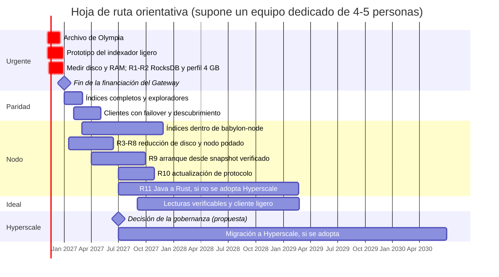

[← Índice](../../README.es.md) · [Anterior: Capítulo 7: cambios concretos en cada repositorio](07-cambios-por-repositorio.md) · [Siguiente: Capítulo 9: nodos más ligeros (RAM y disco) y migración de Java a Rust](09-nodos-ligeros.md)

# 8. Hoja de ruta

> [!IMPORTANT]
> - **¿Es posible?** Solo en parte antes del 31-dic-2026: el subconjunto crítico del indexador ligero puede tener un prototipo si se empieza ya; el resto del plan llega en 2027 y años siguientes.
> - **Dificultad:** Media para el calendario a corto plazo; muy alta para las fases F4-F5.
> - **Esfuerzo y plazo:** las fechas suponen un equipo dedicado de unas 4-5 personas a tiempo completo (supuesto de este informe); con menos personas, los plazos se alargan.

| Fase | Fechas orientativas | Contenido | Resultado |
|---|---|---|---|
| **F0** | nov.-dic. 2026 | **Archivo verificable del ledger de Olympia** ([2.2](01-02-situacion-actual.md#s2-2)), antes de que se apague. **Medir el tamaño por column family de un nodo de mainnet.** R1-R2 (RocksDB y perfil de 4 GB). Prototipo de `radix-lite-indexer` con el subconjunto crítico: estado, envío, preview, saldos, NFT, metadatos, subintents, validadores. Perfil en `babylon-nodecli`. Pruebas de conformidad contra el Gateway público. | Wallets, RDT y ROLA actuales funcionan cambiando solo la URL |
| **F1** | ene.-feb. 2027 | Índices de historial, ubicación de NFT y reglas de rol. Índices para exploradores (titulares, estadísticas, búsqueda). Reenvío. Modo público. Snapshots. Convención `api_endpoints` en los validadores. Primera versión de `radix-explorer`. | Paridad con lo que usan los clientes. Exploradores sin Gateway. Varios operadores de nodos sirviendo datos con el indexador. |
| **F2** | feb.-abr. 2027 | Clientes: listas con conmutación por error y descubrimiento (Sargon, wallets, RDT, ROLA, extensión, SDK). Reenvío en Sargon. Correcciones (`BaseUrlInterceptor`, mainnet fijo, servicios fijos). | Sin proveedor por defecto central |
| **F3** | 2027 | `babylon-node`: N1, N6, N5b, después N2-N4. R3-R8 (reducción de disco y nodo podado) y R9 (arranque desde snapshot verificado). Captura de snapshots en consultation. | Cada nodo es un punto de acceso; el indexador pasa a ser opcional |
| **F4** | 2027-2029 | Migración del núcleo a Rust (R11) por fases, **si la gobernanza no adopta Hyperscale o lo aplaza** (sección [11.8](11-evolucion-hyperscale.md#s11-8)). Actualización de protocolo R10. Lecturas verificables y cliente ligero ([6.2](06-solucion-recomendada.md#s6-2), [10.6](10-guia-de-implementacion.md#s10-6)). | Nodos de 4 GB con margen; acceso sin confiar en el nodo |
| **F5** | Tras la decisión de la gobernanza | Migración a Hyperscale (capítulo [11](11-evolucion-hyperscale.md#s11)): preparación para mainnet, API de lectura e indexador, wallets, génesis con reclamación verificable, reescritura de dApps. | Evolución final de Radix, si la comunidad la adopta |

---

[← Índice](../../README.es.md) · [Anterior: Capítulo 7: cambios concretos en cada repositorio](07-cambios-por-repositorio.md) · [Siguiente: Capítulo 9: nodos más ligeros (RAM y disco) y migración de Java a Rust](09-nodos-ligeros.md)
