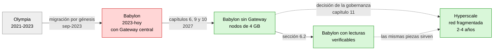
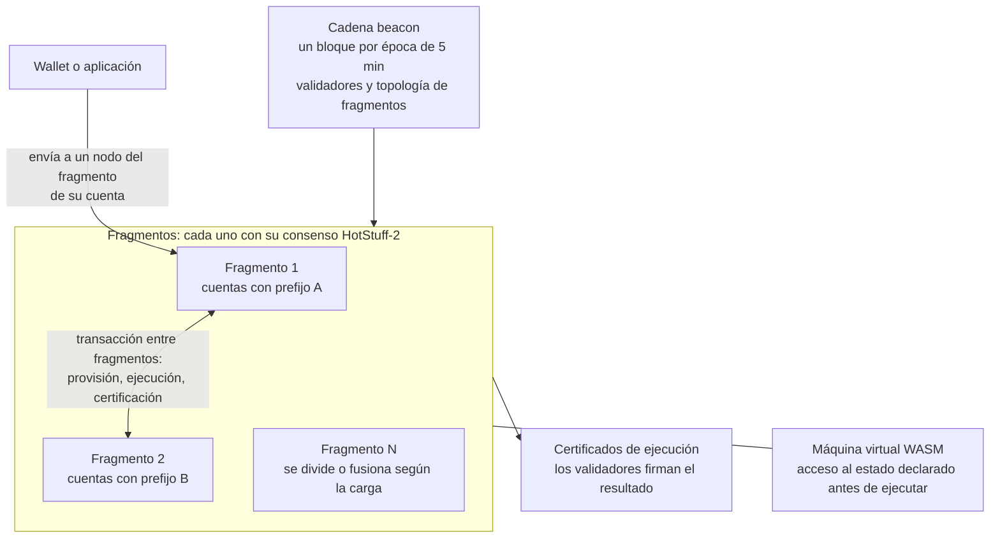
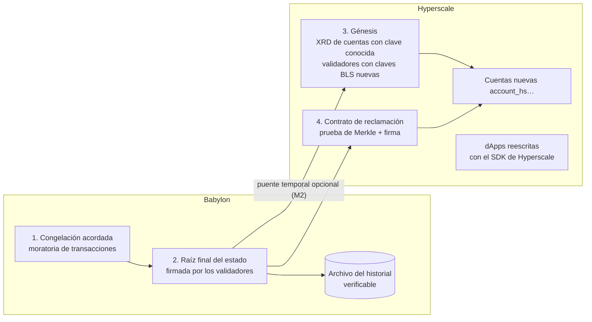
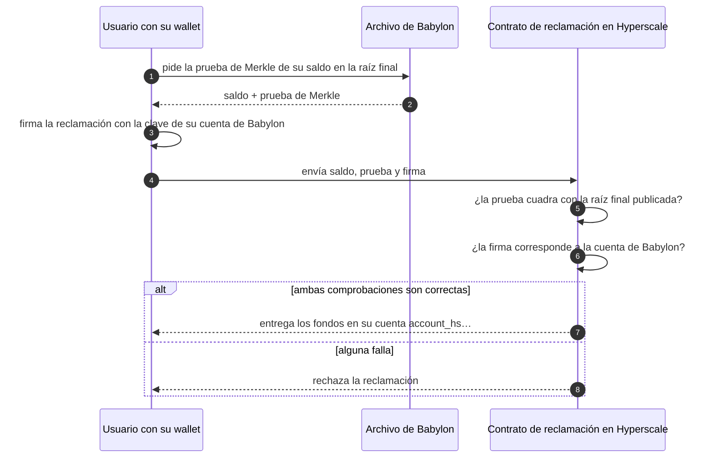

[← Índice](../../README.es.md) · [Anterior: Sección 10: guía de implementación paso a paso](08-guia-de-implementacion.md) · [Siguiente: Fuentes y metodología](10-fuentes.md)

# 11. Evolución final: de Babylon a Hyperscale

**Objetivo de este capítulo.** Describir qué sería necesario para que Radix adopte Hyperscale como evolución final de la red, quién tendría que hacerlo y con qué dificultad.

Hyperscale es de código abierto y la Foundation está en modo de mantenimiento. Por tanto, si la comunidad decide adoptarlo, será la propia comunidad quien tenga que adaptar el código de Radix y dirigir la migración.

## Veredicto: ¿es posible migrar Radix usando el código de Hyperscale?

**Sí, es posible, pero no de forma directa ni con el código tal como está hoy.**

| Qué se quiere migrar | ¿Es posible con el código de Hyperscale? | Condición |
|---|---|---|
| La red (consenso, validadores, nodos) | **Sí** | Es el propósito de `hyperscale-rs`. Requiere completarlo para mainnet y que los validadores generen claves BLS nuevas. |
| Los saldos de XRD | **Sí** | Con una génesis y un contrato de reclamación verificable (estrategia M1). La génesis actual ya admite saldos del token de comisiones. |
| Las cuentas y claves de los usuarios | **Sí, con dirección nueva** | Hyperscale acepta las mismas claves Ed25519 y secp256k1, pero las direcciones cambian (`account_rdx…` → `account_hs…`). |
| Otros tokens, NFT y stakes | **Sí, con desarrollo adicional** | Hay que ampliar la génesis o reemitirlos mediante reclamación; hoy no hay forma de importarlos. |
| Los contratos Scrypto y las dApps | **No** | Hyperscale declara la compatibilidad con Scrypto como no-objetivo. Cada contrato debe reescribirse con su SDK. |
| El historial de Babylon | **No dentro de Hyperscale** | Se conserva aparte, en nodos de archivo y almacenamiento distribuido verificable. |
| El software actual (wallets, RDT, ROLA, exploradores) | **No sin adaptarlo** | Formato de transacción, direcciones y API distintos. Hyperscale tampoco tiene todavía API de lectura ni indexador. |

En resumen: la **red y los fondos** pueden migrar a Hyperscale; las **aplicaciones** tienen que rehacerse. Con el código actual (versión en desarrollo, v0.0.6) **todavía no es posible hacerlo en producción**; hace falta el trabajo descrito en las secciones 11.4 y 11.5.

## 11.1 Qué es Hyperscale

Hyperscale es un diseño de red **fragmentada** (*sharded*): el estado se reparte entre varios fragmentos, cada uno con su propio consenso, y la capacidad crece al añadir fragmentos. Su objetivo es escalar sin perder la **composición atómica**: una transacción que afecta a varios fragmentos se confirma en todos o en ninguno.

| Aspecto | Hyperscale (`hyperscale-rs`) |
|---|---|
| Código | `github.com/hyperscalers/hyperscale-rs` y `github.com/hyperscalers/hyperscale-vm`, licencia MIT o Apache-2.0, en Rust |
| Actividad | ~4 450 commits en hyperscale-rs, la gran mayoría de un único desarrollador; última versión publicada v0.0.6 (ene-2026); actividad hasta nov-2026 |
| Estado | Ambos repositorios advierten: «Work in progress. Do not use.» |
| Consenso | Tres capas: HotStuff-2 por fragmento, certificados de ejecución y una cadena *beacon* (un bloque por época de 5 minutos) que gestiona validadores y fragmentos |
| Fragmentación | Dinámica: los fragmentos se dividen o se fusionan según la carga (desactivado por defecto) |
| Estado | Un único árbol de Merkle (JMT binario, Blake3); cada cuenta y lo que posee viven en el mismo fragmento |
| Ejecución | Máquina virtual WASM propia, con acceso al estado **declarado antes de ejecutar** |
| Red | QUIC mediante iroh |
| Firmas de validadores | BLS12-381, con agregación de firmas |
| Firmas de usuarios | Ed25519, secp256k1 (las mismas que Babylon) y ML-DSA-65 (post-cuántica) |
| Pruebas publicadas por la Foundation | 500 000 TPS sostenidas y picos de más de 800 000 en 128 fragmentos (feb-2026). Las hizo la Foundation con su propia implementación; no son mediciones de `hyperscale-rs`. |

## 11.2 Diferencias con Babylon que afectan a la migración

| Aspecto | Babylon (hoy) | Hyperscale |
|---|---|---|
| Contratos | Scrypto sobre Radix Engine | SDK propio con acceso declarado. **La compatibilidad con Scrypto es un no-objetivo explícito**, sin capa de adaptación (`hyperscale-vm/docs/00-overview.md`) |
| Codificación de datos | SBOR | HBOR |
| Direcciones | `account_rdx1…` (30 bytes, Blake2b) | `account_hs1…` (32 bytes, Blake3): **no se pueden convertir** |
| Claves de usuario | Ed25519 y secp256k1 | Las mismas, más ML-DSA. **Un usuario puede usar sus claves actuales**, pero su cuenta tendrá otra dirección. |
| Claves de validador | secp256k1 | BLS12-381: **todos los validadores necesitan claves nuevas** |
| Comisiones | Modelo de Babylon, con royalties para desarrolladores | Todas las comisiones se queman; los validadores cobran de una emisión fija; **no hay royalties** |
| Paquetes | Inmutables, con componentes configurables | Inmutables; las actualizaciones se hacen publicando una versión nueva a la que cada usuario migra |
| Génesis | Se usó para migrar Olympia (saldos, stakes, tokens, validadores) | Solo admite saldos del token de comisiones y pools de staking; **no hay importación de otros tokens, NFT ni componentes** |
| API para clientes | Core API, Engine State API (y hoy el Gateway) | RPC mínimo: estado del nodo, envío, preview y estado de transacción. **Sin lecturas de estado, historial ni eventos.** |
| Enrutado | Una sola cadena | Los clientes deben saber qué nodos alojan el fragmento de cada cuenta |

**Conclusión de la comparación:** pasar a Hyperscale **no es una actualización de protocolo**, sino una **migración a una red nueva**, parecida a la de Olympia a Babylon en 2023 pero más profunda. Las aplicaciones no se trasladan: hay que reescribirlas.

## 11.3 Estrategias de migración

### M1. Migración por génesis con reclamación verificable (recomendada)

1. **Congelar Babylon** en una época acordada. `v1.4.0.0` ya incluye un mecanismo de «moratoria» de transacciones de usuario que puede servir de base.
2. **Publicar la raíz final del estado** de Babylon (`state_tree_hash` firmado por los validadores en la última época) y archivar el ledger en nodos de archivo y almacenamiento distribuido (capítulo 9, R9; sección 10.5).
3. **Génesis de Hyperscale** con los saldos de XRD que se puedan asignar directamente: cuentas cuya clave pública ya es conocida porque la cuenta ha firmado alguna vez.
4. **Contrato de reclamación en Hyperscale** para todo lo demás. El usuario presenta:
   - una **prueba de Merkle** de su saldo contra la raíz final de Babylon;
   - una firma con la clave que controla esa cuenta, o la prueba de su badge si la cuenta está securificada.

   El contrato verifica ambas y entrega los fondos en la cuenta nueva. No hace falta confiar en ningún operador.
5. **Otros tokens y NFT:** cada proyecto decide si los reemite en Hyperscale usando la misma prueba de saldo.

**Por qué es la recomendada:**

- reutiliza piezas de este informe (pruebas de Merkle y snapshots verificados);
- no deja a nadie fuera, porque quien no reclame puede hacerlo más tarde;
- no exige confiar en un puente.

### M2. Coexistencia con un puente

Babylon y Hyperscale funcionan a la vez, y un puente traslada XRD y otros activos.

- **Ventaja:** la migración es gradual y no hay un día de corte.
- **Inconvenientes:**
  - durante años hay dos redes que mantener, con la liquidez dividida entre ellas;
  - el puente es un objetivo de ataque.

  Un puente basado en clientes ligeros (verificando pruebas firmadas de ambas redes) es más seguro que uno de custodios.
- **Uso razonable:** como complemento temporal de M1, para dar margen a las dApps mientras se reescriben.

### M3. Hacer compatible Scrypto con Hyperscale

Ejecutar el Radix Engine dentro de Hyperscale, o traducir Scrypto a su SDK.

- **Dificultad: muy alta.**
  - Hyperscale declara la compatibilidad con Scrypto y el uso de varios motores como no-objetivos.
  - Scrypto descubre el estado durante la ejecución, mientras que Hyperscale exige declararlo antes.
- **Viabilidad:** requeriría bifurcar Hyperscale y cambiar decisiones centrales de su diseño. No se recomienda, salvo quizá como herramienta de ayuda a la traducción de contratos sencillos.

## 11.4 Qué tendría que modificar o construir la comunidad

| Área | Trabajo necesario | Dificultad |
|---|---|---|
| **Hyperscale para mainnet** | Sustituir valores de desarrollo (p. ej. `SHARD_CAPACITY=4`, ratios de comisiones provisionales); auditorías de seguridad independientes; ampliar la verificación formal (hoy acotada); herramientas para operadores (equivalente a `babylon-nodecli`, despliegue de *vnodes*); decidir los parámetros económicos (emisión, comisiones, stake mínimo) y que el token de comisiones sea XRD | Muy alta |
| **Génesis y reclamación** | Ampliar la génesis de Hyperscale (otros recursos, stakes) o escribir el contrato de reclamación de M1; herramienta de exportación del estado final de Babylon con pruebas | Alta |
| **Babylon (lado de salida)** | Congelación ordenada (moratoria), publicación de la raíz final firmada, endpoint de pruebas de Merkle (sección 10.6), nodos de archivo | Media |
| **API de lectura e indexador de Hyperscale** | Hoy no existen. Hay que añadir lecturas de estado, eventos, recibos e historial, conscientes de la fragmentación. El diseño del indexador ligero, el descubrimiento en la cadena y el cliente ligero de este informe se pueden reutilizar. | Alta |
| **Sargon y wallets iOS/Android** | Soporte de HBOR, nuevas direcciones y sobres de transacción, fragmentos; convivencia con Babylon durante la transición; flujo de reclamación; agenda que relacione direcciones antiguas y nuevas. Gracias a la interfaz `LedgerBackend` propuesta (sección 10.4), Hyperscale sería un backend más. | Muy alta |
| **Monedero hardware (Ledger)** | Nueva app de firma para el formato de Hyperscale | Media |
| **RDT, ROLA y Radix Connect** | Nuevos tipos de petición y verificación de login. Radix Connect (relé, WebRTC o iroh) se puede reutilizar como canal. | Media |
| **dApps** | **Reescribir cada contrato** con el SDK de Hyperscale, rediseñando los patrones que consultan estado no declarado; sin royalties; migrar liquidez (DEX, préstamos) | Muy alta, por proyecto |
| **Exploradores, exchanges, custodios, puentes (p. ej. Hyperlane)** | Integración con la nueva red | Media, por integración |
| **Gobernanza** | Decidir si se adopta, el calendario, la financiación y los parámetros; comunicación a usuarios | Alta (organizativa) |

## 11.5 Esfuerzo y plazo

Son estimaciones de orden de magnitud, para planificar, no presupuestos:

| Bloque | Esfuerzo estimado |
|---|---|
| Endurecer Hyperscale para mainnet (sin contar auditorías externas) | 40-80 persona-mes |
| API de lectura, indexador y explorador para Hyperscale | 15-30 persona-mes |
| Migración: congelación, exportación, génesis, reclamación y puente temporal | 15-30 persona-mes |
| Sargon, wallets, Ledger, RDT y ROLA | 40-70 persona-mes |
| **Total del núcleo (sin dApps de terceros)** | **~110-210 persona-mes**, del orden de **2-4 años** con un equipo pequeño |

**Dificultad global de la migración a Hyperscale: muy alta.** Es el proyecto más grande de todo el informe.

## 11.6 Riesgos

- **Dependencia de una sola persona.** Casi todo el código de `hyperscale-rs` lo ha escrito un único desarrollador. La comunidad necesitaría formar un equipo que lo entienda y lo mantenga.
- **Madurez.** El proyecto se declara en desarrollo y no apto para su uso.
- **Ecosistema.** Todas las dApps tienen que reescribirse; algunas pueden no hacerlo.
- **Usuarios que no reclamen.** La reclamación debe quedar abierta durante mucho tiempo y ser sencilla.
- **Seguridad** del contrato de reclamación y de cualquier puente.
- **Economía.** Cambian el modelo de comisiones, la emisión y las royalties, lo que afecta a validadores y desarrolladores.

## 11.7 Cómo encaja con el resto del informe

1. **Babylon tiene que seguir funcionando durante años**, porque la migración llevaría de 2 a 4 años. El trabajo para eliminar el Gateway y aligerar los nodos (capítulos 6, 9 y 10) sigue siendo necesario.
2. **Muchas piezas se reutilizan:**
   - la interfaz `LedgerBackend` de los clientes;
   - el descubrimiento de nodos en la cadena;
   - el indexador ligero;
   - los snapshots verificados;
   - las pruebas de Merkle y el cliente ligero.

   Estas mismas piezas son las que necesitan Hyperscale y la reclamación de M1.
3. **Decisión sobre R11 (migración del nodo de Babylon a Rust).** Si la comunidad decide pronto adoptar Hyperscale, conviene **aplicar R1-R9**, que son baratos y dan resultados en meses, y **aplazar R11**, porque su esfuerzo (30-50 persona-mes) compite con el de la migración. Si Hyperscale se retrasa o no se adopta, R11 vuelve a ser la vía para nodos de 4 GB con margen.
4. **Recomendación:** que la gobernanza decida primero si adopta Hyperscale y con qué estrategia (M1, con M2 como apoyo temporal). Mientras tanto, mantener el plan a corto plazo de este informe, cuyo valor no depende de esa decisión.

---

[← Índice](../../README.es.md) · [Anterior: Sección 10: guía de implementación paso a paso](08-guia-de-implementacion.md) · [Siguiente: Fuentes y metodología](10-fuentes.md)
