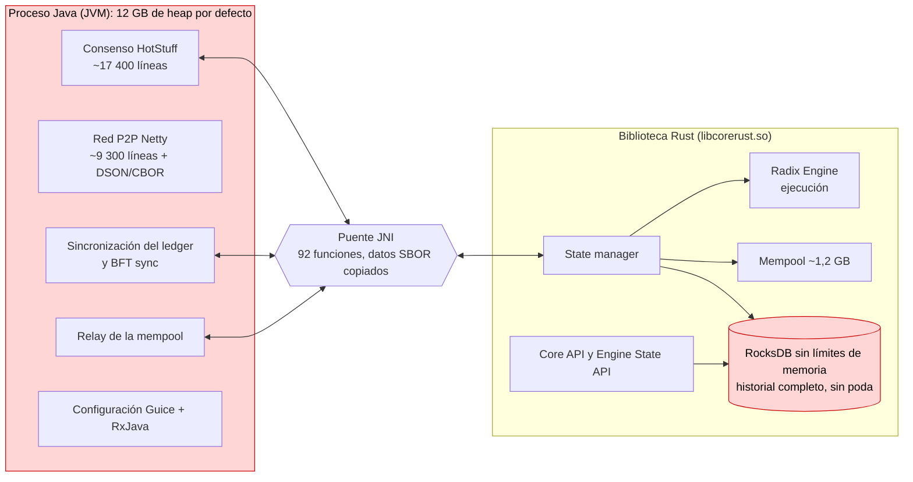
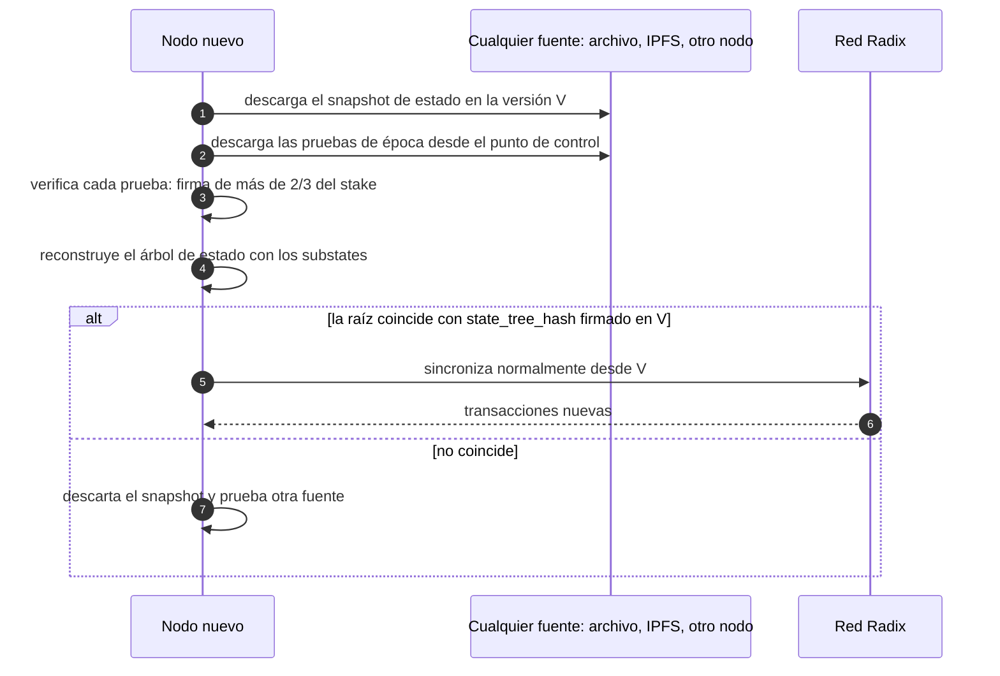
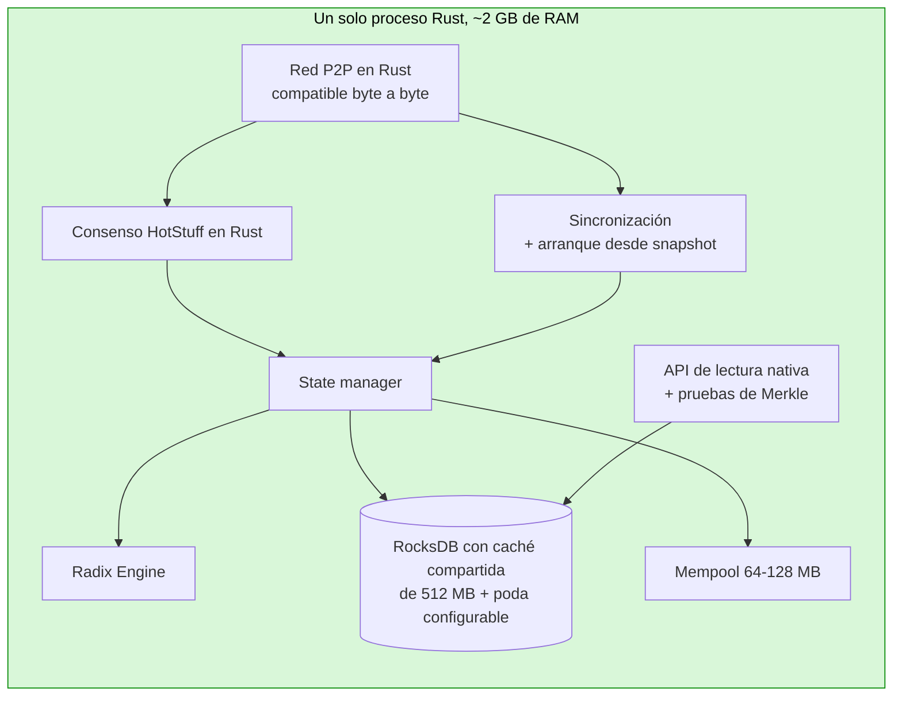
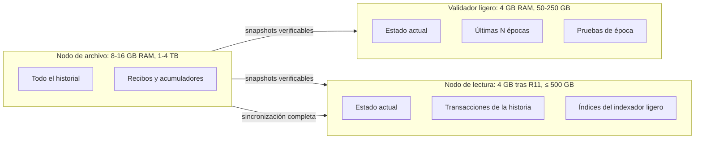

[← Índice](../../README.es.md) · [Anterior: Capítulo 8: hoja de ruta](08-hoja-de-ruta.md) · [Siguiente: Capítulo 10: guía de implementación paso a paso](10-guia-de-implementacion.md)

<a id="s9"></a>

# 9. Nodos más ligeros: objetivo de 4-8 GB de RAM y 500 GB de disco o menos

> [!IMPORTANT]
> - **¿Es posible?** Sí. Un nodo de 8 GB de RAM como máximo parece alcanzable, y 4 GB es plausible, con menos de 500 GB de disco (estimaciones que hay que confirmar midiendo un nodo real).
> - **Dificultad:** Media con Java (R1-R9); muy alta para tener margen holgado (R11, migración a Rust).
> - **Esfuerzo y plazo:** 8-14 personas-mes para R1-R9, incluidas pruebas en Stokenet, revisión y despliegue (supuesto); 30-50 personas-mes para R11 (estimaciones).

**Objetivo.** Que un validador o un nodo completo de mainnet funcione con **4 GB de RAM y 500 GB de disco**, y que la red siga funcionando sin el Gateway.

**Código revisado:**

- `babylon-node`, rama `develop` (12919a01, último commit del 12-mar-2025; las versiones recientes no salen de esta rama);
- la **última versión publicada, `v1.4.0.0` «Eagle Ray»** (7400951e; commit del 8-sep-2026, publicada el 10-sep-2026);
- `babylon-nodecli`.

Las rutas `fichero:línea` son de `develop` salvo que se indique lo contrario. Las diferencias de `v1.4.0.0` que importan aquí se señalan expresamente.

<a id="s9-1"></a>

## 9.1 Situación actual: datos

| Dato | Valor | Fuente |
|---|---|---|
| Requisitos oficiales | 4 CPU, **16 GB de RAM**, «500 GB de SSD (inicialmente)» | docs.radixdlt.com, *Node setup* |
| Memoria configurada por defecto en mainnet | `-Xms12g -Xmx12g -XX:MaxDirectMemorySize=2048m`, contenedor de **14 GB** (`mem_limit: 14000m`) | `babylon-nodecli/node-runner-cli/config/CoreDockerConfig.py:23-32`, `templates/radix-fullnode-compose.yml.j2:17,46` |
| Swap recomendado | 8 GB | docs.radixdlt.com, *Optimizing performance* |
| Tamaño del ledger: snapshot comunitario **comprimido** (zstd) | 6,3 GiB (oct-2023) → 69 GiB (sep-2024) → 180 GiB (sep-2025) → 259 GiB (jul-2026) → **274 GiB (29-sep-2026)** | snapshots.radix.live |
| Crecimiento reciente | **~5-8 GiB/mes** comprimidos | cálculo sobre la fila anterior |
| Otro snapshot publicado | 343,9 GB (PublicNode, v1.4.0.0, altura 566 915 789; no se indica si está comprimido) | publicnode.com/snapshots |
| Peso de los índices opcionales | ~4-5 % (274 frente a 262 GiB sin índices) | snapshots.radix.live |
| Poda del historial de transacciones | **No existe** | código: solo hay GC del árbol de estado y de pruebas del ledger |
| Arranque desde un snapshot verificado | **No existe**. Un nodo nuevo reproduce ~567 millones de transacciones desde la génesis, o descarga un snapshot de terceros sin verificación criptográfica. | código; `babylon-nodecli/.../ledger_snapshot/__init__.py:26-80` |
| Ajuste de RocksDB | **Ninguno**: `Options::default()` para la base de datos y para las 26 column families, también en `v1.4.0.0` | `core-rust/state-manager/src/store/rocks_db.rs:164-170` |
| Mempool | 512 MiB de transacciones × factor 2,3 ≈ **~1,2 GB** por defecto | `core-rust/node-common/src/config/mod.rs:74-75`, `RadixNodeModule.java` (cálculo de la mempool) y `priority_mempool.rs:81` (factor del 230 %) |
| Código Java que queda | ~55 500 líneas escritas a mano en `core` + ~35 000 en `common` + ~14 000 de clases del puente Java-Rust (más ~4 000 de capa JNI en Rust) | recuento con `wc -l` |
| Nodo «todo en Rust» oficial | Xi'an / hyperscale-rs es **otra red** (no Babylon) y no tiene fecha de lanzamiento. Según radix.wiki, el 3-sep-2026 su desarrollador principal dejó las propuestas, subvenciones y colaboraciones con Radix, aunque sigue desarrollando el código (sección [11.1](11-evolucion-hyperscale.md#s11-1)). | radixdlt.com (hoja de ruta 30-nov-2024), radix.wiki |

**Conclusión de partida:**

- **RAM:** con lo que se publica hoy, un nodo de mainnet **no cabe en 4 GB**: reserva 12 GB de heap para Java, RocksDB no tiene límites de memoria y la mempool puede ocupar ~1,2 GB. El heap y la memoria directa configurados (12 + 2 GB) ya igualan el límite del contenedor (14 GB); son máximos reservados, no consumo medido: el consumo real (RSS) de un nodo de mainnet no se ha publicado.
- **Disco:** el ledger comprimido ya ocupa 274 GiB. Descomprimido ocupa bastante más; la cifra exacta no se ha publicado. Así que **500 GB de disco pueden ser ya insuficientes, o lo serán pronto**.

<a id="s9-2"></a>

## 9.2 Dónde se va la memoria

### El nodo hoy



| Consumidor | Hoy | Por qué | Se puede bajar a |
|---|---|---|---|
| Heap de Java | 12 GB reservados de inicio (`-Xms12g`) | Valor por defecto del instalador. El consumo real no se ha publicado; en betanet (2023) se midieron 1,5-7 GB. | **1-1,5 GB** (objetivo) con límites en las estructuras Java (vertex store, colas de mensajes); **0 GB** tras migrar a Rust |
| Memoria directa (Netty) | hasta 2 GB | Buffers de red | 256 MB; **0** tras migrar |
| RocksDB: índices y filtros de cada fichero SST | **Sin límite**; crece con el ledger | `max_open_files=-1` y `cache_index_and_filter_blocks=false` (opciones por defecto) mantienen en memoria los índices de **todos** los ficheros abiertos, ~0,5-1,5 % del tamaño de la base de datos (*estimación*) | Contabilizados dentro de una caché compartida de **512 MB** |
| RocksDB: memtables | 64 MB × 2 por column family, sin tope global; ~0,6-1,3 GB en la práctica (*estimación*) | Opciones por defecto (documentación de RocksDB, capítulo [12](12-referencias-otras-redes.md#s12)) | **256 MB** en total con `WriteBufferManager` |
| RocksDB: caché de bloques | una independiente por column family: 26 × 32 MB ≈ 0,8 GB con RocksDB 10.4 (`v1.4.0.0`); 26 × 8 MB con RocksDB 8.1 (`develop`) | Opciones por defecto | Una sola, compartida (la de arriba) |
| Mempool | ~1,2 GB | 512 MiB por defecto | **64-128 MB** en validadores pequeños |
| Vertex store (consenso, Java) | hasta 150 MB, reserializado entero en cada cambio | `VertexStoreJavaImpl.java:223-238` | Igual, sin reserializar, cuando pase a Rust |
| Cachés de resultados y de ejecución (Rust) | 3 LRU de 10 000 entradas y la caché de staging | `state_manager.rs:257-264` | Tamaño configurable |

**El factor decisivo es RocksDB sin ajustar.** Su memoria crece con el tamaño del ledger y no hay ningún límite. Se corrige sin tocar el consenso, con unas decenas de líneas en `rocks_db.rs` (cambio R1).

<a id="s9-3"></a>

## 9.3 Dónde se va el disco

Unos 555 de los ~567 millones de versiones del ledger (~97-98 %) son **cambios de ronda**: transacciones de sistema, una por ronda de consenso. Cada una escribe, de forma **permanente**:

| Dato guardado por cada cambio de ronda | Bytes sin comprimir (estimación a partir de los esquemas) | ¿Se poda? | ¿Para qué hace falta? |
|---|---|---|---|
| Transacción en bruto (`raw_ledger_transactions`) | ~50 | No | Servir la sincronización a otros nodos |
| Identificadores (`committed_transaction_identifiers`) | ~200 (hashes, apenas comprimen) | No | Arranque del nodo, APIs; para usuarios, validación de duplicados |
| **Recibo** (`transaction_receipts`) | **~4-4,5 KB**. ~3,8 KB son la estadística de propuestas de ~100 validadores, guardada **dos veces** (valor nuevo y valor previo, `receipt.rs:105-124`) | No | Solo APIs, salvo los recibos de cambio de época (los usa la preparación de actualizaciones de protocolo) |
| Ejecución local (`local_transaction_executions`) | ~0,7-1,5 KB | No (activado por defecto) | Solo APIs |
| Fragmentos del acumulador (`transaction/receipt_accu_tree_slices`) | ~0,9-1,3 KB (hashes) | **No** | Solo se lee el último fragmento de la época en curso |
| Índice de hash de la transacción (`ledger_transaction_hashes`) | 40 | No | Comprobación de duplicados; ningún lector de API |
| Pruebas del ledger | ~5-8 KB | Sí, tras 12 épocas queda ~1 de cada 1 000 | Sincronización |
| Nodos del árbol de estado (JMT) | ~3-6 KB | Sí, ventana de 60 000 versiones | Consenso (raíz de estado) |

- **Coste permanente estimado por cambio de ronda:** la suma de la tabla da ~6-6,5 KB **sin comprimir** con la ejecución local activada. En ~555 millones de rondas serían **del orden de 3-4 TB sin comprimir**. Son cifras de **límite superior**: buena parte de estos datos (recibos casi idénticos de una ronda a otra) se comprime muy bien, y el snapshot comprimido completo ocupa 274 GiB. El tamaño real en disco solo se puede conocer midiéndolo.
- **Orden de importancia:** recibos > fragmentos del acumulador > ejecuciones locales > identificadores. Las transacciones en bruto de los cambios de ronda solo suman ~25-30 GB.
- **Cómo confirmarlo:** el nodo ya publica el tamaño por column family (métricas `raw_db_size`, `SM/metrics.rs:590-640`). El **primer paso** del plan es publicar esas cifras de un nodo de mainnet.
- **Causa de fondo:** el campo `CurrentProposalStatistic` del ConsensusManager, ~1,9 KB, se reescribe entero en cada ronda. Su valor previo se guarda en el recibo y su ruta se reescribe en el árbol de estado.
- **Novedad de `v1.4.0.0`:**
  - Añade la opción **`db.keep_previous_substate_values`**: con `false`, el recibo deja de guardar los valores previos (`rocks_db.rs:705-714` en `v1.4.0.0`), lo que **casi divide por dos el recibo de cada ronda**.
  - Está **activada por defecto** (`true`) en mainnet y solo se aplica a lo que se escriba a partir de ese momento.
  - Además, `v1.4.0.0` **elimina la Mesh API**.

<a id="s9-4"></a>

## 9.4 Cambios: qué hacer, dónde y cómo

Cada cambio indica:

- **dónde** tocar;
- **cómo** hacerlo;
- **cómo probarlo**;
- **ahorro** estimado;
- **riesgo**.

Los cambios R1-R7 **no tocan el consenso** y se pueden publicar en cualquier versión del nodo. R8 y R9 cambian la forma de sincronizar. R10 es una actualización de protocolo. R11 es la migración de Java a Rust.

### R1. Configurar RocksDB con límites de memoria (P0, esfuerzo S-M)

> [!NOTE]
> **Referencia en otras redes:** la documentación oficial de RocksDB describe estos mismos ajustes (caché compartida, índices y filtros dentro de la caché, Write Buffer Manager). Ver capítulo [12](12-referencias-otras-redes.md#s12).

- **Dónde:**
  - `core-rust/state-manager/src/store/rocks_db.rs:164-170` (y las aperturas de solo lectura y secundaria, `:201-207`, `:237-243`);
  - `core-rust/p2p/src/rocks_db.rs:117-123`;
  - nuevas propiedades en `RadixNodeModule.java` y `DatabaseConfig`.
- **Cómo:**

```rust
// Una sola caché y un solo presupuesto de memtables para todo el nodo.
let cache = Cache::new_lru_cache(cfg.block_cache_bytes);            // p. ej. 512 MiB
let wbm = WriteBufferManager::new_write_buffer_manager_with_cache(
    cfg.memtable_budget_bytes, /*allow_stall=*/ true, cache.clone()); // p. ej. 256 MiB

let mut db_opts = Options::default();
db_opts.create_if_missing(true);
db_opts.create_missing_column_families(true);
db_opts.set_max_open_files(cfg.max_open_files);                   // p. ej. 1 024
db_opts.set_write_buffer_manager(&wbm);
db_opts.set_max_background_jobs(cfg.background_jobs);              // p. ej. 2

let cf_opts = |cf: &str| {
    let mut t = BlockBasedOptions::default();
    t.set_block_cache(&cache);
    t.set_cache_index_and_filter_blocks(true);
    t.set_pin_l0_filter_and_index_blocks_in_cache(true);
    if is_point_lookup_cf(cf) { t.set_bloom_filter(10.0, false); } // substates, JMT, índices de hash
    let mut o = Options::default();
    o.set_block_based_table_factory(&t);
    o.set_level_compaction_dynamic_level_bytes(true);
    o.set_write_buffer_size(if is_hot_cf(cf) { 32 << 20 } else { 8 << 20 });
    o.set_compression_type(DBCompressionType::Lz4);
    if is_append_only_cf(cf) {                                      // recibos, ejecuciones, transacciones
        o.set_bottommost_compression_type(DBCompressionType::Zstd);
    }
    o
};
```

- **Nota sobre el código:** la rama `develop` usa el crate `rocksdb` 0.21 (RocksDB 8.1.1), pero la versión `v1.4.0.0` ya usa el crate 0.24 (RocksDB 10.4.2), que incluye todas las funciones del fragmento (`WriteBufferManager`, `set_block_cache`, `set_cache_index_and_filter_blocks`, `set_bloom_filter`, etc.). El fragmento es orientativo.
- **Propiedades nuevas:**
  - `db.rocksdb.block_cache_mb` (512);
  - `db.rocksdb.memtable_budget_mb` (256);
  - `db.rocksdb.max_open_files` (1 024);
  - `db.rocksdb.compression` (`lz4+zstd`).
- **Pruebas:**
  - sincronizar un nodo de Stokenet y uno de mainnet desde un snapshot;
  - medir RSS, latencia de commit, rendimiento de la sincronización y compactación;
  - comparar el hash del estado con un nodo sin cambios.
- **Ahorro:**
  - RAM de RocksDB acotada en **~0,8 GB**, en vez de varios GB y creciendo;
  - **25-40 % menos disco** en los recibos y ejecuciones a medida que se compacten (*estimación*).
- **Riesgo:** bajo; lecturas en frío algo más lentas.

### R2. Perfil «nodo pequeño» en el instalador (P0, S)

- **Dónde:** `babylon-nodecli` (`CoreDockerConfig.py`, `CoreSystemDConfig.py`, plantillas `radix-fullnode-compose.yml.j2` y `systemd-environment.j2`).
- **Cómo:** nuevo perfil `--profile small-4gb` con:
  - `JAVA_OPTS="-Xms1g -Xmx1536m -XX:MaxDirectMemorySize=256m -XX:+UseG1GC -XX:MaxGCPauseMillis=200"`;
  - `mem_limit: 3500m`;
  - `RADIXDLT_MEMPOOL_MAX_MEMORY=134217728` (128 MB);
  - límites de canales P2P más bajos (`network.p2p.max_inbound_channels` y `max_outbound_channels` de 1 024 a ~64);
  - opciones de R1 y R3.
- **Mismo repositorio, fallo de seguridad:** el comando de snapshot descarga sin verificar TLS un *script* remoto que se ejecuta con bash, y no comprueba hash ni firma del snapshot (ver la sección [7.3](07-cambios-por-repositorio.md#s7-3)). Hay que verificar TLS y una **firma o hash publicado** del snapshot.
- **Pruebas:** validador de Stokenet con 4 GB durante varias semanas, midiendo rondas perdidas y RSS.
- **Riesgo:** bajo. Si el heap queda corto, el nodo se reinicia; lo evita la prueba prolongada.

### R3. Validadores sin índices de API (P0, S)

- **Qué:** en validadores, `db.local_transaction_execution_index.enable=false` y `db.account_change_index.enable=false`.
- **Dónde:** hoy no se pueden desactivar en una base de datos existente (`traits.rs:124-133` lo rechaza). Hay que permitir el paso de `true` a `false`:
  - borrar las column families (`drop_cf` o `delete_range`);
  - lanzar una compactación manual;
  - guardar el nuevo estado de la opción en `extensions_data`.
- **Ahorro:** ~0,7-1,5 KB por versión, **posiblemente cientos de GB** en mainnet (estimación sin comprimir: ~555 millones de cambios de ronda × 0,7-1,5 KB ≈ 0,4-0,8 TB, antes de la compresión).
- **Qué se pierde:** en ese nodo, `/stream/transactions`, `/transaction/receipt` y la LTS de historial. Los nodos de lectura (capítulo [6](06-solucion-recomendada.md#s6)) sí los mantienen.
- **Riesgo:** bajo; los handlers de la API ya comprueban la opción.

### R4. Recibos sin valores previos, también los antiguos (P0, S)

- **Qué:**
  1. Poner **`db.keep_previous_substate_values=false`** por defecto en validadores (ya existe en `v1.4.0.0`).
  2. Añadir un **filtro de compactación** de RocksDB en la column family `transaction_receipts` que borre `previous` de los recibos antiguos al compactarlos. Es el mismo bucle de `rocks_db.rs:705-714`, aplicado en el filtro.
- **Ahorro:** ~1,9 KB por cambio de ronda sin comprimir; **del orden de cientos de GB** sobre la historia (*estimación*, a confirmar con `raw_db_size`).
- **Riesgo:** las APIs dejan de devolver el valor previo; ya lo asume `v1.4.0.0`.

### R5. Podar los fragmentos del acumulador de épocas cerradas (P1, S)

- **Dónde:** el GC de pruebas del ledger (`SM/store/proofs_gc.rs`) o un GC nuevo.
- **Cómo:** `delete_range` de `transaction_accu_tree_slices` y `receipt_accu_tree_slices` hasta el inicio de la época anterior a la actual. Cada época empieza un árbol nuevo a partir de la raíz anterior (`staging/epoch_handling.rs:174-200`), y solo se lee el último fragmento (`accumulator_tree/tree_builder.rs:110-113`).
- **Ahorro:** ~0,9-1,3 KB por ronda, de datos que **no comprimen**: **cientos de GB** (*estimación*).
- **Riesgo:** bajo. Se pierde la posibilidad de construir pruebas históricas de inclusión de transacciones, que hoy ninguna API ofrece. Los nodos de archivo pueden mantenerlas.

### R6. No indexar el hash de los cambios de ronda (P2, S)

- **Dónde:** `rocks_db.rs:676-690`.
- **Cómo:** omitir el `put` y la comprobación de duplicados cuando la transacción es `RoundUpdate`. El motor ya rechaza rondas que no crecen.
- **Ahorro:** ~20-30 GB (estimación: ~555 millones × 40 bytes) y algo de RAM de índices.

### R7. Recibos de cambio de ronda opcionales (P1, S-M)

- **Qué:** opción `db.round_update_receipts=epoch_only` que guarde solo los recibos de cambio de época, los únicos que lee el núcleo (`protocol_state.rs:599-616`).
- **Por qué es seguro:** la raíz de los recibos sigue en los identificadores y en las pruebas firmadas, así que el consenso no cambia. Cualquier recibo se puede recalcular reproduciendo la transacción.
- **Ahorro:** el **mayor componente restante** tras R4.
- **Riesgo:** las APIs de recibo de rondas antiguas, y la reconstrucción de índices de entidades (`rocks_db.rs:1541`), tendrían que reproducir la transacción. Por eso es opcional y pensado para validadores.

### R8. Modo «nodo podado» (P1, M-L)

> [!NOTE]
> **Referencia en otras redes:** Cosmos SDK ofrece la poda como opción configurable (nodos podados y de archivo), y en julio de 2025 todos los clientes de ejecución de Ethereum incorporaron la expiración del historial anterior al Merge (EIP-4444), ahorrando 300-500 GB por nodo. Ver capítulo [12](12-referencias-otras-redes.md#s12).

- **Qué:** opción `ledger.retain_epochs=N`. Borra por rangos las transacciones, identificadores, recibos y ejecuciones de más de N épocas. Conserva:
  - las pruebas de época y de actualización de protocolo;
  - los recibos de cambio de época;
  - el índice `intent_hashes` y los identificadores de transacciones de usuario dentro de la ventana de validez, que necesita `validation.rs:74-81`.
- **Cambios de código:**
  1. **Protección contra huecos** en `get_syncable_txns_and_proof` (`rocks_db.rs:1011-1066`): hoy no comprueba que la primera transacción devuelta esté en la versión pedida, así que podría construir una respuesta inconsistente.
  2. **Anunciar la versión más antigua que se puede servir** en los mensajes de estado de la sincronización (`RemoteSyncService.java:128-166`), para que los demás nodos no pidan lo que ya no hay.
  3. Revisar `max_state_version` y `get_first_proof` (`rocks_db.rs:990-995, 1134-1138`).
- **Ahorro:** casi todo el historial. Un validador ocuparía el estado más N épocas (**decenas a ~200 GB**, según N; *estimación*).
- **Riesgo:** la red necesita **suficientes nodos de archivo** para que los nodos nuevos puedan arrancar. Sin R9, los nodos nuevos dependen de ellos.

### R9. Arranque desde un snapshot de estado verificado: «fast sync» (P0 para el objetivo, L)

> [!NOTE]
> **Referencia en otras redes:** CometBFT/Cosmos (*state sync*) y Ethereum (*checkpoint sync*) usan este mismo esquema: snapshot o punto de control verificado contra la cadena a partir de un punto de confianza. Ver capítulo [12](12-referencias-otras-redes.md#s12).

Un nodo nuevo arranca **en horas (estimación), sin reproducir 567 millones de transacciones y sin confiar en quien le da el snapshot**.

- **Exportación** (en cualquier nodo, en una versión V que sea final de época):
  - column families `substates` y `substate_node_ancestry_records`;
  - identificadores y último fragmento del acumulador de V;
  - pruebas de época desde la génesis;
  - estado de protocolo;
  - un manifiesto con hashes por bloque.
- **Distribución:** HTTP, BitTorrent o IPFS. Su origen no importa, porque se verifica.
- **Importación y verificación:**
  1. Verificar la **cadena de pruebas de época** desde la génesis, o desde un punto de control incluido en el binario: cada prueba la firma más de 2/3 del stake del conjunto de validadores anterior.
  2. Cargar los substates y **reconstruir el árbol de estado** (JMT).
  3. Comprobar que la raíz reconstruida es igual al `state_tree_hash` de la prueba firmada en V. Si no coincide, se descarta el snapshot.
  4. Continuar con la sincronización normal desde V.
- **Dónde:**
  - un comando nuevo `babylon-node snapshot export` / `import` (Rust, `state-manager`), reutilizando la infraestructura de checkpoints (`node-common/src/store/rocks_db.rs:214`);
  - en Java, que `LocalSyncService` acepte arrancar desde V.
- **Riesgo:** hay que diseñar bien el modelo de confianza (punto de control inicial) y la coherencia del estado de protocolo. Es el cambio más delicado de este grupo, pero **no cambia el consenso**.
- **Efecto:**
  - Ningún nodo necesita el historial completo salvo los de archivo.
  - Desaparece la dependencia de snapshots de terceros sin verificar.
  - Los 500 GB dejan de ser un problema a largo plazo.

### Cómo arranca un nodo con R9



### R10. Actualización de protocolo: estadística de propuestas por validador (P2, M; requiere votación de validadores)

- **Esfuerzo:** no incluido en los totales de personas-mes de este informe.
- **Qué:** dividir `CurrentProposalStatistic` (~1,9 KB reescritos en cada ronda) en una colección con una entrada por validador, de modo que cada ronda solo reescriba la del proponente (~20 bytes).
- **Dónde:**
  - el blueprint ConsensusManager en `radix-engine`;
  - una nueva actualización de protocolo en `babylon-node` (`protocol/protocol_updates/definitions/`), como las de Bottlenose, Cuttlefish o Eagle Ray.
- **Ahorro:** los recibos de ronda y la reescritura del árbol de estado bajan del orden de diez veces (estimación) **para todo lo que se escriba a partir de la actualización**.
- **Riesgo:** es una actualización de protocolo; necesita pruebas y la señal de preparación de los validadores.

### R11. Migrar el núcleo de Java a Rust (P1 para 4 GB con margen, XL)

> [!NOTE]
> **Referencia en otras redes:** En Solana, Frankendancer combina componentes del nuevo cliente Firedancer con los del cliente existente, un ejemplo real de sustitución por partes. Ver capítulo [12](12-referencias-otras-redes.md#s12).

**Qué queda en Java** (versión `develop`):

| Área | Líneas aprox. | ¿Hay algo ya en Rust? |
|---|---|---|
| Consenso: HotStuff, pacemaker, safety rules, vertex store, épocas | ~17 400 | La persistencia (safety store, vertex store) y el cálculo del siguiente conjunto de validadores |
| Red P2P: Netty, handshake ECIES tipo RLPx, cifrado AES-CTR + MAC Keccak, descubrimiento, address book | ~9 300 | Solo el almacenamiento del address book (`core-rust/p2p`) |
| Mensajería y serialización DSON/CBOR (47 tipos de mensaje) | ~5 400 + ~7 400 | No |
| Sincronización del ledger y BFT sync | ~4 900 | La parte servidora (`getSyncableTxnsAndProof`) |
| Retransmisión de la mempool | ~1 700 | La mempool entera |
| Configuración, Guice y RxJava | ~7 000 | `StateManagerConfig` |
| System API y Prometheus | ~3 300 | El registro de métricas |
| Claves y keystore | ~750 + criptografía | Primitivas secp256k1 |
| **Desaparece al migrar:** SBOR en Java, DTOs del puente, capa JNI | ~7 000 + ~14 000 + ~4 000 | — |

**Cómo hacerlo sin poner en riesgo la red** (patrón *strangler*: sustituir pieza a pieza, con el nodo siempre funcionando):

1. **Fase 0: base de pruebas.**
   - Portar a Rust el arnés determinista de Java (`core/src/test-core`, ~17 800 líneas escritas a mano) o envolverlo para ejecutar los mismos escenarios contra ambas implementaciones.
   - Sirve de referencia el diseño *sans-io* de `hyperscale-rs/crates/core` y su simulador.
2. **Fase 1: piezas sin red.**
   - Vertex store y safety rules en Rust, llamados desde Java por JNI. Esto elimina la reserialización completa del vertex store en cada cambio.
   - Retransmisión de la mempool en Rust, que elimina la llamada de vuelta `triggerMempoolRelay`.
   - Configuración en Rust.
3. **Fase 2: sincronización.** Cliente de sincronización del ledger y BFT sync en Rust. La parte servidora ya está en Rust.
4. **Fase 3: red P2P en Rust, compatible byte a byte.**
   - Handshake, cifrado del canal y Snappy.
   - Códec DSON/CBOR de los 47 mensajes.
   - **Pruebas de compatibilidad** con vectores capturados de nodos Java reales.
   - Desplegar primero en nodos completos, después en validadores. Se pueden reutilizar patrones de `hyperscale-rs/crates/network` (reintentos, *backoff*, registro de handlers).
5. **Fase 4: consenso en Rust.**
   - Portar HotStuff, pacemaker y épocas.
   - Ejecutar en **modo sombra**: el nodo Rust calcula los votos, pero firma el Java, y se comparan.
   - Después, testnet mixta Java/Rust y, por último, mainnet con adopción progresiva.
6. **Fase 5:** retirar la JVM, el puente JNI y el código Java.
7. **Opcional, más adelante:** nuevo transporte (QUIC/iroh) negociado por capacidad, cuando todos los nodos hablen Rust.

### El nodo tras migrar a Rust (R11)



**Beneficio:**

- Desaparecen el heap de Java, el metaspace, el JIT y la memoria directa de Netty: **~1,5-2,5 GB menos** con un perfil pequeño (*estimación*).
- Un solo proceso y un solo asignador de memoria.
- Desaparece la copia de datos por JNI.

**Esfuerzo:** del orden de **30-50 personas-mes** con perfiles expertos en consenso (*estimación*).

**Riesgo:** alto, porque toca el consenso. Se mitiga con el modo sombra, la testnet mixta y la adopción gradual.

**Relación con Xi'an/hyperscale-rs:** es una red nueva, con otra máquina virtual, firmas BLS y fragmentación (sharding). No sustituye a Babylon a corto plazo y no tiene fecha de lanzamiento (capítulo [11](11-evolucion-hyperscale.md#s11)). Migrar el nodo de Babylon a Rust sigue teniendo sentido. Se pueden reutilizar patrones de hyperscale-rs (red, almacenamiento RocksDB con memoria acotada, pruebas deterministas), pero no su protocolo.

<a id="s9-5"></a>

## 9.5 Presupuesto de memoria con 4 GB

> [!NOTE]
> **Referencia en otras redes:** ninguna de las redes analizadas funciona hoy con 4 GB en un nodo completo que haga consenso y ejecución; la más cercana es Cardano, con ~5-5,8 GB tras llevar su ledger a disco. Radix parte con ventaja porque su estado ya está en disco, tiene unos 100 validadores y su carga es baja. Ver la sección [12.9](12-referencias-otras-redes.md#s12-9).

Las cifras son *estimaciones* que hay que validar con la prueba prolongada de R2.

| Componente | Validador con Java (R1-R4) | Validador sin Java (tras R11) | Nodo de lectura con indexador ligero (capítulo [6](06-solucion-recomendada.md#s6)) sin Java |
|---|---|---|---|
| Sistema operativo y otros | 0,4 GB | 0,4 GB | 0,4 GB |
| JVM: heap + metaspace + hilos + memoria directa | 1,5 + 0,4 GB | — | — |
| RocksDB: caché compartida + memtables | 0,5 + 0,25 GB | 0,5 + 0,25 GB | 0,75 + 0,25 GB |
| Mempool | 0,13 GB | 0,13 GB | 0,13 GB |
| Ejecución, cachés y runtime de Rust | 0,4 GB | 0,5 GB | 0,5 GB |
| APIs e indexador ligero | — | — | 0,6 GB |
| **Total** | **~3,6 GB (justo)** | **~1,8 GB (con margen)** | **~2,6 GB (con margen)** |

**Lectura de la tabla:**

- Con Java y los ajustes R1-R4, un validador **cabe en 4 GB, pero sin margen**.
- Tras la migración a Rust cabe con margen suficiente, **incluso un nodo de lectura con indexador**.
- Se recomiendan **4 GB de swap** como red de seguridad.

<a id="s9-6"></a>

## 9.6 Presupuesto de disco con 500 GB

- **Hoy:**
  - 274 GiB comprimidos (sep-2026), +5-8 GiB/mes.
  - El tamaño descomprimido en un nodo real no se ha publicado. La primera tarea es medirlo con las métricas `raw_db_size` por column family.
  - Con los valores por defecto, un nodo completo **superará los 500 GB**: puede que ya lo haga, o lo hará en pocos años (*estimación*).
- **Con R3 + R4 + R5 + R6 + R7, sin podar el historial:**
  - Se eliminan la mayoría de los bytes por ronda: recibos de ronda, ejecuciones, acumuladores e índice de hashes.
  - Quedan sobre todo las transacciones en bruto (~25-30 GB de rondas + las de usuario), los identificadores (~110 GB sin comprimir) y el estado.
  - Previsión: **del orden de 150-250 GB** para un validador con todo el historial de transacciones (*estimación*).
- **Con R8 + R9 (nodo podado que arranca desde un snapshot verificado):**
  - estado + N épocas, **decenas de GB**;
  - el disco deja de crecer con la edad de la red.



| Tipo de nodo | RAM (estimación) | Disco (estimación) | Qué guarda |
|---|---|---|---|
| **Validador ligero** | 4 GB | ≤ 500 GB (estimado: 50-250 GB según la poda) | Estado actual, N épocas, pruebas de época; sin índices de API (R1-R9) |
| **Nodo de lectura** | 4 GB tras R11; ~4,5 GB antes (suma de la columna Java de 9.5 más el indexador) | Previsiblemente ≤ 500 GB con R4-R6, la compresión e índices ligeros; hay que medirlo (`raw_db_size`) | Historial de transacciones + índices del indexador ligero |
| **Nodo de archivo** (unos pocos, en varias manos) | 8-16 GB | 1-4 TB, según la compresión (ver [9.3](#s9-3)) | Todo el historial; sirve sincronización completa y genera los snapshots verificables de R9 |

<a id="s9-7"></a>

## 9.7 Conclusión de este capítulo

- **¿Es posible un nodo de 4-8 GB de RAM y 500 GB de disco?** **Sí, previsiblemente (estimación):** 8 GB como máximo parece alcanzable y 4 GB es plausible.
  - Con **R1-R4** (semanas de trabajo, sin tocar el consenso), un validador bajaría a ~3,6 GB de RAM (estimación) y dejaría de crecer en memoria con el ledger.
  - Con **R5-R9** (meses), el disco queda muy por debajo de 500 GB, y los nodos nuevos arrancan en horas desde un snapshot verificado.
  - Con **R11** (más de un año) hay margen holgado, y también caben en 4 GB los nodos de lectura que sustituyen al Gateway.
- **Lo más urgente:** medir el tamaño real por column family en un nodo de mainnet, y aplicar R1 y R2. Tienen un coste bajo y eliminan la causa principal de los 16 GB actuales.
- **Dificultad:**

  | Cambios | Dificultad |
  |---|---|
  | R1-R4, R6 | Baja |
  | R5, R7 | Baja-media |
  | R8 | Media |
  | R9 | Media-alta |
  | R10 | Media (actualización de protocolo) |
  | R11 | **Muy alta** |

---

[← Índice](../../README.es.md) · [Anterior: Capítulo 8: hoja de ruta](08-hoja-de-ruta.md) · [Siguiente: Capítulo 10: guía de implementación paso a paso](10-guia-de-implementacion.md)
