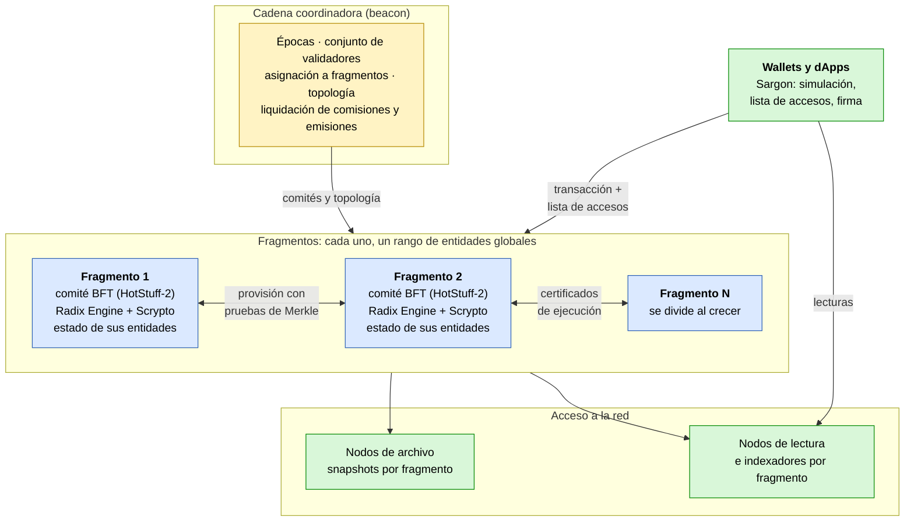
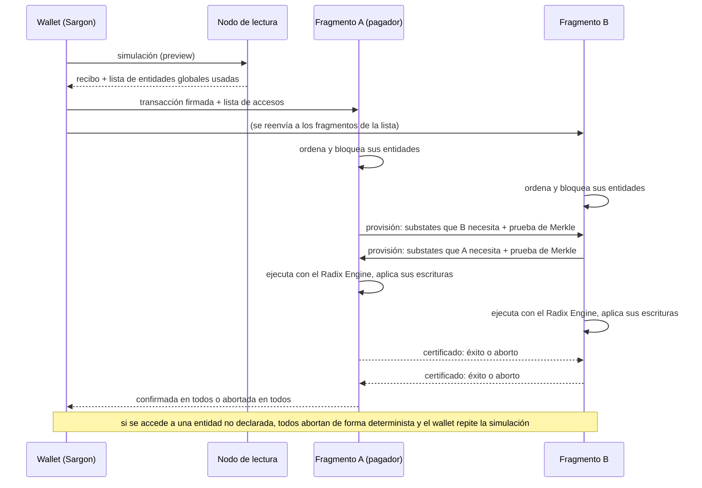
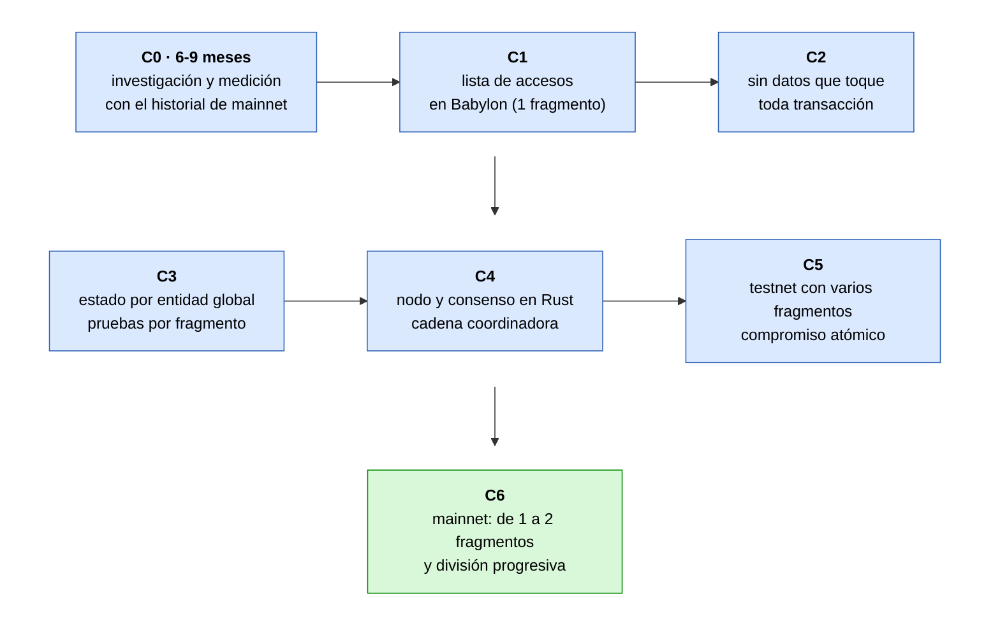

[← Índice](../../README.es.md) · [Anterior: Capítulo 12: referencias de otras redes descentralizadas](12-referencias-otras-redes.md) · [Siguiente: Fuentes, metodología y preguntas abiertas](fuentes-y-metodologia.md)

# 13. Etapa final alternativa: Xi'an con Scrypto, sin migrar a Hyperscale

> [!IMPORTANT]
> - **¿Es posible?** Sí, con condiciones. Hay que cambiar el Radix Engine para que cada transacción declare las entidades globales que usa, rediseñar los datos que hoy toca casi toda transacción y construir un consenso fragmentado nuevo. La capacidad final no está demostrada para Scrypto: hay que medirla.
> - **Dificultad:** Muy alta. Es el cambio de protocolo más difícil del informe, aunque evita reescribir las dApps.
> - **Esfuerzo y plazo:** ~150-280 personas-mes y 3-5 años con un equipo pequeño (estimación; sección [13.10](#s13-10)).

Los apartados 13.2 a 13.8 y 13.10 desarrollan la valoración de este recuadro; el 13.9 tiene la suya propia.

**Objetivo de este capítulo.** Describir una tercera etapa final (**FINAL C**): que Babylon evolucione **en su propia cadena**, mediante actualizaciones de protocolo, hasta una red fragmentada (*sharded*) con composición atómica entre fragmentos y capacidad que crece al añadir fragmentos, como prometía Xi'an, **conservando Scrypto, las dApps, las direcciones y los saldos**. Se explica qué tecnologías usar, qué infraestructura construir, qué código cambiar y en qué etapas.

**Punto de partida verificado:**

- Radix diseñó Babylon pensando en la fragmentación. Su hoja de ruta de 2024 afirma que «el Radix Engine, ya implementado en Babylon, se construyó pensando en la fragmentación», y RDX Works describió Babylon como un «modelo de estado totalmente fragmentable» (fuentes en la sección [13.12](#s13-12)).
- Babylon funciona hoy con una forma **no fragmentada** de Cerberus, según la propia Radix.
- El plan público más reciente para Xi'an ya no conserva el Radix Engine. El RFC «Xi'an: Delivering Hyperscale for Radix» (abril de 2026) todavía usaba una integración del Radix Engine, que su autor describía en el hilo como aún no lista para producción, con el objetivo de la «paridad de funciones con Babylon a nivel de motor». Según radix.wiki, en agosto de 2026 esa integración se sustituyó por una máquina virtual nueva (`hyperscale-vm`). En el canal oficial de Hyperscale en Telegram, en agosto de 2026, se escribió (radix.wiki atribuye esos mensajes a su desarrollador principal) que los ajustes para fragmentar «son tantos que habría que tocarlo todo» y que es «más fácil empezar con esa intención que adaptarlo después».
- Este capítulo **no contradice** esa valoración: confirma que hay que tocar el motor, el estado y el consenso. Lo que muestra es que existe un camino técnico conocido, con precedentes en la literatura, para hacerlo **sin perder Scrypto**. La gobernanza puede compararlo con FINAL A (seguir mejorando Babylon) y FINAL B (migrar a Hyperscale).

## 13.1 Veredicto por objetivo

| Objetivo | ¿Es posible con Scrypto? | Condición | Dificultad |
|---|---|---|---|
| Fragmentación del estado y de la ejecución | **Sí** | Reorganizar el estado por entidad global ([13.4](#s13-4)) | Alta |
| Atomicidad entre fragmentos | **Sí, con condiciones** | Cada transacción declara de antemano las entidades globales que usa; si descubre otra, se aborta de forma determinista y se repite ([13.3](#s13-3)) | Muy alta |
| Escalabilidad horizontal (más fragmentos, más capacidad) | **Sí, con condiciones** | Que la mayoría de las transacciones toquen pocos fragmentos y que se eliminen los datos que toca casi toda transacción ([13.5](#s13-5)); hay que medirlo | Muy alta |
| Un millón de transacciones por segundo | **No se puede prometer** | Ninguna red lo ha demostrado con contratos como Scrypto; solo es un objetivo a medir ([13.8](#s13-8)) | — |
| Mantener las dApps, direcciones y saldos | **Sí** | Las dApps siguen funcionando; algunas con patrones muy dinámicos pueden necesitar ajustes o tener más abortos | Media para el ecosistema |
| Reutilizar el consenso de Hyperscale | **Solo en parte** | Su consenso está acoplado a su máquina virtual; se reutilizan piezas y diseños, no el conjunto ([13.6](#s13-6)) | Alta |

## 13.2 El problema central: Scrypto descubre durante la ejecución qué estado usa

Todos los protocolos conocidos de compromiso atómico entre fragmentos necesitan saber, **antes de ejecutar**, a qué fragmentos afecta una transacción:

- **Cerberus** (Hellings, Hughes, Primero y Sadoghi; *Journal of Systems Research*, 2023), el diseño original de Radix para Xi'an, supone que las entradas y salidas de cada transacción se pueden determinar *a priori* (supuesto 2.2 del artículo).
- **Hyperscale** exige declarar antes de ejecutar cada clave que se lee o escribe, y su documentación declara como no-objetivo la compatibilidad con Scrypto (sección [11.4](11-evolucion-hyperscale.md#s11-4)).
- **Solana** exige que cada transacción especifique por adelantado todas las cuentas que lee o escribe.
- **NEAR**, **MultiversX** y **TON** evitan el problema con llamadas asíncronas entre fragmentos, que no garantizan la atomicidad que busca Xi'an. En NEAR, si la segunda parte falla, la primera no se revierte automáticamente (su documentación); en MultiversX, un fallo del contrato llamado en otro fragmento no hace fallar al que llama; en TON, los mensajes entre fragmentos pueden ejecutarse en bloques distintos.

**Lo que hace hoy el Radix Engine** (comprobado en `radixdlt-scrypto`, rama `develop`):

- Las referencias que aparecen en el manifiesto se extraen de forma estática (`radix-transactions/src/model/preparation/references.rs:4-29`), con un máximo de 512 por intención (`transaction_validation_configuration.rs:95,107`).
- Pero durante la ejecución, cualquier dirección global guardada dentro de un substate leído pasa a ser una referencia válida (`radix-engine/src/kernel/call_frame.rs:981-988`). Por eso **una transacción puede tocar entidades globales que no aparecen en su manifiesto**.
- Además, algunas entidades son visibles siempre, sin estar en el manifiesto (XRD, paquetes nativos; `radix-common/src/constants/always_visible_nodes.rs:8-40`), y la finalización de cada transacción escribe en el gestor de consenso y en el registro de transacciones ([13.5](#s13-5)).
- El recibo y la simulación (*preview*) no devuelven hoy la lista de lo que se ha leído: las lecturas se descartan de los cambios de estado (`radix-engine/src/track/track.rs:73-74`). Solo el modo de depuración registra cada substate abierto con su `node_id` (`costing_entry.rs:503-509`), y ese modo no está activo en la simulación (`transaction_executor.rs:277-289`).

**La solución que propone este capítulo** combina dos técnicas con precedentes publicados:

1. **Declarar solo las entidades globales**, no cada substate. Los nodos internos de una entidad (sus vaults, almacenes clave-valor y objetos propios) se guardan en el mismo fragmento que la entidad ([13.4](#s13-4)), así que se pueden descubrir libremente durante la ejecución. Es la misma idea de **Pilotfish** (Kniep y otros, arXiv:2401.16292, motor de ejecución escalable de Sui, prueba de concepto): el acceso dinámico se permite dentro de la jerarquía de un objeto raíz declarado.
2. **Reconocimiento previo y repetición determinista**, la técnica **OLLP** de **Calvin** (Thomson y otros, SIGMOD 2012):
   - una consulta previa, de solo lectura, descubre el conjunto de lectura y escritura;
   - la transacción real se envía con ese conjunto;
   - si al ejecutarse el conjunto ya no es válido, se reinicia de forma determinista.
   
   En Radix, la consulta previa es la **simulación** que el wallet ya ejecuta antes de firmar. Pilotfish usa una variante: cuando descubre un objeto nuevo, vuelve a proponer la transacción ampliada a los fragmentos que lo contienen.

**Consecuencia para las dApps:** las que siempre tocan las mismas entidades (la mayoría de transferencias, swaps contra un pool concreto, préstamos con una posición conocida) funcionan igual. Las que eligen en tiempo de ejecución a qué componente llamar según un estado que cambia con frecuencia (por ejemplo, un enrutador que busca el mejor pool en ese momento) sufrirán más abortos y repeticiones. Habrá que medir cuántas hay (etapa C0).

## 13.3 Declaración de accesos y aborto determinista

**Cambios en `radixdlt-scrypto`:**

| Componente | Cambio |
|---|---|
| `radix-transactions` | Nueva versión de transacción con una **lista de accesos**: entidades globales y modo (lectura o escritura). Validación: tamaño máximo, sin duplicados, coherencia con las referencias estáticas del manifiesto. |
| `radix-engine` (`kernel/call_frame.rs`, `system/system_callback.rs`) | Al abrir un substate, comprobar que su **entidad global raíz** está en la lista con el modo adecuado. Si no lo está, abortar con un error nuevo y determinista, cobrando la comisión hasta ese punto. |
| `radix-engine` (`track/`) | Registrar las entidades globales abiertas y su modo. Ya existe la instrumentación (`IOAccess::ReadFromDb` en `track/interface.rs:234-238`, `OpenSubstateEvent` en `costing_entry.rs:503-509`); hay que exponerla como lista en el recibo de simulación. |
| `radix-engine` (`updates/`) | Una actualización de protocolo nueva que active todo lo anterior. El mecanismo ya existe (Anemone, Bottlenose, Cuttlefish, Dugong; `updates/protocol_updates.rs:225-261`). |

**Cambios en los clientes:**

- **Sargon, Radix Engine Toolkit y wallets:** ejecutar la simulación, leer la lista de accesos del recibo, añadirla a la transacción y firmarla. Si la transacción se aborta por un acceso no declarado, repetir la simulación y volver a firmar. Para una wallet con firma en el móvil, la repetición puede pedir otra confirmación al usuario; conviene un margen (declarar también las entidades que la simulación considere probables).
- **App de Ledger:** firmar el nuevo formato de transacción.
- **SDK y RDT:** construir transacciones con lista de accesos.

**Introducción gradual:** primero la lista es opcional y solo informativa, como EIP-2930 en Ethereum, donde los accesos fuera de la lista están permitidos pero cuestan más. Así se mide cuántas transacciones la cumplirían. Después pasa a ser obligatoria, antes de dividir el estado en varios fragmentos.

## 13.4 Reorganizar el estado por entidad global

**Hoy** (comprobado en el código):

- Un `NodeId` tiene 30 bytes: 1 de tipo de entidad y 29 derivados de un hash (`radix-common/src/types/node_and_substate.rs:23-27`).
- La clave de cada nodo en la base de datos es un prefijo de 20 bytes del hash del `NodeId` seguido del propio `NodeId` (`radix-substate-store-interface/src/db_key_mapper.rs:107-108, 167-172`). El árbol de estado (JMT) tiene tres niveles: entidad, partición y substate (`radix-substate-store-impls/src/state_tree/`).
- Los nodos internos (por ejemplo, el vault de una cuenta) tienen su propio `NodeId` y, por ese hash, **quedan dispersos**, lejos de su entidad global. El motor no guarda quién es el dueño de un nodo interno. Solo el nodo de Babylon calcula esa relación, en un índice propio (`substate_node_ancestry_records`, `state-manager/src/store/column_families.rs:185-190`; `staging/node_ancestry_resolver.rs:75`).

**Cambio propuesto:**

- La clave de cada nodo pasa a ser **«hash de su entidad global raíz» + `NodeId`**. Así, una entidad global y todo lo que posee forman un subárbol contiguo del árbol de estado, y un fragmento es un **rango de prefijos** de ese árbol. Es el mismo principio de Hyperscale (clave = dueño + local, «las claves no cambian al dividir o unir fragmentos») y de las jerarquías de Pilotfish.
- El motor tiene que conocer la raíz al escribir un nodo interno. Hay que llevar al motor, o a la capa de almacenamiento, la lógica que hoy calcula el índice de ascendencia del nodo.
- **Caso que hay que estudiar:** si un nodo interno puede pasar de una entidad global a otra, su clave cambiaría (borrar y crear). El índice de ascendencia ya registra el padre y la raíz de cada nodo; la etapa C0 debe medir con datos de mainnet cuántas veces ocurre.
- **Migración:** una actualización de protocolo que reconstruya el árbol de estado con las nuevas claves. Las raíces anteriores se conservan en los nodos de archivo. Es una operación grande, comparable a R9 (sección [9.4](09-nodos-ligeros.md#s9-4)), y se prueba primero en Stokenet.
- **Pruebas por fragmento:** el árbol ya produce raíces firmadas por los validadores (`state_tree_hash`). El endpoint de pruebas de Merkle de la sección [6.2](06-solucion-recomendada.md#s6-2) sirve también para que un fragmento demuestre a otro el valor de un substate.

## 13.5 Datos que hoy toca casi toda transacción

En un sistema fragmentado, un dato que escriben todas las transacciones obliga a que todas pasen por el mismo fragmento. En Babylon hay tres (comprobado en el código):

| Dato | Qué ocurre hoy | Cambio propuesto | Referencia en otras redes |
|---|---|---|---|
| **Registro de transacciones** (evita repetir una intención) | Cada transacción lee su `intent_hash` en una partición por época y **reescribe siempre** el campo del registro (`radix-engine/src/system/system_callback.rs:555-590, 893-977`; particiones de 100 épocas en `transaction_tracker/package.rs:24-26`) | Un registro **por fragmento**: la intención se registra en el fragmento de quien paga la comisión, que siempre participa en la transacción. El campo global se sustituye por contadores por fragmento | En Sui, la transacción nombra la versión de cada objeto propio que usa (documentación de Sui) |
| **Comisiones** | La finalización lee el líder actual y escribe las recompensas del proponente y el vault de recompensas del gestor de consenso en **cada** transacción cuya comisión tenga parte para el proponente o los validadores, es decir, prácticamente todas (`system_callback.rs:642-881`, condición en la línea 788). El reparto es: propinas 100 % al proponente; comisiones de red 25 % proponente, 25 % conjunto de validadores, resto quemado (`radix-common/src/constants/transaction_execution.rs:41-50`) | Acumular las comisiones **por fragmento** y liquidarlas una vez por época mediante la cadena coordinadora ([13.6](#s13-6)), manteniendo los mismos porcentajes | Hyperscale quema las comisiones en el fragmento del pagador y paga a los validadores con la emisión (documentación de su VM) |
| **Rondas y estadística de propuestas** | Una transacción de sistema por ronda actualiza el gestor de consenso (`consensus_manager.rs:888, 1097`) | Rondas **por fragmento**; las épocas, el conjunto de validadores y las emisiones, en la cadena coordinadora. Encaja con R10 (sección [9.4](09-nodos-ligeros.md#s9-4)) | Cadena coordinadora (*beacon*) de Hyperscale |

**Entidades que todos leen pero casi nadie escribe** (paquetes nativos, el recurso XRD, cuyo suministro no se contabiliza: `system/bootstrap.rs:415`): se **replican en todos los fragmentos** como estado de solo lectura, y solo cambian mediante actualizaciones de protocolo. Los demás recursos con suministro contabilizado siguen en su fragmento: acuñar o quemar incluye ese fragmento en la transacción.

## 13.6 Consenso fragmentado: qué tecnología usar y qué se reutiliza de Hyperscale

**Hoy:** el consenso de Babylon es HotStuff en Java, con regla de confirmación de tres QC consecutivos (`core/src/main/java/com/radixdlt/consensus/safety/SafetyRules.java:181-190`). Java llama a Rust para preparar y confirmar (`RustStateComputer.java:110,119`; `state-manager/src/jni/state_computer.rs:68,84`). El conjunto de validadores es de 100 como máximo (`mainnet_genesis`, `radix-engine-interface/src/blueprints/consensus_manager/invocations.rs:59-65`).

**Arquitectura propuesta** (es la misma familia de diseño de Cerberus y Hyperscale):

1. **Consenso por fragmento:** cada fragmento tiene su comité de validadores y su cadena de bloques con un BFT de la familia HotStuff. HotStuff-2 (confirmación en dos fases, la que usa Hyperscale) necesita una fase menos que la regla de tres QC actual.
2. **Cadena coordinadora (*beacon*):** gestiona épocas, conjunto de validadores, asignación aleatoria de validadores a fragmentos, topología de fragmentos y liquidación de comisiones y emisiones. No procesa transacciones de usuario.
3. **Compromiso atómico entre fragmentos**, en tres pasos (Cerberus; «provisión-ejecución-certificación» en Hyperscale):
   - **ordenar:** cada fragmento implicado incluye la transacción en su bloque y bloquea las entidades declaradas;
   - **provisionar:** cada fragmento envía a los demás los substates que estos necesitan leer, con prueba de Merkle contra su raíz de estado certificada;
   - **ejecutar y certificar:** cada fragmento ejecuta la transacción completa con el Radix Engine, de forma determinista y con las mismas entradas, aplica solo sus propias escrituras y vota el resultado. Si un fragmento aborta, abortan todos.
4. **Firmas agregadas (BLS)**, para que los certificados entre fragmentos sean pequeños. Hyperscale usa BLS con la biblioteca `blst`.

**Reutilización de `hyperscale-rs`** (licencia MIT o Apache-2.0; comprobado en su código, commit `6204357`):

- **No es fácil reutilizar el consenso completo.** No hay una interfaz para cambiar de motor de ejecución: `engine::Executor` es una estructura concreta, y los tipos de su máquina virtual aparecen en `types`, `core`, `shard`, `mempool`, `execution`, `provisions` y en el almacenamiento. Su protocolo entre fragmentos supone que el acceso se declara clave a clave, y su documentación descarta expresamente la ejecución optimista y varios motores.
- **Sí se pueden reutilizar con poco esfuerzo:** las bibliotecas de red sobre iroh (`network`, `network-iroh`), criptografía y BLS (`crypto`, `crypto-bls`), métricas, y el patrón *sans-io* con simulador determinista, que reproduce una ejecución byte a byte a partir de una semilla.
- **Se pueden reutilizar como diseño de referencia**, reimplementándolos o extrayéndolos con un trabajo considerable: HotStuff-2 por fragmento, la cadena coordinadora con tiempo ponderado, la provisión con pruebas de Merkle, la división de fragmentos sin interrupción (*make-before-break*) y los modelos formales en Quint de la carpeta `specs/`.
- **Tamaño, como referencia:** el núcleo de consenso de `hyperscale-rs` (`types`, `shard`, `beacon`, `node`) suma ~247 000 líneas de Rust, y la coordinación entre fragmentos (`execution`, `provisions`, `remote-headers`, `mempool`), ~62 000, pruebas incluidas.

**Recomendación:** escribir el consenso nuevo en Rust **dentro de `babylon-node`**, sustituyendo la parte Java. Esto **sustituye a R11** (sección [9.4](09-nodos-ligeros.md#s9-4)): ese esfuerzo no se duplica. Se reutilizan las bibliotecas independientes de Hyperscale y sus diseños y especificaciones como referencia, citando la licencia.

## 13.7 Infraestructura final

**Una transacción entre dos fragmentos:**

## 13.8 Capacidad: qué se puede afirmar y qué no

| Prueba | Qué se midió | Límites |
|---|---|---|
| Hyperscale, prueba pública (enero de 2026) | 500 000 transacciones por segundo sostenidas, con más de 100 fragmentos (128 según la publicación de febrero), swaps e incluidas transacciones atómicas entre fragmentos | La propia Radix la describe como «no validada»; las cifras de pico difieren entre sus publicaciones (más de 700 000 y más de 800 000); no usa Scrypto; los registros no se habían publicado |
| Radix, 2019 | 1,4 millones por segundo reproduciendo el historial de Bitcoin | Consenso Tempo, no Cerberus; sin contratos inteligentes |
| NEAR (diciembre de 2025) | 1 millón por segundo con 70 fragmentos | Solo transferencias nativas y con salvaguardas relajadas; entre fragmentos no es atómico |
| Aptos, Shardines (2025) | Más de 1 millón por segundo en un clúster de 30 máquinas | Dato de fuente secundaria; no consta su uso en mainnet |
| Babylon hoy | «Al menos 50 transacciones DeFi por segundo», según Radix | Sin fragmentar |

**Conclusión honesta:**

- Ninguna red ha demostrado un millón de transacciones por segundo con contratos de composición atómica entre fragmentos como Scrypto. **No se puede prometer esa cifra.**
- La capacidad crecería con el número de fragmentos **si** la mayoría de las transacciones tocan pocos fragmentos y los abortos por accesos no declarados son pocos. Las dos cosas se pueden medir antes de construir nada, con el historial de mainnet (etapa C0).
- La capacidad de un fragmento con el Radix Engine tampoco se ha medido. Se mide reproduciendo el historial de mainnet en un nodo con el motor actual.
- **La seguridad limita el número de fragmentos.** Cada fragmento necesita un comité suficiente de validadores. Con los 100 validadores actuales caben pocos fragmentos seguros. Para crecer hay que aumentar `max_validators` mediante una actualización de protocolo y permitir que un mismo operador ejecute varias identidades de validador (los *vnodes* de Hyperscale).

## 13.9 Orden global para las APIs y el historial

> [!IMPORTANT]
> - **¿Es posible?** Sí. El orden derivado se calcula a partir de datos ya confirmados; solo hace falta fijarlo en la especificación.
> - **Dificultad:** Media.
> - **Esfuerzo y plazo:** incluido en las etapas C0 (especificación), C5 y C6 (estimación).

**El problema.** El formato de API que usan hoy los wallets (el del Gateway) y los índices de este informe se basan en **una sola secuencia global**, `state_version`:

- `at_ledger_state` fija una versión para que varias lecturas sean coherentes entre sí;
- el stream de transacciones y los cursores de paginación avanzan por ella;
- los índices se ordenan y se podan por ella.

Con varios fragmentos, cada uno tiene su propia altura y esa secuencia única deja de existir. Lo planteó un miembro de la comunidad en relación con Hyperscale. El desarrollador de Hyperscale preguntó de dónde salía el requisito, y la respuesta es que **viene de la API, no del protocolo**. Afecta igual a FINAL B y a FINAL C.

**Propuesta en dos niveles:**

1. **Compatibilidad:**
   - Un **orden derivado** que cualquier nodo o indexador calcula igual a partir de datos ya confirmados. Por ejemplo, por época y ronda de la cadena coordinadora, después por número de fragmento y después por altura dentro del fragmento.
   - Una transacción entre fragmentos ocupa una sola posición: la de su certificado final.
   - Esta regla debe quedar **escrita en la especificación del protocolo**, para que nadie construya sobre un orden que pueda cambiar.
   - Si la cadena coordinadora registra periódicamente las alturas certificadas de cada fragmento (un «corte»), ese corte sirve como `at_ledger_state` para lecturas coherentes entre fragmentos.
2. **Largo plazo:** una API nativa para fragmentos, con un cursor por fragmento y orden causal entre ellos. No necesita un orden total, y es la que deberían adoptar los clientes nuevos.

**Coste:** pequeño frente al resto del capítulo. Forma parte de las etapas C5 y C6, y su especificación, de C0.

## 13.10 Etapas y pasos

| Etapa | Qué se hace | Repositorios y código | Criterio para pasar a la siguiente |
|---|---|---|---|
| **C0. Investigación y medición** | Reproducir el historial de mainnet con un motor instrumentado. Medir: entidades globales por transacción, porcentaje de transacciones que tocarían más de un fragmento con N fragmentos, accesos que la simulación no habría previsto, frecuencia con que un nodo interno cambia de raíz, rendimiento por fragmento. Especificar el protocolo en Quint o TLA+ | `radixdlt-scrypto` (instrumentación en `track/` y `kernel/`), herramienta nueva de reproducción sobre `babylon-node` | Datos publicados que muestren que la mayoría de transacciones tocan pocos fragmentos y que los abortos serían raros |
| **C1. Lista de accesos** | Nueva versión de transacción; lista opcional y después obligatoria; aborto determinista. Sigue habiendo un solo fragmento | `radix-transactions`, `radix-engine`, `updates/`; Sargon, Radix Engine Toolkit, wallets, app de Ledger, RDT | Actualización de protocolo aplicada; los wallets la generan siempre |
| **C2. Datos comunes** | Registro de transacciones por fragmento, comisiones acumuladas y liquidadas por época, entidades de solo lectura replicadas | `radix-engine` (`system_callback.rs`, `transaction_tracker/`, `consensus_manager/`) | Ninguna transacción de usuario escribe ya un dato común a todas |
| **C3. Estado por entidad global** | Nuevas claves (raíz + `NodeId`), reconstrucción del árbol, pruebas de Merkle por fragmento, snapshots verificados por fragmento (R9) | `radix-substate-store-interface`, `radix-substate-store-impls`, `state-manager` de `babylon-node` | Migración probada en Stokenet; raíces y pruebas verificadas |
| **C4. Nodo y consenso en Rust** | Sustituir el HotStuff en Java por un consenso en Rust; cadena coordinadora; firmas BLS. Sustituye a R11 | `babylon-node` (nuevo módulo de consenso; retirar `core/` en Java y el puente JNI); bibliotecas de red y BLS de `hyperscale-rs` | Mainnet funcionando con el nodo nuevo y un solo fragmento |
| **C5. Varios fragmentos en testnet** | Compromiso atómico entre fragmentos, provisión con pruebas, división de fragmentos, asignación de validadores; nodos de lectura e indexador por fragmento | `babylon-node`, `radix-lite-indexer`, `babylon-nodecli`; simulador determinista | Semanas de funcionamiento estable; auditorías externas; capacidad medida y publicada |
| **C6. Mainnet fragmentada** | Dividir el fragmento único en dos y después según la carga; aumentar el número de validadores | Actualizaciones de protocolo; configuración de la cadena coordinadora | Cada división se decide primero por gobernanza (como NEAR, que programa las divisiones en actualizaciones); más adelante, automática según la carga (como TON o CockroachDB) |

**Esfuerzo estimado** (orden de magnitud, para planificar):

| Bloque | Esfuerzo |
|---|---|
| C0: medición y especificación formal | 8-15 personas-mes |
| C1: lista de accesos en motor y clientes | 15-30 personas-mes |
| C2: datos comunes | 10-20 personas-mes |
| C3: estado por entidad global y pruebas | 15-30 personas-mes |
| C4: nodo y consenso en Rust con cadena coordinadora (incluye R11) | 40-70 personas-mes |
| C5: compromiso atómico, división, sincronización, lectura por fragmento | 45-85 personas-mes |
| Pruebas, simulador y verificación formal (sin auditorías externas) | 15-30 personas-mes |
| **Total** | **~150-280 personas-mes**, del orden de **3-5 años** |

C6 (divisiones en mainnet) no tiene fila propia: se incluye en C5 y en las actualizaciones de protocolo.

**Base de la estimación:** las cifras de R11 (30-50 personas-mes, sección [9.4](09-nodos-ligeros.md#s9-4)) y de endurecer Hyperscale para mainnet (40-80, sección [11.6](11-evolucion-hyperscale.md#s11-6)), más el tamaño de la parte equivalente de `hyperscale-rs` (~310 000 líneas de consenso y coordinación entre fragmentos, pruebas incluidas). Es una estimación, no un presupuesto.

## 13.11 Comparación de las tres etapas finales

| | **FINAL A**: seguir mejorando Babylon | **FINAL B**: migrar a Hyperscale | **FINAL C**: Xi'an con Scrypto |
|---|---|---|---|
| Fragmentación y escalabilidad horizontal | No | Sí, por diseño | Sí, con las condiciones de 13.3-13.5 |
| Atomicidad entre fragmentos | No aplica (un solo fragmento) | Sí | Sí, con abortos si hay accesos no declarados |
| Scrypto y dApps actuales | Se mantienen | Hay que reescribirlas | Se mantienen; algunas pueden necesitar ajustes |
| Direcciones y saldos | Se mantienen | Migración con reclamación | Se mantienen |
| Red nueva | No | Sí | No: actualizaciones de protocolo |
| Madurez del código de partida | En producción | En desarrollo («Do not use») | El motor está en producción; el consenso fragmentado hay que construirlo |
| Esfuerzo (estimación) | R1-R11: ~40-65 personas-mes | ~110-210 personas-mes **más** reescribir las dApps | ~150-280 personas-mes |
| Plazo (estimación) | 1-3 años | 2-4 años | 3-5 años |
| Dificultad | Media a muy alta (R11) | Muy alta | Muy alta |

**Cuándo conviene cada una:**

- **A:** si la demanda de la red no exige más capacidad en los próximos años.
- **B:** si se prioriza la capacidad y llegar antes a una red fragmentada, aceptando reescribir el ecosistema.
- **C:** si se prioriza conservar las dApps, las direcciones y la continuidad de la cadena, aceptando un proyecto más largo cuyo resultado hay que validar con la etapa C0.

**Recomendación:** la etapa **C0 es barata y útil para las tres opciones**: mide con datos reales cuántas transacciones serían entre fragmentos y cuánto rinde el Radix Engine. Conviene hacerla antes de que la gobernanza elija entre A, B y C. Además, C1 y C2 mejoran Babylon aunque nunca se fragmente.

## 13.12 Referencias

- Cerberus: Hellings, Hughes, Primero y Sadoghi, *Journal of Systems Research*, vol. 3, n.º 1, 2023 ([JSys](https://www.jsys.org/bibliography/2023-06-06-hellingsProblem.html), [arXiv:2008.04450](https://arxiv.org/abs/2008.04450)); [Radix: Cerberus revisado por pares](https://www.radixdlt.com/blog/cerberus-consensus-peer-reviewed).
- Calvin y OLLP: Thomson y otros, SIGMOD 2012, sección 3.2.1 ([PDF](https://cs.yale.edu/homes/thomson/publications/calvin-sigmod12.pdf)).
- ByShard: Hellings y Sadoghi, PVLDB, vol. 14, n.º 11, 2021 ([PDF](https://www.vldb.org/pvldb/vol14/p2230-hellings.pdf)).
- Chainspace y S-BAC: Al-Bassam y otros ([arXiv:1708.03778](https://arxiv.org/abs/1708.03778)).
- Pilotfish: Kniep y otros ([arXiv:2401.16292](https://arxiv.org/abs/2401.16292); [blog de Sui](https://www.sui.io/blog/pilotfish-execution-scalability-blockchain)).
- Sui: [propiedad de objetos](https://docs.sui.io/concepts/object-ownership); Mysticeti ([arXiv:2310.14821](https://arxiv.org/abs/2310.14821)).
- Solana: [runtime y declaración de cuentas](https://github.com/solana-labs/solana/blob/master/docs/src/validator/runtime.md).
- Aptos: Block-STM ([arXiv:2203.06871](https://arxiv.org/abs/2203.06871)); Shardines ([crypto.news](https://crypto.news/aptos-introduces-shardines-for-horizontal-scalability-with-1m-tps/), fuente secundaria).
- NEAR: [llamadas entre contratos](https://docs.near.org/smart-contracts/anatomy/crosscontract); [NEP-568, resharding](https://github.com/near/NEPs/blob/master/neps/nep-0568.md); [prueba de 1 millón por segundo](https://blog.nearone.org/announcement/2025/12/11/scaling-near-to-1m-tps.html).
- Ethereum: [EIP-2930](https://eips.ethereum.org/EIPS/eip-2930); [EIP-7928](https://eips.ethereum.org/EIPS/eip-7928).
- MultiversX: [llamadas entre contratos](https://docs.multiversx.com/developers/developer-reference/sc-to-sc-calls). TON: [paradigma de fragmentación infinita](https://docs.ton.org/v3/documentation/smart-contracts/shards/infinity-sharding-paradigm). CockroachDB: [división por carga](https://docs.cockroachlabs.com/docs/stable/load-based-splitting).
- Radix: [hoja de ruta 2024](https://www.radixdlt.com/blog/radix-labs-roadmap---to-hyperscale-and-beyond); [Babylon tras su lanzamiento](https://www.radixdlt.com/blog/the-road-post-babylon-thoughts-from-the-ceo-of-rdx-works); [capacidad de Babylon](https://www.radixdlt.com/articles-learn/what-is-the-throughput-tps-of-radixs-babylon-mainnet); [prueba de 500 000](https://www.radixdlt.com/blog/hyperscale-update-500k-public-test-done); [cierre de la etapa interina](https://www.radixdlt.com/blog/interim-hyperscale-closing-the-chapter); [prueba de 2019](https://www.radixdlt.com/blog/scaling-dlt-to-over-1m-tps-on-google-cloud); [RFC de Xi'an](https://radixtalk.com/t/rfc-xian-delivering-hyperscale-for-radix/2280); mensajes del canal de Hyperscale ([10336](https://t.me/hyperscale_rs/10336), [6019](https://t.me/hyperscale_rs/6019)).
- Código: `radixdlt-scrypto` (rama `develop`, commit `a405d7ae48`, ene-2026), `babylon-node` (rama `develop`), `hyperscale-rs` (commit `6204357`, 30-oct-2026) y la documentación de `hyperscale-vm`.

---

[← Índice](../../README.es.md) · [Anterior: Capítulo 12: referencias de otras redes descentralizadas](12-referencias-otras-redes.md) · [Siguiente: Fuentes, metodología y preguntas abiertas](fuentes-y-metodologia.md)
